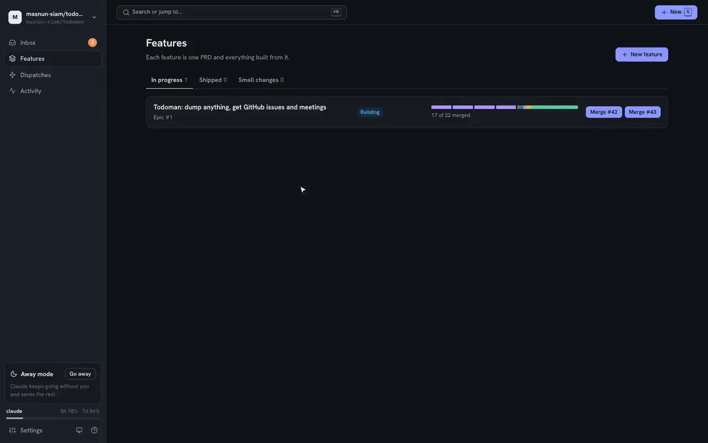

# ai-workflow

**Type an idea. Get back a reviewed pull request.**

[](https://masnun-siam.github.io/ai-workflow)
[](https://github.com/masnun-siam/ai-workflow/actions/workflows/tests.yml)
[](docs/HOW-IT-WORKS.md)

[](https://masnun-siam.github.io/ai-workflow)

A Claude Code plugin that carries one team process, from an idea to a merged PR: a PRD that
reviewers sign off, small issues, code written and checked in its own worktree, and a PR reviewed
before you see it. One local UI (`aiw ui`) shows where everything stands and asks you only what
needs a person.

## The flow

`PRD → tasks → refined issues → /implement-issue → /pr-review`

A person decides at three points: answering the PRD questions and approving the PRD, and merging.
Everything between runs as a headless Claude session.

## Features

- A skill per stage: `/create-prd`, `/create-tasks`, `/refine-issues`, `/implement-issue`, `/pr-review`.
- `/peer-review`: independent reviewer lenses (critical, CEO, CTO, security, QA, UX, performance) read the PRD until all approve.
- `aiw ui`: a local web app that starts each stage as a session and shows the board, blockers and next step.
- A worktree per issue, with every local check run the way CI runs it, before a draft PR.
- A review grind: `/pr-grind` loops the review-fix cycle until the PR is approved.

## Quick start

Needs Python 3.10+ and an authenticated `gh`. Easiest: ask Claude Code to follow
[docs/INSTALL.md](docs/INSTALL.md). By hand:

```bash
claude plugin marketplace add masnun-siam/ai-workflow
claude plugin install ai-workflow@ai-workflow
aiw ui          # open the web app
```

Then run `/create-prd` in a repo to start a feature.

## Docs

- [docs/INSTALL.md](docs/INSTALL.md): the setup protocol, written for an AI agent to follow
- [docs/HOW-IT-WORKS.md](docs/HOW-IT-WORKS.md): the process, stage by stage
- [docs/REFERENCE.md](docs/REFERENCE.md): commands, the `aiw` CLI, `aiw ui`, state, layout, tests
- [guides/](guides/): the engineering process and review standards the skills follow
- [CONTRIBUTING.md](CONTRIBUTING.md): which docs to update, and the pre-commit hooks
- [CHANGELOG.md](CHANGELOG.md)
