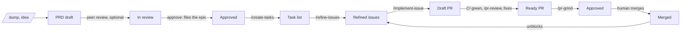

# How it works

One process takes a feature from idea to merged PR. Each stage is a skill with a clear input
and output; GitHub and the repo's `docs/prds/` hold the state. The `aiw ui` web app starts a
stage as a headless session, and `herdr-dispatch` starts it in a terminal tab.

A human decides at three points: approving the PRD, deciding what to do at a peer-review cap, and merging.
Nothing in this plugin merges a PR on its own: the UI's **Merge** button is a human's click, behind a confirm.

## Stages

| Stage | Skill | In → out |
|---|---|---|
| Capture | `/dump` | free-form input → a Problem statement filed in the Obsidian vault |
| PRD | `/create-prd` | a requirement → `docs/prds/<slug>.md`, every decision settled by interview. Approving it files one epic per `## Epics` entry |
| Tasks | `/create-tasks` | an Approved PRD → one child issue of the epic per small one-PR task, with native blocked-by links |
| Refine | `/refine-issues` | the epic's child issues → each carries a WHAT, WHY, HOW and the `refined` label, and moves to Ready on the board once unblocked |
| Implement | `/implement-issue <n \| epic>` | one refined issue (or an epic's next Ready one) → a Ready PR (below) |
| Review | `/pr-review` | a PR or branch → findings with evidence and a verdict; `--fix` fixes the review feedback on a PR |
| Grind | `/pr-grind` | a Ready PR → the Slack reviewer-bot loop until approved |
| Docs | `/docs-updater` | the code's changes → `docs/` brought in line |
| Feedback | `/skill-feedback` | feedback, or `reconcile` over closed PRs' learning logs → approved edits to the skills and guides |

The planning skills read `templates/` (PRD, epic, issue) and follow `guides/engineering-workflow.md`;
review follows `guides/code-review.md`. The skills are imported as they are, so read them for
the exact steps.

## implement-issue

One session, start to Ready:

1. Given an epic, pick its lowest-numbered Ready issue. Stop if any blocking issue is still open, or the issue is not refined.
2. Read the issue, its comments, the PRD and the epic.
3. Work in a new worktree under `.worktrees/`, branched from the latest base.
4. Implement, write the tests, update the docs in the same PR.
5. `/verifier-locally`: run the checks CI runs, then exercise the behaviour against the acceptance criteria.
6. Open a draft PR. Mark it Ready only when CI is green and every review comment is handled.
7. Log learnings on the issue.
8. After the merge: close the issue, set it to Done, clean up, and move the issues it unblocked to Ready.

Independent refined issues run in parallel, each in its own worktree. `herdr-dispatch` fans a
batch out into herdr tabs, one `/implement-issue <n>` per tab, in dependency order under a
concurrency cap; a tab is done when its issue has a non-draft PR.

## Grind

`/pr-grind` works a Ready PR through the Slack reviewer bot:

1. Post the trigger in the repo's review channel (`channels.json`); the thread is the loop's anchor.
2. Wait for the bot's round, then split findings into fix and rebut.
3. Fix inline, in the grind session itself: commit, reply on and resolve the thread.
4. Run `/verifier-locally` before every push. A failing CI check gets one fix attempt per head commit.
5. Push, re-trigger, repeat until approved or a rail stops it (round cap, stall, rate limit).
6. Post the closing summary and mention the owner.

Each round re-enters as a fresh headless session that reads the PR's state file under
`pr-grind/`, so a crash or a rate limit loses nothing.

## Peer review

`/peer-review` runs a panel on one artifact: a draft PRD, or the session's change (the diff plus
the final answer, checked against what was asked). Each picked lens (critical, CEO, CTO,
security, QA, UX, performance) is a read-only `peer-reviewer` session on Opus. The UI starts one
session per lens, collects each lens's closing `Verdict: approve|changes` line, and relays the
verdicts to the root session, which revises the artifact. The same lens sessions then re-review,
for up to 5 rounds. A panel that still has a `changes` after round 5 stops as "cap reached" and
the user decides. Verdicts are free text: nothing checks them beyond the verdict line. The UI
starts a panel from its **Peer review** box.

## The UI

`aiw ui` shows the process around one question: what needs you. The **Inbox** collects, across
repos, the questions to answer, PRs ready to merge, paused grinds, failed sessions and reviews at their
cap. A **Feature** page follows one PRD from draft to shipped with one next step, and the **Board**
shows its issues from Needs refinement to Merged. **Auto-build** starts refined, unblocked issues of an
epic up to the repo's cap as merges unblock them, grind starts when a PR turns ready (per-repo
setting), and a merged issue's clean worktree is removed. GitHub is read with one GraphQL call per
watched repo per poll; nothing is written back.

It starts these as sessions and keeps them going: it takes your answers to `aiw ask` questions in the
Inbox or the session page, resumes after a rate limit, and notifies you. **Away mode** answers
recommended options and retries failures while you are away. Details are in [REFERENCE.md](REFERENCE.md).

## State

| Where | What |
|---|---|
| GitHub | issues, labels, blocked-by links, PRs, review threads, CI |
| `docs/prds/`, `docs/tasks/` in the repo | the PRD and the task list |
| the Obsidian vault | `/dump` captures and the PRD mirror |
| plugin data dir | UI sessions, settings, grind and peer-review state: nothing here is a source of truth for the work |
