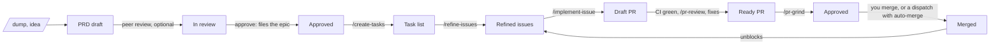

# How it works

One process takes a feature from idea to merged PR. Each stage is a skill with a clear input
and output; GitHub and the repo's `docs/prds/` hold the state. The `aiw ui` web app starts a
stage as a headless session. A **dispatch** runs a whole epic: each child issue as a lane, in parallel
and in dependency order, from implementation through grind, merge and followups, in herdr tabs
(`herdr-dispatch`) or as headless sessions (the UI).

A human decides at three points: approving the PRD, deciding what to do at a peer-review cap, and merging.
The only thing that merges a PR without a click is a dispatch you started with auto-merge on, and only
once CI is green, a review approves and the grind is done. Otherwise **Merge** is your click, behind a confirm.

## Stages

| Stage | Skill | In → out |
|---|---|---|
| Capture | `/dump` | free-form input → a Problem statement filed in the Obsidian vault |
| PRD | `/create-prd` | a requirement → `docs/prds/<slug>.md`, every decision settled by interview. Approving it files one epic per `## Epics` entry |
| Tasks | `/create-tasks` | an Approved PRD → one child issue of the epic per small one-PR task, with native blocked-by links |
| Refine | `/refine-issues` | the epic's child issues → each carries a WHAT, WHY, HOW and the `refined` label, and moves to Ready on the board once unblocked |
| Implement | `/implement-issue <n \| epic>` | one refined issue (or an epic's next Ready one) → a Ready PR (below) |
| Review | `/pr-review` | a PR or branch → findings with evidence and a verdict; `--fix` fixes the review feedback on a PR |
| Grind | `/pr-grind` | a Ready PR → the Slack reviewer-bot loop until approved |
| Docs | `/docs-updater` | the code's changes → `docs/` brought in line |
| Feedback | `/skill-feedback` | feedback, or `reconcile` over closed PRs' learning logs → approved edits to the skills and guides |

The planning skills read `templates/` (PRD, epic, issue) and follow `guides/engineering-workflow.md`;
review follows `guides/code-review.md`. The skills are imported as they are, so read them for
the exact steps.

## implement-issue

One session, start to Ready:

1. Given an epic, pick its lowest-numbered Ready issue. Stop if any blocking issue is still open, or the issue is not refined.
2. Read the issue, its comments, the PRD and the epic.
3. Work in a new worktree under `.worktrees/`, branched from the latest base.
4. Implement, write the tests, update the docs in the same PR.
5. `/verifier-locally`: run the checks CI runs, then exercise the behaviour against the acceptance criteria.
6. Review the local branch with `/pr-review`, fix Critical and Major findings, merge the base branch in, then push and open a draft PR. Mark it Ready only when CI is green and every review comment is handled.
7. Log learnings on the issue.
8. After the merge: close the issue, set it to Done, clean up, and move the issues it unblocked to Ready.

Independent refined issues run in parallel, each in its own worktree, as the lanes of a dispatch.

## Dispatch

A dispatch takes one epic, or a list of picked issues (from the UI only), and runs its open, refined
issues as **lanes** (an unrefined one is skipped as "needs refine" until it is refined). Up to `max`
lanes (default 2) run at once; a lane starts only when every issue blocking it is merged and its
followups are done. Each lane, in one session (a herdr tab or a headless session):

1. `/implement-issue <n>` until the PR is Ready (CI green, `/pr-review` handled).
2. `/pr-grind <pr>` in the same session, unless grinding is off or the repo has no Slack channel.
   Simple ends on any approval, full on zero blocker and should-fix. Between rounds the engine types
   the next round into the lane when a review lands or the heartbeat is due.
3. The merge gate: CI green on the head, an approving review, the grind done. A conflict with the
   base sends the lane to merge the base in, resolve, re-run the checks and push; then the gate again.
4. Merge (a merge commit) when auto-merge is on; otherwise the lane waits for you and goes on once
   it sees your merge.
5. Followups: implement-issue's after-merge steps (close the issue, clean up, unblock). Then the tab
   closes and the next unblocked lane starts.

A lane that needs you (a question, red CI, a paused grind, a failed merge) is held and tells you in
the Inbox, by a notification on the channels picked in Settings → Notifications and in the `herdr-dispatch` session; its dependents wait, the other
lanes go on. At a Claude usage limit no new lane starts until the reset. Settings (grind mode,
auto-merge, max, model, effort) change while it runs. With a feature branch, every PR targets it
(cut from the default branch). When every lane is done you choose what follows: open the feature
branch's PR, run QA (`/verifier-locally` plus a browser end-to-end test; each bug becomes a new epic
child, which joins the dispatch as a lane), or grind the final PR.

The `aiw ui` server runs the engine: every 30 s it reads each lane's facts from the board poll (no
extra GitHub calls), the grind state files and the lane's session, and acts. A dispatch survives a
server restart.

A dispatch of picked issues (**Run small changes**) differs from an epic's: 1 to 30 issues in one
repo, no feature branch, no Open PR, Run QA or Grind the final PR at the end, and its lane set is fixed:
the engine re-reads only the listed issues, so nothing joins later. An issue already a lane of a live
dispatch cannot be picked.

**Small changes.** A bug or change that needs no PRD starts on the Features page's **Small changes**
tab: describe it, and one `/create-tasks` session files it and runs `/refine-issues` on it. Then tick
the refined issues and **Run N** dispatches them.

## Grind

`/pr-grind` works a Ready PR through the Slack reviewer bot:

1. Post the trigger in the repo's review channel (`channels.json`); the thread is the loop's anchor.
2. Wait for the bot's round, then split findings into fix and rebut.
3. Fix inline, in the grind session itself: commit, reply on and resolve the thread.
4. Run `/verifier-locally` before every push. A failing CI check gets one fix attempt per head commit.
5. Push, re-trigger, repeat until approved or a rail stops it (round cap, stall, rate limit).
6. Post the closing summary and mention the owner.

Each round re-enters as a fresh headless session that reads the PR's state file under
`pr-grind/`, so a crash or a rate limit loses nothing.

## Peer review

`/peer-review` runs a panel on one artifact: a draft PRD, or the session's change (the diff plus
the final answer, checked against what was asked). Each picked lens (critical, CEO, CTO,
security, QA, UX, performance) is a read-only `peer-reviewer` session on Opus. The UI starts one
session per lens, collects each lens's closing `Verdict: approve|changes` line, and relays the
verdicts to the root session, which revises the artifact. The same lens sessions then re-review,
for up to 5 rounds. A panel that still has a `changes` after round 5 stops as "cap reached" and
the user decides. Verdicts are free text: nothing checks them beyond the verdict line. The UI
starts a panel from its **Peer review** box.

## The UI

`aiw ui` shows the process around one question: what needs you. The **Inbox** collects, across
repos, the questions to answer, PRs ready to merge, paused grinds, failed sessions and reviews at their
cap. A **Feature** page follows one PRD from draft to shipped with one next step and its issues, and
shows its running dispatch; **Small changes** holds the open issues outside any feature. **Dispatches**
shows each dispatch: what needs you first, then its issues as a graph or a list, its activity and live
settings. Grind starts when a PR turns
ready (per-repo setting) unless a dispatch lane owns it, and a merged issue's clean worktree is removed. GitHub is read with a cheap GraphQL probe per
watched repo per poll, and the full query only when something changed; nothing is written back.

It starts these as sessions and keeps them going: it takes your answers to `aiw ask` questions in the
Inbox, the session page or a dispatch's issue panel, resumes after a rate limit, and notifies you.
**Away mode** answers every question while you are away (recommended options at once, Opus for the rest,
risky or unanswerable rounds held) and retries failures, dispatch issues included. Details are in [REFERENCE.md](REFERENCE.md).
A repo's own copy of a skill (`.claude/skills/<name>/`) is used in place of the plugin's when it has one; see [Repo copies of skills](REFERENCE.md#repo-copies-of-skills).

## State

| Where | What |
|---|---|
| GitHub | issues, labels, blocked-by links, PRs, review threads, CI |
| `docs/prds/`, `docs/tasks/` in the repo | the PRD and the task list |
| the Obsidian vault | `/dump` captures and the PRD mirror |
| plugin data dir | UI sessions, settings, grind, peer-review and dispatch state: nothing here is a source of truth for the work |
