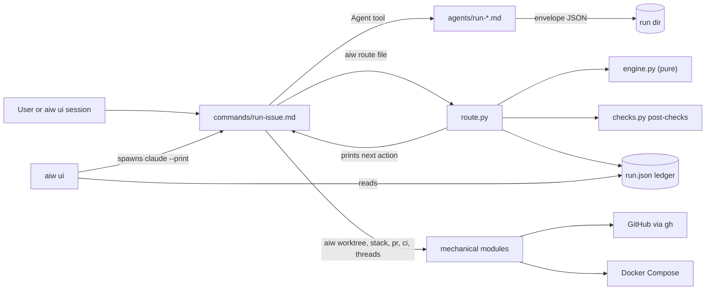
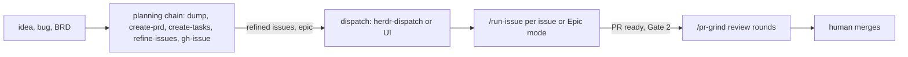
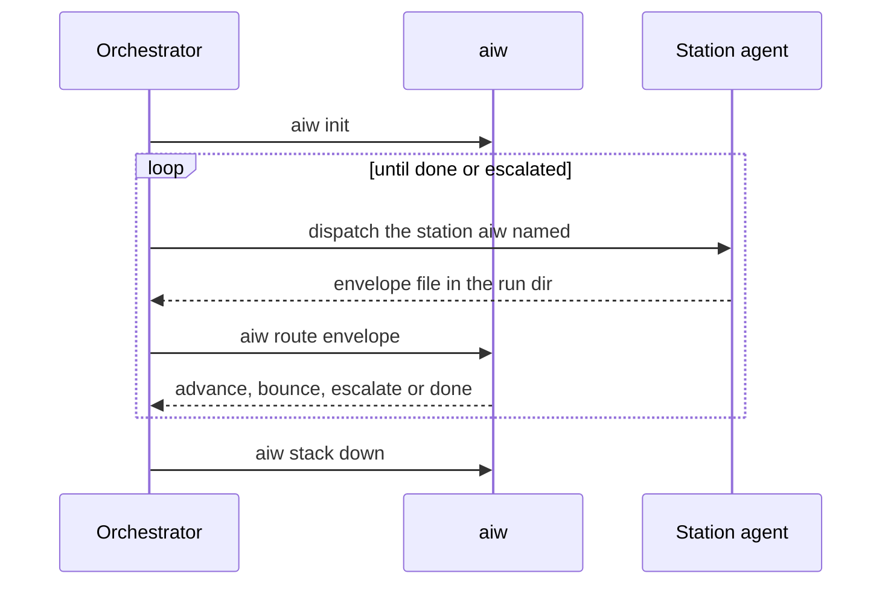

# Architecture

Covers: `commands/`, `agents/`, `skills/`, `bin/aiw`, `run-engine/`, `.claude-plugin/`

A Claude Code plugin. Markdown prompts (commands, agents, skills) do the judgment work; stdlib Python under `run-engine/` does everything that can be computed. Terms are defined in [CONTEXT.md](../CONTEXT.md).

## Components

| Component | Where | Role | Doc |
|---|---|---|---|
| Orchestrator | `commands/run-issue.md` | Runs `/run-issue`. Dispatches stations and acts on what `aiw route` prints; never picks the next step itself | [features/run-issue.md](features/run-issue.md) |
| Stations | `agents/run-*.md` | One subagent per stage, fresh context, returns an envelope | [plugin.md](plugin.md#agents) |
| Engine | `run-engine/engine.py` | Pure, deterministic: ledger model, router, envelope validation, classifier, review panel | [engine.md](engine.md) |
| Mechanical modules | `run-engine/*.py` (non-UI) | I/O: ledger files, post-checks, worktree, Docker stack, PR, CI, threads, epics, peer review | [engine.md](engine.md#module-map) |
| `aiw` CLI | `bin/aiw` → `run-engine/route.py` | The single entry every prompt calls | [cli.md](cli.md) |
| Web UI | `aiw ui`: `run-engine/ui_*.py`, `run-engine/ui_static/` | Starts and tracks headless Claude sessions; Board, Flow, Dispatch, grind, AFK | [ui.md](ui.md), [ui-api.md](ui-api.md), [ui-frontend.md](ui-frontend.md) |
| Skills and other commands | `skills/*/SKILL.md`, `commands/*.md` | Planning chain, peer review, pr-grind, dispatch, review skills, utilities | [plugin.md](plugin.md#slash-commands) |
| Policy | `run-engine/config.json`, per repo `.run-issue.json` | Roster, budgets, checks, classifier and review policy | [engine.md](engine.md#config) |

## How the parts talk

- Prompts call Python only through `aiw <subcommand>`. The engine and mechanical modules never call an LLM; only `aiw ui` spawns `claude` sessions.
- A station returns one JSON envelope written into the run dir. `aiw route <file>` validates it, runs the station's post-check, updates the ledger and prints `advance(<station>)`, `bounce(<station>)`, `escalate: <reason>` or `done`. Exit codes and mechanics: [engine.md](engine.md#aiw-route-step-by-step).
- Post-checks verify each station's central claim from git, `gh` or the test suite; a station's claim is never trusted.
- GitHub (issues, sub-issues, PRs, review threads, checks) is reached through the `gh` CLI. Slack through `slackcli`. Optional tools (GitNexus, Docker, herdr, Obsidian, Tailscale, ntfy) and what happens without each: [features/setup.md](features/setup.md#optional-dependencies).
- `aiw ui` launches `claude` as a detached child with `stream-json` output and follows its files; a session asks the user only through `aiw ask`. See [ui.md](ui.md#how-a-session-runs).

## Data stores

| Store | Where | Holds | Doc |
|---|---|---|---|
| Ledger | `<data_dir>/runs/<owner>-<repo>-issue-<n>/run.json` | The only source of truth for a Run; envelopes sit next to it | [engine.md](engine.md#the-ledger-runjson) |
| Plugin data dir | `$CLAUDE_PLUGIN_DATA`, else `~/.claude/plugins/data/ai-workflow` | Runs, epics, pr-grind state, `channels.json`, `checkouts.json`, locks, peer review rounds, UI state | [cli.md](cli.md#state-on-disk) |
| Target repo | the repo being worked on | `.run-issue.json`, `tasks/lessons.md`, `docs/prds/`, `docs/tasks/`, the run's worktree `../wt-issue-<n>/` | [cli.md](cli.md#state-on-disk) |
| GitHub | issues and PRs | Issue bodies, sub-issue and blocked-by links, review threads, CI checks | [features/planning.md](features/planning.md) |
| Obsidian vault | the user's vault | `/dump` Project → Feature notes, PRD mirrors | [features/planning.md](features/planning.md#dump) |

Nothing is stored in this repo at run time.

## Main flows

### Idea to merged PR

- Planning: [features/planning.md](features/planning.md). Dispatch: [features/dispatch.md](features/dispatch.md). Epic mode: [features/epic-mode.md](features/epic-mode.md). Grind: [features/review.md](features/review.md#pr-grind).

### One `/run-issue` run

- Roster, gates and stations: [features/run-issue.md](features/run-issue.md). Review, fix and CI: [features/review.md](features/review.md).

### Peer review

- `--review` on planning commands and `/peer-review` run lens reviewers in rounds until all approve: [features/peer-review.md](features/peer-review.md).

## Invariants

- `engine.py` stays pure (no I/O); routing rules live there and are asserted in `run-engine/test_engine.py`.
- The ledger is the only Run state; the UI reads it but writes through `aiw`.
- Three human gates only; an envelope status cannot add a fourth ([engine.md](engine.md#the-envelope)).
- Python 3.10+, stdlib only, no frontend build step ([development.md](development.md)).
