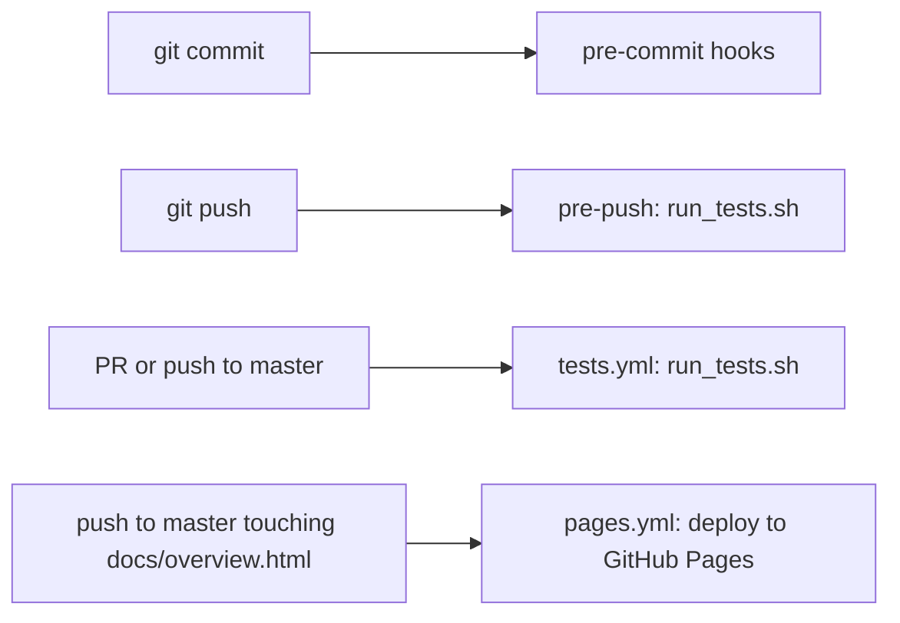

# Development

Covers: `run-engine/run_tests.sh`, `run-engine/test_*.py`, `.pre-commit-config.yaml`, `ruff.toml`, `.git-blame-ignore-revs`, `.github/workflows/`, `.gitignore`, `CONTRIBUTING.md`, `CHANGELOG.md`, `AGENTS.md`

Working on this repo. Language and runtime rules are in `CLAUDE.md`; this doc does not repeat them.

## Setup

| Need | Why | Without it |
|---|---|---|
| `python3` 3.10+ | engine, `aiw`, every test (CI pins 3.10) | nothing runs |
| `git` with a user identity | many tests make real commits in temp repos | those tests fail (CI sets `GIT_AUTHOR_*` / `GIT_COMMITTER_*`) |
| `pre-commit` (`pip install pre-commit`) | the commit and push hooks | hooks do not run; CI still does |
| `node` | JS logic checks in `test_ui_static.py` | those checks are skipped with a `note: node not found` line |

- Runtime is stdlib only. There is nothing to `pip install` for the plugin itself.
- Load your checkout into Claude Code with a local marketplace ([setup](features/setup.md)) or for one session with `claude --plugin-dir <repo>`.
- State never lands in the repo: it goes to `$CLAUDE_PLUGIN_DATA`, else `~/.claude/plugins/data/ai-workflow` (`shared.data_dir()`). Tests set `CLAUDE_PLUGIN_DATA` to a temp dir.

```bash
pre-commit install                                        # once per clone: pre-commit + pre-push hooks
git config blame.ignoreRevsFile .git-blame-ignore-revs    # optional: skip the ruff reformat in blame
```

## Tests

```bash
bash run-engine/run_tests.sh          # every run-engine/test_*.py, serially, ~2 min
python3 run-engine/test_engine.py     # one file; exit 0 = green
```

- Plain `assert` scripts, no framework, no network, no Docker. Most print `  ok  <label>` per check via a local `ok()` helper.
- `run_tests.sh` globs `test_*.py`, so a new test file is picked up with no registration.
- `run_tests.sh` unsets `GIT_INDEX_FILE`, `GIT_DIR`, `GIT_WORK_TREE` before running, so temp-repo commits cannot write into this repo's index when called from a hook.

| Area | Files |
|---|---|
| Engine and router | `test_engine.py` (`engine.py`: routing, envelopes, bounces, classify) |
| Mechanical `aiw` subcommands and doc pins | `test_scripts.py` (stack, worktree, threads, pr, ci, epic, review and more, plus pins on command/agent/doc text) |
| Other `aiw` subcommands | `test_ask.py` (`aiw ask`), `test_peer_review.py`, `test_refined.py`, `test_maintree.py`, `test_worktree_main.py` (`worktree create --main-tree`) |
| UI server and HTTP | `test_ui_server.py`, `test_ui_static.py` (static serving + frontend JS run under `node`), `test_ui_events.py`, `test_ui_sessions.py`, `test_ui_tailscale.py` |
| UI sessions and runner | `test_ui_runner.py`, `test_ui_limits.py`, `test_ui_usage.py`, `test_ui_options.py`, `test_ui_settings.py`, `test_ui_cleanup.py` |
| UI features | `test_ui_board.py`, `test_ui_dispatch.py`, `test_ui_flows.py`, `test_ui_grind.py`, `test_ui_notify.py`, `test_ui_afk.py`, `test_ui_repos.py`, `test_ui_vault.py`, `test_ui_issue.py`, `test_ui_pr.py`, `test_ui_status.py` |

- Each `test_ui_<x>.py` tests `run-engine/ui_<x>.py`; see [ui](ui.md) and [ui-frontend](ui-frontend.md).

## Hooks, lint and CI



`.pre-commit-config.yaml` (excludes `run-engine/ui_static/vendor/`):

| Hook | Stage | Blocks |
|---|---|---|
| `check-yaml`, `check-json`, `check-merge-conflict`, `check-added-large-files`, `check-symlinks`, `trailing-whitespace`, `end-of-file-fixer` | commit | yes |
| `gitleaks` | commit | yes |
| `ruff-check`, `ruff-format` (Python only, not Markdown) | commit | yes |
| `shellcheck` | commit | yes |
| `engine-tests`: `test_engine.py`, when a `run-engine/*.py` file is staged | commit | yes |
| `all-tests`: `bash run-engine/run_tests.sh` | push | yes |
| `claude-md-reminder`: warns when `CLAUDE.md` changes | commit | no |

- `ruff.toml`: line length 120, `target-version = "py310"`, rules `E4`, `E7`, `E9`, `F`, vendor dir excluded. Repo-owned so a machine-level ruff config never changes results.
- `.git-blame-ignore-revs` lists the `ruff format` commit (#260).
- `.github/workflows/tests.yml` ("Tests"): Python 3.10, `bash run-engine/run_tests.sh`, on every PR and on pushes to `master`.
- `.github/workflows/pages.yml`: copies `docs/overview.html` to `_site/index.html` and deploys it to GitHub Pages on pushes to `master` that touch it (or by hand).
- A clone set up before the pre-push hook existed must run `pre-commit install` again.

## Docs rules

| Change | Update |
|---|---|
| user-facing (command, flag, `aiw` subcommand, config key, behaviour) | the owning doc in `docs/` (index: [README](README.md)) and an entry under `## Unreleased` in `CHANGELOG.md` |
| new domain term | `CONTEXT.md` |
| hard-to-reverse design decision | a new ADR in `docs/adr/` (`000N-<slug>.md`) |
| PRD / task list | `docs/prds/<slug>.md`, `docs/tasks/<slug>.md` |
| `CLAUDE.md` | only when the user explicitly asks; its hook only warns |
| `AGENTS.md` | nothing: it is a symlink to `CLAUDE.md` |
| `README.md` | nothing new: it is a link hub |

- Each doc in `docs/` starts with a `Covers:` line listing the repo paths it describes. Update the doc whose `Covers:` matches the file you changed.
- `run-engine/test_scripts.py` pins doc and markdown text (exact table rows, required and banned phrases, even sha256 hashes of `commands/run-issue.md` sections). Run it after editing docs or command/agent/skill markdown.

## Adding things safely

**A station**

1. Write `agents/run-<name>.md` that ends with an envelope ([engine](engine.md#the-envelope)).
2. Add it to the roster in `run-engine/config.json` (`modes.<mode>.stations`), and to `evidence_required_stations` when its `passed` rests on a command.
3. Add a post-check to `POST_CHECKS` (and, only if it earns it, `PRE_CHECKS`) in `run-engine/checks.py`.
4. Add the dispatch phase to `commands/run-issue.md`.
5. Add the column to `STATIONS` in `run-engine/ui_board.py` and `run-engine/ui_static/dispatch.js`.
6. Cover it in `test_engine.py`.

**An `aiw` subcommand**

1. Put it in a module with `register(sub, add)`. `add(name, help)` gives a parser with `run_dir` and `--repo`; use `sub.add_parser` for one without a run dir.
2. Add the module to the tuple in `route.py` `main()`.
3. Keep the exit-code contract ([cli](cli.md#exit-codes)): best-effort commands never exit nonzero.
4. Add a `test_<module>.py` or extend `test_scripts.py`; document it in [cli](cli.md).
5. Markdown that calls it needs `Bash(aiw:*)` (or `Bash`) in its tools.

**A skill**

1. `skills/<name>/SKILL.md` with `name` and `description` frontmatter; helpers under `scripts/`, `templates/`, `references/`.
2. Follow the conventions in [plugin](plugin.md#conventions): `> **Paths.**` note, headless `aiw ask` branch, `→ next:` line if it is a flow stage, `## Self-improve` pointer.
3. Add its row to the commands table in [plugin](plugin.md#slash-commands) and a `CHANGELOG.md` entry.

## Gotchas

- When `/run-issue` runs on this repo, a fixer hook (whitespace, final newline, `ruff-format`) or a failing `test_engine.py` can abort an agent's commit. Re-stage the fixed files and commit again; never `--no-verify`.
- `git commit -a` hands hooks a temporary `GIT_INDEX_FILE`. Any hook that runs tests making git commits must unset it (`engine-tests` uses `env -u GIT_INDEX_FILE -u GIT_DIR -u GIT_WORK_TREE`).
- Run GitNexus as `gitnexus analyze --skip-agents-md`, or it writes its block into `CLAUDE.md`/`AGENTS.md`. `aiw gitnexus` already passes `--skip-agents-md --skip-skills`.
- `AGENTS.md` → `CLAUDE.md` is a symlink. With `core.symlinks=false` (Windows) it checks out as a file containing `CLAUDE.md`.
- Engine and markdown can drift: `--full` is still parsed by `commands/run-issue.md` though the engine dropped it ([plugin](plugin.md#slash-commands)). Change both sides together.
- `.gitignore` drops `.claude/`, `kanban.html`, `.gstack/`, `workflows/`; local tool output there is never committed.
- Self-improve edits go to this checkout's `skills/`, never to a plugin cache copy (`self-improve.md` step 3).
