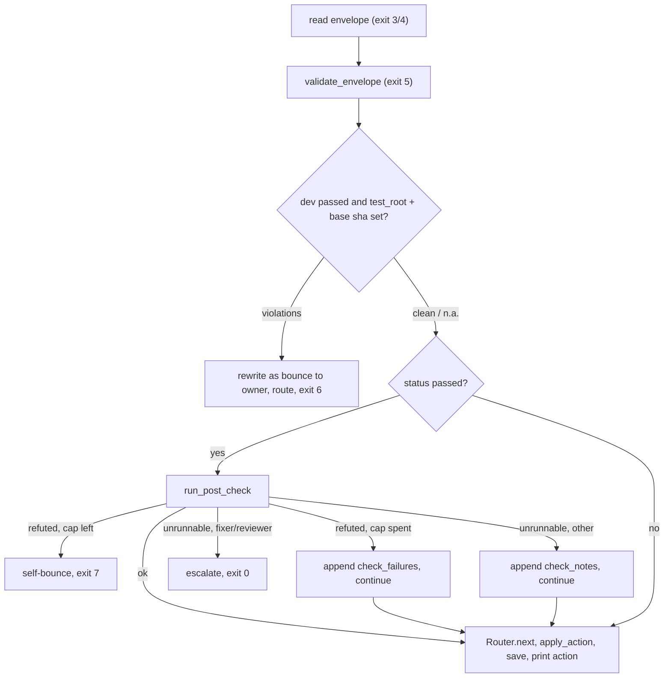
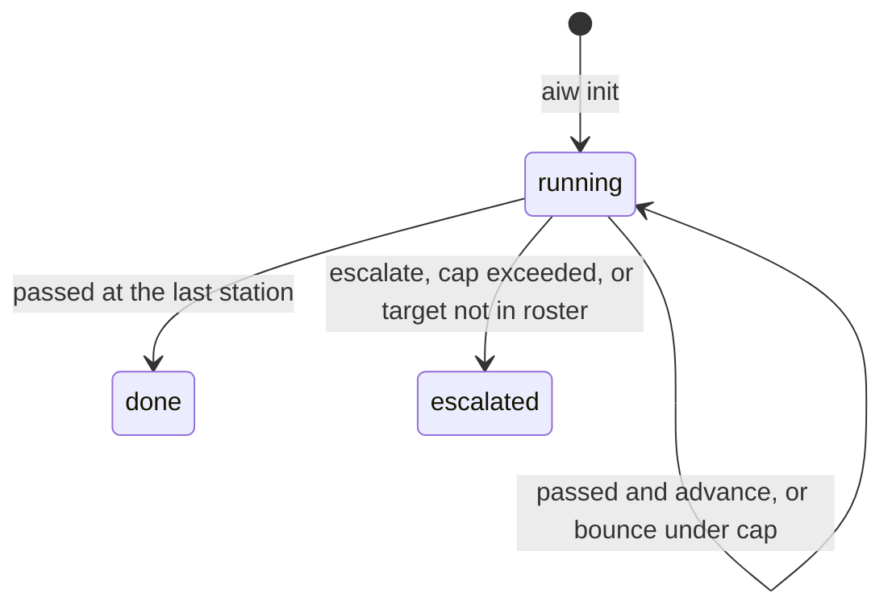

# Run engine

Covers: `run-engine/engine.py`, `run-engine/route.py`, `run-engine/shared.py`, `run-engine/config.json`, `run-engine/checks.py`, `run-engine/project.py`, `run-engine/gitnexus.py`, `run-engine/ci.py`, `run-engine/pr.py`, `run-engine/threads.py`, `run-engine/review.py`, `run-engine/worktree.py`, `run-engine/maintree.py`, `run-engine/stack.py`, `run-engine/refined.py`, `run-engine/epic.py`, `run-engine/ask.py`, `run-engine/dispatch.py`, `run-engine/peer_review.py`

The deterministic half of `/run-issue`. Terms (Run, Ledger, Station, Bounce, Escalated, Classification) are defined in [CONTEXT.md](../CONTEXT.md). Every `aiw` subcommand and its flags are in [cli.md](cli.md). The user-level flow is in [features/run-issue.md](features/run-issue.md).

## Module map

| Module | Owns | Key symbols | `aiw` surface |
|---|---|---|---|
| `engine.py` | Pure core: ledger model, router, envelope validator, classifier, review-panel resolver, path globs | `Ledger`, `Router`, `RouteAction`, `validate_envelope`, `classify`, `resolve_review_panel`, `glob_match`, `STATUSES`, `REQUIRED_FIELDS` | none (imported) |
| `route.py` | CLI entry (`main`), the ledger subcommands, the test-ownership guard, post-check dispatch | `main`, `cmd_route`, `test_root_violations`, `apply_action`, `cmd_paths` | `init route precheck classify resolve-review skip-review set paths` |
| `shared.py` | I/O helpers every module shares: data dir, JSON read/write, config merge, ledger load/save/lock, `gh`/subprocess wrappers | `data_dir`, `load_config`, `deep_merge`, `load_ledger`, `save_ledger`, `ledger_lock`, `record`, `run_dir_for`, `read_json`, `gh_json`, `parse_pr_ref`, `run`, `shell` | none |
| `config.json` | Global policy, see [Config](#config) | | |
| `checks.py` | Post-checks and pre-guards (I/O) | `POST_CHECKS`, `PRE_CHECKS`, `FATAL_WHEN_UNRUNNABLE`, `run_post_check`, `run_suite`, `CheckResult` | via `route`, `precheck` |
| `stack.py` | The per-issue Docker test stack and the only owner of the container contract | `cmd_up`, `compose_project`, `acquire_lock`, `app_healthy`, `limits_override`, `read_test_cmd_override` | `stack up/down/rebuild/status` |
| `worktree.py` | Worktree or main-tree branch, copying gitignored secrets, dependency install | `cmd_create`, `cmd_main`, `ignored_secrets`, `INSTALLS`, `slugify` | `worktree create` |
| `maintree.py` | One main-tree run per repo: holder + queue record | `acquire`, `release`, `phase`, `for_issue`, `STALE` | `maintree acquire/status/release` |
| `pr.py` | Push, `gh pr create`, linking the branch and PR to the issue | `cmd_open`, `link_branch`, `linked_ok`, `closes_ok` | `pr open` |
| `ci.py` | Polling a PR's checks (no flake judgment, that is `run-ci`'s job) | `snapshot`, `state_of`, `failing_detail` | `ci status` |
| `threads.py` | The one copy of the review-thread GraphQL query and resolve mutation | `list_threads`, `resolve_thread`, `thread_for_comment` | `threads list/resolve` |
| `review.py` | Pure pick of the review that carries a pr-grind round's verdict | `pick` | `review pick` |
| `project.py` | GitHub Projects v2 Status move (best-effort) | `match_option`, `FILLER` | `project-status` |
| `gitnexus.py` | GitNexus index sync/index/clean (best-effort) | `analyze`, `cmd_run` | `gitnexus` |
| `refined.py` | Refined fast path: writes researcher + planner envelopes from a `refined` issue body | `parse`, `sections`, `detect_test_root` | `refined` |
| `epic.py` | Epic DAG, readiness, stack budget, sub-issue and blocked-by writes. Flow: [features/run-issue.md](features/run-issue.md), [features/planning.md](features/planning.md) | `parse_depends`, `build_dag`, `ready`, `child_state`, `missing_edges`, `extra_edges` | `epic split/blockers/init/next/status` |
| `peer_review.py` | Peer review verdict validation and round decision. Flow: [features/peer-review.md](features/peer-review.md) | `validate`, `decide`, `check_prior`, `offers`, `DENY` | `peer-review new/next/verdict/diff` |
| `ask.py` | Headless gate question for a UI session (stand-in for AskUserQuestion) | `cmd_ask` | `ask` |
| `dispatch.py` | Dispatch roster parsing, DoR pre-screen, skip detection, `checkouts.json` registry. No CLI of its own; used by the UI. Flow: [features/dispatch.md](features/dispatch.md) | `dor_gaps`, `DOR_ITEMS`, `skip_reason`, `read_checkouts`, `register_checkout`, `checkouts_path` | only `paths` reads it |

`ui_*.py` modules are in [ui.md](ui.md). Tests (`test_*.py`) are in [development.md](development.md).

## Pure vs I/O

- `engine.py` has no I/O, network or LLM. Every rule that decides routing lives there and is asserted in `test_engine.py`.
- `route.py` and the mechanical modules do the I/O. They load the ledger, call the engine, persist, and print.
- The same split repeats inside files: the top of `epic.py`, `dispatch.py` and `peer_review.py` is pure; the I/O half sits below an `import json  # noqa: E402` line. `review.py` is pure apart from reading its two input files.
- `classify` and `resolve_review_panel` take every glob, weight and threshold from config, so retuning is a config edit.
- Path globs (`glob_match`): `*` never crosses `/`, `**` does, `**/x` also matches `x`, `{a,b}` braces work, matching is case-insensitive on purpose.

## The ledger (`run.json`)

- Location: `<data_dir>/runs/<owner>-<repo>-issue-<n>/run.json` (`shared.run_dir_for`, `shared.ledger_path`). `<data_dir>` is `$CLAUDE_PLUGIN_DATA`, else `~/.claude/plugins/data/ai-workflow` (`shared.data_dir`). Never in the repo.
- Written only through `save_ledger`, which is atomic (tmp file, fsync, `os.replace`) because the UI reads it live.
- `aiw set`, `aiw route` and `aiw skip-review` hold `ledger_lock` (an `fcntl` lock on `<run_dir>/.run.lock`) for load, mutate, save.
- Mechanical subcommands write context through `shared.record(run_dir, ledger, **pairs)` (drops `None` values) instead of asking the orchestrator to `aiw set`.

| Field | Type | Meaning |
|---|---|---|
| `issue` | int | Issue number |
| `stations` | list | The roster, fixed at `init`. A resumed run cannot swap rosters |
| `currentIndex` | int | Index of the station holding the baton |
| `bounceCounts` | dict | Keyed `"<from>-><to>"`, not by target, so separate budgets never merge |
| `status` | str | `running`, `done` or `escalated` |
| `trace` | list | `init: …`, `advance->x`, `bounce->a->b#n`, `classify: …`, `review-panel: […]`, `escalate: …`, `done` |
| `context` | dict | Free-form string map, below |
| `classification` | dict/null | Set by `aiw classify` |
| `specialists` | list | Set by `aiw resolve-review` |

Context keys written by code (others are written by the orchestrator with `aiw set`, see [features/run-issue.md](features/run-issue.md)):

| Writer | Keys |
|---|---|
| `aiw init` | `mode`, `repo`, `review=skipped` (with `--no-review`) |
| `aiw route` | `tests_sha` (from default-mode dev's handoff), `check_notes[]`, `check_failures[]` |
| `aiw skip-review` | `review=skipped` |
| `aiw worktree create` | `worktree`, `branch`, `main_checkout`, `repo`; with `--main-tree` also `tree=main`, `carried[]` |
| `aiw stack up` | `stack` (`up`/`none`/`failed`), `test_cmd`, `test_cmd_host`, `compose_prefix`, `compose_project`, `app_service`, `app_url`, `api_url`, `web_url`, `source_mounted`, `tests_unverified` |
| `aiw pr open` | `pr`, `pr_number`, `link` (`ok`/`FAILED`) |
| `aiw gitnexus … --run-dir` | `gitnexus` (index key or `none`) |
| `aiw epic init` | `epic`, `depends_on` |

Keys the engine reads that the orchestrator sets: `test_root`, `base_branch`, `sdet_sha` (full roster only), `pr_number` (via `pr open`).

## The envelope

Each station writes one JSON object into the run dir and the orchestrator passes its filename to `aiw route`. Files: `00-readiness.json` (researcher), `10-plan.json` (planner), `20-tests.json` (sdet), `30-build.json` (dev), `40-verify.json` (verifier), `50-review.json` (reviewer), `60-fix.json` (fixer). Side files: `45-classification.json` (`aiw classify`), `48-<lens>-verdict.json` (specialists, read by run-reviewer).

`validate_envelope` (exit 5 on any error):

- Required: `issue` (int ≥ 1), `station` (in this run's roster), `status`, `attempt` (int ≥ 1), `summary`.
- `status` is one of `STATUSES = ("passed", "bounce", "escalate")`. There is no `blocked`: the run has three human gates (`_human_gates` in config) and a station may not add a fourth.
- `bounce` requires `bounce.to` and `bounce.reason`, both strings. `bounce.findings[]` is optional.
- Evidence gate: a `passed` envelope from a station in `evidence_required_stations` needs a non-empty `evidence.commands[]` (`cmd`, `exit`, `excerpt`) unless `evidence.skipped` is true. It catches an omitted pass, not a fabricated one.
- Default roster (no `sdet`): `dev` may only report `passed`; what is unmet goes in `summary` and `handoff.report`.
- `read_json` recovers the first balanced `{…}` when the model wrapped the JSON in a fence or prose (`extract_json_object`). The contract is still enforced.

`handoff` is station-specific. The fields the engine and checks read:

| Station | `handoff` fields read by code |
|---|---|
| planner | `test_root`, `base_branch` (the orchestrator records them) |
| sdet | `test_files[]` |
| dev | `commit`, `files_changed[]`, `tests_sha`, `test_changes[]` (`file`, `reason`), `verify` |
| verifier | `verdict`, `criteria[]`; or top-level `modes.{backend,frontend}` + rollup `verdict` |
| reviewer | `review_url`, `panel[]`, `counts_by_severity` |
| fixer | `commits[]`, `needs_confirmation[]`, `needs_test_root_fix[]`, `needs_new_file[]` (each with `thread_node_id`/`thread_url`) |

The full per-station shape is in each `agents/run-*.md`.

## `aiw route`, step by step

- Printed action: `advance(<station>)`, `bounce(<station>)`, `escalate: <reason>` or `done`.
- Exit codes: 0 ok, 2 usage, 3 unreadable artifact, 4 not a JSON object, 5 contract violation (also any `ValueError` from the engine), 6 test-ownership violation, 7 post-check refuted. 6 and 7 have already routed the bounce; every other nonzero means teardown and report.

## Router and bounce budgets

- `passed` advances to the next roster entry, or `done` at the last one.
- `bounce` to a station outside the roster escalates (`… is not in this run's roster … — unroutable`).
- `bounce` past `bounce_cap` (default 2) for that `<from>-><to>` key escalates.
- Post-check self-bounces use the key `<station>-><station>` with their own cap `check_bounce_cap` (default 1), so they never spend a real bounce budget. A spent check budget advances; it does not halt.
- `escalate` maps to Escalated with the envelope's `summary` as the reason.

## Test-ownership guard

Runs in `cmd_route` when `dev` reports `passed` and both `context.test_root` and a base sha exist.

- Owner: `sdet` when the roster has it (base sha `context.sdet_sha`), else `dev` itself (base sha `context.tests_sha`, copied from the first dev handoff that carries `tests_sha`).
- `test_root_violations` runs `git diff --name-only <sha>..HEAD -- <test_root>`, so committed edits, additions and deletions all count.
- When `test_root` ends in `test`, `tests`, `__tests__`, `spec` or `specs`, every file under it is guarded. Otherwise only test-named files (`test_*`, `*_test.*`, `*.test.*`, `*.spec.*`).
- Default roster: files listed in `handoff.test_changes[]` with a non-empty `reason` are allowed.
- A violation becomes a bounce to the owner with `blocker` findings, consumes that bounce budget, and exits 6. Stderr tells the orchestrator to revert with `git checkout <sha> -- <files>`.
- A guard that cannot run (bad sha) warns and allows the run to continue.

## Post-checks and pre-guards

`checks.py` answers each station's central claim from an exit code, a git object, a GitHub response or a file on disk. Skipped when `checks.enabled` is false or the station is in `checks.skip`.

| Station | Post-check (`POST_CHECKS`) | Pre-guard (`PRE_CHECKS`, via `aiw precheck`) |
|---|---|---|
| sdet | `test_files[]` exist under `test_root`; suite must be red | worktree clean apart from `carried` |
| dev | `commit` resolves; no changed file missing from `files_changed[]` (test root excluded); suite green. Default roster also: `tests_sha` is an ancestor and touches only the test root, `verify` present, not `fail`, and passes the verifier check | none |
| verifier | `pass` verdict has `criteria[]` all met; rollup equals worst mode; evidence paths with `/` exist | none |
| reviewer | `panel` equals `resolve_review_panel`; the review id in `review_url` exists on the PR; a review claiming findings is not empty | PR is OPEN |
| fixer | HEAD equals `@{u}`; `commits[]` are on the remote; every open thread is listed in a `needs_*` array | PR is OPEN |

- sdet, dev and fixer also fail if a commit touches a `carried` path (main-tree runs, `_carried_guard`).
- `run_suite` runs `context.test_cmd` through the shell with timeout `checks.suite_timeout` (default 900). It never uses `test_cmd_host`. With `stack=up` it first calls `stack.app_healthy`. No runner or a timeout means "unrunnable", not "failed".
- Unrunnable is fatal only for `FATAL_WHEN_UNRUNNABLE = {"fixer", "reviewer"}`.
- Known hole (commented in code): the sdet check inverts the whole suite, so an already-red suite passes it.

## Classification and the review panel

- `aiw classify` scores the diff: `blast_radius` from `--depth` (absent means `unknown`, scored like `d2`), plus file count, LOC, migration presence and capped signal severity, clamped 0–100. Bands come from `classification.bands`. `ticket_type` is the first matching `type_rules` entry, else `type_default`.
- `aiw resolve-review` maps signals, `risk_band` and `ticket_type` through `review_policy` into ordered specialist lenses. The generalist (`review_policy.generalist`) is never in the output; empty means generalist only.
- `backend`/`frontend` signals only route runtime verification; they carry no severity and fire no lens. `ci-config` raises the score but fires no lens.
- Lens prompts live in `review_policy.lenses`. Flow: [features/review.md](features/review.md).

## Config

`run-engine/config.json` holds the global defaults. `load_config(repo)` deep-merges `<repo>/.run-issue.json` on top: dicts merge, lists and scalars replace (so an overlay can narrow a glob list, never silently widen it).

| Key | Default | Read by |
|---|---|---|
| `bounce_cap` | 2 | `Router` |
| `check_bounce_cap` | 1 | `cmd_route` |
| `checks.enabled` / `checks.skip` / `checks.suite_timeout` | true / [] / 900 | `checks.run_post_check`, `checks.suite_timeout` (invalid values fall back to 900 with a warning) |
| `default_mode` | `"default"` | `cmd_init` (unknown mode exits 2) |
| `modes.<name>.stations` | default: researcher, planner, dev, reviewer, fixer | `cmd_init` |
| `stations` | same list | `cmd_init` fallback when the mode has no `stations` |
| `evidence_required_stations` | sdet, dev, verifier, reviewer, fixer | `validate_envelope` |
| `classification.*` | `signals`, `signal_severity`, `type_rules`, `type_default`, `risk_weights`, `migration_globs`, `bands`, `blast_radius.d1_max_depth` | `classify` |
| `review_policy.*` | `generalist`, `order`, `signals`, `risk_band`, `ticket_type`, `lenses` | `resolve_review_panel`, reviewer post-check, run-specialist |
| `peer_review.*` | `max_rounds` 3, `default_lenses`, `diff_max_lines` 3000, `rubric`, `lenses`, `kinds` | `peer_review.py` |
| `test_cmd` | none (overlay only) | `stack.read_test_cmd_override`; a non-empty string replaces the derived test command |

- Keys starting with `_` (`_note`, `_check_note`, `_human_gates`, `_evidence_note`) are documentation; no code reads them.
- `modes.default` also carries `classifier`, `specialists`, `skipped`, `absorbed_by` and `tradeoff`, read by the orchestrator prose, not by Python.
- Repo setup of the overlay: [features/setup.md](features/setup.md).

## Gotchas

- The global config ships only `modes.default`. `aiw init` has no `--mode` flag; a full roster (with `sdet` and `verifier`) exists only in legacy ledgers or if a repo overlay defines another mode and sets `default_mode`. The engine still handles that roster (owner `sdet`, `sdet_sha`).
- `peer_review.py` calls `load_config(None)`, so a repo overlay does not change peer review policy.
- `route.py` imports `ui_server` (and through it the UI modules) on every `aiw` call.
- The best-effort subcommands (`stack down`, `gitnexus`, `project-status`) never exit nonzero, by design: the orchestrator treats nonzero as stop.
- `stack.py` lock is per Compose project (`runissue-<repo-slug>-<sha1[:8]>-<issue>`), not per host, despite the older comment above `LOCK_TIMEOUT`.
