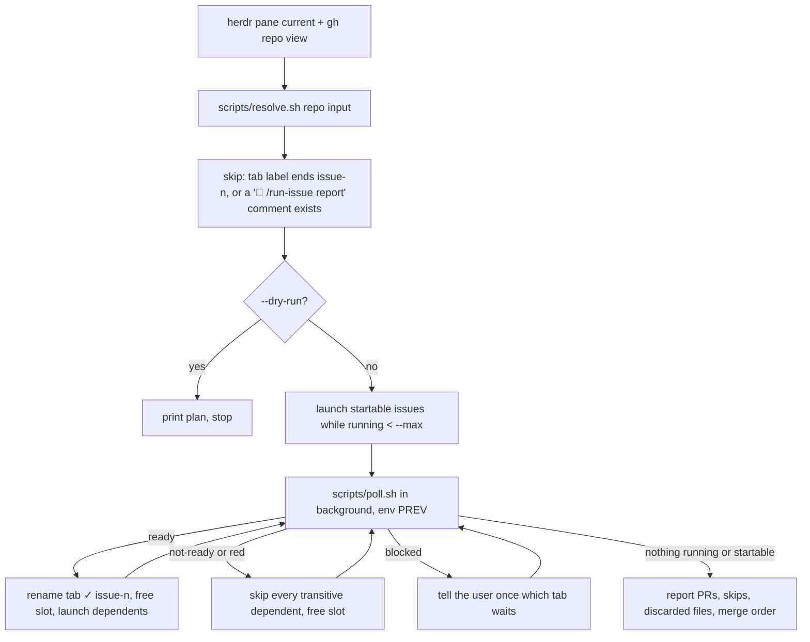

# Dispatch

Covers: `skills/herdr-dispatch/`, `run-engine/dispatch.py`

[Dispatch](../../CONTEXT.md) launches `/run-issue` over a batch of issues in dependency order with a concurrency cap. Two front ends share the idea but not the code:

| Front end | Where | Runs each issue as |
|---|---|---|
| `herdr-dispatch` skill | terminal controller session | one herdr tab per issue, an interactive Claude session |
| `#/dispatch` page | `aiw ui` (`run-engine/ui_dispatch.py`, the "UI twin" of the skill) | a headless UI Session per issue |

The UI side (pipelines in `<data_dir>/pipelines/`, the 5s tick, AFK mode in `run-engine/ui_afk.py`) is documented in [ui.md](../ui.md). This doc covers the skill and the shared helpers in `dispatch.py`.

Planning stages hand over with `→ next: herdr-dispatch <n or epic>` ([planning.md](planning.md)). `/flow` always runs `--dry-run` first and launches only on "Launch".

## herdr-dispatch skill

`herdr-dispatch <input> [flags]`. `<input>` is a GitHub issue-search URL, a label name, issue numbers, or one epic parent number.

| Flag | Effect |
|---|---|
| `--sequential` | one at a time, oldest first |
| `--max N` | concurrency cap (default 2) |
| `--cmd "<template with {n}>"` | default `/ai-workflow:run-issue {n}` |
| `--dry-run` | print order, launch commands and poll plan, then stop |
| `--no-worktree` | run each issue as `/ai-workflow:run-issue {n} --no-worktree` in the main checkout; requires `--sequential` |
| `--no-review` | pass `--no-review` to each run (no review or fix step) |
| `--grind` | pass `--grind` so each tab keeps grinding its PR after Gate 2 |

**Launch, per issue:**
1. Unless `--no-worktree`: `git status --porcelain`, then discard modified tracked files **by path** (`git checkout -- <file>...`) and remember them. Untracked files stay. `/run-issue` preflight stops on a dirty tree.
2. `herdr tab create --workspace <ws> --cwd <repo dir> --label issue-<n>`.
3. `herdr agent start issue-<n> --kind claude --pane <pane>`, then `herdr agent prompt issue-<n> "<cmd>" --wait`.

**Ordering:** an issue starts only after all its in-set dependencies reach Gate 2 Ready. No confirmation prompt. With `--no-worktree`, the next run waits in the main-tree queue (`aiw maintree acquire`, see [cli.md](../cli.md)); its tab shows `waiting for #N`, which is not `blocked`.

**State** lives in GitHub (report comments) and herdr (tab labels); the skill keeps no file, so a re-run resumes.

### Scripts

| Script | Output |
|---|---|
| `scripts/resolve.sh <owner/repo> <input...>` | `n<TAB>title<TAB>deps` sorted by number; deps are in-set issues only |
| `scripts/poll.sh <owner/repo> <issue>...` (env `PREV="n=state,..."`) | loops every 120s; exits printing `<n> <state>` on the first change |

`resolve.sh` input handling: an `http*` URL → its `q=` search minus `is:issue`/`sort:` tokens; one non-numeric arg → a label; one number with sub-issues → its sub-issues; otherwise the numbers as given. URL and label lookups take open issues only, at most 100.

`poll.sh` states:

| State | Source |
|---|---|
| `not-ready` | the latest `🤖 /run-issue report` comment contains `Not ready` |
| `working` | report exists and `gh pr checks` shows pending; or no report and the tab is not blocked |
| `red` | report exists and a check failed |
| `ready` | report exists and checks are settled with no failure |
| `blocked` | no report and the herdr tab's `agent_status` is `blocked` (a human gate) |

### Rules and gotchas

- The controller never answers a gate, merges or comments on GitHub.
- The cap exists because each run raises its own Docker test stack.
- Gate 2 is read from the report comment, never from the pane. A new push re-runs CI, so `working` after `ready` is expected.
- `resolve.sh` uses `mapfile`, so it needs bash 4+ on `PATH` (macOS `/bin/bash` is 3.2).
- `resolve.sh` reads dependencies with a looser match than `epic.parse_depends`: any `depends on` text up to a period, case-insensitive, colon optional.
- Discarded tracked files can include a lesson a finished run wrote to `tasks/lessons.md`; the final report lists them.

## dispatch.py

Library only: it registers no `aiw` subcommand. Pure helpers on top, I/O below.

| Symbol | Does | Used by |
|---|---|---|
| `parse_issue_list(raw)` | comma list, `#` tolerated; `ValueError` on empty or non-numeric | `ui_dispatch.py` |
| `dedupe(nums)` | drop repeats, first wins | `ui_dispatch.py` |
| `DOR_ITEMS`, `dor_gaps(body)` | mechanical Definition of Ready screen: six headings mirroring `definition-of-ready.md`, also matching the `/gh-issue` section names; a heading with no text under it is a gap | `_issue_readiness` |
| `lane_mode(labels)` | `lean` if a `lean` label is present, else `full` | `_issue_readiness` |
| `skip_reason(run_json_path, has_open_pr)` | skip on an open linked PR or a ledger with `status: running`; `done` and `escalated` are re-runnable; unreadable ledger = no run | `_issue_readiness` |
| `_issue_readiness(args, n)` | `gh issue view` + screen → `{issue, gaps, mode, skip_reason, title, deps}`, or `{closed}` / `{error}` | `ui_dispatch._screen` |
| `_has_open_linked_pr(slug, nums)` | lists open PRs and intersects with `closedByPullRequestsReferences`; returns an error rather than `False` on `gh` failure | `_issue_readiness` |
| `checkouts_path()` | `<data_dir>/checkouts.json` | `route.cmd_paths` (`aiw paths` key `checkouts`) |
| `read_checkouts()` | slug → local path registry; `{}` when missing or invalid | `ui_repos.py`, `ui_board.py` |
| `register_checkout(slug, path)`, `rename_checkout(old, new)` | atomic write through `stack._write_holder` | `ui_repos.py` |

- `deps` in a readiness result come from `epic.parse_depends` (imported locally to avoid an import cycle).
- `_has_open_linked_pr` deliberately avoids `gh pr list --search "linked:<n>"`, which `gh` ignores and returns every open PR.
- `checkouts.json` holds only slug and path pairs, never environment or `.env` content.

## Tests

- `run-engine/test_scripts.py`: `dor_gaps`, `lane_mode`, `skip_reason`, `parse_issue_list`, `dedupe`, the checkouts registry, and `herdr-dispatch` file checks (scripts exist, are executable, pass `bash -n`, and are called through `<plugin_root>`).
- `run-engine/test_ui_dispatch.py`: the UI pipeline side.
