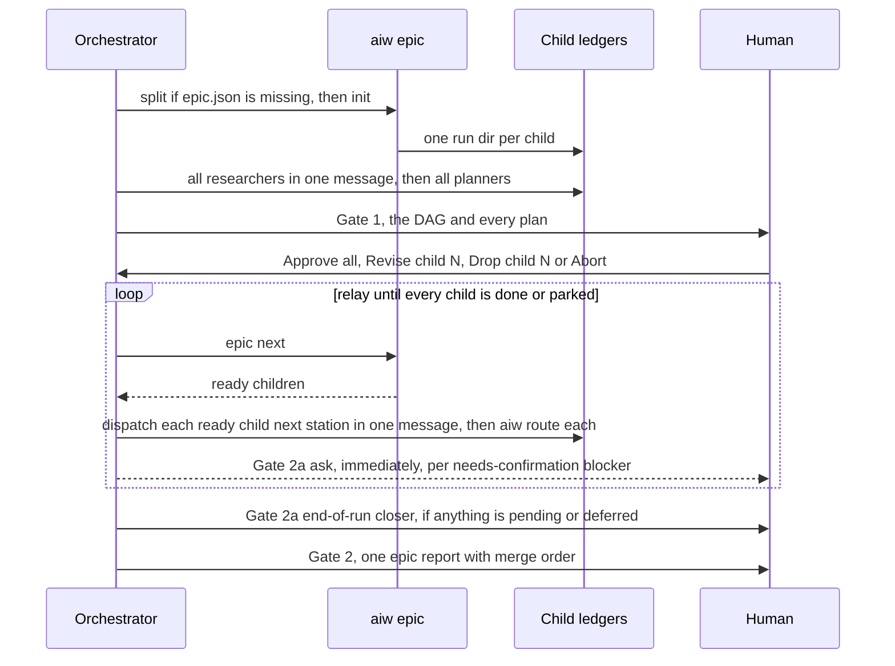

# /run-issue Epic mode

Covers: `commands/run-issue.md`, `run-engine/epic.py`

`/run-issue <parent>` on an issue that has GitHub sub-issues runs every child in one session, with N child ledgers and still three human gates. Children are not nested `/run-issue`s: subagents do not nest, so this session walks every ready child's roster itself. Single-issue phases: [run-issue](run-issue.md). How epics and `epic.json` are made (`/create-prd approve`, `/refine-issues`, `aiw epic split`/`blockers`): [planning](planning.md). Term: Epic in [CONTEXT](../../CONTEXT.md).

## Entry

- Preflight step 3.5 calls `gh api repos/{owner}/{repo}/issues/<n>/sub_issues` **before** the resume check. A non-empty list → Epic mode.
- A `/create-prd` epic (labelled `epic` and `prd-<slug>`) with no sub-issues is refused and never run as one issue. Link its children with `/refine-issues` or `aiw epic split`. An `epic` label without `prd-<slug>` is a team label and takes the ordinary path.
- Running `/run-issue` on a single child is legal. If its `Depends on:` branch is missing on the remote (`git ls-remote --heads origin <dep-branch>`), the run asks whether to base on the default branch instead. It never guesses a base.

## Steps

| Step | Command | Notes |
|---|---|---|
| 0 Split | `aiw epic split <runs_dir>/<owner>-<repo>-epic-<n> --parent <n> --slug <owner>/<repo> --children <a>,<b>,…` | only when `epic.json` is missing (it is written on the machine that ran `/refine-issues`). Idempotent on linkage. Exit 1 = not a DAG → stop. `--max-stacks` defaults to 3 |
| 1 Init | `aiw epic init <epic-dir> --runs-dir <runs_dir> --repo <main-checkout>` | one ordinary ledger per child, plus `context.epic` and `context.depends_on`. Idempotent. Every guard and post-check applies unchanged |
| 2 Research + plan | — | one `run-researcher` per child in one message, route each, then one `run-planner` per child. Gate 1 waits for every plan |
| 3 Gate 1 | — | prints the DAG as an order with parallel groups, every child's DoR gaps and assumptions, then every plan in full. Drop child N is refused while a kept child depends on N |
| 4 Relay | `aiw epic next <epic-dir> --runs-dir <runs_dir>` | prints JSON `{ready, states}`. Every ready child's next station goes out in one message |
| 6 Gate 2a closer | `aiw epic status <epic-dir> --runs-dir <runs_dir>` | one line per child: status, station, `pr`, `blocked_on`, `blocker_ask` |
| 7 Gate 2 | — | one report for the whole epic |
| 8 No grind | — | phase 10 is skipped (pr-grind holds a session-local Monitor and wakeup). The user runs `/pr-grind <url>` per PR |

- **Known bug:** the command passes `--mode full` to `aiw epic init` when the epic is run with `--full`. That flag was removed in #202, so argparse exits 2. Without `--full`, every child gets the default roster. Per-child `full` labels are not read.

## Sequencing and stacked branches

`ready()` in `run-engine/epic.py` returns the children that may advance now. A child is ready when:
- its own status is `running`;
- every dependency has reached **PR open** (`context.pr` is set). That is the point where a stacked child has a base branch to branch from;
- it needs a stack and a slot is free. Slots are counted from every ledger with `stack: "up"`, against `max_stacks`.

- **Independent children run at the same time.** Children desynchronize freely, with no waves.
- **A dependent child stacks its branch on the branch it depends on**, and waits for that one to reach "PR open" first. Before the child's phase 2 the orchestrator must run `aiw set <child-run-dir> base_branch=<dependency's context.branch>`. Nothing does it automatically. Miss it and the stack silently degrades to everything onto the default branch.
- A dependency that was dropped or died leaves the child on the default branch. Gate 2 reports that child as **re-targeted**.
- The orchestrator runs each child's mechanical phases (worktree, `aiw stack up`/`rebuild`, `aiw pr open`, sync, CI gate, `aiw stack down`) at the same points as a single run.
- Stack slots: raise a child's stack in the same turn `epic next` hands out its slot. Run `aiw stack down` as soon as the child clears its CI gate. A stack that is `none` or `failed` holds no slot.

## Blockers park a child, not the epic

Checked for each child after routing, every relay tick:

| Cause | Ledger write | Ask |
|---|---|---|
| (a) `aiw route` printed `escalate` | `blocked_on='…' blocker_ask=pending`. The child also takes its own Degraded finish | none. It prints `#<child> escalated at <station>: <reason> — continuing other children…`. The ledger is terminal and an answer cannot resume it this session |
| (b) the child's `60-fix.json` `needs_confirmation[]` (or the Laravel equivalent) is non-empty | same | an **immediate Gate 2a ask, fired as soon as that child parks**, one per child and never batched. Confirmed, continue → resolve threads, `blocked_on= blocker_ask=answered`. Defer → `blocker_ask=deferred`, and the child does not reach 7b/8.5 this run |

- A blocker in one child parks that child while the others keep going.
- A parked child's stack is torn down at once. `ready()` counts its `stack_up` against `max_stacks` whatever its status.
- If the user interrupts to answer a case (a) blocker: `aiw set <child> blocker_answer='…' blocker_ask=answered`. A later single-issue resume prints `blocker_answer`.
- **Gate 2a end-of-run closer** fires once if any child's `blocker_ask` is still `pending` or `deferred`. Both the immediate asks and the closer count as Gate 2a, so there are still three gates.

## Gate 2, the epic report

- Per child: PR, CI verdict, open threads, runtime verification, and anything carried forward.
- Parked children, what they wait on, any `blocker_answer`, and their resume command.
- **Children that never started, named with the failed dependency**, e.g. "Never started, blocked by #14".
- Children re-targeted to the default branch.
- **The merge order**, explicitly. The PRs are stacked and merging is manual.
