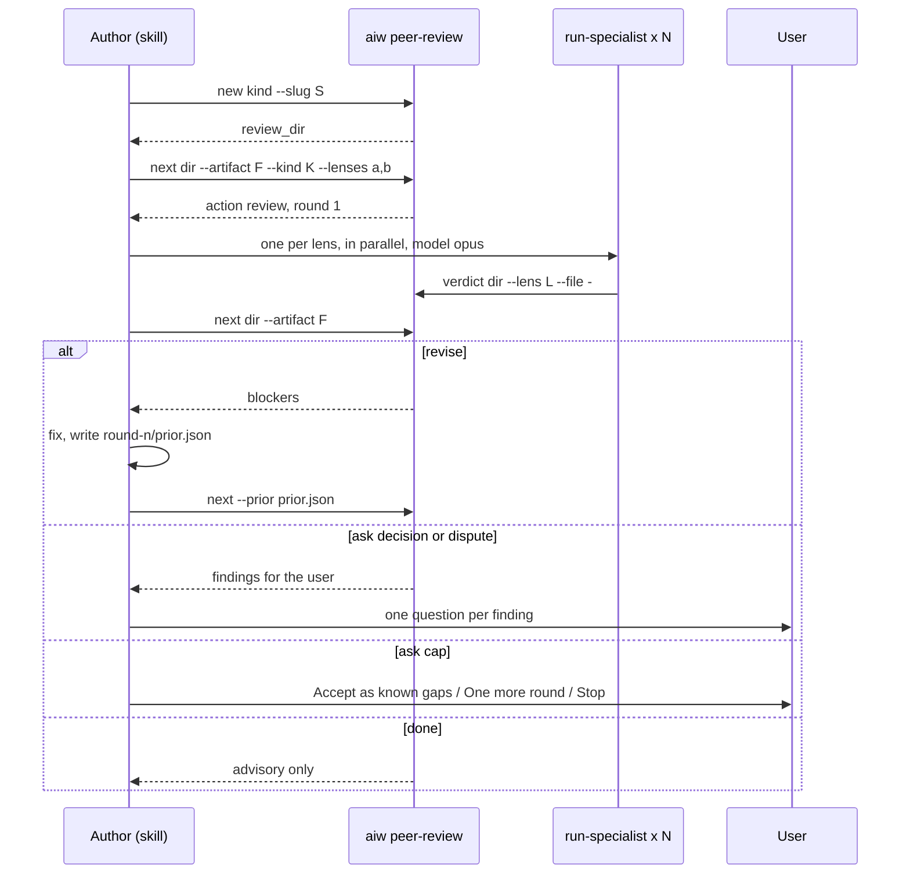

# Peer review

Covers: `skills/peer-review/`, `run-engine/peer_review.py`, `agents/run-specialist.md`

A panel of single-lens reviewers checks one artifact in rounds until every picked lens approves. Terms (Peer review panel, lens pool, dispute) are in [CONTEXT.md](../../CONTEXT.md). This is not the PR review inside `/run-issue`; that is [review.md](review.md).

## Entry points

| Caller | Kind | Artifact | On `stopped` |
|---|---|---|---|
| `/create-prd ... --review [<lens,lens>] [--herdr]` (Step 5.5) | `create-prd` | `<review_dir>/draft.md` (the PRD draft) | saves nothing; known gaps go under `## Open questions` |
| `/intake ... --review ...` (step 3.5) | `intake` | `draft.md` (the brief) | returns no result; gaps go in `## Known gaps` |
| `/dump ... --review ...` (Step 2.5) | `dump` | `draft.md`, one `## <vault path>` section per file | writes nothing; gaps go under **Open questions** |
| `/gh-issue ... --review ...` | `gh-issue` | `draft.md`, `## Issue 1: <title>` | creates nothing; gaps go in the issue's Notes |
| `/peer-review [--lenses a,b] [--since <sha or @{u}>] [--herdr]` | `custom` | `artifact.md` (Ask, Answer, Decisions, Diff) | gaps go in the final answer |
| UI custom prompt with review | `custom` | `artifact.md` built from the server-written `ask.md` | see [ui.md](../ui.md) |

- Flag parsing: the token after `--review` is a lens list only if it does not start with `--`. Bare `--review` uses `peer_review.default_lenses` (`critical`).
- A programmatic call never passes `--review`; `/intake --whole` ignores it, so a brief is never reviewed twice.
- Each caller runs `aiw peer-review new <kind> --slug <...>`, writes the draft, then invokes the `ai-workflow:peer-review` skill with `--kind <kind> --dir <review_dir> --lenses <picked> [--herdr]`.
- `/peer-review` with non-flag text does that work first, then reviews it as `custom` with the text as the Ask.

## Lenses and kinds

Config: `peer_review` in `run-engine/config.json` (keys and the no-overlay rule: [engine.md](../engine.md)).

| Lens | Focus |
|---|---|
| `critical` | completeness: testable requirements, edge cases, contradictions, undefined terms |
| `ceo` | product value: evidence, metrics, traceability, implied scope |
| `cto` | feasibility against this repo, code as evidence only |
| `security` | authorization, untrusted input, data exposure, PII, abuse |
| `qa` | testability: observable acceptance, coverage, regression risk |
| `ux` | user flows, empty/loading/error states, accessibility, copy |
| `performance` | load, data volume, query cost, slow paths |

| Kind | Rubric | Offers |
|---|---|---|
| `create-prd` | `prd-doc` | all seven |
| `intake` | `doc` | critical, ceo, cto, security, qa |
| `dump` | `doc` | critical, ceo, qa |
| `gh-issue` | `doc` | critical, cto, security, qa, ux, performance |
| `custom` | `change` | all seven |

- `doc` rubric: a fix rewords; it never adds modules, tables or endpoints. `prd-doc` allows contracts in `## Technical design` but flags file paths, class names and step-by-step logic. `change` may name code to change (file:line).
- The UI's lens picker reads `peer_review.offers()` through `GET /api/peer-review`; no lens is hardcoded in the frontend.

## The loop

`decide()` (pure) sorts each round's findings:

| Finding | Goes to |
|---|---|
| `needs_decision: true` | `decisions` → action `ask`, reason `decision` |
| `minor` | `advisory` (never blocks) |
| blocker/major that `reraises` a finding the author `dismissed` or the user `decided` | `disputes` → `ask`, reason `dispute` |
| other blocker/major | `blockers` → `revise`, or `ask` reason `cap` once `round >= max_rounds` |
| none of the above | `done` |

- Every picked lens blocks; a spent budget hands over to the user and never auto-approves.
- `next` opens round n+1 only when the artifact hash changed and the round budget allows; otherwise it decides. With findings it requires `--prior` answering every `(lens, id)` with `fixed`, `dismissed` or `decided` and a reason (exit 2 when `--prior` is missing, 5 when it is incomplete). `--more` adds one round past the budget.
- Decisions are recorded in the artifact's `## Decisions` as `- <decision> — <why> (review: <lens> <id>)`.
- Finish line: `peer review: <approved | known gaps accepted | stopped> after <n> round(s); review dir: <review_dir>`. Callers parse it.
- In Flow auto mode a cap stops the run; gaps are never accepted for the user.

## aiw peer-review

Args: [cli.md](../cli.md). Behaviour beyond the args:

- `new` makes `<data_dir>/peer-review/<kind>/<slug>-<UTC stamp>` (or `<ID>`, the UI's session id); exit 1 if it exists, so a dir is never reused.
- `next` prints one JSON object: `review` (round opened), `wait` (lenses with no verdict yet), or the `decide()` result, which it also writes to `decision.json`.
- `verdict --file -` reads the verdict from stdin, so the reviewer pipes its own JSON.
- `diff` includes untracked files, drops secret-like names (`DENY`), binaries and lockfiles (listed at the top), and caps at `diff_max_lines` with a truncation note.

Files per run: `round-<n>/request.json` (round, kind, rubric, artifact path and sha256, lenses, prior), `round-<n>/<lens>.json`, `round-<n>/decision.json`, plus the author's `round-<n>/prior.json`. `status(dir)` reports `not run`, `unfinished`, `approved` or `cap reached` for the UI session view.

## Verdict contract

`validate()` refuses (exit 5, reasons listed) a verdict that:
- names a lens not on the panel, a round other than the open one, or an `artifact_sha256` that is stale;
- has more than 8 findings, or a `verdict` other than `approve`/`changes`;
- has a finding without a `severity` in `blocker|major|minor` or an `id`;
- quotes fewer than 4 words, quotes text not in the artifact (whitespace and markdown emphasis ignored), or, with no quote, names a `section` that is not a `##`/`###` heading;
- approves while carrying a blocker or major;
- has a blocker/major without `reraises` (prior id or null), re-raises a `decided` finding without `new_evidence`, or repeats a dismissed finding's quote without `distinct_because`.

## run-specialist in peer review

- Dispatched with `artifact: peer-review`, the lens, `<review_dir>`, the round and the repo path; on Opus.
- Reads `round-<n>/request.json`, then its lens prompt and rubric from config only (dispatch text checklists are ignored).
- Records its own verdict with `aiw peer-review verdict ... --file -`; the author never writes, copies or edits a verdict.
- Never edits the artifact or any file. Its PR-review role in `/run-issue` is in [review.md](review.md).

## --herdr

- Reviewers run in herdr tabs `rv-<lens>`, started as `--agent ai-workflow:run-specialist --model opus --disallowedTools "Write,Edit,NotebookEdit"`. Tabs persist across rounds; the user can talk to them.
- Headless runs ignore `--herdr`; a missing `herdr` binary falls back to subagents.
- Gotcha: the tab still has a shell, so it is not truly read-only.
- Gotcha: right after a prompt a tab can read `idle`; a missing `round-<n>/<lens>.json` means wait again, not re-dispatch.

## Tests

`run-engine/test_peer_review.py` covers `validate`, `decide`, `check_prior`, `check_lenses`, `status`, `offers`, `_drop_reason` and the `aiw peer-review` subcommands.
