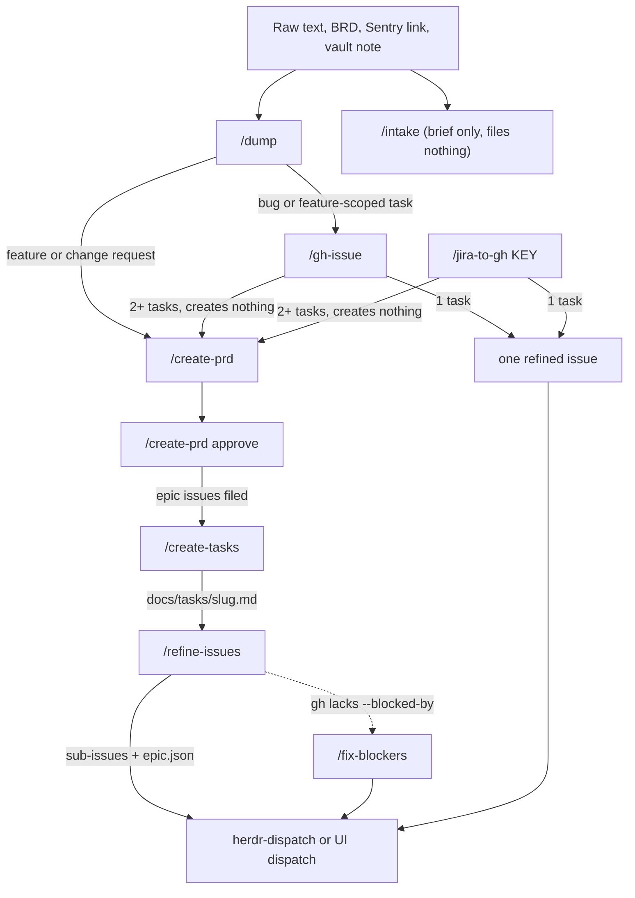
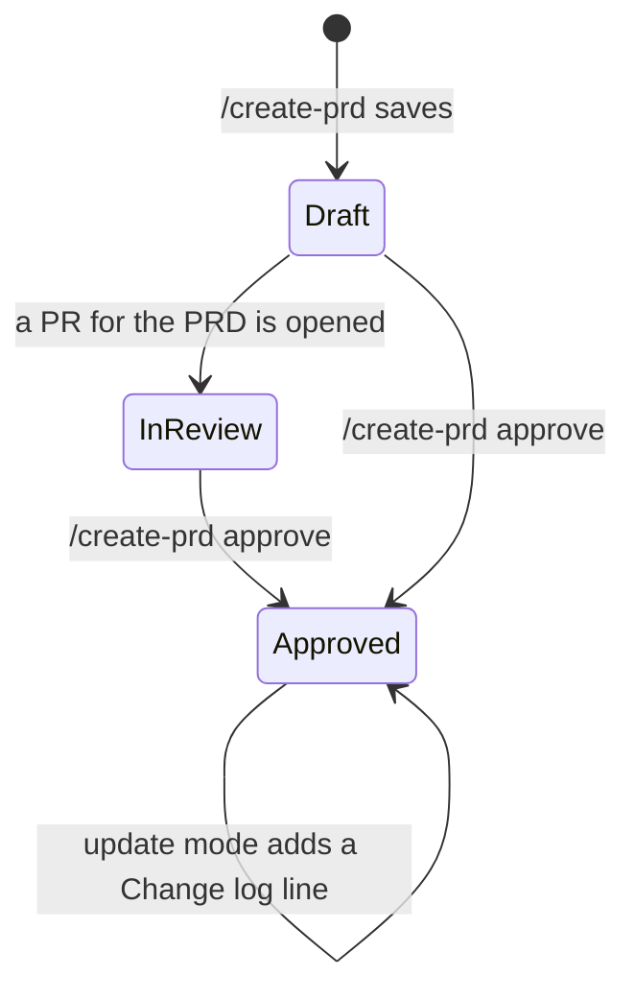

# Planning: idea to issues

Covers: `commands/intake.md`, `commands/gh-issue.md`, `commands/jira-to-gh.md`, `agents/gh-issue-factchecker.md`, `skills/dump/`, `skills/create-prd/`, `skills/create-tasks/`, `skills/refine-issues/`, `skills/fix-blockers/`, `skills/flow/`, `run-engine/epic.py`, `run-engine/refined.py`

How raw input becomes [Refined](../../CONTEXT.md) issues that `/run-issue` can take. Terms (Dump, Problem statement, PRD, Task list, Epic, Refined) are defined in [CONTEXT.md](../../CONTEXT.md). The command rows (args, flags) are in [plugin.md](../plugin.md).

## The chain

- Every stage ends with one line, `→ next: <command> <argument>`, as the last line of its output. `/flow` and the UI Flow parse it; never reword it.
- `/flow` (skill) holds no stage logic. It picks the entry stage from its input, invokes each stage's skill in the same session, and asks "Continue / Stop here" at every boundary. No state file: the vault note, PRD and issues are the state, so `/flow <argument>` resumes. The UI's guided Flow tab is documented in [ui.md](../ui.md).
- Dispatch is documented in [dispatch.md](dispatch.md). Peer review (`--review`) is in [peer-review.md](peer-review.md).

| Stage | Last line |
|---|---|
| `/dump` feature or change request | `→ next: /create-prd <feature-folder>` |
| `/dump` bug or feature-scoped task | `→ next: /gh-issue <Bugs.md or Tasks.md path>` |
| `/dump` standalone task, meeting notes, unclassifiable | none (flow stops) |
| `/create-prd` (and `approve`) | `→ next: /create-tasks <prd-path>` |
| `/create-tasks` | `→ next: /refine-issues docs/tasks/<slug>.md` |
| `/refine-issues` | `→ next: herdr-dispatch <epic>` |
| `/fix-blockers` | `→ next: herdr-dispatch <parent>` |
| `/gh-issue` | `→ next: herdr-dispatch <n>`, or `→ next: /create-prd <input>` on 2+ tasks |
| `/jira-to-gh` | `→ next: /create-prd <jira-key-or-url>` on 2+ tasks only |

`/flow` entry stage by input: raw text → dump; `05-Work/<Project>/<Feature>` folder or its `Dump.md` → create-prd; a PRD path → create-tasks; `docs/tasks/<slug>.md` → refine-issues; a `Bugs.md`/`Tasks.md` note → gh-issue; an epic number or issue numbers/URLs → dispatch.

## Shared conventions

- **Headless questions.** Every stage asks through `AskUserQuestion`, or through `aiw ask` (quoted heredoc, then end the turn) when the system prompt contains `Headless run: ask via aiw ask`. See [cli.md](../cli.md).
- **Flow auto mode.** When the system prompt contains `Flow auto mode` (the UI Flow), stages ask only grilling questions:

| Stage | Flow auto mode changes |
|---|---|
| `/dump` | Step 3 confirmation skipped; may create the proposed project/feature folder |
| `/create-prd` | grilling also covers acceptance criteria and corner cases; `## Open questions` must end empty; review gate auto-approves; saved as `Draft`; wiki never pushed |
| `/create-tasks` | asks nothing; approves a `Draft` PRD through `create-prd approve` after the readiness checks pass; an existing list with another `Source PRD:` saves as `<slug>-2` |
| `/refine-issues` | asks nothing; **Assignees:** none; project = repo-linked project; project fields auto-filled |
| `/gh-issue` | grilling only; assignee = the authenticated user; never invokes `/create-prd` or herdr |

- **Size rubric** (identical text in `/gh-issue` step 3.5, `/jira-to-gh` step 4.5 and `/create-tasks` step 5): a task is one layer-scoped deliverable (a DB migration, service logic, one API endpoint with its request and resource, or one UI unit), touches 3 or fewer production files (tests excluded), has 1-4 acceptance criteria, one verify command and no new dependency. An endpoint over 3 files splits by file group. A failing task is split before the list is shown.
- **`refined` label.** `/gh-issue`, `/jira-to-gh` and `/refine-issues` put it on every issue they create, creating the label idempotently (`gh label create ... || true`, never `--force`).
- **`lean` label.** `/gh-issue` and `/jira-to-gh` add it only when the issue is one outcome, about 1-2 files, no new dependency, no new public API, and touches none of auth, migrations, payments or a public API contract. It picks the lean roster in `/run-issue` ([run-issue.md](run-issue.md)).
- **Bodies** go through `--body-file`, never `--body` (shell quoting).
- **Templates.** A repo's own `docs/templates/{prd,epic,task-list,issue}.md` override the skill's `templates/` copy.
- **Self-improve.** Skills end with a `## Self-improve` pointer to `self-improve.md` at the plugin root.

## /intake

Normalises one source into a `## Intake result` block (`type:` then the brief). It never creates an issue and never writes to the repo.

| Source (first match wins) | Adapter |
|---|---|
| `*sentry.io/*` or `/organizations/*/issues/` | Sentry MCP: stack trace, occurrences; Seer output kept under its own "unverified" heading; auth failure stops |
| existing `.md`/`.txt`/`.pdf`/`.docx` file | BRD: keeps the document's wording; several shippable outcomes → asks which one, unless `--whole` |
| a vault note whose filename stem equals the argument exactly | Note: body verbatim |
| anything else | Text |

- `--whole` is passed only by `/gh-issue` step 0 and `/run-issue` preflight; it puts every candidate into the brief. `--review` is ignored with `--whole`.

## /dump

Files input into the Obsidian vault (`vault=notes`) through the `obsidian` CLI only, never plain file writes.

- Classifies as new feature, change request, bug, feature-scoped task, standalone task, weekly meeting notes or unclassifiable.
- Routes by reading `05-Work/Index.md` and `05-Work/<Project>/Index.md`.
- **Always confirms** the target (Step 3) before writing, except `auto-confirm: yes` from a programmatic caller with an existing target, and Flow auto mode.

| Type | Written to |
|---|---|
| New feature | `05-Work/<Project>/<Feature>/PRD.md` (`status: seed`) + `Dump.md` (Problem statement) + project index line |
| Change request | edits `PRD.md`/`SRS.md`, Problem statement into `Dump.md`, dated line in `Decisions.md` |
| Bug | Problem statement block in `Bugs.md` |
| Feature-scoped task | `- [ ] <date>: <text>` in `Tasks.md` |
| Standalone task | this ISO week's `03-Weekly/` note |
| Weekly meeting notes | `05-Work/<Project>/Weekly Meetings/<Project> - <date>.md` (Progress, Next Plan, Notes) |
| Unclassifiable | `00-Quick/<short-title>.md`, tagged `needs-sorting` |

- Every created file gets tags `work,<project-tag>,<type-tag>,<feature-slug>` and a `## Related` block, which stays last. Missing-file checks read the CLI's output text (`Error: ... not found` exits 0).
- Called by `/gh-issue` step 7 and `/run-issue` with a structured brief; then it prints no `→ next:` line.

## /gh-issue

Files **exactly one** issue (or none). It never edits the repo.

1. **Source check.** A vault `Bugs.md`/`Tasks.md` path: pick one block (newest first). Another `/intake` shape: run `/intake <arg> --whole` and keep its `Source:` line in **Notes**.
2. GitNexus lookup, git status, and the `run-researcher` agent for outside context (best-effort).
3. Grill, enumerating every corner case.
4. **Decompose** with the size rubric, shown once with "Create as shown" / "Let me edit the list" (loops). 2+ tasks: create nothing, print the list and end with `→ next: /create-prd <input>`.
5. Write the body: sections mirror `definition-of-ready.md` plus **How** (numbered steps with path:line, a verify command, `Test root:` and optional `Base branch:`).
6. Ask assignees (recommended: the `gh api user` login) and GitHub Project + single-select fields, then one `gh issue create --label "refined,..." --assignee ... --project ...`; fields are set with `gh project item-edit`, one per call.
7. **`gh-issue-factchecker`** agent (sonnet, read-only, fresh context) re-reads the filed issue and checks every path, symbol and behaviour claim. `ISSUES FOUND` → the command fixes the body with `gh issue edit`. A missing How on a non-epic issue is a finding.
8. Dumps the context to the vault via `/dump`.

Called from `/run-issue`, it prints no `→ next: herdr-dispatch` line and hands the number back.

## /jira-to-gh

`acli jira workitem view <KEY> --fields '*all' --json`, then maps fields to the issue sections, asks up to 3 questions, and decomposes with the same rubric and the same two-choice loop.

- 1 task: one issue labelled `refined` (plus `lean` when it qualifies). Jira attachments are posted as comments (images under 64KB inline as base64, others as metadata).
- 2+ tasks: creates nothing; ends with `→ next: /create-prd <jira-key-or-url>`.
- No factchecker, no `--review`, no assignee or project step, no `/dump`.

## /create-prd

`skills/create-prd/SKILL.md`. Forms: `/create-prd <requirement | feature-folder> [--to local,obsidian,wiki] [--review ...]`, `/create-prd --update <prd-path> <decisions>`, `/create-prd approve <prd-path | slug>`.

1. Normalise input (a feature folder reads `Dump.md` + seeded `PRD.md`; files and URLs go through `/intake`).
2. Check every destination for an existing PRD first. A vault `PRD.md` with `status: seed` is the input, not a collision.
3. One Explore agent scans the code; then the `grilling` skill runs a 7-branch tree (problem, goals, requirements, edge cases, technical design, rollout, epics).
4. Draft from `templates/prd.md`: numbered `FR-n` with an acceptance line, contracts but no file paths or class names, Mermaid diagrams, `## Epics` lines `- **E<n> <title>** — covers FR-a to FR-b. Issue: —`.
5. Optional peer review, then the review gate (always shows the full draft; nothing is written before the OK).
6. Save. `--to` defaults to `local,obsidian`; `wiki` only when named and after its own push confirmation.

| Destination | Path | Role |
|---|---|---|
| `local` | `docs/prds/<slug>.md` | canonical; `**Mirror:**` line names the vault copy |
| `obsidian` | `05-Work/<Project>/<Feature>/PRD.md` | mirror; `canonical` property = `<owner/repo>:docs/prds/<slug>.md` |
| `wiki` | `PRD-<Title-With-Dashes>.md` in `<repo>.wiki.git` | published copy |

- New PRDs save to `docs/prds/<slug>.md` with status **Draft**; status becomes **In review** when a PR for the PRD is opened.
- **`/create-prd approve <prd>`** refuses while `## Open questions` has an entry, then files one epic issue per `## Epics` entry labelled `epic` and `prd-<slug>` (from `templates/epic.md`, after one "Create these epics" confirmation, reusing an epic with the same title), writes each epic's `Issue: #<n>` back into the canonical copy and the mirror, and only then sets **Approved** (`status=approved` on the mirror).
- **`--update`** appends `- <decision> — <why> (<source>)` to `## Decisions`, removes answered open questions, edits or adds `FR-n`. On an Approved PRD it also adds a `## Change log` line naming affected issues; it never edits an issue.
- Never commits or pushes the repo. Every vault overwrite re-sets `tags`, `status` and `canonical`, since an overwrite drops frontmatter.
- A legacy singular `prd` folder copy is offered a `git mv` into `docs/prds/`.

## /create-tasks

`/create-tasks <prd-path | slug>` saves `docs/tasks/<slug>.md` from `templates/task-list.md`. It creates no issues.

- **Readiness, in order:** PRD exists, every FR has an acceptance line, `## Open questions` empty, technical design present; then status `Approved` and no epic still `Issue: —` (else → `/create-prd approve`).
- Grounds each FR in code (GitNexus or Grep), marking new files and symbols `(new)`. A gap in the PRD is settled with the user and recorded through `/create-prd --update`; the list holds no decision.
- **Task format:** `## Task <n> — <title>` with `Outcome`, `Area` (one per task), `Files/symbols`, `Acceptance criteria`, `Verify command`, `Depends on` (`none` or `task 1, task 3`), `Parallel`, `Epic: #<n>` when several epics, `Issue: —`.
- **Shared files:** existing files several tasks edit; each is owned by one task or ordered by a dependency. Two tasks in one wave never edit the same file.
- **Waves:** a task sits in the first wave where all its dependencies are in earlier waves. Dependencies never cross epics.
- **Updating:** never renumber a task. A new task takes the next number; a removed one stays marked `Dropped` with the reason; a changed one keeps its `Issue:` and gets `Changed: YYYY-MM-DD <what>`.

## /refine-issues

`/refine-issues <task-list-path | slug>` files each task as a `refined` sub-issue of its epic.

1. Readiness: every task field present, no cross-epic dependency, PRD `Approved`, every epic numbered and open.
2. Research each task against `origin/<base>` (parallel Agents for long lists): cited code, precedent, callers, the PRD parts it needs.
3. Draft from `templates/issue.md`: What, Why, Out of Scope, Context / Affected Code, Acceptance Criteria (`- [ ]`), How (ending with `Test root:` and optional `Base branch:`), Non-functional Constraints, Assumptions, Dependencies / Blockers, Notes (`Task <n> of docs/tasks/<slug>.md · Epic #<n>`).
4. Match existing issues (by `Issue:`, then label `prd-<slug>` + `Task <n>` note, then sub-issues, then title): skip unchanged, update `Changed:`, propose closing `Dropped`.
5. **One confirmation** ("Create these issues" / "Stop") for the whole list.
6. Create in dependency order: `gh issue create --parent <epic> --blocked-by <n,m> --label "refined,prd-<slug>,<area>,<priority>"`. Only `refined` and `prd-<slug>` are ever created; area and priority labels must already exist.
7. **One `aiw epic split` per epic**, with `--children` = every issue of that epic's tasks in list order (new and matched, never Dropped).
8. Read back sub-issues and blocked-by links, then write each number into the task's `Issue:` field and remove `Changed:` lines.

- **Dependencies:** the body carries a `Depends on:` line, e.g. `Depends on: #12, #13` or `Depends on: none`. `parse_depends` reads every `#n` on every `Depends on:` line, so one line per dependency works too. GitHub's native blocked-by links come from `--blocked-by`; on an older `gh` without it (exit 1, "unknown flag") the issues are created without it, `aiw epic split` still links the sub-issues, and `/fix-blockers <epic>` sets the blocked-by links.
- **Assignees:** `/refine-issues` leaves them unassigned unless the user names assignees.
- **Project:** read from where recent issues sit; never hard-coded, never created. Missing `project` token scope is reported, not fatal.

## aiw epic split and blockers

`run-engine/epic.py`. Args and the `epic.json` shape: [cli.md](../cli.md). `init`, `next` and `status` drive [Epic mode](epic-mode.md).

- `split` links each child as a sub-issue (already linked ones are skipped), reads each child's `Depends on:` from GitHub (not from the caller), orders them with `build_dag`, rewrites the parent's `## Tasks` checklist in that order, and writes `<epic_dir>/epic.json`.
- `blockers` validates the same DAG, POSTs only the missing blocked-by edges, and prints edges GitHub has that no `Depends on:` names (never deletes them).
- `<epic_dir>` is `<runs_dir>/<owner>-<repo>-epic-<parent>`.
- `build_dag` raises (exit 1 `invalid epic: ...`) on a self-edge, an edge to an issue outside `--children`, or a cycle. Order is deterministic (sorted queue).
- Gotcha: `split` links children **before** it validates `Depends on:`, so a bad line can leave linked sub-issues and no `epic.json`.
- Gotcha: `split` rewrites `epic.json` from `--children`; passing only new issues drops older children and their edges become foreign (exit 1).
- The sub-issue and blocked-by APIs take the issue's database id sent with `-F` (integer); `-f` 422s.
- Only the first page of a child's blocked-by list is read.

## /fix-blockers

`/fix-blockers <parent>`: sets native blocked-by edges from the children's `Depends on:` lines (the only source, per ADR `docs/adr/0003-epics-return.md`).

1. No `epic.json` → builds it with `aiw epic split` (this rewrites the parent's `## Tasks`).
2. `aiw epic blockers <epic_dir> --dry-run` preview.
3. One question, "Add these" / "Stop", then `aiw epic blockers <epic_dir>`. Re-runs are safe; an edge already present (422 "already been taken") counts as done.

## aiw refined

`aiw refined` (`run-engine/refined.py`, args in [cli.md](../cli.md)) lets `/run-issue` skip researcher and planner for a refined issue. Exit 0 writes `00-readiness.json` (researcher skipped) and `10-plan.json` (planner envelope synthesised from the body). Exit 1 `not refined: <reason>` means run both stations.

Checks, in order:
- the `refined` label (case-insensitive);
- `## Acceptance Criteria` has bullet or numbered items;
- `## How` has numbered steps;
- no `[...placeholder...]`, `[TBD]` or `[TODO]`; `Test root:`/`Base branch:` not `<...>`;
- `Test root:` from How, else the single existing dir among `tests/`, `test/`, `__tests__/`, `spec/`; must be repo-relative;
- `Base branch:` from How, else `origin/HEAD`.

The plan says the How was taken verbatim and not checked for drift against current code.

## Tests

- `run-engine/test_scripts.py`: `epic.parse_depends`, `build_dag`, `ready`, and prose checks on the planning skills and commands.
- `run-engine/test_refined.py`: `refined.parse` and the `aiw refined` CLI end to end.
