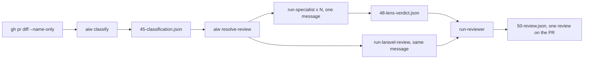
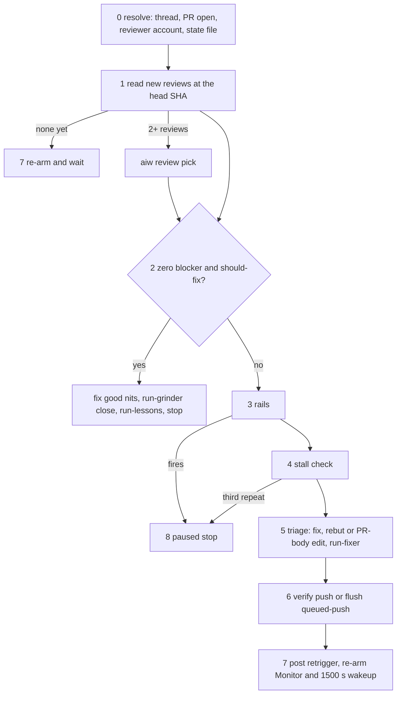

# Review, fix, CI and /pr-grind

Covers: `agents/run-reviewer.md`, `agents/run-specialist.md`, `agents/run-laravel-review.md`, `agents/run-fixer.md`, `agents/run-ci.md`, `agents/run-grinder.md`, `agents/run-lessons.md`, `commands/pr-fix-comments.md`, `skills/pr-grind/`, `skills/pr-review/`, `skills/api-hardening-patterns/`, `skills/data-migration-strategy/`, `skills/deployment-readiness/`, `skills/frontend-performance-review/`, `skills/migration-index-reviewer/`, `skills/resilient-check/`, `skills/upgrade-assistant/`, `run-engine/review.py`, `run-engine/threads.py`, `run-engine/ci.py`

Phases 5.5–10 of [/run-issue](run-issue.md), plus the standalone loops that act on a PR. The envelope, post-checks and bounce budgets live in [engine](../engine.md). Every `aiw` flag is in [cli](../cli.md).

## Review phase (5.5 and 6)

- `gh pr diff <pr> --name-only | aiw classify "$RUN_DIR" --loc <n> --labels "<labels>" [--depth <d>]` scores the diff: ticket type, risk band, signals, blast radius. Scoring rules: [engine](../engine.md). Omit `--depth` when GitNexus is down. A fake `0` scores the change narrow.
- `aiw resolve-review "$RUN_DIR"` prints one lens per line from `engine.resolve_review_panel()`. Empty output means the generalist reviews alone, which is normal.
- The classifier and the panel are not stations. They write side-steps to `run.json` and are never routed.
- `aiw skip-review "$RUN_DIR"` drops reviewer + fixer before review starts (see [run-issue](run-issue.md#roster)).

Default lens policy (`config.json` → `review_policy`, overridable per repo):

| Trigger | Lenses |
|---|---|
| signal `auth` or `dependency` | security |
| signal `migration` | performance |
| signal `api-contract` | api-contract |
| risk band `high` | security, performance |
| `ci-config`, `backend`, `frontend` | none (they still raise the score, except `backend`/`frontend`) |

Output order is `review_policy.order`. Each lens prompt is `review_policy.lenses.<lens>`.

| Agent | Model | Does | Never |
|---|---|---|---|
| `run-specialist` | sonnet | reviews one lens. Verdict `approve` or `critical` (critical needs findings and a `route_hint`: dev / planner / sdet). Written to `48-<lens>-verdict.json` | edits, routes or posts to the PR. A malformed verdict is re-dispatched; after two failures the lens is dropped |
| `run-reviewer` | opus | clean context: gets the PR URL, issue number, verdict paths and the `detect_changes` blast radius, never the plan. Runs `ai-workflow:pr-review`, folds accepted panel findings into one review, re-verifies `definition-of-done.md`. An accepted `critical` → `bounce` to dev, sdet or planner (`bounce(planner)` re-fires Gate 1) | Write/Edit |
| `run-laravel-review` | opus | self-gates on `composer.json` requiring `laravel/framework`, else returns `verdict: SKIPPED (not a Laravel repo)`. Routes the diff to **at most two** skills. Its findings merge into the review body | posts on its own or gates on its own. Only its `## Needs human confirmation` (irreversible data operations) feeds Gate 2a |

`run-laravel-review` is deliberately not policy-selected: its trigger is a repo fact, not a changed path. Its routing table:

| Diff touches | Skill |
|---|---|
| `database/migrations/**`, schema; query paths and scopes | `migration-index-reviewer` (+ `data-migration-strategy` when data moves) |
| `routes/api.php`, API controllers, FormRequests, policies | `api-hardening-patterns` |
| jobs, queues, external HTTP, webhooks, retries | `resilient-check` |
| config, queue/cache/session drivers, new `.env` keys | `deployment-readiness` |
| Blade views, assets, frontend build | `frontend-performance-review` |
| `composer.json` PHP or framework bumps | `upgrade-assistant` |

When three or more skills match, it picks by blast radius: schema/data, then API, then frontend.

### The pr-review skill

`skills/pr-review/SKILL.md` is used by `run-reviewer` and runs standalone on any PR.
1. Preflight: `scripts/preflight.sh <pr-ref>`. An authenticated `gh` is a hard gate.
2. Gather: `scripts/gather_context.sh` writes a bundle with the PR, commits, diff, files, linked issues and existing comments.
3. Six passes: intent vs implementation, commit hygiene, WHY-not-WHAT comments, DRY against the whole repo, SOLID, security. Criteria are in `references/review-checklist.md`.
4. Triage: critical / blocker / should-fix / nit, at most about 15 inline comments.
5. Post: `scripts/post_review.py` posts one review (payload: `references/posting.md`).
- Verdict: APPROVE, REQUEST_CHANGES, or COMMENT on a self-authored PR. A run-issue PR always posts COMMENT.
- `critical` adds an escalation banner that @-mentions default handles (`--reviewers` / `PR_REVIEW_ESCALATION_HANDLES` override them).
- `--no-approve` / `PR_REVIEW_NO_APPROVE=1` turns approvals into COMMENT. The script skips a head SHA it already reviewed unless `--force`.
- The verdict line `**Verdict: …** — N blocker, M should-fix` is what pr-grind parses.

## Fix loop

| Mode | Phase 7 agent | Can create files / edit tests | Leftovers |
|---|---|---|---|
| default | `run-dev` with `fix: true`, following run-fixer's procedure and envelope (station `fixer`) | yes. Test edits need `handoff.test_changes[]` | none. 7b sets `fix_newfile=SKIPPED fix_tests=SKIPPED` |
| full (a roster with `sdet`, see [run-issue](run-issue.md#roster)) | `run-fixer` (sonnet, Edit only) | no | phase 7b: `needs_new_file[]` → `run-dev`, `needs_test_root_fix[]` → `run-sdet` (then move `sdet_sha` forward) |

- `aiw precheck "$RUN_DIR" fixer` runs first. It exits 1 on a closed PR.
- The fixer auto-applies every actionable finding in one pass: commit, reply, resolve, push once.
- It returns `passed` even with `needs_confirmation[]`. That list is Gate 2a's business ([run-issue](run-issue.md#the-three-human-gates)), not the router's.
- The fixer post-check refutes a pass when the push did not happen or a thread was left open without being handed onward.
- `hold_push: true` (pr-grind only) commits, replies and resolves but does not push. The commits come back in `handoff.commits`.

## Review threads

`run-engine/threads.py` holds the only copy of the `reviewThreads` query and the `resolveReviewThread` mutation. `checks.py` imports it.

| Command | Use |
|---|---|
| `aiw threads list <pr> [--open-only] [--for-comment <rest-id>]` | JSON threads. `--for-comment` maps a REST comment id to its thread node id |
| `aiw threads resolve <node-id> …` | warns and continues per thread that fails |

Gate 2 lists `aiw threads list <pr> --open-only`.

## CI

`aiw ci status <pr> [--watch] [--timeout 1200]` prints `{state: green|red|pending, head_sha, failing: [{name, run_id, link, log_excerpt}]}`. `--watch` polls every 30 s until nothing is pending. Pending beats failing. "No checks configured" counts as green. Deciding flake vs defect is not the script's job.

`run-ci` (sonnet) is the only agent allowed GitHub Actions writes (`gh run rerun`). It gets **one attempt per head SHA**.

| Outcome | Meaning | Caller does |
|---|---|---|
| `flake-rerun` | infra failure, `gh run rerun --failed` once | re-poll |
| `fixed` | real failure fixed, committed and pushed (Edit only, never the test root, never weakens a check) | re-poll |
| `rerun-denied` | the rerun was refused | one empty `chore: retrigger CI (…)` commit + push, unless HEAD already carries that marker |
| `cannot-fix` | needs a new file or a test change, or a guess | stop and report |

- `/run-issue` phase 8.5, before Teardown:
  - Green → `ci=green`.
  - Transient failure → `run-ci`. Real defect → one `run-dev` attempt with the log.
  - Still red → `ci='RED — <url>'`, reported at Gate 2.
  - The attempt is recorded with `aiw set … ci-attempt="<sha> — <outcome>"` **before** acting on it.
- Known gap: the run ledger and pr-grind's state file track `ci-attempt` separately. An attempt spent in one is invisible to the other.

## /pr-grind

`/pr-grind <slack-thread-url>` (`skills/pr-grind/SKILL.md`) loops review → fix → re-trigger until the reviewer bot reports zero blocker and zero should-fix findings, or a rail stops it. It runs in the main session: `ScheduleWakeup` and a persistent `Monitor` cannot live in a subagent. `/run-issue --grind` reaches it at phase 10. The Slack config (`<channels>`: `bot_uid`, `owner_uid`, `channels`, `dm_fallback`, `trigger`, `retrigger`, `known_bots`) is described in [setup](setup.md).

- `run-grinder` (sonnet) handles the bookends only.
  - `open` resolves the channel by an exact `owner/repo` key (else `dm_fallback`), posts `trigger` as a new top-level message and returns the thread URL.
  - `close` posts the outcome and @-mentions `owner_uid` for the manual merge.
  - It never loops, edits or merges.
- State: `<pr_grind_dir>/<owner>-<repo>-<pr>.md`. It has header keys (`owner repo number thread reviewer author base`, plus `ci-attempt:`, `queued-push:`, `paused:`, `next-poll:`, `done:`, `poll-since:`, `ci-seen:`) and one `## Round <n>` block per round with each finding's fingerprint (`path:line` + about 80 normalized chars).

### A round

- `aiw review pick --reviews <f> --comments <f>` (`run-engine/review.py`) picks the round's review. Newest wins, except that a review carrying comments beats a same-commit, same-window empty review.
- Fix vs rebut is decided by the skill, not `run-fixer`. A rebuttal needs concrete evidence. If unsure, fix.
- `run-fixer` gets only the files already in the PR diff.
- The skill brings the run's stack back with `aiw stack up <runs_dir>/<owner>-<repo>-issue-<n>` and drops it afterwards. Orchestrator stack exclusivity ends at Teardown.

### The rails

The first rail that fires stops the round and goes to the paused stop:

| Rail | Fires when |
|---|---|
| 1 Round cap | 10 rounds already recorded |
| 2 CI red | `aiw ci status` is red at the head. It escalates to `run-ci` once: **one attempt per head SHA**, recorded as `ci-attempt:` before acting. `fixed`/`flake-rerun` keeps the round going with the push gate closed. While CI is not green (red **or** pending), `run-fixer` runs with `hold_push: true` and its commits are **queued** in `queued-push:`. No retrigger is posted until they are pushed. `run-ci` is never dispatched while `queued-push:` is set |
| 3 Third-party human comment | a comment from someone who is neither the reviewer nor the author. Bots (`[bot]` suffix, `user.type == "Bot"`, `known_bots`) do not count. An unknown named account does |
| 4 Diff scope | structural: `run-fixer` only gets files in the PR diff |
| 5 Owner asked to hold | said in the session, never in Slack |

Also stops: a `run-fixer` or `run-ci` `Needs human confirmation`.

### The stall detector

Each finding's fingerprint is checked against the state file history:

| Seen before | Action |
|---|---|
| never | fix normally |
| once | fix with `run-fixer` on `model: opus`, with the prior attempt and an instruction to diagnose why it did not satisfy the reviewer |
| twice | stop the loop, post that it is stuck, paused stop |

### Paused stop, and nothing listening

- A paused stop writes `paused: <ISO8601> — <reason>`, posts the reason ending with `To resume: … re-run /pr-grind <thread url>`, then stops the wakeup.
- **Slack is output-only.** `ScheduleWakeup` and `Monitor` die with the session, and there is no Slack-to-Claude webhook. A reply in the thread reaches nothing, and the skill never takes an instruction from Slack (`slackcli` posts as `owner_uid`, so an author check cannot separate them).
- Only a human re-invoking `/pr-grind <thread url>` clears `paused:`. An automated re-entry never does.
- The reviewer bot replies to any thread activity. Terminal posts are one message and never contain the retrigger text or the bot mention.

### Headless re-entry (ADR 0002)

`aiw ui` keeps grinds alive without a live session (`docs/adr/0002-pr-grind-headless-reentry.md`).
- `ui_runner.prgrind_tick()` checks each state file that has `next-poll:`.
- It skips a file with `paused`/`done` or a live session, and takes an `fcntl.flock` on `<state>.lock` (a busy lock means skip).
- A merged or closed PR gets a `done:` header.
- It starts `claude -p "/pr-grind <thread>"` with `AIW_HEADLESS=1` when a new review landed, `ci-seen` changed, or `next-poll` (round end + `PRGRIND_HEARTBEAT` = 1500 s) is due.
- A headless round skips Monitor/ScheduleWakeup. It writes `next-poll:` and exits, or writes `done:` on approval.
- Owner decision stops go through `aiw ask`.
- Ticks only run while `aiw ui` runs. Details: [ui](../ui.md).

## /pr-fix-comments

`/pr-fix-comments <PR url | owner/repo#n>` is the interactive fixer. Nothing happens without a confirmation.
1. Fetches inline and top-level comments (`gh api … --paginate`) and groups them into issues.
2. Shows the full list with a proposed action for each.
3. `AskUserQuestion` per issue: Fix as proposed / Skip / Reply only / a different fix.
4. Each fix: minimal edit, tests, one commit, a `Fixed in <sha>` reply, then `aiw threads list --for-comment` + `aiw threads resolve`.
5. One `git push` at the end.

## Lessons

`run-lessons` (opus) runs at `/run-issue` phase 9.2 (clean or degraded finish) and at pr-grind's approved close.
- It appends to the **main checkout's** `tasks/lessons.md`.
- Every lesson cites `file:line` or a review-comment id. A lesson without evidence is dropped.
- The best source is a finding the reviewer raised twice (the stall detector).
- It never rewrites or deletes an entry. A suspect lesson gets a `**Disputed**` line.
- It never commits. The file stays dirty for a human-reviewed commit, which is why the dirty-tree check exempts it.
- `0 added` is a normal result.
- The next run reads the file at preflight and passes relevant entries to the planner and `run-dev`.
