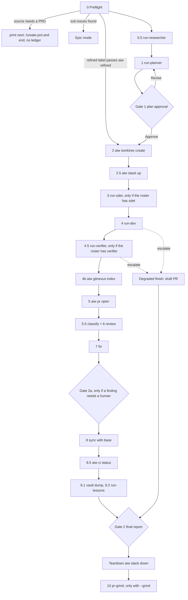

# /run-issue

Covers: `commands/run-issue.md`, `commands/issue-to-pr.md`, `agents/run-researcher.md`, `agents/run-planner.md`, `agents/run-sdet.md`, `agents/run-dev.md`, `agents/run-verifier.md`, `definition-of-ready.md`, `definition-of-done.md`, `run-engine/refined.py`, `run-engine/worktree.py`, `run-engine/maintree.py`, `run-engine/pr.py`, `run-engine/project.py`

`/run-issue <issue | sentry-url | file | vault-note | text> [--full (broken, see Roster)] [--no-worktree] [--grind] [--no-review]` takes one GitHub issue to a reviewed PR. The orchestrator is `commands/run-issue.md`; it acts on what `aiw route` prints and never routes by judgment. Ledger, envelope, post-checks, bounce budgets and exit codes: [engine](../engine.md). Every `aiw` subcommand: [cli](../cli.md). Terms (Run, Ledger, Station, Bounce, Escalated, Refined, Epic): [CONTEXT](../../CONTEXT.md).

A parent issue with sub-issues runs in [Epic mode](epic-mode.md). Review, fix, CI and `--grind`: [review](review.md).

## Flow

## Preflight (phase 0)

1. `aiw paths` first. Its first JSON key must be `plugin_root`; anything else means `aiw` is not this plugin (the old name `route` collided with `/sbin/route`). Every `<key>` placeholder in the command is a key from this JSON.
2. Dirty-tree check (`git status --porcelain`, exempting `tasks/lessons.md` and any `CLAUDE.md`/`AGENTS.md`). Dirty → stop. Skipped with `--no-worktree`.
3. Strip flags. `--lean` and `--no-grind` are deprecated no-ops.
4. Resolve the source:
   - A number or issue URL → that issue. Free text after it is the answer to that issue's pending gate.
   - Anything else → `/intake <arg> --whole`, then `/gh-issue`. If `/gh-issue` returns no issue and its last line is `→ next: /create-prd …` (the input splits into 2+ tasks), the run prints that line and ends. It makes no Ledger, no worktree and no `aiw init`. See [planning](planning.md).
5. `gh issue view <n>`, then the Epic check: `gh api …/issues/<n>/sub_issues`. Non-empty → [Epic mode](epic-mode.md). Empty but labelled both `epic` and `prd-<slug>` → refused (a `/create-prd` epic whose children were never linked).
6. Resume check on `<runs_dir>/<owner>-<repo>-issue-<n>/run.json` (see [Resume](#resume)).
7. `--no-worktree` only: `aiw maintree acquire <owner>/<repo> <n> --wait 540 [--grind]`, repeated until it prints `granted`.
8. Choose the roster and `aiw init` (see [Roster](#roster)).
9. `aiw gitnexus sync <main-checkout>` (best-effort, always exits 0).
10. Read `tasks/lessons.md` and pass only the relevant entries to the planner and every `run-dev` prompt. Entries are claims; the code wins.

If research or the plan shows the change belongs in another repo, the run asks (Transfer / Stay here / Abort), runs `gh issue transfer`, continues under the new number and records `transferred_from=<old owner/repo>#<old n>`.

## Roster

`aiw init` builds the roster from `config.json` `default_mode` → `modes.default.stations`:

| Roster | Stations | How |
|---|---|---|
| default | researcher → planner → dev → reviewer → fixer | every run |
| `--no-review` | drops `reviewer` and `fixer` | `aiw init --no-review` also records `review=skipped` |

- `run-dev` does the sdet and verifier jobs in the default roster. What that gives up is in `config.json` → `modes.default.tradeoff`.
- **Known bug: `--full` is broken at init.** Commit 68a4f04 (#202) removed full/lean modes from `config.json`, `aiw init` and `aiw epic init`. `commands/run-issue.md` still runs `aiw init … --mode full` for `--full` or a `full` label, and argparse rejects that flag (exit 2). `--lean` and a `lean` label change nothing.
- `run-sdet` and `run-verifier` are dispatched only when the ledger's roster contains `sdet`/`verifier`. `run-fixer` replaces `run-dev` fix mode at phase 7 only in full mode. Both need a mode or roster that a repo's `.run-issue.json` defines, or a ledger initialised before #202. See [engine](../engine.md). Where this doc says "full mode" it means such a roster.
- A resumed run keeps its ledger roster. Flags and labels that disagree are ignored.
- `aiw skip-review <run-dir>` (called by the UI) drops reviewer + fixer mid-run. It exits 1 once the reviewer is current.

**Refined fast path.** An issue labelled `refined` on a fresh init goes through `aiw refined <run-dir> --labels … --body-file …` (`run-engine/refined.py`). It needs a non-empty `## Acceptance Criteria`, a numbered `## How`, a resolvable test root and base branch, and no `[placeholder]`. Then:
- Exit 0 → it writes `00-readiness.json` and `10-plan.json` as skip envelopes. The researcher and planner are not dispatched, and Gate 1 does not fire (the issue body is the approved plan).
- Exit 1 → the run prints the reason and runs the researcher and planner as normal.
- The roster is unchanged either way, so a later `bounce(planner)` runs the real planner and Gate 1.

## Stations

| Phase | Station | Agent (model) | Job | Artifact |
|---|---|---|---|---|
| 0.5 | researcher | `run-researcher` (haiku) | triage bug vs feature, related issues and PRs, vault notes, wiki, public docs. Scores `definition-of-ready.md` into `handoff.gaps[]` / `assumptions[]`. Always `passed` | `00-readiness.json` |
| 1 | planner | `run-planner` (opus) | read-only combined test + implementation plan in `handoff.plan_md`, plus `test_root` and `base_branch` | `10-plan.json` |
| 3 | sdet | `run-sdet` (sonnet), sdet rosters only | tests under the test root only, confirmed red, committed | `20-tests.json` |
| 4 | dev | `run-dev` (sonnet) | default mode: RED tests commit (`handoff.tests_sha`), implement, runtime-verify (`handoff.verify`). With an sdet in the roster: implement only | `30-build.json` |
| 4.5 | verifier | `run-verifier` (opus), verifier rosters only | backend over real HTTP, frontend with Playwright against a mocked API. Evidence only under `$RUN_DIR/40-verify/` | `40-verify.json` |
| 6 | reviewer | `run-reviewer` (opus) | see [review](review.md) | `50-review.json` |
| 7 | fixer | `run-dev` with `fix: true` (default) or `run-fixer` (sdet roster) | see [review](review.md#fix-loop) | `60-fix.json` |

- Readiness is advisory. DoR gaps print as **⚠ This issue was thin** above the plan at Gate 1. A researcher crash means the run continues without a brief.
- Default-mode `run-dev` must return `passed`. The engine rejects `bounce`/`escalate` from dev when there is no `sdet` (`engine.py`). Unmet items go in `summary`/`handoff.report` and reach Gate 2.
- Verifier modes come from the `backend`/`frontend` signals of `aiw classify` (`config.json` `classification.signals`), not from the agent's judgment. Neither matches, or the URL is `none` → skip envelope, reported at Gate 2. Rollup verdict: `FAIL` > `PASS` > `UNVERIFIABLE` > `skipped`. `UNVERIFIABLE` never blocks.
- `run-dev` self-certifies against `definition-of-done.md` (plus `<repo>/tasks/definition-of-done.md`). `run-reviewer` re-verifies it.
- H1: the orchestrator never writes a station envelope, except a skip envelope for a station it never dispatched. H2: a hard-gated tool that is unusable → halt and ask. GitNexus is not hard-gated.

## The three human gates

| Gate | When | Options |
|---|---|---|
| Gate 1, plan approval | after the planner. Re-fires on any `bounce(planner)`. Skipped on the refined fast path | Approve and start / Revise (unbounded loop) / Abort |
| Gate 2a, a finding a human must confirm | `60-fix.json` `handoff.needs_confirmation[]` or `run-laravel-review`'s `## Needs human confirmation` is non-empty. Never with `--no-review` | Confirmed, continue / Hold here |
| Gate 2, final report | every path, clean or degraded. The only terminal report | none: it hands back. Merging is manual |

- The rule: **nothing else may stop to ask.** A spent budget, a failed verification, a stack that will not come up or an unpushable branch is recorded and carried to Gate 2. The engine has no `pause` action and no `blocked` status. `config.json` `_human_gates` numbers the same three gates 1-3.
- Gates are not stored in `run.json`. Gates 1 and 2 re-fire on resume.
- On approval the plan is posted as an issue comment, and `test_root`, `base_branch` and `plan_comment` are written with `aiw set`.
- Gate 2 lists: the verdict (Ready / Not ready with `blocked_on`), CI, `tests_unverified`, the review and the lenses that ran, open threads (`aiw threads list <pr> --open-only`), `context.check_failures[]` and `check_notes[]`, whether runtime verification ran, every `test_changes[]` reason (default mode), the sync outcome, lessons added, a failed issue link, and anything that would have been a question. The same report is posted on the issue.
- Headless runs (system prompt contains `Headless run: ask via aiw ask`) ask through `aiw ask` with the same options instead of `AskUserQuestion`, then end the turn. See [ui](../ui.md).
- A few stops come before any work and are not gates: a dirty tree, an H2 halt, a resume of a `done`/`escalated` ledger, a child's missing dependency branch, an issue transfer.

## Test-ownership guard

- Roster with `sdet` (full mode): `run-sdet` owns the test root. After its commit the orchestrator runs `aiw set … sdet_sha=<HEAD>`. On every `dev` `passed` envelope the engine diffs `sdet_sha..HEAD` on the test root, so committing an edit does not hide it.
- Default mode: the baseline is `tests_sha`. A test-root change is legal only with a `handoff.test_changes[]` reason. Every reason goes into the PR body (`## Test changes after RED`) and the Gate 2 report.
- Violation → `aiw route` exits 6 with the bounce already routed. The orchestrator reverts the listed paths from the baseline (`git checkout <sha> -- <paths>`, or `git show` if a hook blocks it), then acts on the printed action.
- After phase 3, only a `bounce(sdet)`, phase 7b and phase 8's test-root conflict resolution may edit the test root. Move `sdet_sha` (default mode: `tests_sha`) forward after each, or the guard trips on legitimate work.
- Mechanics (cap keys, exit codes): [engine](../engine.md).

## Worktree, test stack, checks

- `aiw worktree create "$RUN_DIR" --title "<title>"` adds `../wt-issue-<n>` on branch `issue-<n>-<slug>` from `origin/<base>`, copies gitignored `.env*`/key/credential files, installs dependencies, excludes `.docker-agent.yml` locally, and records `worktree`, `branch`, `main_checkout`, `repo`. Exit 1: the fetch or the add failed, or the directory exists. A failed install is a warning.
- `--no-worktree` → `--main-tree`: branches inside the main checkout, records `tree=main` and `carried=[…]` (the owner's uncommitted files, which no station may stage).
- `aiw stack up "$RUN_DIR"` always exits 0 and records `test_cmd_host` first. With a test compose file it brings the stack up as `runissue-<repo-slug>-<digest>-<n>` with an OS-chosen host port per service, then records `stack`, `test_cmd`, `source_mounted`, `app_url`, `api_url`, `web_url`.

| `stack` | Meaning | Effect |
|---|---|---|
| `up` | running | `test_cmd` is live |
| `none` | no test compose file | `test_cmd == test_cmd_host` unless pinned in `.run-issue.json` |
| `failed` | did not come up, twice | `tests_unverified` leads the Gate 2 report |

- The orchestrator owns the stack exclusively. No agent may run `aiw stack` or `docker compose up|build|down|run|restart`; agents run only the `test_cmd` string they are given. Default-mode `run-dev` may call `aiw stack rebuild` once, and nothing else.
- `aiw stack rebuild` is called after dev/fix/CI commits and is a no-op when `source_mounted: yes`.
- `aiw precheck "$RUN_DIR" <sdet|reviewer|fixer>` before those dispatches. Exit 1: dirty worktree (sdet) or closed PR (reviewer, fixer).
- Post-checks on `passed` envelopes run inside `aiw route`: [engine](../engine.md).
- `aiw gitnexus index <worktree> --run-dir …` (phase 4b) records `gitnexus=wt-issue-<n>` or `none`. With `none`, `--depth` is omitted from `aiw classify`, never passed as 0.

## Opening the PR

`aiw pr open "$RUN_DIR" --body-file <file> [--draft] [--base <b>]` (`run-engine/pr.py`):
- The body must contain `Closes #<n>`.
- It links the branch to the issue **before** pushing (`createLinkedBranch` silently no-ops after a push), pushes, and creates the PR against `base_branch`.
- It verifies `linkedBranches` and `closingIssuesReferences` and retries once. On a second miss it posts a `PR: <url>` issue comment and records `link=FAILED`.
- It records `pr`, `pr_number`, `link`.
- Exit 1 = the push failed, with the hook output on stderr. The orchestrator triages once per category: test-root failures → sdet (default: dev), touched files → dev, untouched files → fix the setup gap, or a Degraded finish with no PR. Never `--no-verify`.

## After review

- Phase 8, sync: `git merge origin/<base>`. Conflicts are split by test root (sdet or dev), with one attempt. A red merge is aborted (`sync='CONFLICTS UNRESOLVED …'`) and never pushed. If `origin/<base>` is gone, sync is skipped and no substitute is guessed.
- Phase 8.5, CI: [review](review.md#ci).
- Phase 9.1: the `ai-workflow:dump` skill appends the run to an existing vault feature folder. Clean finish only, best-effort.
- Phase 9.2: `run-lessons` writes the main checkout's `tasks/lessons.md`: [review](review.md#lessons).
- Project status (`aiw project-status <owner>/<repo> <n> "<status>"`, always exits 0): **In Progress** at phase 2, **In Review** at Gate 2 and at Gate 2a's Hold here.
- Teardown: `aiw stack down "$RUN_DIR"` on every exit path (always exits 0).
- Phase 10, only with `--grind`, after Teardown: `run-grinder open`, then `pr-grind` in this session: [review](review.md#pr-grind). Skipped after a Degraded finish or Hold here.

## When things go wrong

| Situation | What happens |
|---|---|
| `aiw route` prints `escalate: <reason>` | `aiw set blocked_on=…`, then **Degraded finish**: `aiw pr open --draft` with a `## Not ready — <reason>` body, then 9.2, Gate 2 (Not ready) and Teardown. 9.1 and 10 are skipped |
| the branch cannot be pushed (pre-push hook on untouched tests) | Degraded finish with no PR, the one path with no artifact |
| `aiw route` exits 7 | a post-check refuted the claim. The station is re-dispatched; the bounce is already routed |
| any other nonzero `aiw route` exit (not 6 or 7) | Teardown, then report |
| a subagent dies | re-dispatch it (H1). An agent failure is retried at most once, then surfaced |
| `run-verifier` errors twice | skip envelope `skipped — verifier errored twice` |
| CI still red after one dev attempt | `ci='RED — <url>'`, reported at Gate 2 |
| Gate 2a Hold here | Teardown, In Review, end. Phases 7b–9 are skipped |

### Resume

Re-running `/run-issue <n>` reads the existing ledger and branches on `status`:
- `done` → stop, report `context.pr`, and ask whether to start fresh (move the old run dir aside first).
- `escalated` → print the reason (and any `blocker_answer`) and ask whether to resume or start fresh.
- `running` → continue at `stations[currentIndex]` with the ledger's roster and bounce counts. Phase 0.5 is skipped when `00-readiness.json` exists.
- `aiw init` refuses to re-init over a ledger (exit 2).

## /issue-to-pr, the interactive variant

`commands/issue-to-pr.md <issue-url>` has no engine, ledger, stations or worktree. One session runs:
1. Gathers context (`gh`, GitNexus, `CLAUDE.md`/`AGENTS.md`, `tasks/lessons.md`, git history).
2. Interviews the user.
3. Writes a plan and a todo list, and runs `gitnexus_impact` before each edit.
4. Implements and verifies.
5. **Stops for a manual E2E checkpoint**, and repeats until the user replies "continue".
6. Asks before commit/push/PR.
7. Asks for the base branch: `master`, `staging` or the current branch, if they exist on the remote.
8. Opens the PR with `Closes #<n>` via `--body-file`.
9. Does not finish until `closingIssuesReferences` is non-empty.
