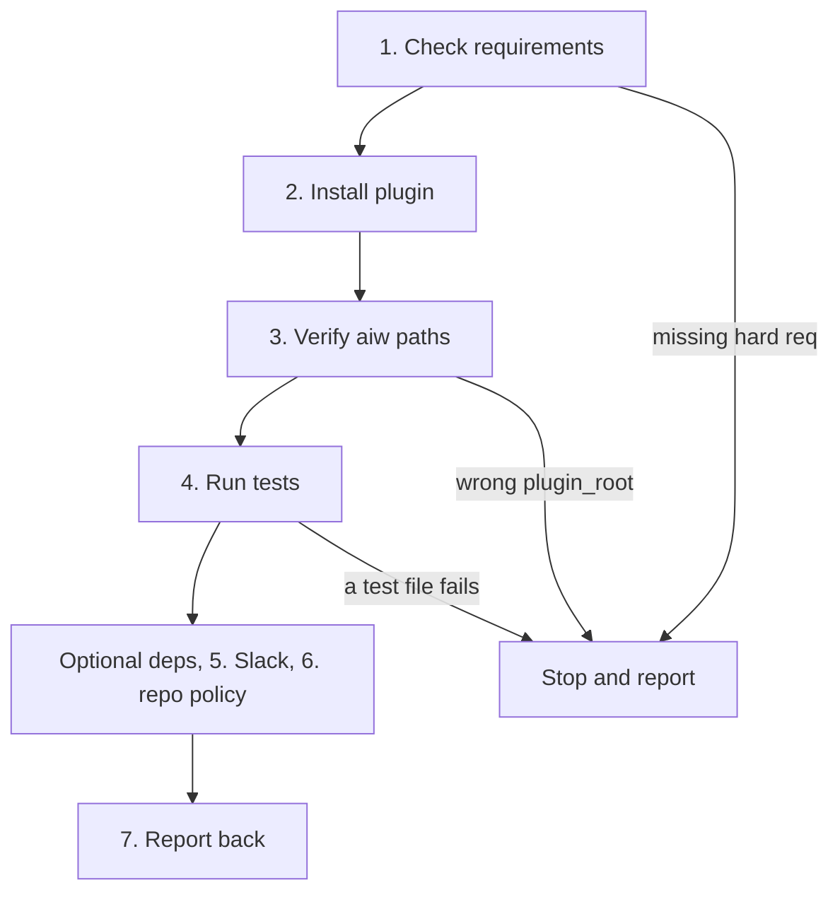

# Setup

Covers: `.claude-plugin/`, `bin/aiw`, `run-engine/shared.py`, `run-engine/stack.py`, `run-engine/gitnexus.py`, `run-engine/project.py`, `run-engine/ui_tailscale.py`, `agents/run-grinder.md`

A protocol for an AI agent installing this plugin. Follow it top to bottom.



## Ground rules

- Ask before installing anything. Show what is missing and the command you propose.
- Never run an auth flow for the user (`gh auth login`, Slack, Jira). Print the command; they run it. Never ask for a token.
- Never edit config you were not asked to edit (shell rc files, global `settings.json`, other plugins).
- Verify each step from an exit code, a parsed JSON key or a file that exists. "No error printed" is not proof.
- Missing optional dependencies are fine. Report what will be degraded and continue.
- Do not run `/run-issue` as a smoke test: it opens PRs and comments on issues.

## 1. Requirements

```bash
python3 --version     # 3.10+
git --version
gh --version && gh auth status
```

| Requirement | Why | If missing |
|---|---|---|
| Python 3.10+ | `aiw` and the engine; stdlib only, nothing to `pip install` | stop |
| `git` | worktrees, branches, commits | stop |
| `gh`, authenticated | every phase reads or writes GitHub | stop; user runs `gh auth login` |
| `gh` token scope `project` | GitHub Projects status (`aiw project-status`) | warns and skips; add later with `gh auth refresh -s project` |

## 2. Install

```bash
git clone <repo-url> <path>                       # if not on disk; ask the user where
claude plugin marketplace add <path>
claude plugin install ai-workflow@ai-workflow
claude plugin list | grep -A4 ai-workflow         # expect "Status: ✔ enabled"
```

- A local-path marketplace is read from the checkout itself (`claude plugin list` shows `Read from: <path>`), so edits in the checkout are live.
- A manifest validation error means `.claude-plugin/plugin.json` is malformed: a repo bug. Stop and report.
- For one session only, `claude --plugin-dir <path>` loads the checkout without installing.

## 3. Verify `aiw` resolves to this plugin

```bash
aiw paths
```

- Parse the JSON. Check that `plugin_root` equals `<path>`. A zero exit code alone proves nothing: `route`, the old name of this CLI, is also the system network command and exits 0 on bad input.
- `aiw: command not found` means the plugin `bin/` is not on `PATH` yet. Plugin bins are resolved at session start: restart Claude Code and retry.
- `aiw paths` also creates `runs_dir` and `pr_grind_dir`. The data dir is `$CLAUDE_PLUGIN_DATA`, else `~/.claude/plugins/data/ai-workflow`. Every key is listed in [cli](../cli.md#aiw-paths).

## 4. Run the tests

```bash
bash <path>/run-engine/run_tests.sh
```

- Must end with `all test files passed` and exit 0 (about 2 minutes, no network, no Docker).
- A failure means the checkout is broken, not the machine. Stop and report the `FAIL` output.
- Without `node`, `test_ui_static.py` skips its JS checks and still passes. Details: [development](../development.md#tests).

## Optional dependencies

Check each and report the result as a table. None blocks the install.

| Check | Enables | Without it |
|---|---|---|
| `docker info` | the per-issue Docker test stack when the target repo has a test compose file (`aiw stack up`) | repo without a compose file: `stack=none`, tests run on the host runner (normal). Repo with one: `stack=failed`, the reason goes in `tests_unverified` and is reported at Gate 2 |
| `node --version`, `npx gitnexus --help` | the GitNexus code index (`aiw gitnexus`) | best-effort: never exits nonzero; agents use grep and glob |
| gitnexus MCP server | `mcp__gitnexus__*` tools in most agents | agents fall back to Read, Grep, Glob |
| `command -v herdr` | `herdr-dispatch` tabs, `--herdr` on `--review` commands | dispatch from the UI's `#/dispatch` page or run `/run-issue` per issue |
| Slack MCP or `command -v slackcli` | `--grind` review loop, `/pr-grind`, `/release-pr` trigger (MCP first, `slackcli` fallback) | no grind loop; the PR still lands at Gate 2. `/release-pr` stops after opening the PR |
| `command -v obsidian` (Obsidian running) | `/dump`, `/worklog`, vault reads in `run-researcher`, vault copies in `/create-prd` | `run-researcher` notes it and moves on; `/create-prd` can write `--to local`; `/dump` and `/worklog` cannot work |
| `command -v acli` | `/jira-to-gh` | that command cannot fetch tickets |
| Sentry plugin MCP | Sentry links in `/intake` (and so `/gh-issue`, `/run-issue`) | a Sentry link cannot be read |
| `command -v tailscale` | `aiw ui` on the tailnet ([ui](../ui.md#reaching-it-over-a-tailnet)) | UI stays on loopback |
| an ntfy server and topic in `ui.json` | push notifications from `aiw ui` ([ui](../ui.md#notifications)) | no push notifications |

Report findings, not a shopping list: "No Docker, so a repo with a test compose file will finish with unverified tests" beats "install Docker".

## 5. Slack review loop (optional)

Only if the user wants `--grind` or `/release-pr`. Ask before writing; show the file.

1. `aiw paths` → read the `channels` key (`<data_dir>/channels.json`).
2. Write it with this shape:

```json
{
  "bot_uid": "U...",
  "owner_uid": "U...",
  "channels": { "<owner>/<repo>": "C..." },
  "dm_fallback": "D...",
  "known_bots": [],
  "trigger": "<@{bot_uid}> review {pr_url}",
  "retrigger": "<@{bot_uid}> recheck"
}
```

| Key | Meaning |
|---|---|
| `bot_uid` | the reviewer bot's Slack user id; the only account an `open` message mentions |
| `owner_uid` | the human @-mentioned when the PR is ready. Ask the user for theirs; never derive it from an email or a name in a config file |
| `channels` | exact `owner/repo` → channel id; no prefix or fuzzy match |
| `dm_fallback` | bot DM used when the repo has no `channels` entry |
| `known_bots` | extra logins `/pr-grind` treats as bots, not humans |
| `trigger`, `retrigger` | message templates; `{bot_uid}` and `{pr_url}` are the only placeholders |

- `run-grinder` and `/pr-grind` stop if the file is missing or unparseable.
- `/release-pr` needs a `channels` entry for the repo; without one it stops after opening the PR (no `dm_fallback`).
- The `userConfig` keys `slack_owner_uid` and `slack_review_channel` (`claude plugin configure ai-workflow`) are declared but read by nothing; `channels.json` is what counts. See [plugin](../plugin.md#userconfig).
- These are workspace ids, not secrets.

## 6. Per-repo policy (optional)

- A repo may put `.run-issue.json` at its root. It is deep-merged over `run-engine/config.json` (`shared.load_config`).
- A top-level `test_cmd` string pins the test command; a non-string or blank value is ignored with a warning.
- Do not create one during setup. Keys and defaults: [engine](../engine.md#config).

## 7. Report back

Tell the user, in this order:

1. Ready or not; if not, exactly what is missing.
2. What is degraded and what it costs on their repos.
3. The first command to try: `/ai-workflow:run-issue <issue-number-or-url> [--no-review]`. Do not suggest `--full`: it fails at `aiw init` ([plugin](../plugin.md#slash-commands)).
4. Read [run-issue](run-issue.md) before the first run; the three gates are the part to understand up front.
