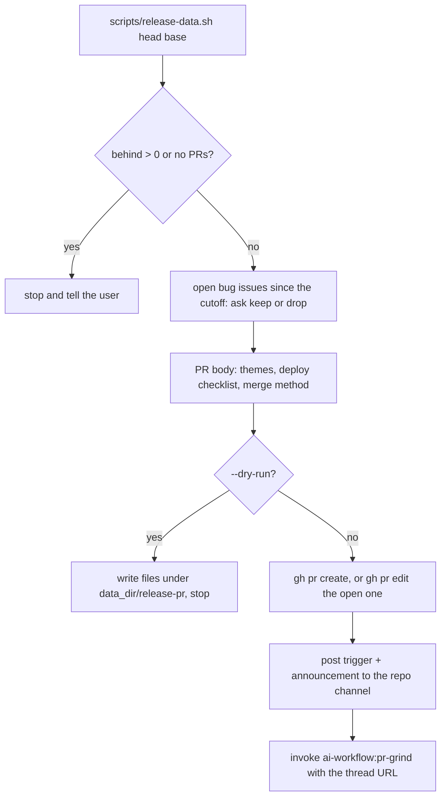
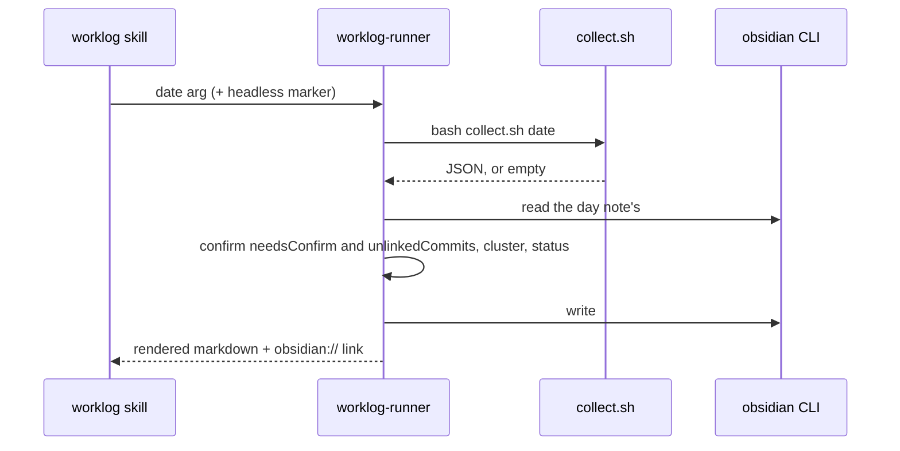

# Utilities

Covers: `skills/release-pr/`, `skills/worklog/`, `agents/worklog-runner.md`, `agents/ship.md`

Standalone tools outside the issue-to-PR chain. Every other skill in `skills/` is documented elsewhere:

| Skill | Doc |
|---|---|
| `dump`, `create-prd`, `create-tasks`, `refine-issues`, `fix-blockers`, `flow` | [planning.md](planning.md) |
| `peer-review` | [peer-review.md](peer-review.md) |
| `herdr-dispatch` | [dispatch.md](dispatch.md) |
| `pr-review`, `pr-grind`, the seven Laravel review skills | [review.md](review.md) |

## /release-pr

`skills/release-pr/SKILL.md`. Args: `[--dry-run] [head=staging] [base=master]`. Opens or refreshes the `<head>` → `<base>` release PR, posts the reviewer-bot trigger in Slack, then hands off to `/pr-grind`. It never merges or edits code.

**`scripts/release-data.sh [head] [base]`** (read-only, about a minute). Markdown on stdout:

| Section | Content |
|---|---|
| Branches | ahead/behind counts, content diff, head SHA, open release PR, previous release (the cutoff) |
| PRs in this release | PRs merged since the cutoff that touch a file still differing from `<base>`; a batch branch PR is tagged `[UMBRELLA: ...]` |
| Excluded since the cutoff | hotfixes merged straight to `<base>`, PRs whose content `<base>` already has, `<base>` → `<head>` syncs |
| New env vars, `.env.example` additions, Migrations added, Scheduler changes, Queue config changes | inputs for the deploy checklist |

- `RELEASE_PRS="<n> <n>"` skips PR discovery; needed for a cherry-picked branch, whose commits git ancestry cannot trace.
- The script exists because squash-merged releases leave `<head>` showing commits `<base>` already has; trust its lists over the commit log.

**Partial release** ("release everything except X"): group PRs into themes, check kept PRs do not call code from held-back ones, close any open release PR (and mark its pr-grind state `done: ... — superseded`), cherry-pick kept merge commits with `-x` (`-m 1` for merge commits) onto `release/<YYYY-MM-DD>` from `origin/<base>` in a separate worktree, grep the diff for held-back names, `php -l` changed PHP files, push, then rerun the script with `RELEASE_PRS`. The body gains a **Held back** section.

**PR body rules:**
- Title `Release: <head> → <base> — <theme>, <theme>, ...` (up to four themes).
- Lines `#<pr>: <plain-language outcome>`, grouped by theme, singles under **Other**.
- Deploy checklist items only for changes in this release (migrate, `php artisan config:cache`, `php artisan horizon:terminate`, scheduled commands, smoke tests).
- Merge method: merge commit, never squash.
- Never secret values; say where to get them.
- Always `--body-file`.

**Slack:** reads `<channels>` (`aiw paths`), entry `channels["<owner>/<repo>"]`, fills the `trigger` template's `{bot_uid}` and `{pr_url}`, adds a short release summary, and posts a new message (the bot ignores edits) via the Slack MCP, falling back to the `slack-cli` skill. No channel mapping → stop after the PR. The channel config and the grind are in [review.md](review.md).

**Dry run** writes `pr-body.md`, `pr-title.txt`, `slack-message.md` and `release-data.md` to `<data_dir>/release-pr/<owner>-<repo>-<YYYY-MM-DD>/` and creates or posts nothing.

**Evals:** `skills/release-pr/evals/evals.json` holds two dry-run prompts with expected outputs (skill-creator eval format); nothing in `run-engine/` runs them.

- Gotcha: the checklist, `php -l` and `vendor/` symlink steps assume a Laravel repo.
- Gotcha: the skill says it never pushes, yet the partial-release flow pushes `release/<YYYY-MM-DD>`.

## /worklog

`skills/worklog/SKILL.md` only dispatches the `worklog-runner` agent (opus, medium effort, tools `Bash`, `AskUserQuestion`) with the raw date argument (`today`, `yesterday` or `YYYY-MM-DD`; default today), then relays its report.

**`collect.sh [today|yesterday|YYYY-MM-DD]`** needs `gh` (authenticated) and `jq`; the author is `gh api user`. Output: `{date, window, issues, orphanPrs, unlinkedCommits, needsConfirm}` or `{date, empty: true}`.
- PRs are the entry point, because `gh search commits` only sees the default branch. A PR counts only with a non-merge commit authored in the day window.
- `orphanPrs`: kept PRs with no issue reference. `unlinkedCommits`: direct pushes with no issue reference. `needsConfirm`: issues authored that day that no PR or commit references.
- Gotcha: `TZ_OFFSET="+06:00"` is hardcoded; the day window is UTC+6.

**`projects.json`** maps `owner/repo` → [Project](../../CONTEXT.md) name; unmapped repos fall back to the bare repo name. `run-engine/ui_board.py` reads the same file for Board names.

**Runner rules:**
- Groups by Project, clusters issues of the same work into one task, one plain-language line each.
- Status per task: `merged`, `in review`, `open`, or `done` for a `## Log` item.
- Writes only through `obsidian vault=notes`: replaces an existing `## Worklog` section or appends; a missing note is created with `daily:append` for today or `create` for a past day.
- Sources are GitHub and the note's `## Log` only; `## Log` is never rewritten.
- Headless: one `aiw ask` round for both confirmations, then the runner returns `RECORDED q-...` plus the date; the skill ends its turn and re-dispatches the runner with the answer.

The UI can start worklog sessions too (batched by date range); see [ui.md](../ui.md). `run-engine/test_ask.py` checks the headless worklog rounds; `collect.sh`, `release-data.sh` and `ship` have no tests.

## ship agent

`agents/ship.md` (sonnet, medium effort): a non-interactive "ship it" workflow for the current feature branch. No command, skill or agent in this repo dispatches it; it runs only when Claude picks it from its description ("ship", "create a PR", "merge and push").

Steps: detect platform (GitHub, GitLab or git-only) and base branch, abort on the base branch, merge the base in, run tests (new failures abort), review and auto-fix the diff, check plan files and `TODOS.md`, coverage, bump `VERSION`, prepend `CHANGELOG.md`, `git add -A` and commit, push, then `gh pr create --fill` or update the existing PR (`glab` on GitLab).

- Stops only for the cases in its "Only stop for" list (conflicts, new test failures, MINOR/MAJOR bump, review items needing judgment).
- Gotcha: its preamble cites "Step 7", "Step 8.1", "Step 12", "Step 14", "Step 17" and "Step 19", which do not match its own numbered steps (0-14). Read the steps, not the cross-references.
- Gotcha: it uses `gh pr edit --body` and `git add -A`, unlike the plugin's `--body-file` convention.
