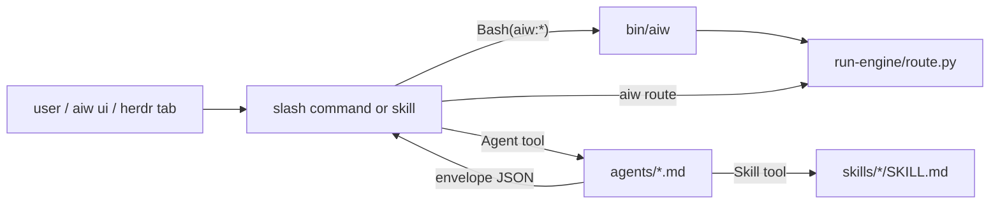

# Plugin surface

Covers: `.claude-plugin/`, `commands/`, `agents/`, `skills/`, `bin/aiw`, `definition-of-ready.md`, `definition-of-done.md`, `self-improve.md`, `tasks/lessons.md`

What Claude Code loads from this repo, and the conventions every command, agent and skill follows. Terms (Run, Ledger, Station, Epic...) are defined in [CONTEXT.md](../CONTEXT.md).

## Manifests (`.claude-plugin/`)

| File | Holds |
|---|---|
| `marketplace.json` | marketplace `ai-workflow` with one plugin, `source: "./"`, `version` |
| `plugin.json` | plugin `name`, `version`, `description`, `keywords`, `userConfig` |

- The version lives in both files (currently `1.12.0`). Bump both together.
- `plugin.json`'s description says "14 agents"; `agents/` holds 15.
- No test reads either manifest. A malformed manifest makes the plugin uninstallable.

### `userConfig`

| Key | Declared purpose | Read by |
|---|---|---|
| `slack_owner_uid` | Slack user id @-mentioned on the terminal message | nothing in the repo |
| `slack_review_channel` | review channel for a repo with no `channels.json` entry | nothing in the repo |

- The Slack loop reads `owner_uid`, the channel map and `dm_fallback` from `channels.json` instead (`aiw paths` → `channels`). See [setup](features/setup.md#5-slack-review-loop-optional).

## Slash commands

Typed as `/ai-workflow:<name>`. Commands live in `commands/<name>.md`; skills in `skills/<name>/SKILL.md`. No skill sets `user-invocable` or `disable-model-invocation`, so every skill is both user- and model-invocable. "Internal" below means its main caller is another command or agent.

| Command | What it does | Source, caller | Doc |
|---|---|---|---|
| `/ai-workflow:run-issue <issue-number-or-url \| sentry-url \| file-path \| vault-note \| text> [--full] [--no-worktree] [--grind] [--no-review]` | the full pipeline: issue → reviewed PR, stopping only at the three gates. Accepts an epic parent. Non-issue input goes through `/intake` and `/gh-issue` first. `--no-review` drops the reviewer and fixer stations; `--grind` runs the Slack review loop after Gate 2 (off by default); `--no-worktree` runs in the main checkout. `--lean` and `--no-grind` are deprecated and change nothing. **`--full` currently fails at `aiw init`** (known bug, see the note below) | command | [run-issue](features/run-issue.md) |
| `/ai-workflow:issue-to-pr <issue-url>` | the interactive variant: context → interview → plan → todo → execute → commit → push → PR | command | [run-issue](features/run-issue.md) |
| `/ai-workflow:intake <sentry-url \| file-path \| vault-note \| free text> [--review [<lens,lens>] [--herdr]]` | normalize a Sentry link, BRD file, vault note or text into an issue-ready brief; files nothing. `--whole` is passed only by `/gh-issue` and `/run-issue` | command; internal to `/gh-issue`, `/run-issue` | [planning](features/planning.md) |
| `/ai-workflow:gh-issue [--review [<lens,lens>] [--herdr]]` | file exactly one well-formed issue. It decomposes first; when the input splits into 2 or more tasks it creates nothing and ends `→ next: /create-prd <input>`. A standalone run ends `→ next: herdr-dispatch <n>` | command; also takes `[bug \| feature \| task \| improvement] 
` | [planning](features/planning.md) |
| `/ai-workflow:jira-to-gh <KEY>` | turn a Jira ticket into exactly one issue the same way as `/gh-issue`; 2 or more tasks create nothing and end `→ next: /create-prd <jira-key-or-url>` | command; needs `acli` | [planning](features/planning.md) |
| `/ai-workflow:pr-fix-comments <PR url or owner/repo#123>` | work through a PR's review comments, confirming each fix or reply | command | [review](features/review.md) |
| `/ai-workflow:create-prd <requirement \| feature-folder> [--to local,obsidian,wiki] [--review [<lens,lens>] [--herdr]]` | interview the user into a PRD saved to `docs/prds/<slug>.md` (mirrored to the vault). `--update <prd-path> <decisions>` records later decisions; `approve <prd-path \| slug>` sets Approved and files one epic per `## Epics` entry. Ends `→ next: /create-tasks <prd-path>` | skill | [planning](features/planning.md) |
| `/ai-workflow:create-tasks <prd>` | split an Approved PRD into `docs/tasks/<slug>.md`; files no issues. Ends `→ next: /refine-issues docs/tasks/<slug>.md` | skill | [planning](features/planning.md) |
| `/ai-workflow:refine-issues docs/tasks/<slug>.md` | file each task as a `refined` sub-issue of its epic with blocked-by links, after one confirmation. Ends `→ next: herdr-dispatch <epic>` | skill | [planning](features/planning.md) |
| `/ai-workflow:fix-blockers <parent>` | set GitHub's native blocked-by links between an epic's children from their `Depends on:` lines | skill | [planning](features/planning.md) |
| `/ai-workflow:dump <text> [--review [<lens,lens>] [--herdr]]` | file free-form input into the Obsidian vault's Project → Feature notes, after one confirmation | skill; also called by `/gh-issue`, `/flow` | [planning](features/planning.md) |
| `/ai-workflow:flow <raw text \| feature folder \| Dump.md path \| PRD path \| task list \| epic parent \| issue numbers>` | guided flow: dump → create-prd → create-tasks → refine-issues → herdr-dispatch, asking at every boundary. Passes `--no-worktree`, `--no-review`, `--grind` on to dispatch | skill | [planning](features/planning.md) |
| `/ai-workflow:herdr-dispatch <search-url \| label \| issue numbers \| epic parent> [--sequential] [--max N] [--cmd "<template>"] [--dry-run] [--no-worktree] [--no-review] [--grind]` | run `/ai-workflow:run-issue <n>` per issue in herdr tabs, in dependency order, with a concurrency cap (default 2) | skill; needs `herdr` | [dispatch](features/dispatch.md) |
| `/ai-workflow:peer-review [--lenses <lens,lens>] [--since <sha\|@{u}>] [--herdr]` | reviewer panel on the session's change until every picked lens approves. Commands call it as `--kind <kind> --dir <review_dir>` | skill; internal to `--review` on `/create-prd`, `/intake`, `/dump`, `/gh-issue` | [peer review](features/peer-review.md) |
| `/ai-workflow:pr-review <pr-ref>` | evidence-based PR review posted as inline comments | skill; run by `run-reviewer`, and auto-triggers after a PR is opened | [review](features/review.md) |
| `/ai-workflow:pr-grind <slack thread url>` | loop review → fix → re-trigger on a PR via the Slack reviewer bot until approved or a rail stops it | skill; internal to `/run-issue --grind`, `/release-pr` | [review](features/review.md) |
| `/ai-workflow:release-pr [--dry-run] [head=staging] [base=master]` | open or refresh the staging → master release PR, post the Slack trigger, hand off to `/pr-grind` | skill | [utilities](features/utilities.md) |
| `/ai-workflow:worklog [date]` | build the day's worklog from GitHub activity into the Obsidian daily note | skill; dispatches `worklog-runner` | [utilities](features/utilities.md) |
| `/ai-workflow:api-hardening-patterns` | Laravel API validation, authorization and abuse review | skill; internal to `run-laravel-review` | [review](features/review.md) |
| `/ai-workflow:data-migration-strategy` | Laravel phased data-migration plan | skill; internal to `run-laravel-review` | [review](features/review.md) |
| `/ai-workflow:deployment-readiness` | Laravel deployment-blocker review | skill; internal to `run-laravel-review` | [review](features/review.md) |
| `/ai-workflow:frontend-performance-review` | Laravel frontend performance review | skill; internal to `run-laravel-review` | [review](features/review.md) |
| `/ai-workflow:migration-index-reviewer` | Laravel migration and index review | skill; internal to `run-laravel-review` | [review](features/review.md) |
| `/ai-workflow:resilient-check` | Laravel retries, timeouts and idempotency review | skill; internal to `run-laravel-review` | [review](features/review.md) |
| `/ai-workflow:upgrade-assistant` | Laravel/PHP upgrade plan | skill; internal to `run-laravel-review` | [review](features/review.md) |

**`--full` bug.** Commit `68a4f04` (#202) removed the full and lean modes: `run-engine/config.json` ships only `modes.default` and `aiw init` has no `--mode` flag. `commands/run-issue.md` still passes `--mode full` when `--full` is given, so argparse rejects it at init. See [engine](engine.md#gotchas) and [run-issue](features/run-issue.md).

## Agents

Each file in `agents/` is dispatched by name (`ai-workflow:<name>`) through the Agent tool, with fresh context.

| Agent | Model / effort | Tools | Dispatched by |
|---|---|---|---|
| `run-researcher` | haiku / low | `Bash(aiw:*)`, Read, Grep, Glob, `Bash(gh:*)`, `Bash(git:*)`, `Bash(obsidian:*)`, WebSearch, WebFetch, context7 MCP | `/run-issue` researcher station; `/gh-issue` step 2.5 |
| `run-planner` | opus / high | Read, Grep, Glob, Bash, gitnexus MCP (query, context, impact, trace, route_map) | `/run-issue` planner station |
| `run-dev` | sonnet / high | Read, Write, Edit, Grep, Glob, Bash, gitnexus MCP (context, impact, trace) | `/run-issue` dev station, and in fix mode for review findings |
| `run-sdet` | sonnet / low | Read, Write, Edit, Grep, Glob, Bash, gitnexus MCP (context, query) | `/run-issue`, only when a repo's `.run-issue.json` defines a custom roster with `sdet` ([engine](engine.md#config)) |
| `run-verifier` | opus / high | Read, Grep, Glob, Bash, gitnexus MCP (context, impact) | `/run-issue`, only when a repo's `.run-issue.json` defines a custom roster with `verifier` ([engine](engine.md#config)) |
| `run-reviewer` | opus / high | Read, Grep, Glob, Bash, Skill, gitnexus MCP (context, impact, trace, detect_changes) | `/run-issue` reviewer station; runs the `pr-review` skill |
| `run-specialist` | sonnet / (none) | `Bash(aiw:*)`, Read, Grep, Glob, `Bash(gh:*)`, `Bash(git:*)`, gitnexus MCP (context, impact, explain) | `/run-issue` review phase, one per lens from `aiw resolve-review`; `/peer-review`, one per lens |
| `run-laravel-review` | opus / high | Read, Grep, Glob, `Bash(gh:*)`, Skill, gitnexus MCP (context, impact) | `/run-issue` review phase, beside the specialists; invokes at most two Laravel skills |
| `run-fixer` | sonnet / low | Read, Edit, Grep, Glob, `Bash(aiw:*)`, `Bash(gh:*)`, `Bash(git:*)`, gitnexus MCP (context, impact) | `/pr-grind`; `/run-issue` fixer phase only in full mode, now reachable only through a custom roster (default mode uses `run-dev` in fix mode) |
| `run-ci` | sonnet / medium | `Bash(aiw:*)`, Read, Edit, Grep, Glob, `Bash(gh:*)`, `Bash(git:*)`, gitnexus MCP (context, impact) | `/run-issue` CI phase; `/pr-grind` |
| `run-grinder` | sonnet / low | `Bash(aiw:*)`, Read, Grep, `Bash(gh:*)`, `Bash(slackcli:*)` | `/run-issue` phase 10 (`--grind`) in `open` mode; `/pr-grind` in `close` mode; the UI grind prompt (`run-engine/ui_grind.py`) |
| `run-lessons` | opus / medium | Read, Write, Edit, Grep, Glob, `Bash(gh:*)`, `Bash(git:*)`, gitnexus MCP (context) | end of `/run-issue` and of `/pr-grind` |
| `gh-issue-factchecker` | sonnet / medium | Read, Grep, Glob, `Bash(gh:*)` | `/gh-issue` step 4.5, after the issue is created |
| `worklog-runner` | opus / medium | Bash, AskUserQuestion | `/worklog` skill |
| `ship` | sonnet / medium | Read, Write, Edit, Grep, Glob, `Bash(gh:*)`, `Bash(git:*)`, `Bash(npm:*)`, `Bash(make:*)`, gitnexus MCP (context, impact, trace, detect_changes) | nothing in the repo; picked by its description ("ship", "create a PR") — see [utilities](features/utilities.md) |

- Station agents are described in [run-issue](features/run-issue.md); review-side agents in [review](features/review.md).
- An agent that may edit but not create files has Edit without Write (`run-fixer`, `run-ci`).

## Conventions

### Frontmatter

| Kind | Fields used |
|---|---|
| command | `description`, `argument-hint`; `allowed-tools` only in `run-issue.md` and `pr-fix-comments.md` |
| agent | `name`, `description`, `tools`, `model`, `effort` (`run-specialist` has no `effort`) |
| skill | `name`, `description`; `allowed-tools` (YAML list or comma string), `argument-hint` (`pr-grind`, `release-pr`); the Laravel skills add `license`, `tags`, `version`, `compatible_agents` |

### Calling `aiw`

- Markdown calls `aiw`, never an absolute path; how it resolves is in [cli](cli.md#how-it-resolves).
- Files that need paths open with a `> **Paths.**` note: `<...>` placeholders are keys printed by `aiw paths` ([cli](cli.md#aiw-paths)). Substitute the printed value; never guess.
- Commands never compute a decision `aiw` can compute: routing (`aiw route`), roster (`aiw init`), review panel (`aiw classify`, `aiw resolve-review`), readiness (`aiw refined`), epic order (`aiw epic next`). The orchestrator runs what `aiw` prints.
- A command or agent that calls `aiw` must allow `Bash(aiw:*)` (or plain `Bash`) in its tools.

### Station envelopes

- The seven `/run-issue` stations (`run-researcher`, `run-planner`, `run-sdet`, `run-dev`, `run-verifier`, `run-reviewer`, `run-fixer`) end with one JSON envelope. The orchestrator writes it into the run dir and feeds it to `aiw route`.
- Schema, evidence rules and post-checks: [engine](engine.md#the-envelope). Never trust a station's claim; post-checks verify it.
- Non-station agents (`run-specialist`, `run-ci`, `run-grinder`, `run-lessons`, `run-laravel-review`, ...) return a report in the shape their own file defines.

### `→ next:` hand-off lines

- A planning stage ends its output with one line `→ next: <command> <argument>`. It is printed as text only; the stage never invokes the next command.
- `/flow` and the UI's `#/flow` stepper parse that line to start the next stage. A stage with no line ends the flow.
- Emitters: `/dump`, `/gh-issue`, `/jira-to-gh`, `/create-prd`, `/create-tasks`, `/refine-issues`, `/fix-blockers`. Details in [planning](features/planning.md).

### Asking the user

- A headless run (started by `aiw ui`) has `Headless run: ask via aiw ask` in its system prompt. It asks through `aiw ask` with a quoted heredoc, then ends its turn; otherwise it calls AskUserQuestion with the same question.
- Files with this branch: `run-issue.md`, `gh-issue.md`, `intake.md`, `create-prd`, `create-tasks`, `refine-issues`, `dump`, `fix-blockers`, `peer-review`, `worklog`, `worklog-runner.md`. Headless details: [ui](ui.md).

### Skill layout

| Path | Holds | Used by |
|---|---|---|
| `skills/<name>/SKILL.md` | the skill | all |
| `scripts/` | shell/Python helpers, run as `<plugin_root>/skills/<name>/scripts/...` | `herdr-dispatch`, `pr-grind`, `pr-review`, `release-pr` |
| `templates/` | document templates | `create-prd`, `create-tasks`, `refine-issues` |
| `references/` | long reference read on demand | `pr-review` |
| `evals/` | eval cases | `release-pr` |
| `collect.sh`, `projects.json` | data collection and the Project name map | `worklog` |

- Every skill except `release-pr` ends with `## Self-improve`, pointing at `../../self-improve.md`. No command or agent does.
- `create-prd`, `create-tasks` and `refine-issues` end with an "If anything is left" step that offers to file a `skill(<name>): ...` issue on the plugin repo.

## Root process files

| File | Role | Read by |
|---|---|---|
| `definition-of-ready.md` | six-item readiness rubric for an issue | `aiw paths` → `dor`; `run-researcher`, `/gh-issue`, `/run-issue`; mirrored in `run-engine/dispatch.py` |
| `definition-of-done.md` | quality bar for a change | `aiw paths` → `dod`; `run-dev`, `run-reviewer`, `/run-issue` |
| `self-improve.md` | how a skill proposes edits to itself after a run (ask when attended, log when not) | every skill's `## Self-improve` |
| `tasks/lessons.md` | this repo's own lessons. `run-lessons` appends to the **target** repo's `tasks/lessons.md` | `/issue-to-pr`, `/run-issue`, `run-lessons`, planning skills |
| `CONTEXT.md` | glossary; use its terms | humans and agents |
