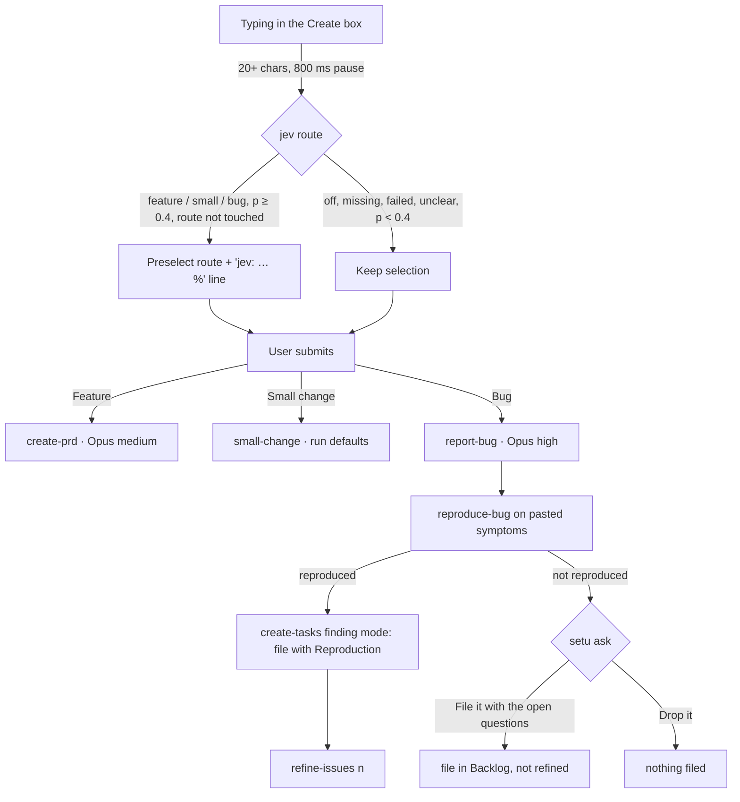

# PRD — Bug route in the Create box, with jev picking the route

**Status:** Approved · **Date:** 2026-11-13 · **Slug:** `bug-route` · **Owner:** Masnun Siam · **Priority:** medium · **Repo:** masnun-siam/ai-workflow

## Overview

The Create box ("What should change?") gets a third route, **Bug**, next to **Feature** and **Small change**. A bug report starts one headless session that reproduces the bug from the pasted evidence with blubird's `reproduce-bug`, then files it as an issue and refines it. While you type, jev reads the text and preselects Feature, Small change or Bug; you can always override it.

Today:
- The Create box has two routes: **Feature** starts the `create-prd` interview (Opus, medium effort); **Small change** starts the `small-change` step (blubird `create-tasks` in finding mode) with the text and a priority. A duplicate check against the repo's open issues runs as you type.
- `reproduce-bug` is a registered step. It runs only from the River: a Backlog issue labelled `bug` gets a **Reproduce** action next to **Refine**. Given pasted symptoms with no issue, the skill has no issue to write its Reproduction section into.
- jev is used for Away mode risk, Inbox urgency, dispatch readiness, duplicates and grind hints (per [jev-judgments.md](jev-judgments.md)). setu dropped the old aiw capture box's jev **Auto** route: nothing picks the route from the text.
- The Small change route is broken: it sends the text plus a `Priority:` line separated by a blank line, and setu rejects any step argument containing a newline ("arguments must be one line"), so every submit fails.

## Problem

A bug has no route of its own. It goes in as a Small change, which files it without reproducing it, and reproduction is a separate manual step from the River that most bugs never get. Pasted logs and stack traces cannot be sent at all, because multi-line text is rejected. And the user must decide the route themselves for every capture, even when the text plainly says "crashes when…".

## Users

The single operator of setu, on the repos they run it on. No roles or tenants.

## Goals

- Paste a bug report (text, logs, stack trace) and get back a reproduced, filed and refined issue, answering only the questions that matter.
- Not have to pick the route by hand when the text makes it obvious, while always seeing and being able to change the pick before starting.
- Multi-line text works on both issue routes.

## Non-goals

- No change to any blubird skill (`reproduce-bug`, `create-tasks`, `refine-issues`). setu only composes the session's argument and instructions.
- jev never starts a session and never submits: it only preselects a route.
- No jev route pick anywhere but the Create box: not the feature page's **Add a task** box, not the Start dialog, not the palette.
- No new Bugs tab or screen; bugs list on Small changes and the River as issues do today.
- No change to the River's **Reproduce** action on existing bug issues.
- No reproduction against production. The environment field records where the bug was seen; it does not widen where `reproduce-bug` may run (locally first, staging read-only).
- No attachments (screenshots, files) in the Create box. Text only.
- No change to the Feature route's text handling beyond the 20,000-character limit.

## Requirements

- **FR-1 Bug route.** The Create box's route control has three options in this order: **Feature** ("a PRD interview, then tasks and a dispatch"), **Small change** ("one issue, no PRD"), **Bug** ("reproduce it, then file and refine"). With Bug selected the box shows Repository, **Priority** (P1, P2, P3; default P2) and **Environment** (Unknown, Local, Staging, Production; default Unknown, meaning where the bug was seen). The submit button reads "Reproduce the bug". Submitting starts one headless `report-bug` session on the chosen repo with Opus at high effort, without changing the saved run defaults. On success the draft clears, the box closes, and a toast reads "Reproducing it: it shows up on Small changes while it runs". On failure the text stays and the error shows.
  - Acceptance: selecting Bug shows Priority and Environment; submitting "Login 500s after upgrade" with P1 and Staging starts a `report-bug` session whose record shows model `opus`, effort `high`, and whose argument contains the text, `Priority: P1` and `Environment: Staging`. The saved run model is unchanged.
- **FR-2 Reproduce, then file.** The `report-bug` session runs `/blubird:reproduce-bug` on the text as pasted symptoms, with no issue. When the bug reproduces, the same session files it with `/blubird:create-tasks` in finding mode, with the Reproduction section (steps, environment, actual versus expected, evidence, cause if found, failing-test outline) in the issue body, the `bug` type label and the chosen priority, then runs `/blubird:refine-issues <n>` on it. If an open issue already covers it, the session comments the reproduction there and refines that issue instead of filing a new one (the finding mode's duplicate rule). Every confirmation the skills ask for goes through `setu ask` as in any headless run.
  - Acceptance: with a fake `claude` stream where reproduction succeeds, the session's prompt names `reproduce-bug`, then `create-tasks` finding mode, then `refine-issues`, in that order; the filed issue body has a Reproduction section and the `bug` label.
- **FR-3 Not reproduced: ask.** When the bug does not reproduce, the session asks through `setu ask` with two options: **File it with the open questions** (recommended), which files the issue labelled `bug` in Backlog with what was tried, the hypotheses ruled out and the exact questions for the reporter, and does not refine it; and **Drop it**, which files nothing and ends the session with a summary of what was tried.
  - Acceptance: a not-reproduced run raises one Inbox question with those two options. Answering "File it…" creates one Backlog issue with the questions and no `refined` label. Answering "Drop it" creates no issue.
- **FR-4 Multi-line text and a limit.** The `small-change` and `report-bug` steps accept multi-line arguments; line breaks reach the session unchanged (`\r\n` becomes `\n`). NUL and a leading `-` stay rejected. Every Create box route accepts at most 20,000 characters: past that the submit button is disabled and a counter shows "20,512 / 20,000", and the server rejects a longer argument with 400. Other steps keep the one-line rule.
  - Acceptance: a Small change submit with a blank line and `Priority: P2` starts a session (it fails today). A Bug submit with a 40-line stack trace starts a session whose argument keeps all 40 lines. A 20,001-character text disables submit; the same text posted directly returns 400.
- **FR-5 jev preselects the route.** When the text is 20 or more characters and the user pauses typing for 800 ms, setu asks jev to classify it as feature, small change, bug or unclear. An answer of feature, small or bug with confidence 0.4 or more selects that route and shows one line under the route control, for example "jev: bug · 82%". Once the user clicks a route, jev stops changing it until the box is next opened with an empty draft. An answer for text that has since changed is ignored. The text sent to jev is redacted and cut to 4,000 characters, as for every jev point.
  - Acceptance: with a fake `jev` answering bug at 0.82, typing a 30-character crash report selects Bug and shows "jev: bug · 82%". Clicking Feature, then typing more, keeps Feature even when jev answers bug again. A slow answer to an earlier text does not change the route.
- **FR-6 No answer keeps the selection.** When jev is switched off, not installed, fails, times out, answers unclear or answers under 0.4, the selection stays as it is (Feature when the box opens) and no jev line shows. No warning, toast or log line beyond what the shared jev helper already logs.
  - Acceptance: with `jev` off `PATH`, typing any text keeps Feature selected and shows no jev line; with jev answering bug at 0.3, the same.
- **FR-7 Shown while it runs.** A live `report-bug` session of the current repo shows as a pending row on the Small changes tab, exactly as a filing Small change does, and counts in the tab's count. The issue it files has no epic, so it lists on Small changes and on the River as any issue does.
  - Acceptance: starting a Bug report adds a pending row on Small changes for that repo; it goes when the session ends. Another repo's Small changes does not show it.

## Edge cases

- **Two Bug reports at once:** each runs its own session and pending row. If both reproduce the same bug, the second hits the finding mode's duplicate rule and comments on the first issue instead of filing again.
- **jev pick versus the duplicate banner:** both can show; they are independent.
- **User picks a route before jev answers:** the user's pick wins; a later jev answer does not change it (FR-5).
- **Draft kept across Cancel:** reopening the box with the draft kept keeps the route the user had selected, including a jev pick. Opening with an empty draft resets to Feature and re-enables jev.
- **Unanswered not-reproduced question:** the session waits on its Inbox question as any `setu ask` does. With Away mode on, the question goes through Away mode's normal path; "File it…" is outward-facing, so the risk check sends it to the Opus answerer, which may hold it for the owner.
- **Reproduction needs a write on staging:** `reproduce-bug` already asks before any write; that question arrives through `setu ask`.
- **Session fails mid-way:** nothing filed before reproduction finishes; a failure after filing leaves the issue as any failed Small change does (unrefined, listed with **Refine**).
- **Limits:** text over 20,000 characters is refused (FR-4). Empty or whitespace-only text cannot be submitted.
- **Repo has no `bug` label:** the finding mode never creates labels; the issue is filed without it and the River shows it without the bug tag.
- **Data isolation:** single operator, no tenants. Pending rows filter to the current repo. jev receives only redacted text.
- **Existing data:** none to migrate. Session records of other steps are unchanged.

## Technical design

*The Create box routes and the Bug session's two outcomes (FR-1 to FR-6).*

### Data

No new store. Session records gain no fields: a Bug session is a session record with step `report-bug`. jev route answers are not written to `jev_cache.json`.

### API

- **`POST /api/jev/route`** (FR-5, FR-6). Local UI only, like every `/api` route. Request `{ "text": string }`, text required, at most 20,000 characters (400 otherwise). Response 200 always for valid input: `{ "route": "feature" | "small" | "bug" | null, "p": number | null, "status": "ok" | "off" | "missing" | "no_answer" | "failed" | "unreadable" | "unsure" }`. `route` is non-null only when status is `ok`; an `unclear` answer or one under 0.4 returns `route: null, status: "unsure"`. jev failures are never an error response.
- **`POST /api/sessions`** (FR-1, FR-4) is unchanged in shape. Step `report-bug` takes `args` = the user's text followed by `Priority: P1|P2|P3` and `Environment: Unknown|Local|Staging|Production` lines. For steps `small-change` and `report-bug`, `args` may contain line breaks; for every step, `args` over 20,000 characters is a 400 `invalid` error.
- **`GET /api/registry`** (steps list) gains the `report-bug` step (API.md §9.1): source blubird, skill `reproduce-bug`, runs in the repo, stage `refine`, label "Report bug", args "<bug report>".

### Backend

- **Route classifier** (FR-5, FR-6): one jev `choice` question through the shared jev helper (pinned model, 8-second timeout, redaction, 4,000-character cut), point name `route`, options feature / small / bug / unclear with one-line descriptions. Not cached and not counted against the 500-per-hour ceiling, per the capture-router precedent in jev-judgments FR-1. Each request runs independently; the UI drops stale answers.
- **`report-bug` step** (FR-2, FR-3): the prompt is `/blubird:reproduce-bug` with the user's argument, followed by fixed setu-owned instructions: there is no issue yet; reproduce from the evidence; on success file it with `/blubird:create-tasks` finding mode carrying the Reproduction section, the `bug` type label and the given priority, then run `/blubird:refine-issues <n>`; on failure ask via `setu ask` with the two FR-3 options. The instructions live with setu's prompts so they version with the binary. Runs in the repo (no worktree): `reproduce-bug` changes no product code.
- **Argument check** (FR-4): multi-line allowed for `small-change` and `report-bug`, `\r\n` normalised to `\n`; 20,000-character cap for every step.
- **Small changes view** (FR-7): pending rows include live `report-bug` sessions as well as `small-change`.

### Frontend

- **Create box** (FR-1, FR-4, FR-5, FR-6): third route option Bug; Priority and Environment fields for Bug; submit label per route; character counter shown past 18,000 and blocking past 20,000. A "route touched" flag set by any click on the route control and cleared when the box opens with an empty draft. While typing, the debounced jev call runs alongside the existing duplicate check; its line ("jev: bug · 82%") shows only for a pick it made and hides as soon as the user picks a route. No loading indicator for jev.
- **Small changes tab** (FR-7): pending rows from `report-bug` render as Small change pending rows do.

### Realtime and other components

No new events. Pending rows update on the existing session events. The River, dispatch, grind and Away mode are not affected beyond the Inbox question FR-3 raises.

### Non-functional

- jev adds at most one call per 800 ms typing pause on text of 20+ characters; under a cent each.
- A Bug session at Opus high effort costs more than a Small change; it is the user's explicit choice per report.

### Threats and mitigations

- Pasted logs may contain secrets. jev receives only redacted text (shared helper). The session receives the text as pasted, as any Small change does today; `reproduce-bug` already forbids copying secrets or customer data into issues.
- Pasted text is data, not instructions: `reproduce-bug` treats collected evidence as records. The leading-`-` and NUL rules stay.

### Testing

- Go unit: argument check (multi-line allowed only for the two steps, `\r\n` normalised, 20,000 cap on every step, NUL and leading `-` rejected); `report-bug` registry entry and built prompt (skill command, user text, fixed instructions); route classifier mapping for each jev status, `unclear` and p < 0.4, and that it neither caches nor counts toward the ceiling (fake `jev`).
- Go API: `POST /api/jev/route` happy path, off, missing, timeout, over-limit 400; Small changes pending rows include a live `report-bug` session of the repo and exclude other repos.
- Web (vitest): Create box three routes and their fields; jev preselect, touched flag, stale answer ignored, no line on null; counter and disabled submit past 20,000; Bug submit sends `report-bug` with Opus high and both lines.
- Manual: one real Bug report that reproduces (filed, refined) and one that does not (Inbox question, both answers).

## Rollout and cost

On for everyone on release; jev preselection follows the existing **Use jev** switch. CHANGELOG lines: the Bug route, jev preselecting the Create box route, and the Small change route fix. Docs: API.md §9.1 and the endpoint list, REFERENCE.md steps. Cost: jev under a cent per typing pause; each Bug session is an Opus high-effort run. Rollback: revert the release; no data to undo.

## Success metrics

None formally defined. The data exists: `report-bug` session records (count, reproduced or not from the issues filed) and how often the user overrides a jev pick could be logged later.

## Epics

- **E1 Bug route in the Create box with jev route pick** — covers FR-1 to FR-7. Issue: #1007

## Decisions

- 2026-11-13 Bug route reproduces first, then files — a filed issue arrives already reproduced and non-bugs are caught before filing; setu owns the glue instructions so no blubird skill changes. Decided by: Masnun Siam, "Reproduce, then file".
- 2026-11-13 jev preselects the route while typing, the user can override, and a user pick is final — the pick is visible before anything starts. Decided by: Masnun Siam, "Preselect while typing (Recommended)".
- 2026-11-13 No jev answer keeps the current selection with nothing shown — jev missing means today's behaviour, as in jev-judgments. Decided by: Masnun Siam, "Leave the selection (Recommended)".
- 2026-11-13 Medium priority, one epic — nothing is lost today; bugs can be filed as Small changes. Decided by: Masnun Siam, "Medium, one epic (Recommended)".
- 2026-11-13 A bug that does not reproduce asks the user each time: file with the open questions, or drop — the user decides whether an unconfirmed report is worth an issue. Decided by: Masnun Siam, "Ask me each time".
- 2026-11-13 Multi-line arguments allowed for `small-change` and `report-bug`, fixing the broken Small change route in this epic — logs keep their shape. Decided by: Masnun Siam, "Allow newlines (Recommended)".
- 2026-11-13 Bug sessions run on Opus at high effort — debugging from loose evidence needs the strongest model. Decided by: Masnun Siam, "Opus, high effort".
- 2026-11-13 Bug route fields: Priority and Environment (where it was seen) — steers where reproduction looks first. Decided by: Masnun Siam, "Priority + environment".
- 2026-11-13 Bug sessions and their issues show on the Small changes tab, no new tab — no new screen. Decided by: Masnun Siam, "Small changes tab (Recommended)".
- 2026-11-13 20,000-character cap on Create box text — fits a long trace, keeps a stray dump out of the prompt. Decided by: Masnun Siam, "20,000 characters (Recommended)".
- 2026-11-13 jev route calls uncached and outside the hourly ceiling — matches the capture-router precedent; cost is bounded by the typing debounce. Decided by: Masnun Siam, "Uncached, outside the ceiling (Recommended)".
- 2026-11-13 Step id `report-bug`, runs in the repo with no worktree; Environment never widens where reproduction runs — team proposal, no source: `reproduce-bug` changes no code and its own staging and production rules stay in force. Decided by: Claude (create-prd), following the decisions above; for owner review.

## Open questions

None.

## Change log

## Related

- [jev-judgments.md](jev-judgments.md) — the shared jev helper and the capture-router precedent.
- [small-changes.md](small-changes.md) — the Small change route and the Small changes tab.
- blubird skills `reproduce-bug`, `create-tasks` (finding mode), `refine-issues`.
