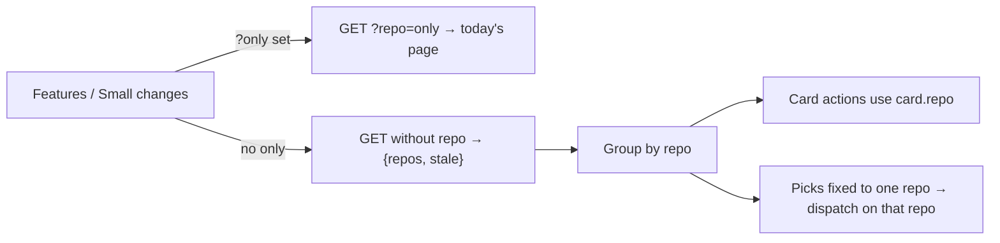

# PRD — Features and Small changes across repos

**Status:** Approved · **Date:** 2026-10-30 · **Slug:** `cross-repo-boards` · **Owner:** Masnun Siam · **Priority:** high · **Repo:** masnun-siam/ai-workflow

Status is `Draft`, `In review` or `Approved`. This document is the source of truth for the feature: every issue is derived from it, and a decision that is not written here has not been made.

## Overview

The Features and Small changes pages show every watched repo at once, grouped by repo, with an optional repo filter. You can see where each feature and small change stands, in every project, without switching repos first.

Today:
- Features and Small changes show one repo: the one in `?repo=`, else the remembered one, else the first registered. The sidebar repo switcher changes it for every page.
- The Inbox and Dispatches already span repos. The Inbox opens on "All repos" with a repo filter, and is built on the server from the in-memory board snapshots of the watched repos.
- Watched repos are the registered GitHub repos opened in the last 7 days, or with a live session or dispatch. While the global Inbox is open, all of them poll on the normal cadence.
- The Features page has a capture bar, a subway map, In progress cards and a Shipped list. The Small changes page has a capture bar, a "Where they stand" priority × column grid, a "Ready to run" panel whose picks start a dispatch, "Needs refining first" cards and the full issue list.
- A dispatch of picked issues runs in one repo.

## Problem

The user works on several projects at once. To see the status of a feature or a small change before sending it to a dispatch, they have to switch the repo, look, switch again, and repeat for each project. Dispatches already shows everything together, and that works well. Features and Small changes should too.

## Users

The single operator of `aiw ui`, across the repos they registered. No roles or tenants.

## Goals

- One look at Features shows every feature in flight in every watched repo.
- One look at Small changes shows every open small change in every watched repo, and lets you pick ready ones and send them to a dispatch.
- Narrowing to one repo is one click and gives today's full single-repo page.

## Non-goals

- No "All repos" entry in the sidebar repo switcher. The switcher keeps choosing the repo for new work and for pages that need one repo.
- No dispatch spanning several repos. Picks stay within one repo.
- No change to which repos are watched, and no way to pin or hide repos.
- No change to the feature page (`/features/<slug>`), Inbox, Dispatches, Activity or New.
- No subway map and no Shipped list in the All repos view.
- No change to any skill or to the poller's GitHub queries.

## Requirements

### Filter

- **FR-1 All repos by default.** Features and Small changes open on "All repos". Each has a repo filter (the same picker as the Inbox, with "All repos" first) that narrows the page to one repo. The filter lives in the URL as `?only=<owner/repo>`; with no `only` the page shows all repos. The filter does not change the sidebar switcher, and the switcher does not change the filter.
  - Acceptance: with three watched repos, opening Features with no `only` shows all three groups. Picking `bop-bd` in the filter sets `?only=…/bop-bd`, shows only that repo, and leaves the switcher's repo unchanged. Reloading keeps the filter.
- **FR-2 Which repos.** "All repos" means the watched repos (same set as the Inbox). The filter lists every registered GitHub repo; picking one that is not watched shows it and starts watching it, as opening a repo does today.
  - Acceptance: a registered repo not opened in 8 days and with nothing live is not in the All repos view; picking it in the filter shows its features after its first poll.
- **FR-3 One repo is today's page.** With a filter set, each page looks and behaves as it does today for that repo, including the subway map and Shipped list on Features.
  - Acceptance: Features filtered to one repo shows the same map, cards and Shipped list as today's page for that repo.

### Features, all repos

- **FR-4 Grouped by repo.** In progress cards are grouped under one heading per repo (project name, raw slug, in-progress count, "N shipped"). Groups with something stopped on the user come first, then by in-progress count, then by name. A repo with nothing in progress shows as one line ("nothing in progress · N shipped") after the others.
  - Acceptance: repo A with 2 features, one needing you; repo B with 3 features; repo C with none → order A, B, then C as one line.
- **FR-5 Cards keep their actions.** Each card behaves as today (next step, Merge, Run epic, dispatch progress) against its own repo. Opening a card goes to its feature page with that card's repo.
  - Acceptance: clicking a bop-bd card while the switcher is on wasensi opens the bop-bd feature page; its next-step button starts the session on bop-bd.
- **FR-6 No map, no Shipped list.** The subway map and the Shipped list are shown only with a filter set. The lede counts across repos ("5 in progress across 3 repos; 2 are stopped on you").
  - Acceptance: All repos view has no map and no Shipped section; each repo header shows its shipped count.

### Small changes, all repos

- **FR-7 Grid across repos.** "Where they stand" counts open small changes across all shown repos. Clicking a number filters the issue lists below as today, across repos.
  - Acceptance: wasensi has 2 high-priority ready and bop-bd 1 → the High/Ready cell reads 3; clicking it shows those 3, under their repos.
- **FR-8 Grouped lists.** "Ready to run", "Needs refining first" and the issue list are grouped by repo, with the same per-repo rules as today (Refine is locked while that repo has a small change being created).
  - Acceptance: a pending small-change session on wasensi disables Refine on wasensi cards only.
- **FR-9 Picks within one repo.** Picking a ready issue fixes the pick to its repo. Checkboxes in other repos are disabled with the note "Picks are from <project>. Clear them to pick from another repo." Clearing the last pick frees them. "Run N as a dispatch" opens the dispatch dialog for the picked repo's issues.
  - Acceptance: pick wasensi #612 → bop-bd checkboxes are disabled; run → the dispatch targets `wasensi#612` even when the switcher is on bop-bd.

### Capture

- **FR-10 Capture picks a repo.** In the All repos view the capture bar shows a repo picker, defaulting to the switcher's repo. With a filter set, the bar files into the filtered repo and shows no picker.
  - Acceptance: All repos view, switcher on wasensi, pick bop-bd in the bar, capture → the session starts on bop-bd.

### States

- **FR-11 Loading, stale and errors.** A repo whose data is still loading or stale shows its group with a "still loading" or "GitHub data is stale" note, never as empty. If the whole request fails, the page shows today's error state with Retry. No watched repo at all shows "No repo opened recently. Pick one in the filter."
  - Acceptance: a repo whose snapshot is missing appears with "still loading", not "nothing in progress".

## Edge cases

- **Concurrency:** two sessions started from cards of different repos run independently; each card's busy state is its own. A pick fixed to a repo whose last picked issue stops being ready (picked up by another dispatch) drops that pick on the next refresh, which frees the other repos when it was the last.
- **Empty states:** no watched repos (FR-11); a watched repo with no PRDs and no issues is a one-line group.
- **Limits:** no cap on groups; with all 49 registered repos watched the page is long but one request. Rate-limit pauses show per repo as stale (FR-11).
- **Missing data:** `?only=` naming a repo that is not registered falls back to All repos and drops the parameter. A repo removed while its group is shown disappears on the next refresh.
- **Existing data:** nothing to migrate. Old links with `?repo=` still pick the switcher's repo and do not set the filter.
- **Data isolation:** single-operator tool; repos are only the user's registered ones. Card actions always use the card's own repo, never the switcher's.

## Technical design

### Data

Not affected. No new stored state; the filter is in the URL.

### API

`GET /api/planning` and `GET /api/delivery` (FR-1, FR-2, FR-11):

- With `?repo=<owner/repo>`: unchanged.
- Without `repo`: returns, for the watched repos,

  ```
  { "repos": [ { "repo": "owner/name", ...the same body as ?repo=owner/name returns } ],
    "stale": ["owner/name", ...] }
  ```

  `repos` is sorted by slug; each entry carries its own `error` and `retry_at` as today. `stale` lists watched repos whose snapshot is missing or stale (same rule as the Inbox's `stale`). `?refresh=1` without `repo` polls every watched repo off the request thread.
- Errors: as today (`400` for an unregistered `repo`). No GitHub calls on the request path.

Calling either without `repo` marks every watched repo as viewed (the global Inbox rule), so they poll on the normal cadence while the page is open.

### Backend

- The two board handlers build the per-repo body once per watched repo from the in-memory snapshots and wrap them (FR-2). A failure building one repo's body puts that repo in `stale` with its error and does not fail the response.
- No poller, session or dispatch change.

### Frontend

- **Repo filter (FR-1, FR-2):** the Inbox's repo picker, with "All repos", bound to `?only=`. Independent of the switcher's `?repo=`.
- **Features (FR-3 to FR-6):** with `only`, today's page for that repo. Without, the all-repos response grouped as FR-4, cards as today but bound to their repo for links, actions and live dispatch, no map or Shipped list.
- **Small changes (FR-7 to FR-9):** grid computed over all groups; Ready, Needs refining and issue list grouped by repo; pick state carries its repo; the dispatch dialog takes the repo of the picks instead of the switcher's.
- **Capture bar (FR-10):** an optional repo picker, shown in the All repos view.
- **States (FR-11):** per-group loading and stale notes; whole-page error and empty states as above.


_The filter decides between today's single-repo page and the grouped all-repos view._

### Realtime and other services

Not affected. Pages refresh on their existing poll interval.

### Non-functional

- The all-repos response is built from memory; with 20 watched repos it must return in under 300 ms locally.
- GitHub cost is the same as having the global Inbox open: every watched repo on the normal cadence while the page is open.

### Testing

- Server (`run-engine/test_*.py`, plain asserts): the no-`repo` shape for both endpoints; `stale` for a missing snapshot; one repo failing to build stays in `stale` without failing the response; `?repo=` unchanged (FR-2, FR-11).
- UI component tests: FR-1 filter and URL; FR-4 grouping order; FR-5 card link and action use the card's repo; FR-6 no map; FR-7 grid totals; FR-9 pick lock and dispatch target; FR-10 capture repo; FR-11 loading/stale notes.
- Manual: with 3+ watched repos, walk both pages in All repos and filtered.

## Rollout and cost

Everyone at once with the next release. No billing impact. GitHub API use as with the global Inbox open. Rebuild `run-engine/ui_dist/`.

## Success metrics

None formally defined. Informally: checking status across projects needs no repo switch.

## Epics

- **E1 Features and Small changes across repos** — covers FR-1 to FR-11. Issue: #661

## Decisions

- Features and Small changes default to All repos with an optional filter — mirrors the Inbox, which already works this way.
- All repos = watched repos — already polled, no extra GitHub cost; stale repos stay out of the way.
- Features grouped by repo — matches "how is project X doing".
- Small changes picks stay within one repo; other repos' checkboxes are disabled, not silently cleared — a dispatch runs in one repo, and disabling is less surprising than losing picks.
- The page filter is its own `?only=` parameter; the switcher is untouched — avoids every single-repo page having to handle "all".
- The capture bar gets a repo picker in All repos, defaulting to the switcher's repo — capturing stays one step away.
- Subway map only with a filter — lines from many repos would be unreadable.
- Shipped: count on each repo header in All repos, full list when filtered — the overview is about work in flight.
- Server-side aggregation by omitting `repo` on `/api/planning` and `/api/delivery` — one request per page, no GitHub calls on the request path, same pattern as `/api/inbox`.
- Small changes grid totals across repos; Ready, Needs refining and the list are grouped by repo — keeps the cross-repo glance.
- Priority high, everyone at once — a daily pain; UI-local change with no migration.
- One epic.

## Open questions

None.

## Change log

## Related

- `docs/prds/small-changes.md` (Small changes page and picked-issue dispatches)
- `docs/prds/ui-rewrite.md` (Inbox across repos, repo switcher)
