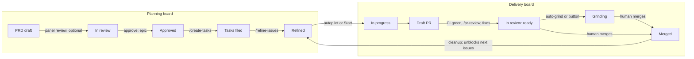

# PRD — Replace run-issue with the dev-workflow process

**Status:** Approved · **Date:** 2026-10-20 · **Slug:** `dev-workflow-replacement` · **Owner:** Masnun Siam · **Priority:** high · **Repo:** masnun-siam/ai-workflow

Status is `Draft`, `In review` or `Approved`. This document is the source of truth for the feature: every issue is derived from it, and a decision that is not written here has not been made.

## Overview

ai-workflow drops its own issue-to-PR machine (`/run-issue`, the routing engine, the run ledger and the station agents). It adopts the dev-workflow process: PRD → tasks → refined issues → `/implement-issue` → `/pr-review`. The `aiw ui` web app is rebuilt around that process as two boards, Planning and Delivery. A handful of standalone tools survive and are adapted to the new process.

Today:
- `/run-issue` drives one issue through stations (planner, SDET, dev, verifier, reviewer, fixer, CI) routed by a deterministic engine. A per-run `run.json` ledger is the source of truth. The UI board, cleanup, grind autostart, dispatch and main-tree lock all read that ledger.
- dev-workflow lives in a separate folder (Shahria-skills), installed as a local plugin `dev-workflow`. It provides eight short skills, three guides and three templates. `/implement-issue` is one session from the blocked check to a ready PR.
- ai-workflow already has `create-prd`, `create-tasks`, `refine-issues` and `pr-review` of its own, forked from an older Wasensi process. Their names collide with dev-workflow's.
- The UI starts headless sessions as `claude --print`, which exit after each turn and come back via `--resume`. It answers questions through `aiw ask`, auto-resumes after rate limits, and reports through notifications, AFK mode, Tailscale/PWA, a vault browser, cleanup and a repo picker.
- `/pr-grind` loops a Slack reviewer bot on a PR, but delegates fixes to the `run-fixer` and `run-ci` agents and reads the run ledger.
- Peer review runs lens agents (`run-specialist`) as subagents and validates their verdicts in `aiw peer-review`.

The new process end to end, and which board shows each stage:



## Problem

- Two workflows overlap: the team process (dev-workflow) and ai-workflow's own engine. They disagree on base branch, PR lifecycle (draft until green versus ready at once), review posting and lessons. Same-name skills shadow each other.
- The engine, ledger and station agents are a large surface to maintain: about 30 Python modules plus tests, and a 96K orchestrator prompt. dev-workflow does the same job in about 460 lines of skills.
- The UI is built on `run.json`. It cannot show the planning stages (PRD, epic, tasks, refinement), and it cannot run the process the team actually follows.

## Users

- **The plugin owner (Masnun Siam).** Runs every stage, mostly from the UI, sometimes from the CLI or herdr tabs.
- **Teammates who install the plugin.** They get one plugin carrying the whole team process.
- **Unattended sessions.** Headless sessions started by the UI (implement-issue, grind, lens reviewers) with no human watching.

## Goals

- One plugin carries the whole dev-workflow process, with no second plugin and no name shadowing.
- The UI shows where every PRD and every issue stands, and starts the next stage from the card.
- Independent refined issues of an epic run in parallel unattended, within a cap, and the next ones start as merges unblock them.
- A PRD can be reviewed by a panel of lens reviewers before approval, and revised until they all approve.
- Ready PRs go through the Slack reviewer-bot loop without a human per round.

## Non-goals

- **Nothing of `/run-issue` is ported.** No engine, envelopes, post-checks, ledger, stations, Gate 1/2/3, test-ownership guard, Docker stack capping, main-tree mode or `.run-issue.json` overlay.
- **Removed tools are not replaced:**
  - `/gh-issue` and its fact-checker, `/intake`, `/jira-to-gh`, `/pr-fix-comments`, `/issue-to-pr` and the `ship` agent;
  - `/fix-blockers`;
  - the Laravel review skills and their agent: api-hardening, migration-index, resilient-check, deployment-readiness, frontend-performance, data-migration and upgrade-assistant.
- **The dev-workflow skills are not modified to fit ai-workflow.** They are imported as they are (generic, Wasensi-derived). The only changes are the plugin-path references and the improve-loop target. Deviations live in the surviving tools and the UI, not in the imported skills.
- **No automated peer-review verdict validation.** No quote-in-artifact check, no stale-sha refusal and no verdict schema.
- **`/dump --review` is removed.** Peer review is started from the UI only (PRD card and custom prompt box) or with `/peer-review` by hand.
- **The UI never merges a PR** and never opens a release PR on its own.
- **No board across several repos.** One repo at a time.
- **No team-shared settings.** Per-repo settings are personal, not committed.
- **History is not kept.** Old ADRs, PRDs and task docs about run-issue are deleted. CHANGELOG is the record.

## Requirements

### E1 — Import dev-workflow, delete run-issue

- **FR-1 Import the dev-workflow skills, guides and templates.**
  - The plugin ships `create-prd`, `create-tasks`, `refine-issues`, `implement-issue`, `verifier-locally`, `pr-review`, `docs-updater` and `sync-from-wasensi` with the dev-workflow content.
  - It also ships dev-workflow's `guides/` and `templates/`.
  - Where ai-workflow already has a skill of the same name, the dev-workflow version replaces it wholesale.
  - Acceptance: every one of these skills' `SKILL.md`, and every guide and template, matches the Shahria-skills source at the import commit, apart from the path and improve-loop changes in FR-2. `/ai-workflow:implement-issue 42` runs the dev-workflow procedure.
- **FR-2 Repoint maintenance.**
  - The "Improve this skill" loop and `sync-from-wasensi` edit and commit in the ai-workflow source repo, not Shahria-skills.
  - The `dev-workflow` name in guides and skills reads `ai-workflow`.
  - Acceptance: no imported file mentions Shahria-skills or `/dev-workflow:`. `guides/skills.md` names the ai-workflow source folder.
- **FR-3 Delete the run-issue system.**
  - Removed: `/run-issue`, the routing engine and its verbs, `run.json`, every `run-*` agent, the Docker stack and worktree modules, the config keys only the engine reads, and the removed tools listed under Non-goals.
  - Removed `aiw` verbs: init, route, precheck, classify, resolve-review, skip-review, set, stack, worktree, maintree, pr, gitnexus, epic, refined, project-status, review.
  - `aiw` keeps `ui`, `paths`, `ask`, `ci` and `threads`, plus anything a kept tool still calls.
  - The UI pages and endpoints that read the ledger (Board, Run, Flow, Dispatch, Pipeline) go too. Until E3 lands, the UI is Sessions, New and Settings.
  - The UI's PR merge endpoint and its merge dialog go too, since the UI never merges a PR.
  - Also removed: the run-issue Definition of Done and Definition of Ready files (and the `aiw paths` keys that point at them), the kanban page, the published overview page with its Pages deploy workflow, the superpowers plans and the repo's run-issue lessons file. The shared self-improve note loses its run-issue line, and the pre-commit engine-test hook runs the whole test suite instead.
  - Acceptance:
    - `aiw --help` lists only the kept verbs;
    - a search of the repo for `run-issue`, `run.json`, `run-fixer` and `run-specialist` finds nothing outside CHANGELOG, this PRD and its task list (`docs/tasks/dev-workflow-replacement.md`);
    - the test suite passes.
- **FR-4 Kept tools stay working.**
  - `/dump`, `/release-pr`, `/worklog` (with its runner agent), `/peer-review`, `/flow`, `herdr-dispatch` and `/pr-grind` load and run.
  - None of them references a deleted agent, verb or file.
  - `/dump` loses `--review`.
  - `/peer-review` runs each lens as the new `peer-reviewer` agent (FR-13) in place of `run-specialist`, still as subagents with `aiw peer-review`, until E2 replaces it with lens sessions.
  - `/flow` loses its gh-issue and run-issue stages and ends at herdr-dispatch of implement-issue (FR-12), until FR-11 (E3) moves it onto the full chain.
  - Acceptance: each kept tool's text names no deleted item, `/dump --review` is no longer documented, and `/peer-review` names `peer-reviewer` as its lens agent.
- **FR-5 The repo checkout registry survives.**
  - The UI's list of registered repo checkouts keeps working after the stack module is deleted.
  - Acceptance: registering, renaming and scanning repos in the UI behaves as before.
- **FR-6 Archive Shahria-skills.**
  - A last commit in Shahria-skills replaces its README with a pointer to ai-workflow.
  - The `shahria-skills` local marketplace entry is removed, so `/dev-workflow:*` no longer loads.
  - The folder stays on disk.
  - Acceptance: after reinstall, the skill list shows no `dev-workflow:` skills, and Shahria-skills' README links to ai-workflow.
- **FR-7 Docs rewritten, history deleted.**
  - `CLAUDE.md`, `README.md`, `CONTEXT.md`, `CONTRIBUTING.md` and the how-it-works, reference and install docs describe the new system.
  - Old ADRs, PRDs (including `integrate-user-skills`) and task docs are deleted.
  - CHANGELOG gets a major-version entry naming what was removed.
  - Acceptance: no doc outside CHANGELOG describes run-issue, the engine or stations. `docs/adr/` and `docs/tasks/` hold nothing about run-issue.
- **FR-8 Old data cleared on first start.**
  - On first start after upgrade, the UI deletes the old run-issue data from the plugin data dir: `runs/`, `pipelines/`, `flows/`, `maintree/`, `locks/`, `gh-status.json`, `titles.json`, `grind_requests.json` and `grind_notified.json`.
  - It does this once, records that it ran, and logs what it removed.
  - Acceptance: after the first start those paths are gone and the log lists them. A second start removes nothing. Sessions, settings, the checkout registry, pr-grind state and worklog data are untouched.
- **FR-9 Grind fixes inline.**
  - `/pr-grind` applies review fixes in its own session: no fixer, CI or grinder agent.
  - It opens the Slack thread and posts the closing summary itself.
  - Before each push it runs `/verifier-locally`, and fixes failures locally first.
  - A failing CI check gets one fix attempt per head commit. The attempt is recorded in grind's own state file.
  - Each round still re-enters as a fresh headless session that reads its state file.
  - Acceptance:
    - a grind round on a PR with one should-fix finding commits the fix, replies on and resolves the thread, and pushes, all from the grind session;
    - the state file records the round;
    - no subagent is spawned for the fix;
    - a push is preceded by a `/verifier-locally` report in the session.
- **FR-12 herdr-dispatch runs implement-issue.**
  - The default command is `/ai-workflow:implement-issue {n}`.
  - A tab counts as done when its issue has a non-draft PR.
  - Main-tree and run-issue flags are gone.
  - Acceptance: dispatching three unblocked issues opens three tabs running implement-issue. A tab is reported done when its PR is marked ready.

### E2 — Peer-review lens sessions

- **FR-13 Peer-review panel with lens sessions.**
  - A panel review of an artifact starts one session per chosen lens. Each lens session loads a new read-only `peer-reviewer` agent on Opus.
  - Lens sessions report findings only to the authoring session (the root), never to each other.
  - The root revises the artifact and asks the same lenses to re-review. This repeats until every lens approves, or 5 rounds have run.
  - At the cap, the root stops and the UI shows the open findings for your decision.
  - Acceptance:
    - a 3-lens review of a PRD shows three lens sessions linked to the root session;
    - after the root revises, each lens receives a re-review request;
    - the panel ends "approved" when all three approve, or "cap reached" after round 5 with the open findings listed;
    - no lens session edits a file.
- **FR-14 Lens-to-root transport.**
  - The first task of E2 is a spike. It proves Claude Code's built-in messaging between sessions works for UI-started sessions, and records the result in the PRD's change log.
  - If it works, lenses message the root directly.
  - If it does not, each lens writes its verdict to the review's folder, and the UI resumes the root session with the verdicts once all lenses of the round have reported, the same way it resumes a session with an answer today.
  - Acceptance:
    - the spike's finding is in the change log with the Claude Code version tested;
    - whichever transport is chosen, a lens verdict reaches the root within one UI poll of the lens finishing.

### E3 — The new UI

- **FR-15 Planning board.**
  - One repo at a time, with columns PRD draft → In review → Approved → Tasks filed → Refined.
  - Cards:
    - one card per PRD, read from the repo checkout's PRD folder (drafts included);
    - each card shows its status, PR (In review), epic number (Approved), issue count (Tasks filed) and refined count (Refined).
  - Each card offers the next stage's action:
    - Peer review (draft);
    - Create tasks (approved, no child issues);
    - Refine (child issues not all `refined`);
    - Autopilot (all refined).
  - An action starts a headless session with that skill.
  - Acceptance:
    - a draft PRD file appears under PRD draft within one poll of being saved;
    - an approved PRD whose epic has 8 child issues, 3 labelled `refined`, shows under Tasks filed with "3/8 refined" and a Refine button;
    - clicking the button starts a `/refine-issues <epic>` session.
- **FR-16 Delivery board.**
  - One repo at a time, with one swimlane per open epic, plus "No epic" for loose issues.
  - Columns:
    - Ready: refined, no open PR;
    - In progress: live implement-issue session, no PR;
    - Draft PR;
    - In review: ready PR;
    - Grinding: active grind;
    - Merged: last 7 days.
  - A blocked issue sits in Ready with a lock and its blocker numbers.
  - A non-refined issue with no PR and no live session is not shown on Delivery; the Planning board's refined count covers it.
  - Cards show CI state, the live-session chip and the grind round.
  - Unblocked Ready cards have Start, which runs implement-issue headless, and Start in herdr.
  - Acceptance:
    - an issue blocked by an open issue shows the lock and cannot be started;
    - once the blocker closes, Start is enabled within one poll;
    - a ready PR with an active grind shows under Grinding with its round number.
- **FR-17 Board data and rate limits.**
  - Each poll makes one GitHub GraphQL query per repo. It fetches the repo's open epics and issues with labels, priority, sub-issues, blocked-by, linked PRs, draft state and CI rollup, plus PRs merged in the last 7 days.
  - Polls run every 60 s, and every 15 s while any PR's CI is pending.
  - When GitHub reports a rate limit, fetching pauses for 10 minutes and the last data shows as stale.
  - Local data is overlaid: PRD files, live sessions and grind state. It is never written back to GitHub.
  - Acceptance:
    - with 20 open issues the UI makes at most 1 GraphQL call per poll (checked by counting gh calls in the log);
    - a forced rate-limit response pauses fetching and shows a stale marker.
- **FR-18 Peer review from the UI.**
  - A draft PRD card and the launcher's custom prompt box offer the lens picker.
  - The picker starts the FR-13 panel, with the PRD's authoring session (or the custom prompt's session) as root.
  - The card shows panel progress (approved lenses / total, round).
  - Acceptance: starting a 3-lens review from a draft PRD card shows "0/3, round 1" on the card, which updates as lenses report.
- **FR-19 Autopilot.**
  - Toggled per epic on its Delivery swimlane.
  - While on, the UI starts implement-issue headless sessions on the epic's Ready, unblocked, refined issues that have no open PR or live session. It picks by `priority:` label, then lowest issue number.
  - It never runs more than the repo's cap (default 2) of implement-issue sessions across all the repo's epics.
  - It re-evaluates on every poll, so a merge that unblocks an issue starts it.
  - Acceptance:
    - with cap 2 and five eligible issues, exactly two sessions run;
    - when one PR merges and unblocks another issue, a new session starts within one poll;
    - a non-refined issue is never started.
- **FR-20 Merge-detect cleanup.**
  - When a board poll sees an issue's PR merged, the UI removes that issue's worktree under the repo's `.worktrees/` and its local branch — but only if the worktree has no uncommitted or unpushed work.
  - Otherwise the Merged card is flagged "needs cleanup" with a Clean button that lists what would be lost (the uncommitted paths and unpushed commits) before it confirms.
  - The main checkout is never touched.
  - Acceptance:
    - a merged PR with a clean worktree has its worktree and branch gone within one poll;
    - one with an uncommitted file keeps both and shows the flag.
- **FR-21 Per-repo settings.**
  - The Settings page holds three settings per repo:
    - auto-grind (on/off, default off);
    - autopilot cap (1–5, default 2);
    - the Slack review channel grind posts to.
  - Settings are stored in the UI's own settings file, keyed by owner/repo.
  - Acceptance: setting the cap to 1 for repo A limits A's autopilot to one session and leaves repo B at its own value.
- **FR-22 Kept UI features.**
  - Sessions list and session view, the answer pane (`aiw ask`), rate-limit auto-resume, limits and usage, AFK mode, notifications, Tailscale/PWA, the vault browser, the repo picker and session cleanup all keep working.
  - The launcher drops `run-issue` and its options, and lists the kept and imported skills.
  - AFK keeps auto-answering, and its run-issue-only actions are dropped.
  - Session cleanup moves to `/api/sessions/cleanup` in E1 and removes finished sessions' records only; worktree cleanup is FR-20's.
  - Acceptance: each kept feature works against a session started from the new boards. Navigating to a removed page shows "Page not found".
- **FR-10 Grind starts after ready.**
  - Grind runs on a PR only once it is marked ready.
  - With the repo's auto-grind setting on, the UI starts grind when it sees a PR from an implement-issue session turn ready. Otherwise the In review card shows a Grind button.
  - `/release-pr`'s handoff to `/pr-grind` works with the inline grind.
  - Acceptance:
    - with auto-grind on, a PR going draft → ready starts a grind session within one board poll;
    - with it off, nothing starts and the button appears;
    - grind refuses a draft PR with a one-line reason.
- **FR-11 `/flow` on the new chain.**
  - `/flow` runs `/dump` (optional) → `/create-prd`, offering the peer-review panel → approval → `/create-tasks` → `/refine-issues` → switching on autopilot for the epic.
  - It asks for your go-ahead at each stage boundary, and picks its entry stage from the input.
  - It switches autopilot on with a new `aiw autopilot <owner/repo> <epic> on|off` verb, which writes the UI settings' `autopilot` map; the UI reads that map on every poll.
  - Acceptance:
    - given a raw idea, `/flow` stops for confirmation before each of the five stages;
    - given an approved PRD, it starts at `/create-tasks`;
    - its last step switches on autopilot for the epic (FR-19).

## Edge cases

- **Concurrency.**
  - Two board polls racing must not start the same issue twice. Autopilot and the Start button both refuse an issue that already has a live implement-issue session or an open PR.
  - Grind keeps its per-PR lock, so only one grind session per PR runs at a time.
- **Cap reached.** Eligible issues wait in Ready. The swimlane shows "2/2 running".
- **Cap lowered while running.** No running session is stopped. New starts wait until the count drops below the new cap.
- **Empty states:**
  - a repo with no PRDs shows an empty Planning board with a "Run /create-prd" hint;
  - a repo with no epics shows only the "No epic" lane;
  - with no repo selected, the boards ask you to pick one.
- **Rate-limited or offline.** The boards show the last data marked stale. Autopilot and cleanup pause while data is stale, so they never act on old state.
- **PR closed without merge.** No cleanup runs. The card leaves Draft PR / In review and returns to Ready.
- **Worktree missing** (already removed by hand). Cleanup treats it as clean and only deletes the local branch, if present.
- **Lens session crashes.** It counts as not reported. The root waits until the UI marks the session failed, then the panel shows that lens as "failed", and you choose whether to re-run it or drop the lens.
- **Cap of 5 review rounds reached.** Nothing is auto-approved. The decision is yours.
- **Draft PRD deleted** while a panel runs. The panel stops and the card disappears on the next poll.
- **implement-issue stops to ask** (blocked or unrefined). It shows in the answer pane like any session question, and its slot counts against the cap until it ends.
- **Existing data.** Old run-issue data is deleted on first start (FR-8). In-flight `/run-issue` runs are abandoned: their PRs and branches stay on GitHub, untouched.
- **Data isolation.** Single user, local only. Each board shows only the selected repo's data.

## Technical design

### Data

- **GitHub is the source of record** for epics, issues, labels, sub-issues, blocked-by, PRs, draft state and CI (FR-15–FR-17).
- **Local overlay.** Nothing new is persisted beyond these:
  - PRD files in the repo checkout;
  - the UI's existing session records;
  - pr-grind state files;
  - peer-review folders (one per panel, holding the artifact path, lenses, round and each lens's last verdict as free text). The `peer_review` config keeps only the lens list and lens prompts.
- **UI settings** gain a `repos` map keyed by `owner/repo`, each with `auto_grind` (bool, default false), `autopilot_cap` (int 1–5, default 2) and `slack_channel` (string). The existing global `auto_grind` is removed; its value seeds every registered repo's `auto_grind` on first start. Also in UI settings, `autopilot` maps `owner/repo` to a list of epic numbers switched on (FR-19, FR-21).
- **Cleanup marker.** A one-time marker records that old data was removed (FR-8).
- **Lens transport fallback.** If the spike fails, each lens writes `round-<n>/<lens>.md` in the panel folder (FR-14).

### API

The UI server's JSON endpoints (browser ↔ `aiw ui`, local only, no auth beyond today's Tailscale setup):

| Method and path | Purpose | Request | Response / errors |
|---|---|---|---|
| `GET /api/planning?repo=owner/repo` | Planning board (FR-15) | none | `{repo, stale, fetched_at, prds:[{slug, title, status, path, pr, epic, issues, refined, panel:{approved,total,round,state}|null}]}`; 400 unknown repo |
| `GET /api/delivery?repo=owner/repo` | Delivery board (FR-16) | none | `{repo, stale, fetched_at, cap, running, lanes:[{epic, title, autopilot, cards:[{n, title, column, priority, blocked_by:[n], pr:{n,draft,ci,url}|null, session, grind_round, needs_cleanup:null|{uncommitted:[path], unpushed:[sha]}}]}]}`; 400 unknown repo |
| `POST /api/start` | Start a skill session from a card (FR-15, FR-16) | `{repo, skill, arg, via:"headless"|"herdr"}`; skill ∈ create-tasks, refine-issues, implement-issue, pr-grind, peer-review | `{session}`; 409 issue already has live session or open PR; 409 issue blocked |
| `POST /api/autopilot` | Toggle autopilot for an epic (FR-19) | `{repo, epic, on}` | `{repo, epic, on}`; 400 not an epic |
| `POST /api/review` | Start a panel (FR-13, FR-18); without `root_session` the UI starts a fresh headless root session on the artifact's repo | `{repo, artifact, lenses:[...], root_session?}` | `{panel}`; 400 no lenses / unknown lens |
| `POST /api/review/<panel>/lens` | Re-run or drop a failed lens (FR-13) | `{lens, action:"rerun"|"drop"}` | `{panel}`; 409 lens not failed |
| `POST /api/cleanup` | Clean a flagged merged issue (FR-20) | `{repo, issue, confirm:true}` | `{removed:[...]}`; 409 PR not merged |
| `GET/POST /api/sessions/cleanup` | Session cleanup (FR-22), moved from `/api/cleanup` in E1; removes finished sessions' records only | GET none; POST `{keys:[...]}` | GET `{items:[{key, label, repo, flags}]}`; POST `{removed:[...]}` |
| `GET/PUT /api/settings` | Gains `repos` (FR-21) | `repos[slug].{auto_grind, autopilot_cap, slack_channel}` | 400 cap outside 1–5 |

Removed: `/board.json`, `/api/runs/*`, `/api/pipelines*`, `/api/maintree/*`, `/api/grind/*` endpoints that read the ledger, and the flow endpoints.

### Backend

- **Board poller (FR-17).** One per selected repo.
  - It runs the GraphQL query on the 60 s/15 s cadence and keeps the last result in memory.
  - It pauses for 10 minutes on a rate-limit response.
  - Board requests read the in-memory result and never wait on GitHub.
- **Autopilot tick (FR-19).** Runs after each successful poll, never on stale data.
  - It computes eligible issues, subtracts live implement-issue sessions, and starts up to the cap.
  - Each start goes through the same guard as `POST /api/start`, under one per-repo lock, so two ticks cannot double-start.
- **Merge cleanup (FR-20).** Runs after each successful poll for newly merged PRs.
  - Its safety check is: no uncommitted changes and no commits ahead of the remote in the worktree.
  - It only acts on paths under the repo's `.worktrees/`.
- **Grind autostart (FR-10).** Uses the same poll: a PR that turned ready, whose repo has `auto_grind` on and which has no grind state, starts `/pr-grind` with the repo's Slack channel. The existing 60 s re-entry tick stays, minus its ledger lookups.
- **Session runner.**
  - It keeps `--print` stream-json, `--dangerously-skip-permissions`, `aiw ask`, rate-limit resume and the per-issue double-start guard. The guard now keys on `/implement-issue <n>` and `/pr-grind`.
  - Its fallback re-entry from the ledger and its run-issue-specific prompt lines are removed.
  - If the FR-14 spike adopts built-in messaging, lens and root sessions start in whatever mode the spike proved. That mode change is recorded in the change log before E2's peer-review task starts.
- **Peer-review panel (FR-13).** The UI creates the panel folder and starts one `peer-reviewer` session per lens.
  - The root is told the panel id and lens session ids.
  - Rounds advance when all lenses of the round have reported.
  - The UI counts rounds and stops at 5. Lens verdicts are free text with an approve/changes verdict line, and nothing validates them beyond that line.
  One panel round. The transport arrow is built-in messaging or the UI relay, depending on the FR-14 spike:

  ```mermaid
  sequenceDiagram
      participant U as UI
      participant R as Root (authoring session)
      participant L as Lens sessions (peer-reviewer, 1 per lens)
      U->>L: start round n on the artifact
      L-->>R: verdict + findings (each lens, independently)
      R->>R: revise artifact
      alt all approve
          U->>U: panel "approved"
      else round < 5
          R->>L: re-review request (round n+1)
      else round = 5
          U->>U: panel "cap reached", findings shown to you
      end
  ```
- **First-start cleanup (FR-8).** Runs once at server start, before anything reads the data dir.
- **Checkout registry (FR-5).** Its holder-file helper moves out of the deleted stack module, and its behaviour is unchanged.
- **Grind (FR-9).**
  - The pr-grind skill text replaces agent dispatches with inline steps: fix, `/verifier-locally`, commit, reply and resolve via `aiw threads`, push, check CI via `aiw ci`, and post to Slack via slackcli.
  - The `ci-attempt` key stays in its state file.
  - Ledger, stack and maintree reads are removed.

### Frontend

- **Navigation.** Planning, Delivery, Sessions, New, Settings. The old Board, Run, Flow, Dispatch and Pipeline pages are deleted.
- **Planning board (FR-15, FR-18).** Stage columns and a repo picker.
  - Each card shows its title, stage detail and one primary action.
  - Draft cards show the lens picker and panel progress.
  - Loading state is a skeleton. The empty state is the `/create-prd` hint. The error state is the stale banner with the last fetch time.
- **Delivery board (FR-16, FR-19, FR-20).** Epic swimlanes × stage columns.
  - Each swimlane header has the autopilot switch and shows "running/cap".
  - Cards show the lock with blocker numbers, CI state, the session chip (linking to the session view), the grind round, and the needs-cleanup flag with its Clean button.
  - Start and "Start in herdr" sit on unblocked Ready cards.
- **Settings (FR-21).** A per-repo section with auto-grind, autopilot cap and Slack channel.
- **Launcher (FR-22).** The run-issue entry and its Options fieldset are removed, and the command list shows the kept and imported skills. The custom prompt box keeps the lens picker, wired to FR-13.
- **Vendored stack unchanged.** Preact/htm, no build step.

### Realtime and other services

- **No push from GitHub.** Polling only (FR-17).
- **Notifications.** Fired on: a session waiting on you, a PR turning ready, a grind paused or done, panel "cap reached", and "needs cleanup".
- **herdr** is used only via herdr-dispatch (FR-12) and "Start in herdr".
- **Slack** is used only by grind and release-pr, via slackcli.

### Non-functional

- Python 3.10+ stdlib only, no frontend build step, tests as plain `assert` scripts. These are the repo's rules and are unchanged.
- At most 1 GraphQL call per repo per poll (FR-17).
- Headless sessions keep `--dangerously-skip-permissions`, which is what they use today.
- The UI never merges a PR, never pushes, never deletes outside the plugin data dir and the repo's `.worktrees/`, and never touches the main checkout.

### Testing

| Requirement | Test |
|---|---|
| FR-1, FR-2, FR-4 | Script test: imported files match the source apart from the allowed substitutions; no kept or imported file references a deleted agent, verb or `/dev-workflow:` |
| FR-3, FR-7 | Script test: `aiw --help` verb list; repo search for removed names outside CHANGELOG |
| FR-5, FR-21, FR-22 | UI unit tests on the checkout registry, settings and session runner, adapted from the existing `test_ui_*` scripts |
| FR-8 | UI unit test with a fake data dir: removes the listed paths once, keeps everything else |
| FR-15–FR-17 | UI unit tests feeding a recorded GraphQL response: column placement, lock, refined counts, stale on rate limit, one call per poll |
| FR-19 | UI unit test: cap respected, priority order, no double start under two concurrent ticks, no action on stale data |
| FR-20 | UI unit test on temp git repos: clean worktree removed; dirty or unpushed kept and flagged; nothing outside `.worktrees/` touched |
| FR-10, FR-13, FR-14 | UI unit tests with fake sessions for autostart and round counting; FR-14 spike is manual and recorded |
| FR-9, FR-11, FR-12 | Manual: one grind round, one `/flow` run and one herdr dispatch on a scratch repo, recorded in the PR body |
| Boards' look | Manual browser check at desktop and phone width |

## Rollout and cost

- Released as a major version. Upgrading removes `/run-issue`, so any in-flight runs must be finished or abandoned first. The CHANGELOG says so.
- E1 ships first and removes the old run-issue pages (FR-3), so between E1 and E3 the UI is only Sessions, New and Settings.
- **Cost.** Panel reviews run one Opus session per lens per round, so a 3-lens PRD review takes up to 15 Opus sessions at the 5-round cap. Autopilot raises concurrent usage up to the cap.
- **Operations.**
  - Reinstall the plugin after E1.
  - Remove the `shahria-skills` local marketplace (FR-6).
  - Set the Slack channel per repo before switching auto-grind on.

## Success metrics

None formally defined.

## Epics

- **E1 Import dev-workflow and delete run-issue** — covers FR-1 to FR-9 and FR-12. Issue: #324
- **E2 Peer-review lens sessions** — covers FR-13 and FR-14. Issue: #325
- **E3 Planning and Delivery boards** — covers FR-10, FR-11 and FR-15 to FR-22. Issue: #326

## Decisions

- **Merge dev-workflow into ai-workflow and archive Shahria-skills.** One plugin to install, no shadowing. Wasensi sync and the improve loop now work in this repo.
- **dev-workflow wins every name collision wholesale.** The old `integrate-user-skills` PRD is deleted with its extras. Keeping it would diverge from the Wasensi source and make syncs harder.
- **Delete the engine, ledger and post-checks entirely.** implement-issue is a single session, and GitHub plus the local session files hold all the state the UI needs.
- **Kept tools:** `/dump`, `/release-pr`, `/peer-review`, `/worklog` (with its runner), `/flow` and herdr-dispatch, plus grind. These are the tools still used outside run-issue. Everything else is covered by the imported skills or no longer used.
- **Grind runs after implement-issue marks the PR ready.** implement-issue already does CI-green → `/pr-review` → fix → ready, so grind adds the Slack bot loop and changes nothing upstream.
- **Grind fixes and posts to Slack inline, with no agents.** You chose fewer moving parts. Each round is still a fresh headless session, so context does not build up across rounds.
- **Grind runs `/verifier-locally` before pushing, and CI attempts live only in its state file.** This follows dev-workflow's "local first, CI confirms", and the ledger is gone.
- **Auto-grind is a per-repo setting.** It replaces the old global toggle.
- **Peer review runs as lens sessions that report only to the authoring session.** You wanted visible sessions with the author revising in place. Lenses don't talk to each other, so they stay independent (no groupthink).
- **Lens transport: spike built-in messaging first, fall back to the UI relay.** UI sessions are `--print` and exit after each turn, so built-in messaging is unproven for them. The relay reuses the existing resume path.
- **A new `peer-reviewer` agent runs each lens,** read-only, on Opus. It replaces `run-specialist`, which is deleted, and its tool restrictions stop a lens editing files.
- **Verdict validation is dropped.** You chose simplicity over the quote and sha guards.
- **Review round cap is 5, then you decide.** Without validation, the cap is what bounds the loop. You chose 5 over 3.
- **`/dump --review` is dropped.** Peer review starts from the UI (PRD card, custom prompt box) or `/peer-review` by hand.
- **Main-tree mode is dropped.** implement-issue never works in the main checkout, and maintree reads the ledger.
- **Two boards (Planning, Delivery), one repo at a time.** Planning is columns by stage. Delivery is epic swimlanes × stage columns.
- **The boards read GitHub plus a local overlay.** Draft PRDs and live session/grind state exist only locally, and nothing new is stored.
- **One GraphQL query per repo per poll,** 60 s / 15 s, with a 10-minute pause on rate limit. The old board hit GitHub's limit (#279), and this way cost no longer scales with card count.
- **Parallel runs are driven by both UI autopilot and herdr-dispatch.** Headless for unattended work, herdr when you want tabs.
- **Autopilot is per epic.** It starts refined, unblocked issues by priority then issue number, with a per-repo cap, default 2. This matches implement-issue's own blocked check, and the cap is safe for one laptop.
- **Merge-detect cleanup runs automatically when safe, otherwise asks.** It never loses uncommitted or unpushed work.
- **Per-repo settings live in the UI's settings file.** They are personal and need no PR to change.
- **Worktrees go in `<repo>/.worktrees/`, and the stack and worktree modules are deleted.** That is the dev-workflow way.
- **Headless sessions keep `--dangerously-skip-permissions`.** That is today's behaviour, and the answer pane still surfaces questions.
- **`aiw` keeps `ui`, `paths`, `ask`, `ci`, `threads` and the helpers kept tools need.** The engine verbs go with the engine.
- **herdr-dispatch counts a tab done when its PR is ready.** That is implement-issue's definition of done, and it works without a project board.
- **The Flow and Dispatch pages are deleted, and the `/flow` skill is kept.** The Planning board and autopilot replace those pages.
- **`/flow` runs dump → create-prd (+ panel) → approve → create-tasks → refine-issues → autopilot,** asking for your go-ahead at each stage.
- **Old data is deleted on first start, once.** You chose a clean data dir.
- **Shahria-skills gets a README pointer and its local marketplace entry is removed.** No shadowing, and the folder stays on disk.
- **Docs are rewritten, CLAUDE.md included, and history is deleted.** You authorized the CLAUDE.md rewrite, and CHANGELOG keeps the record.
- **Delivery is phased: three epics, one per phase.** Each phase ships on its own.
- **E1 removes the ledger-based UI pages, and the UI runs on Sessions, New and Settings until E3.** Each epic ships clean.
- **The old global `auto_grind` value seeds every registered repo.** Today's behaviour carries over.
- **Delivery's Merged column shows the last 7 days.** That keeps the query small.
- **Priority is high.**
- **Epic scope moves so every epic merges cleanly in order (E1 → E2 → E3) with no cross-epic dependency.** E1 also covers FR-9, FR-12, the `peer-reviewer` agent swapped into `/peer-review`, and `/flow` stripped of its gh-issue and run-issue stages; E2 covers FR-13 and FR-14; E3 also covers FR-10 and FR-11. — FR-3 deletes the agents and verbs those kept tools call, and FR-10/FR-11 need the board poll, per-repo settings and autopilot (/create-tasks)
- **FR-3's acceptance grep exempts CHANGELOG, this PRD and its task list; the run-issue DoD/DoR, kanban page, overview page with its Pages workflow, superpowers plans and lessons file are deleted, self-improve loses its run-issue line, and the pre-commit engine-test hook runs the whole suite.** — they all describe run-issue and the grep would otherwise never pass (/create-tasks)
- **FR-8 also removes `maintree/`, `locks/`, `grind_requests.json` and `grind_notified.json`.** — they are orphaned once the engine, stack and old grind queue go (/create-tasks)
- **A crashed lens is re-run or dropped through `POST /api/review/<panel>/lens`.** — the API had no contract for that choice (/create-tasks)
- **A panel started without a root session gets a fresh headless root session on the artifact's repo.** — a PRD written from the CLI has no UI authoring session (/create-tasks)
- **`/flow` switches autopilot on with a new `aiw autopilot` verb that writes the UI settings' `autopilot` map.** — a skill cannot reach the UI's endpoint, and the verb works whether or not the UI is running (/create-tasks)
- **`needs_cleanup` is `null` or `{uncommitted, unpushed}`, and non-refined issues without a PR or live session are left off Delivery.** — the Clean button must show what would be lost, and Planning already counts refinement (/create-tasks)
- **Session cleanup moves to `/api/sessions/cleanup` and removes finished sessions only.** — `/api/cleanup` belongs to FR-20's merge cleanup, and ledger runs, worktrees and the main-tree lock are gone (/create-tasks)
- **E1 deletes the UI's PR merge endpoint and merge dialog.** — the UI never merges a PR, and the dispatch page was its only caller (/create-tasks)
- **`/pr-review` posting becomes opt-in** (dev-workflow behaviour), as a consequence of "dev-workflow wins wholesale". Grind's Slack bot is the posted review.

## Open questions

None.

## Change log

- 2026-10-20 — Epic scope moved: FR-9 and FR-12 (plus the `peer-reviewer` agent swap and the `/flow` trim) into E1, FR-10 and FR-11 into E3, E2 is FR-13 and FR-14; issues affected: #324, #325, #326 (epic bodies and E2's title)
- 2026-10-20 — FR-3/FR-4/FR-7 scope: grep exemptions, extra run-issue files deleted, merge endpoint removed; issues affected: #324
- 2026-10-20 — FR-8 removes four more orphaned data paths; issues affected: #324
- 2026-10-20 — Lens re-run/drop endpoint and fresh root session (FR-13); `aiw autopilot` verb (FR-11); `needs_cleanup` shape and non-refined issues off Delivery (FR-16, FR-20); issues affected: #325, #326
- 2026-10-20 — Session cleanup moves to `/api/sessions/cleanup` (FR-22, done in E1); issues affected: #324, #326
- 2026-10-20 — FR-14 spike (Claude Code 2.1.304): built-in messaging does not work for UI-started `--print` sessions. A `--print` session gets SendMessage/ListAgents and sees live peers, but once a session's turn ends it leaves the peer list, a message to it has no target and nothing is queued, and a `--resume` of it receives nothing. Transport chosen: UI relay — each lens writes `round-<n>/<lens>.md` and the UI resumes the root with the round's verdicts. Session start mode is unchanged (`--print`); issues affected: #325

## Related

- dev-workflow source: Shahria-skills (README, guides, skills)
- PR #279 (board rate limits)
- Superseded and deleted: `docs/prds/integrate-user-skills.md`, ADR 0004
