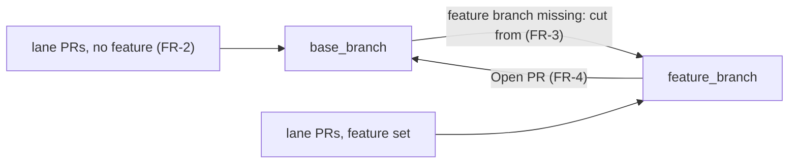

# PRD — Base branch for a dispatch

**Status:** Approved · **Date:** 2026-10-26 · **Slug:** `dispatch-base-branch` · **Owner:** Masnun Siam · **Priority:** medium · **Repo:** masnun-siam/ai-workflow

## Overview

A dispatch gets a **Base branch** setting: the branch its work lands in. You pick it from a searchable list of the repo's existing branches when you start a dispatch, from the UI, the `aiw dispatch` CLI or `herdr-dispatch`. If you leave it empty, nothing changes from today.

Today:
- A dispatch already has a **Feature branch** setting (free text). When it is set, the engine creates the feature branch on GitHub if it is missing, always cutting it from the repo's GitHub default branch. Every lane's PR then targets the feature branch, and the end-of-dispatch **Open PR** action opens feature branch → GitHub default branch.
- Without a feature branch, a lane is given no base, so `implement-issue` works it out the guide's way: the base named in the repo's `CLAUDE.md`/`AGENTS.md`, else the first of `staging`, `stage` or `dev` on the remote, else the default branch.
- The lane engine can already pass a base to every stage prompt (implement, conflict fix, followups). Only the feature branch fills it in today.
- A dispatch of picked issues (**Run small changes**) may not have a feature branch.
- The repo picker in the UI shell is already a searchable dropdown built on `cmdk`, which is installed. It sets the pattern for the new picker.
- Nothing lets you choose the branch a feature branch is cut from or merged into, or point plain lanes at a branch such as a release branch.

## Problem

On a repo whose working branch is `staging`, a dispatch with a feature branch cuts it from `master` and its final PR goes back into `master`. That skips staging and drags in commits staging has not seen. Without a feature branch, lanes can only target whatever the repo's base resolves to. There is no way to send one dispatch's PRs to `release/1.4` or a hotfix branch. The workaround today is to retarget each PR by hand or edit `CLAUDE.md` for the run.

## Users

Whoever starts a dispatch: from the **Run an epic** / **Run small changes** dialog in `aiw ui`, from `aiw dispatch plan|start`, or from the `herdr-dispatch` skill. This is a single-user, local tool: no roles or permissions beyond the user's own `gh` login.

## Goals

- Choose, per dispatch, the branch its PRs land in.
- With a feature branch, the feature branch starts from the chosen base, and the final PR goes back into it.
- You can only pick a branch that exists, so a typo never becomes a stray branch.

## Non-goals

- A different base per repo for a multi-repo epic. One name applies to every repo.
- Changing the base on a running dispatch.
- Creating the base branch when it is missing. Only the feature branch is ever created.
- Changing what an empty base does. The engine does not start resolving `staging`/`stage`/`dev` itself.
- Moving an existing feature branch onto the new base. A feature branch that already exists is used as it is.
- A searchable branch picker for the Feature branch field. It stays free text, because it may name a new branch.
- Remembering the last base used per repo.

## Requirements

- **FR-1 Base branch setting.** A dispatch has an optional `base_branch` setting: a branch name, or empty (null). It is validated by the same name rule as `feature_branch` and may not equal `feature_branch`. It is set at start and cannot be changed afterwards.
  - Acceptance: starting with `base_branch: "staging"` stores it, and the dispatch page shows it. A live settings edit that includes `base_branch` is refused with an error. A start with `base_branch` equal to `feature_branch`, or with an invalid name, is refused.
- **FR-2 Lanes without a feature branch target the base.** When `base_branch` is set and `feature_branch` is not, every lane is told to branch from `base_branch` and open its PR into it. Conflict-fix and followups prompts name it as the base.
  - Acceptance: a lane of a dispatch with `base_branch: "release/1.4"` and no feature branch opens a PR whose base is `release/1.4`. A conflict on that PR sends a prompt to merge `origin/release/1.4`.
- **FR-3 Feature branch is cut from the base.** When both are set and the feature branch does not exist in a lane repo, it is created from the current head of `base_branch` in that repo. An existing feature branch is left as it is. Lanes still target the feature branch.
  - Acceptance: starting with `feature_branch: "feat/x"` (missing) and `base_branch: "staging"` creates `feat/x` on GitHub at the head commit of `staging`. A start where `feat/x` already exists does not move it.
- **FR-4 Open PR goes into the base.** The end action **Open PR** opens `feature_branch` → `base_branch` in each repo when `base_branch` is set. The button reads "Open PR from <feature> into <base>".
  - Acceptance: after every lane is done, **Open PR** on a dispatch with `feature_branch: "feat/x"` and `base_branch: "staging"` creates a PR with head `feat/x` and base `staging`.
- **FR-5 Empty means today.** With `base_branch` empty, lanes, the feature branch cut, Open PR and every prompt behave exactly as they do now. Saved dispatches with no `base_branch` load as empty.
  - Acceptance: the existing dispatch tests pass unchanged. A dispatch record saved before this change loads, runs and shows "Repo's base" for Base branch.
- **FR-6 The branch must exist.** Preview warns, for each lane repo, when `base_branch` does not exist there. Start refuses the dispatch with an error that names the repo and the branch, and creates nothing (the feature branch included).
  - Acceptance: Preview of a two-repo epic where `staging` exists in one repo only shows the warning `<repo>: base branch staging does not exist`. Start returns 400 (CLI: a non-zero exit with the same message), and no feature branch is created in either repo.
- **FR-7 Searchable branch picker.** The New dispatch dialog has a **Base branch** field: a searchable dropdown of the existing branches of the dialog's repo (the epic's repo, or the picked issues' repo). The list's first entry is "Repo's base (default)", which means empty. Typing filters the list, and you can only pick an entry from it. The default branch is marked in the list. While the list loads the field shows a loading state. If loading fails it shows the error and keeps "Repo's base". It is disabled until the dialog knows its repo.
  - Acceptance: typing `sta` narrows the list to the branches whose name contains `sta`. A name that is not in the list cannot be submitted. Choosing "Repo's base (default)" sends `base_branch: null`.
- **FR-8 Small changes get it too.** A dispatch of picked issues accepts `base_branch`, and the rule against a feature branch still applies.
  - Acceptance: `POST /api/dispatches` with `{issues: [...], settings: {base_branch: "hotfix"}}` succeeds, and each lane's PR targets `hotfix`. The same request with `feature_branch` set is still refused with 400.
- **FR-9 CLI and herdr-dispatch.** `aiw dispatch plan|start` take `--base-branch <name>`, and `herdr-dispatch` passes it through and lists it in its flags table and preview.
  - Acceptance: `aiw dispatch plan <epic> --base-branch staging` prints `settings.base_branch: "staging"`, plus the FR-6 warning when the branch is missing.

## Edge cases

- **Concurrency.** The base is fixed at start, so no tick can see it change. Two dispatches may share a base branch. Their PRs into it conflict exactly as two lanes do today, and the existing conflict-fix stage handles it.
- **Base branch deleted mid-run.** A lane's PR then fails to open or merge. The lane is held with GitHub's error, as any failed PR or merge is today. Open PR fails with `gh`'s message and can be retried once the branch is back.
- **Base equals the default branch.** This is allowed and behaves the same as picking it explicitly. The followups prompt no longer claims "not the default branch". It tells the session to close the issue if it is still open, which is harmless either way.
- **Existing feature branch on another base.** It is used as it is (FR-3). Open PR still targets `base_branch`, and its diff shows whatever the branch carries. The dispatch page shows both names, so this stays visible.
- **Empty states.** A repo with only its default branch shows "Repo's base (default)" and that one branch. When the dialog has no repo yet, the picker is disabled with the hint "Pick an epic first".
- **Limits.** The branch list is every branch of the repo, read in pages. A repo with thousands of branches loads more slowly but stays searchable. The list is not cached across dialog openings, so a branch created a moment ago is there.
- **Multi-repo epic.** The picker lists the epic repo's branches. The other lane repos are only checked at Preview and Start (FR-6).
- **Existing data.** Nothing to migrate. Records without the key read it as empty.
- **Data isolation.** Not multi-tenant. The branch list uses the user's own `gh` login and only reads repos that login can see.

## Technical design


*Where each PR lands once a base branch is set. With `base_branch` empty, every arrow to B goes where it goes today (FR-5).*

### Data

The dispatch record (a JSON file in the plugin data dir) gets one new settings key, `base_branch`: string or null, default null. It uses the same validation as `feature_branch` (letters, digits, `.`, `_`, `/`, `-`, 1–100 characters) and must differ from `feature_branch`. No migration: loading already fills missing keys from the defaults (FR-1, FR-5).

### API

- `POST /api/dispatches` and `POST /api/dispatches/plan`: `settings.base_branch` (string or null) is accepted for an epic and for `issues`.
  - 400 for an invalid name, for a value equal to `feature_branch`, or on Start when the branch is missing in any lane repo. The error reads `<owner/repo>: base branch <name> does not exist`.
  - Plan returns the missing-branch case as a warning instead (FR-1, FR-6, FR-8).
- `POST /api/dispatches/<id>/settings`: a body that contains `base_branch` is refused with 400 `base_branch is fixed at start` (FR-1).
- `GET /api/dispatches`, `GET /api/dispatches/<id>`: `settings.base_branch` is included.
- **New** `GET /api/github/branches?repo=<owner/name>`:
  - Returns `200 {"branches": ["master", "staging", ...], "default": "master"}`, with the names sorted and the default first.
  - 400 when `repo` is not `owner/name`, 502 with `gh`'s last error line when `gh` fails.
  - It reads every branch through `gh`, in pages, and caches nothing (FR-7).

### Backend

- **Settings.** `base_branch` joins the dispatch defaults and the settings check. The live settings editor rejects it (FR-1).
- **Lane base.** The base each lane is given is `feature_branch`, else `base_branch`, else nothing. Nothing means today's behaviour. The implement, conflict-fix and followups prompts already take this base (FR-2, FR-5).
- **Followups prompt.** The tail sentence becomes "close #n if it is still open" whenever a base is given. It no longer says the base is not the default branch (edge case).
- **Start.**
  - The branch-existence check comes first. It checks `base_branch` in every lane repo, and fails before anything is created (FR-6).
  - The feature branch is then cut from `base_branch` when that is set, else from the default branch as today (FR-3).
- **Preview.** It adds one warning per lane repo where `base_branch` is missing (FR-6).
- **Open PR.** Its PR base is `base_branch` when set, else the GitHub default branch as today (FR-4).
- **Failure.** Every GitHub call has the timeout and error reporting of the current feature-branch calls. A failed branch check fails the start, and a failed list fails only the picker.

### Frontend

- **New dispatch dialog.** A **Base branch** field sits next to **Feature branch**. It is a searchable dropdown in the style of the existing repo picker (`cmdk` in a popover, with no new dependency). Its states:
  - Disabled until the dialog knows its repo, with the hint "Pick an epic first".
  - A loading state while the list loads.
  - The error, with "Repo's base" kept, when loading fails.
  - It is shown for small changes too (FR-7, FR-8).
- **Hints.**
  - Base branch: "Where PRs land. With a feature branch: it is cut from here and its final PR goes here."
  - Feature branch: "Cut from the base branch (or the default branch) if missing; every PR targets it."
- **Dispatch page settings.** Base branch is read-only, as Feature branch is today. It shows the name, or "Repo's base".
- **End panel.** The button reads "Open PR from <feature> into <base or default branch>" (FR-4).

```
Feature branch  [ feat/tags                ]
Base branch     [ staging               ▾ ]
                ┌───────────────────────────┐
                │ 🔍 sta                    │
                │   Repo's base (default)   │
                │   staging                 │
                │   stage-hotfix            │
                └───────────────────────────┘
```
*The New dispatch dialog with the picker open.*

### Realtime and other services

Not affected. The dispatch page already re-reads the record, and no other service reads dispatch settings.

### Non-functional

- The branch list may take a few seconds on large repos and must not block the rest of the dialog.
- `repo` is validated as `owner/name` before it reaches `gh`, and is passed as one argument, never through a shell.
- The branch name rule keeps `base_branch` safe to put in `gh` arguments and prompts.

### Testing

- **Engine (assert scripts, fake `gh`).**
  - The settings check covers valid names, invalid names, equal-to-feature and the live-edit refusal (FR-1).
  - The lane base resolves in the order feature → base → none, and the prompts carry it (FR-2, FR-5).
  - The feature branch is cut from the base's head commit, and an existing one is left alone (FR-3).
  - Open PR uses `--base <base_branch>`, and the default branch when the base is empty (FR-4).
  - A missing base gives a Preview warning, and Start fails with no branch created (FR-6).
  - An issue-list dispatch accepts a base and still refuses a feature branch (FR-8).
  - The CLI flag is parsed (FR-9).
  - A record without the key loads as empty (FR-5).
- **Server (assert scripts).** `GET /api/github/branches` returns 200 with the default first, 400 for a bad repo and 502 when `gh` fails. Settings edits with `base_branch` get 400.
- **UI (component tests).** The picker filters by typing, only accepts listed entries, sends null for "Repo's base", and shows its disabled, loading and error states. The end button label names the base.
- **Manual.** Run a real dispatch with a feature branch and base `staging` on a test repo. Confirm the cut point and the final PR's base.

## Rollout and cost

Everyone at once, behind no flag: an empty base is today's behaviour. There is no cost impact. The only new GitHub traffic is one paginated branch read per dialog opening and one branch check per lane repo at Preview and Start. Rebuild `ui_dist` and note the change in `CHANGELOG.md`. Update `docs/REFERENCE.md`, `docs/HOW-IT-WORKS.md` and the `herdr-dispatch` flags table.

## Success metrics

None formally defined.

## Epics

- **E1 Base branch for a dispatch** — covers FR-1 to FR-9. Issue: #486

## Decisions

- **One setting covers both cases.** It is the lane PR target without a feature branch, and the feature branch's cut point and Open PR target with one. One field means one thing: where this dispatch's work lands. It also fixes the hard-coded default branch for staging-based repos.
- **The UI picks from existing branches only, in a searchable dropdown.** Chosen by the user over free text with suggestions, so a typo can't be submitted. The repo picker's `cmdk` pattern means no new dependency.
- **A missing branch is refused, never created.** It is a warning in Preview and a 400 on Start (the CLI exits non-zero). The UI can't produce one, but the API and CLI can.
- **Small changes get the setting.** Hotfix-style changes need a target branch just as much. Lanes already accept a base, so it costs nothing extra.
- **Empty means exactly today's behaviour.** Existing users and saved dispatches see no change. The engine can't reliably read a repo's `CLAUDE.md` base anyway.
- **Fixed at start**, like the feature branch. Changing it mid-run would split PRs across two targets.
- **One name for every repo.** It mirrors the feature branch. A per-repo base is rare and can come later.
- **An existing feature branch is not moved.** Rewriting a shared branch would lose work, so it is used as it is.
- **Priority medium.** Workarounds exist: set the base in `CLAUDE.md`, or retarget PRs by hand.

## Open questions

## Change log

## Related

- `docs/prds/small-changes.md`: the issue-list dispatch and its no-feature-branch rule.
- `skills/herdr-dispatch/SKILL.md`: the flags table and end actions.
- `guides/engineering-workflow.md`: "Repository settings → Base branch".
