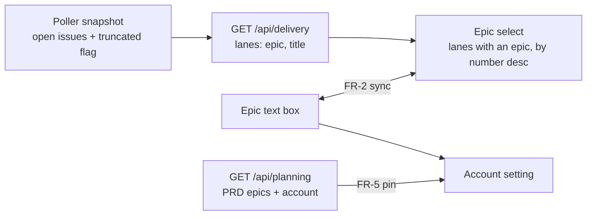

# PRD — Every open epic in the Run an epic dialog

**Status:** Approved · **Date:** 2026-11-06 · **Slug:** `dispatch-epic-select` · **Owner:** Masnun Siam · **Priority:** medium · **Repo:** masnun-siam/ai-workflow

Status is `Draft`, `In review` or `Approved`. This document is the source of truth for the feature: every issue is derived from it, and a decision that is not written here has not been made.

## Overview

The **Run an epic** dialog in `aiw ui` gets an epic select that lists every open epic of the dialog's repo, so the user picks the epic to dispatch instead of looking up its number. The user who runs epics from the Dispatches page or a feature's Run epic button uses it.

Today:
- The dialog has an **Epic** text box (`owner/repo#123` or `123`) and, beside it, a small "Pick an epic…" select.
- The select lists only epics found through a PRD file directly in `docs/prds/` of the repo, one epic per PRD. Epics without a PRD (#701), epics of a PRD in a subfolder (`docs/prds/ui/blubird-ui.md`), and the second and third epics of a PRD with several (#924, #925) never appear.
- The select is hidden when that list is empty, and after a pick it snaps back to "Pick an epic…", so it never shows what is picked.
- Picking an epic whose PRD was written on a saved account pre-selects that account for the run.
- The same dialog in **Run small changes** mode dispatches issues ticked on the Small changes page, with no PRD or epic. That mode has no epic field.
- The repo's issue board data (`GET /api/delivery`) already returns one lane per open epic, with its number and title, from the poller snapshot.

## Problem

The user cannot pick most of the repo's epics from the dialog. They have to find the epic's number on GitHub or the board and type it, and the select they see suggests the hidden epics do not exist.

## Users

The single local operator of `aiw ui`. No roles or permissions beyond the user's own `gh` login.

## Goals

- Every open epic of the dialog's repo can be picked from the select, with or without a PRD.
- The select always shows which epic is picked, or why it has nothing to offer.
- Small-change dispatch keeps working exactly as today.

## Non-goals

- No change to **Run small changes** mode or to how issues are picked on the Small changes page. No small-changes picker inside this dialog, no mixed epic-and-issue list.
- No epics from other repos in the select. No repo picker inside the dialog. A typed `owner/repo#n` still reaches any repo, as today.
- No search box or custom popover: the select stays a native select beside the text box.
- No filtering by runnability (refined open children). Preview still says when nothing is runnable.
- No new endpoint and no new GitHub call.
- No change to the account pin rule beyond keeping it for epics with a PRD.
- No change to how project-coordinator runs are offered (blubird-ui FR-17 wraps this dialog later).

## Requirements

- **FR-1 Every open epic is listed.** In epic mode, the select lists every open issue labelled `epic` of the dialog's repo (the repo passed in by the page, else the repo switcher's), whether or not a PRD names it. Each option reads `#<n> <title>` with a leading `Epic:` removed from the title. Options are ordered by number, highest first. The first option is "Pick an epic…".
  - Acceptance: on this repo the select lists every open `epic` issue (12 today, #925 down to #540) in descending number order, with `#925 Blubird in the UI — parallel runs and new views` first; it includes `#701 Audit fixes and follow-ups (2026-11)`, which has no PRD; and no option text starts with `Epic:`.
- **FR-2 Text box and select stay in step.** Picking an option sets the text box to `<repo>#<n>` and clears any preview, as today. When the text box holds a reference to a listed epic (`<n>`, `#<n>` or `<repo>#<n>` of the dialog's repo), the select shows that epic. Any other value, including an epic of another repo, shows "Pick an epic…". Typing a reference still works for epics not in the list.
  - Acceptance: typing `925` shows `#925 …` selected; typing `9` shows "Pick an epic…"; typing `other/repo#5` shows "Pick an epic…" and Preview works on it as today; picking `#924` puts `<repo>#924` in the text box.
- **FR-3 Always shown, with states.** In epic mode the select is always shown. While the list loads it is disabled and reads "Loading epics…". With no open epic it is disabled and reads "No open epics in <repo>". If loading fails, it stays enabled with only "Pick an epic…", and a red hint under the field reads "Could not load epics: <message>". The text box works in every state.
  - Acceptance: each of the three states renders as described, and Preview on a typed `123` works in all of them.
- **FR-4 Truncated hint.** When the repo's snapshot read stopped before all open issues (more than the poller's page limit, 500 issues today), a hint under the field reads "Only the newest 500 open issues were read; type an older epic's number."
  - Acceptance: with a snapshot marked truncated the hint shows; without it no hint shows.
- **FR-5 Account pin kept for PRD epics.** Picking or typing an epic whose PRD was written on a saved account pre-selects that account, unless the user already changed a setting, as today. An epic with no such PRD runs on the default account.
  - Acceptance: an epic whose PRD carries an account pre-selects it; #701 (no PRD) leaves the default account; changing the account first and then picking a PRD epic keeps the user's account.
- **FR-6 Small changes unchanged.** In Run small changes mode the dialog shows the picked issues as today, with no epic field and no epic list load.
  - Acceptance: opening the dialog from the Small changes page shows the picked issue chips and no Epic field, and starts the dispatch as today.

## Edge cases

- **Concurrency.** The list refreshes on the boards poll (every 15 s). An epic closed while the dialog is open drops out of the list; if it was picked, the text box keeps the reference, the select shows "Pick an epic…", and Preview reports the epic as today.
- **Stale snapshot.** The list shows whatever the last snapshot holds; a just-created epic appears after the next poll and can be typed meanwhile.
- **Empty states.** No open epic: FR-3 disabled state. No repo known yet (none registered): the select is disabled and reads "Pick a repo first"; the text box accepts `owner/repo#n`.
- **Limits.** Above 500 open issues: FR-4 hint. No cap on the number of options.
- **Prefilled epic.** Opened from a feature's Run epic button (`epic` prefilled), the select shows that epic once the list loads (FR-2).
- **Data isolation.** Single local user; the list holds only epics of the dialog's repo.
- **Existing data.** Nothing to migrate.

## Technical design

_Where the select's options and the account pin come from._

### Data

Not affected. The list is read from the existing poller snapshot; nothing is stored.

### API

- `GET /api/delivery?repo=<owner/repo>` (existing). Each lane `{epic, title, …}` with `epic` not null is one open epic; `title` already has a leading `Epic:` removed. FR-1.
- New field on its response: `truncated: bool`, true when the snapshot's open-issue read stopped at the page limit (the snapshot's `issues_truncated`), false otherwise. FR-4.
- `GET /api/planning?repo=` (existing) keeps supplying `account` per PRD epic for the pin. FR-5.
- `POST /api/dispatches/plan` and `POST /api/dispatches` are unchanged; the target is still `{epic: "<owner>/<repo>#<n>"}`.

### Backend

- The delivery builder passes the snapshot's truncated flag through as `truncated`. FR-4. Nothing else changes.

### Frontend

- The Run an epic dialog reads the repo's delivery data for its options instead of the planning data, keeps the "No epic" lane out, and sorts by epic number descending. FR-1.
- The select's value is derived from the text box (FR-2); its disabled and label states follow the delivery query (FR-3); the truncated hint reads the new field (FR-4).
- The account pin keeps looking the epic up in the planning data (FR-5).
- Small-changes mode does not request the delivery data (FR-6).

### Realtime and other services

Not affected. The list refreshes on the existing boards poll. `aiw dispatch` and the herdr-dispatch skill are not affected.

### Non-functional

- The dialog adds one delivery request per open repo, shared with any board already polling the same repo. No GitHub calls are added.
- The select is a native `<select>` with a label, so it stays keyboard and screen-reader accessible.

### Testing

- Component tests in the UI suite (vitest): FR-1 (all epics, no "No epic" lane, descending, `Epic:` stripped), FR-2 (pick fills text, typed number selects, unknown and other-repo values show the placeholder), FR-3 (loading, empty, error states, text box usable), FR-4 (hint on and off), FR-5 (PRD epic pins its account, epic without PRD does not, user's choice wins), FR-6 (small-changes mode has no epic field).
- Python `assert` test for the delivery builder: `truncated` mirrors the snapshot flag. FR-4.
- Manual: in `aiw ui` on this repo, open Run an epic and confirm #925, #924, #923 and #701 are listed and Preview works from a pick.

## Rollout and cost

Everyone at once, with the next UI build (`run-engine/ui_dist/` committed). No cost impact.

## Success metrics

None formally defined.

## Epics

- **E1 Every open epic in the Run an epic dialog** — covers FR-1 to FR-6. Issue: #972

## Decisions

- Fix the missing epics and keep small changes as they are — the user's dispatch of loose issues from the Small changes page must keep working, and folding it into this dialog would duplicate that page.
- Keep the text box plus a full native select — chosen over one searchable picker or a select-only field.
- Typing a reference not in the list stays possible — reaches epics of other repos or not yet polled, as today.
- List every open epic, not only runnable or PRD-backed ones — Preview already explains why nothing runs.
- The dialog's repo only — today's scope; other repos are reached by typing.
- Newest first by number — newest epics are usually the ones run.
- Options read `#n title` with `Epic:` stripped — the data is already there and names fit.
- Reuse `GET /api/delivery` lanes — it already lists every open epic, so no new endpoint or GitHub call.
- Keep the account pin for PRD epics — no behaviour lost; others use the default account.
- Select always shown, with loading, empty and error states — the control never jumps.
- Two-way sync between text box and select — the select shows what is picked.
- Show a hint when the snapshot is truncated — an older epic may be missing; typing covers it.
- Vitest component tests plus one manual check in `aiw ui`.
- Own PRD with one epic, not folded into blubird-ui #925 — small and independent; blubird-ui FR-17 later wraps the same dialog.
- Priority medium — a usability fix with a working fallback.

## Open questions

None.

## Change log

- 2026-11-06 — Approved. FR-1 acceptance corrected: the repo has 12 open epics, not five, so the check now counts every open epic instead of a fixed list. Epic #972 filed.

## Related

- `docs/prds/dispatch-base-branch.md` (Base branch picker in the same dialog).
- `docs/prds/dispatch-list-table.md` (Dispatches page).
- `docs/prds/ui/blubird-ui.md` FR-17 (Run epic offers UI dispatch or project-coordinator), epic #925.
