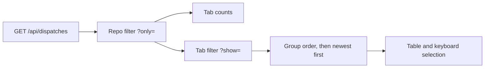

# PRD — Dispatches list as one filtered table

**Status:** Approved · **Date:** 2026-10-31 · **Slug:** `dispatch-list-table` · **Owner:** Masnun Siam · **Priority:** medium · **Repo:** masnun-siam/ai-workflow

## Overview

The Dispatches page becomes one table of every dispatch, live and past, with filter tabs above it and the same repo filter as the Features page. Anyone running epics or small changes through `aiw ui` uses it to see what needs them and what has already run.

Today:
- Running and paused dispatches appear as large cards, each with a wave track, progress text and the issues that need you. Everything else sits in a separate History table below.
- The list always shows every repo, with no way to narrow it.
- The Features page already has the repo-or-All-repos filter, kept in the URL as `?only=`.
- There are no filter tabs on this page and no table in the UI sorts by column.

## Problem

A few live cards push history down the page, and live and past dispatches can't be scanned or compared in one place. With several watched repos, one busy repo's runs bury another's, and there is no way to see only the dispatches that are waiting on you.

## Users

The single local user of `aiw ui`. There are no roles.

## Goals

- See every dispatch in one scan, with the ones waiting on you on top.
- Narrow the list to what needs you, what is live or what has finished, in one click.
- Narrow the list to one repo the same way as on Features.

## Non-goals

- No actions on rows. Merging, answering, retrying, pausing and resuming stay on the dispatch page.
- No column sorting.
- No search box, pagination or date filter.
- No wave track on the list. It is not moved elsewhere by this work.
- No side panel for a dispatch. A row opens the dispatch page.
- No change to the dispatch page, the Run an epic dialog or the engine.

## Requirements

- **FR-1 One table.** The Running section, the cards and the History section are replaced by one table with the columns State, Dispatch, Issues, Took and Spent. Run an epic stays at the top right, and the page description under the title is removed.
  - Acceptance: with live and finished dispatches present, the page has one table holding all of them, and no cards or History heading.
- **FR-2 State.** Each row shows one state chip. A running or paused dispatch with at least one issue that needs you shows Needs you. Otherwise it shows Running, Paused, Finished or Cancelled.
  - Acceptance: a paused dispatch with an issue waiting for its merge shows Needs you. A cancelled dispatch with a held issue shows Cancelled.
- **FR-3 Dispatch cell.** The first line is the dispatch's name, linked to its page. The second line is the repo's short name, and for a finished or cancelled dispatch also its start date and, when any were skipped, the skipped count. A row showing Needs you has a third line with the first issue that needs you, in the words the dispatch page uses, followed by "and N more" when there are others.
  - Acceptance: a dispatch with three issues needing you shows the first and "and 2 more". An issue-list dispatch shows its "Small changes: #a, #b" title.
- **FR-4 Issues.** The cell shows closed issues over the total, then a bar in the order done, in progress, waiting, skipped, with each part sized by its issue count. The bar has a text label for assistive technology.
  - Acceptance: a dispatch of 7 with 3 closed, 2 active and 2 waiting shows `3/7` and a label saying 3 of 7 are done.
- **FR-5 Took and Spent.** Took is the dispatch's total working time and Spent its total cost. Spent shows a dash for a herdr dispatch.
  - Acceptance: values match the dispatch's totals, and a herdr dispatch shows a dash, as the History table does today.
- **FR-6 Filter tabs.** Four tabs sit above the table: All, Needs you, Live and Finished, each with a count. Needs you holds dispatches whose state is Needs you. Live holds running and paused ones, so a dispatch needing you appears under both Needs you and Live. Finished holds finished and cancelled ones. All is the default. The tab is kept in the URL as `?show=needs`, `?show=live` or `?show=finished`, with no parameter for All. An unknown value reads as All.
  - Acceptance: clicking Needs you shows only those rows and sets `?show=needs`. Going back restores All. Reloading keeps the tab.
- **FR-7 Row order.** Rows are ordered Needs you, then Running, then Paused, then Finished and Cancelled together. Within each group the newest start comes first. Columns can't be sorted.
  - Acceptance: a Needs you dispatch started last week sits above a Running one started today. A cancelled dispatch started yesterday sits above a finished one started last week.
- **FR-8 Repo filter.** The page has the same repo-or-All-repos control as Features, kept in the URL as `?only=<owner/repo>`, with All repos as the default. It narrows the rows and every tab count. A dispatch belongs to its epic's repo, or to its first issue's repo when it has no epic. Repo names match without regard to case.
  - Acceptance: with `?only=` set to one repo, only its dispatches appear and the tab counts cover only them. Clearing it shows every repo again.
- **FR-9 Row behaviour.** Clicking a row or its name opens the dispatch page. J/K and the arrow keys move through the visible rows in order, and Enter opens the selected one.
  - Acceptance: on a filtered tab, J selects the first visible row and Enter opens that dispatch.
- **FR-10 States of the page.** While loading, the page shows a skeleton. A load failure shows the existing error banner with Retry, above any rows already loaded. With no dispatches at all, the existing Nothing is running empty state shows with Run an epic, and the tabs are hidden. A tab or repo filter with no rows shows one line in place of the table: "Nothing needs you." for Needs you, "Nothing is live." for Live, "Nothing has finished yet." for Finished, and "No dispatches in this repo." for All.
  - Acceptance: each message appears for its case, and the tabs remain clickable when a filter is empty.
- **FR-11 Entry points kept.** `?new=<owner/repo#n>` still opens Run an epic on that epic, and closing the dialog removes only that parameter.
  - Acceptance: opening `#/dispatches?new=o/r%231&show=live` opens the dialog, and closing it leaves `?show=live`.

## Edge cases

- **Concurrency.** A dispatch changes state while the page is open, so a row can change group or leave the current tab on the next refresh. The list reorders with no prompt. If the selected row leaves the tab, the selection follows the list's existing rule for a row that disappears.
- **Empty states.** Covered by FR-10.
- **Limits.** The API returns every dispatch and this version renders every matching row. Paging waits until a real history makes it slow.
- **Older records.** A dispatch with no title falls back the way the page does now. A record with neither epic nor issues has a blank repo, shows only under All repos, and its repo line is left out.
- **Unregistered repos.** The repo filter only accepts registered repos, so a dispatch from a repo no longer registered shows only under All repos.
- **Multi-repo epics.** A dispatch whose lanes span repos is listed under its epic's repo only.
- **Data isolation.** The UI is local and single-user, so none applies.
- **Existing data.** No migration. Everything is derived from existing dispatch records.

## Technical design

*The whole list is computed in the browser: the repo filter feeds both the counts and the rows.*

### Data

Not affected.

### API

Not affected. `GET /api/dispatches` already returns each dispatch's state, lanes, totals, runner and start time, which covers every column.

### Backend

Not affected.

### Frontend

The page is rewritten around the existing table style, status chips, list selection hook, repo filter hook and dispatch vocabulary. The Features repo control is shared, not copied. Tabs are toggle buttons with a pressed state, not tab panels, because they filter one table. Needs you uses the dispatch vocabulary's existing rule for what needs you, limited to running and paused dispatches. Below 760 px the table scrolls sideways inside its frame, as other tables do. Card and wave-track styling that only this page used is removed, along with anything else this leaves unused.

### Realtime and other services

Not affected. The page refreshes through the existing dispatches query.

### Non-functional

Filtering and ordering run in the browser on the loaded list. The rebuilt UI bundle is committed, as for any UI change.

### Testing

Component tests cover FR-1 to FR-11, including a paused dispatch needing you, a cancelled dispatch with a held issue, a herdr dispatch, an issue-list dispatch, the URL round trip, tab counts under a repo filter, keyboard order and `?new=` with `?show=`. Tests that rely on the cards are updated. Layout and the sideways scroll on a narrow screen are checked by hand in the running app. `docs/REFERENCE.md` is updated for the new page and URL parameters.

## Rollout and cost

Everyone at once on the next release. There is no flag, no billing impact and nothing for operations to do.

## Success metrics

None formally defined.

## Epics

- **E1 Dispatches list as one filtered table** — covers FR-1 to FR-11. Issue: #692

## Decisions

- Design B, one filtered table, was chosen over strips, a stage board, a split view and a needs-you queue — the user preferred density and one shape for live and past runs, accepting that actions stay on the dispatch page.
- Tabs are All, Needs you, Live and Finished, and Needs you overlaps Live — paused work can still move, and a dispatch stopped on you is still live.
- "Live" replaces "Running" from the mockup — a paused dispatch is not running.
- A fixed order with no column sorting — what needs you stays on top and no new table pattern is needed.
- Same repo filter as Features — one control across pages, and the API already returns every dispatch.
- The tab is kept in the URL — it matches `?only=` and survives Back and reload.
- Rows carry no action buttons — this was the stated cost of design B when it was chosen.
- The wave track leaves the list — the bar answers how far along a run is, and the dispatch page holds the detail.
- Priority medium — a layout change to a working page.
- Approved in this session with the epic and issue created at once — the user asked for this, and the change is small.

## Open questions

None.

## Change log

## Related

- Features page redesign: PR #689.
- `docs/prds/ui-rewrite.md`, `docs/prds/cross-repo-boards.md`.
