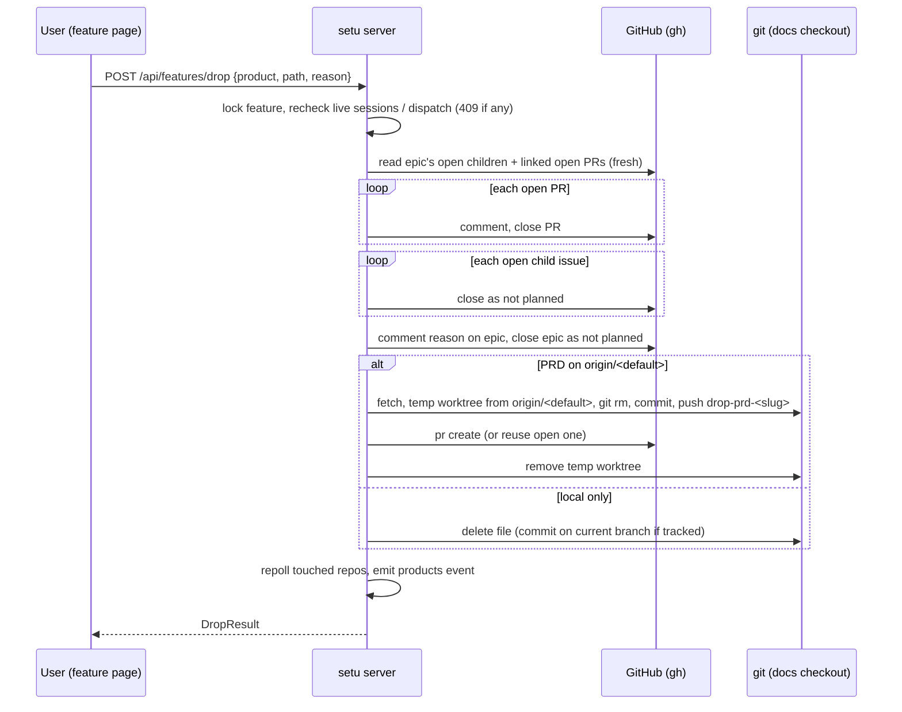

# PRD — Drop a feature

**Status:** Approved · **Date:** 2026-11-13 · **Slug:** `drop-feature` · **Owner:** Masnun Siam · **Priority:** medium · **Repo:** masnun-siam/ai-workflow

## Overview

A **Drop feature** action on a feature's page in setu. After one confirmation it abandons the feature everywhere: it closes the epic, its open issues and their open pull requests as not planned, and removes the PRD from the docs repo.

Today:
- The Features screen lists one row per PRD file found under `docs/prds/` in the product's docs checkout. Each row shows its epic (the open issue labelled `epic` and `prd-<slug>`), the epic's issues, their pull requests, the dispatch and the sessions.
- The closest existing feature is **Close epic** (`POST /api/epics/{owner}/{name}/{n}/close`). It shows a confirm dialog, then closes the epic's open children in the epic's own repo as *completed*, then the epic. It stops at the first failure and reports what it closed.
- Issues can already be closed as not planned one at a time (`POST /api/issues/{owner}/{name}/{n}/state`). The PRD editor commits a PRD change on the checkout's current branch and never pushes.
- No action abandons a whole feature. Today the user closes every issue and PR on GitHub by hand and deletes the PRD in git.

## Problem

Some features are dropped before they ship. Their PRD row stays on the Features screen, their issues stay on the board as work to do, and their open PRs stay mergeable. Cleaning that up means many manual GitHub and git steps across repos, and it is easy to miss one.

## Users

The single local setu user, who owns the product. Only that person drops a feature. No agent, autopilot, away-mode or dispatch run ever starts a drop.

## Goals

- Drop a feature in one confirmed action from setu.
- Nothing about a dropped feature stays open: no epic, issue or PR is left open and no PRD stays on the base branch.
- Before confirming, the user sees exactly what will close.

## Non-goals

- Undoing a drop. Reopening issues or restoring the PRD is done by hand on GitHub and in git.
- Stopping running sessions or dispatches as part of the drop (FR-3 refuses instead).
- Deleting branches, worktrees, labels (`prd-<slug>`), board items or Vault folders.
- Dropping a shipped feature, or dropping several features at once.
- Merging the PRD-removal pull request. Merging stays a human action on GitHub or through setu's existing merge.
- Changing issues the epic has already closed as completed.
- A "Dropped" section or any other new list state (Decision 2026-11-13, keep the row as normal).

## Requirements

- **FR-1 Drop action.** A feature page whose stage is not shipped shows a **Drop feature** action in its header. The action does not appear on Features list rows, on shipped features, or while that feature's PRD-removal PR is open (FR-7).
  - Acceptance: a draft, review, approved, tasks or building feature's page shows the action. A shipped feature's page and every list row do not.
- **FR-2 Confirmation.** The action opens a dialog. It lists the PRD path and whether the PRD will be removed through a pull request or deleted locally, the epic (number and title), each open issue that will close (number and title), each open PR that will close (number), and a count of issues that are already closed and stay as they are. It has an optional reason field (up to 2000 characters), a **Drop feature** button and a **Cancel** button. Nothing changes until **Drop feature** is pressed. When there is no epic, the dialog says only the PRD will be removed.
  - Acceptance: with an epic that has 3 open issues and 1 open PR, the dialog lists those 3 issues and the 1 PR. Pressing Cancel makes no change on GitHub or on disk.
- **FR-3 Refuse while work is running.** The drop is refused when any session about the feature is live (running or waiting), or when a dispatch that owns the epic or any of its issues is running or paused. "About the feature" means the sessions the feature page lists. The refusal names each live session and the dispatch. Nothing is closed or deleted.
  - Acceptance: with an implement-issue session running on one of the epic's issues, Drop answers 409 and names that session. Every issue and the PRD stay as they were.
- **FR-4 Close the work as not planned.** On confirmation, setu closes things in this order:
  1. Each open PR linked to an open child issue of the epic. A comment `Closed: the feature "<title>" was dropped.` plus the reason, if given, is posted first. The PR's branch is kept.
  2. Each open child issue of the epic, in any repo of the product, closed as *not planned*.
  3. The reason, if given, posted as a comment on the epic. Then the epic is closed as *not planned*.

  Children already closed are not changed.
  - Acceptance: after a drop, the epic and every child that was open are closed with state reason "not planned". Every PR that was open is closed and its branch still exists. Children closed earlier as completed still say "completed".
- **FR-5 Remove the PRD through a pull request.** After FR-4 succeeds, if the PRD file exists on the docs repo's base branch (`origin/<default branch>`), setu opens a pull request that only deletes that file:
  - branch `drop-prd-<slug>`, made from the latest base;
  - commit `docs(prd): drop <path>`;
  - title `Drop PRD: <title>`;
  - a body that lists the epic and the issues and PRs closed, and the reason.

  setu does not merge it. The user's checkout, its current branch and its uncommitted changes are not touched.
  - Acceptance: after a drop of a PRD that is on the base branch, an open PR from `drop-prd-<slug>` into the default branch deletes exactly that one file. The docs checkout's `git status` and current branch are the same as before the drop.
- **FR-6 Delete a local-only PRD.** If the PRD file is not on the base branch, setu deletes it from the docs checkout and opens no PR. If the file is tracked on the checkout's current branch, the deletion is committed on that branch (`docs(prd): drop <path> in setu`, only that file, never pushed). If the file is untracked, it is just removed.
  - Acceptance: an untracked draft PRD is gone from disk after a drop and no PR exists. A PRD committed only on a local branch is gone in a new commit on that branch, and nothing is pushed.
- **FR-7 Row while the PRD PR is open.** While an open PR from `drop-prd-<slug>` exists in the docs repo, the feature keeps its normal row and stage. Its next-step line reads `Dropping: PRD removal PR #<n> is open. Merge it to finish.` and its primary action opens that PR. Once the PR is merged and the checkout is pulled, the PRD file is gone and the feature leaves the list.
  - Acceptance: right after a drop that opened PR #n, the row shows that line and an **Open PR** action, and has no Create tasks, Refine, Run epic or Drop action.
- **FR-8 Partial failure and rerun.** The drop stops at the first failing step. It reports what it closed so far and which step failed. Running Drop again picks up where it stopped:
  - items already closed are skipped;
  - an existing open `drop-prd-<slug>` PR is reused;
  - an existing `drop-prd-<slug>` branch with no PR gets its PR opened;
  - a feature whose epic is already closed but whose PRD is still on the base branch can still be dropped, and only the PRD step runs.
  - Acceptance: when closing the second of three issues fails, the error lists the PRs and the first issue as closed, and the PRD is untouched. A second Drop closes the remaining two issues and the epic, then opens the PRD PR, without errors about the items already closed.
- **FR-9 One drop at a time.** A drop that starts while another drop of the same feature is still running is refused with 409 and changes nothing.
  - Acceptance: two simultaneous Drop requests for one feature give one success and one 409.

## Edge cases

- **Concurrency:**
  - Two drops of the same feature (FR-9).
  - A session or dispatch starting after the FR-3 check has passed. The check runs again right before the first write, but a run started between that check and the closes can still meet closed issues. The issues are closed anyway, and that run ends as it does today when its issue is closed.
  - Someone merging or closing one of the PRs at the same moment: a PR that is already closed or merged when setu reaches it counts as done, not as an error.
- **Empty states:**
  - No epic (draft, review, or approved without tasks): only the PRD step runs.
  - An epic with no children: only the epic closes.
  - No PRs: the PR step is skipped.
- **Limits:**
  - Reason: 2000 characters at most.
  - Children come from the epic's sub-issue links and the issues' parent links, the same way the feature page finds them. They can live in any repo registered to the product. Issues in repos outside the product are not seen and are not closed. The dialog's list is exactly what will close.
- **Missing data:**
  - The PRD file is gone from the checkout (deleted or pulled away) by the time Drop runs: 404 `no such PRD`, nothing closed.
  - The poller snapshot is stale: the server reads the epic's open children and their PRs fresh from GitHub just before closing, not from the snapshot.
- **Access and isolation:** setu is local and single-user and runs with the user's `gh` login. A drop only touches the product's own repos and its docs checkout. PRD paths are checked the same way as the PRD editor: only `docs/prds/**/*.md` inside a registered checkout.
- **Existing data:** nothing to migrate.

## Technical design


*The drop sequence; it stops at the first failure (FR-8).*

### Data

No new stored data. Two things are recognised by name from what the poller already collects:
- the PRD-removal PR, by its head branch `drop-prd-<slug>` in the docs repo's open PRs;
- the epic, by the existing `epic` + `prd-<slug>` label match.

The per-feature drop lock lives in memory only.

### API

`POST /api/features/drop`. Only the local UI calls it. The automatic answering of away mode and autopilot never calls it.

- Request: `{product: string, path: string, reason?: string}`.
  - `product` is a registered product's docs repo slug.
  - `path` is `docs/prds/**/*.md` in that docs checkout.
  - `reason` is at most 2000 characters, with no NUL.
- Response 200, `DropResult`:
  ```
  { ok: true,
    closed_prs: string[],     // "owner/name#n", closed by this call
    closed_issues: string[],  // "owner/name#n", closed by this call (children; epic excluded)
    epic: string | null,      // "owner/name#n" closed (or already closed), null when there was none
    prd: { action: "pr" | "deleted" | "committed", url?: string, branch?: string } }
  ```
- Errors (`internal/errs` kinds, body `{error}`):
  - 400: bad product, bad path or reason too long.
  - 404: unknown product, or no such PRD.
  - 409 `{error, live: [{id, title}], dispatch?: id}`: work is running (FR-3).
  - 409: a drop of this feature is already running (FR-9).
  - 409: the feature is shipped.
  - 502 `{error, closed_prs, closed_issues, epic}`: a GitHub or git step failed. The fields say what was done before it (FR-8).

`GET /api/features` changes in one way: when the docs repo has an open PR from `drop-prd-<slug>`, a `Feature` gets `dropping: {n, url}`. Otherwise `dropping` is `null`.

### Backend

- **Drop service** (in the feature views layer, using gh and products).
  - It resolves the feature as the Features view does: PRD, epic, children, linked PRs, sessions and dispatch.
  - It holds the per-feature lock and re-runs the FR-3 check.
  - Before closing, it re-reads the epic's open children and their open PRs from GitHub. A stale snapshot must not decide what closes.
  - It runs the FR-4 order and stops at the first failure.
  - Closing something that is already closed is treated as success.
- **Closing as not planned** reuses the existing issue-state write. The existing Close epic (*completed*, same repo only) stays unchanged.
- **PRD removal through a PR (FR-5):**
  - fetch the docs checkout's origin;
  - find the default branch;
  - check that the PRD exists on `origin/<default>`;
  - add a temporary git worktree from it, `git rm` only that path, commit, push `drop-prd-<slug>`, and open the PR with `gh pr create`, as dispatch already does for its final PR;
  - always remove the worktree, also on failure.
  - If the branch already exists remotely, setu reuses it. An open PR from it is returned as is.
- **Local PRD delete (FR-6)** uses the same path checks as the PRD editor. A tracked file gets a `git rm` and a commit of only that path on the current branch. An untracked file is removed. Nothing is pushed.
- **Features view:** compute `dropping` from the docs repo's open PRs. When it is set, the next step follows FR-7, ahead of every other stage rule. A feature without an open epic but with `dropping` set must not say "Create tasks".
- After the drop, every repo it touched is repolled.

### Frontend

- **Feature page header:**
  - a **Drop feature** button (not primary, in the danger tone), shown under the FR-1 conditions and hidden when `dropping` is set;
  - it opens a drop dialog built from the page's `Feature` data (FR-2), with the reason textarea;
  - **Drop feature** stays disabled while the request runs.
- **Results:**
  - On success: a toast ("Dropped. PRD removal PR #n opened." or "Dropped. PRD deleted."), then the features and the feature page refresh.
  - On 409 for live work: the dialog shows the live sessions, each linking to its session, and the dispatch.
  - On 502: the dialog shows what was closed and the error, and offers **Retry drop**.
- **Features list rows** get no new action. They show the FR-7 line and **Open PR** from the server's actions.

### Realtime and other components

- No new event. After the drop the server publishes the existing `products` topic refresh, and the repolls update the snapshots, so open Features, River and Inbox views drop the closed items on their next update.
- Other parts of setu that see the same issues:
  - Dispatch is refused upfront (FR-3).
  - Grind on a PR that is now closed stops as it does today for a closed PR.
  - The River's PRD card follows the same file and disappears when the file does.

### Non-functional

- A drop makes about one GitHub write per item plus one push. On large epics (more than 50 items) it may take a minute. The request has no fixed timeout beyond the per-command gh and git timeouts already used.
- No new dependencies.

### Threats and mitigations

Not affected. No confidential data. The destructive surface is limited by:
- the human-only endpoint, refused to agents;
- the explicit confirmation dialog;
- the existing PRD path checks;
- never merging, never force-pushing, never touching the user's checkout for the PR path.

### Testing

- **Go tests** (fake `gh` and real temp git repos):
  - FR-3: 409 with live sessions or a paused dispatch;
  - FR-4: the close order, *not planned*, already-closed children untouched;
  - FR-5: the PR deletes exactly one file, and the checkout's status and branch are unchanged;
  - FR-6: untracked and locally tracked files;
  - FR-8: failure part-way and rerun;
  - FR-9: concurrent drops;
  - FR-7: `dropping` and the next-step line in the features view;
  - the 404 and 400 cases.
- **Vitest:**
  - FR-1: the button shows only in the right stages;
  - FR-2: the dialog lists and Cancel makes no request;
  - the 409 and 502 renderings.
- **Manual:** one real drop on a throwaway feature in a test repo, checked on GitHub (state reasons, PR closed, PRD PR diff).

## Rollout and cost

- Everyone at once. No flag.
- No cost.
- Ship with updates to `docs/setu/API.md` (endpoint and `Feature.dropping`) and `CHANGELOG.md`.
- Rollback: revert the release. Drops already done are undone by hand (reopen on GitHub, close the PRD PR).

## Success metrics

None formally defined.

## Epics

- **E1 Drop a feature** — covers FR-1 to FR-9. Issue: #1004

## Decisions

- 2026-11-13 The PRD is removed through a branch and a pull request into the docs repo's default branch, not committed on the checkout's current branch — keeps the removal reviewable and leaves the user's checkout alone. Decided by: Masnun Siam, "Branch + pull request".
- 2026-11-13 Drop is refused while a session or dispatch on the feature is live; setu does not stop them — avoids a run writing to issues that are being closed, and the Stop buttons already exist. Decided by: Masnun Siam, "Refuse until stopped (Recommended)".
- 2026-11-13 Open PRs linked to the epic's issues are closed too, with their branches kept — a dropped feature must not leave mergeable work behind. Decided by: Masnun Siam, "Close them too (Recommended)".
- 2026-11-13 The confirmation is a dialog that lists the impact and takes an optional reason, posted on the epic — the user sees exactly what will close, and the reason stays on GitHub. Decided by: Masnun Siam, "Dialog listing impact (Recommended)".
- 2026-11-13 While the PRD-removal PR is open, the feature keeps its normal row, with a "Dropping" next step and no new list section — no new list state to build. Decided by: Masnun Siam, "Keep it as a normal row".
- 2026-11-13 A PRD that is not on the base branch is deleted locally and gets no PR (committed on the current branch if tracked) — matches "delete the PRD if it is there". Decided by: Masnun Siam, "Delete local file, no PR (Recommended)".
- 2026-11-13 Closing order is PRs, issues, epic, then PRD. The drop stops at the first failure and a rerun resumes — same as Close epic today, and the PRD is never removed while its work is still open. Decided by: Masnun Siam, "Stop, report, rerun resumes (Recommended)".
- 2026-11-13 The Drop action is on the feature page only and never for a shipped feature — destructive actions should not be one click from the list. Decided by: Masnun Siam, "Feature page, any non-shipped (Recommended)".

## Open questions

None.

## Change log

## Related

- Close epic: `POST /api/epics/{owner}/{name}/{n}/close` in `docs/setu/API.md` §5.3.
- Issue state: `POST /api/issues/{owner}/{name}/{n}/state` in `docs/setu/API.md` §5.3.
- PRD editor save: `PUT /api/prd` in `docs/setu/API.md` §5.3.
