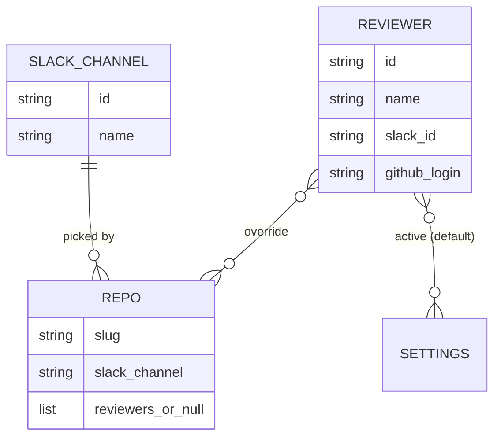
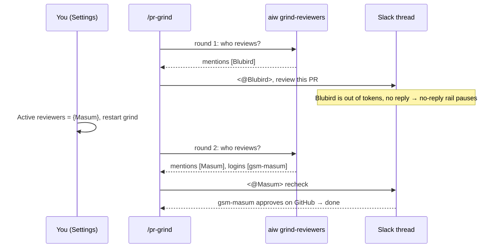
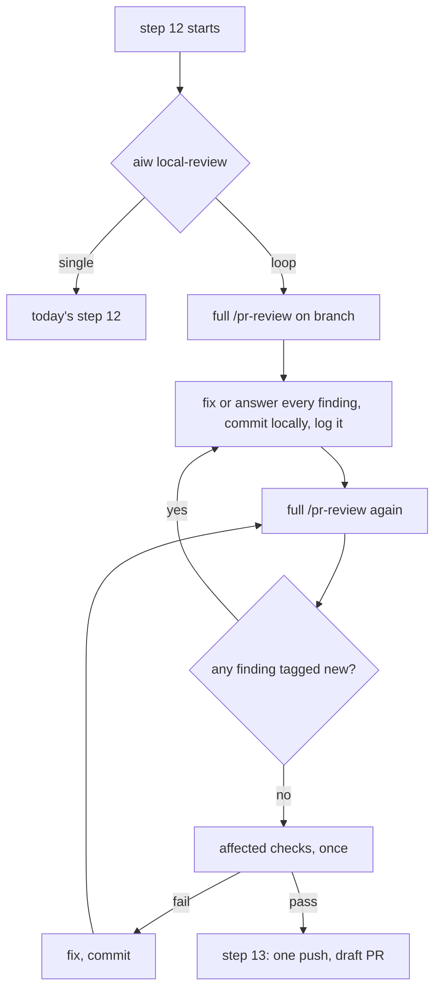

# PRD — Swappable grind reviewers, and a looping local review

**Status:** Approved · **Date:** 2026-11-03 · **Slug:** `grind-reviewers-review-loop` · **Owner:** Masnun Siam · **Priority:** medium · **Repo:** masnun-siam/ai-workflow

## Overview

This PRD adds two things to the `aiw ui` Settings page.

- **Swappable reviewers.** When the review bot changes or runs out of tokens, you switch from the UI to another bot or a human. Every repo follows the switch, and running grinds follow it too. Each repo's Slack channel is picked from a saved list.
- **Local review: Single / Loop.** `/implement-issue` can loop its local `/pr-review` until a round finds nothing new. The PR then reaches the grind clean, so the bot approves in the first round and the slow parts (pre-push hooks, CI, grinding) run about once per issue.

Today:
- **Slack channel.** Settings → Repositories has a free-text Slack channel field per repo. When set, it wins over `channels.json`'s mapping and is passed to `/pr-grind` as `--channel <id>`. A typo'd `#name` is accepted even though pr-grind needs an id.
- **The bot to mention.** It is one global `bot_uid` in `channels.json`, which fills the `trigger` and `retrigger` templates (`"<@{bot_uid}> review {pr_url}"`, `"<@{bot_uid}> recheck"`). To change it you edit that file by hand, and running grinds keep the old value. A bot that has run out never replies. The no-reply rail then pauses the grind.
- **GitHub reviewer.** Each repo can store one GitHub `reviewer` login. There is no field for it in the UI, and it is only used when the repo has no channel in Settings or `channels.json`.
- **Recognising the reviewer.** pr-grind reads a reviewer's rounds from GitHub reviews, by login. On the Slack path the state header's `reviewer:` starts as `UNRESOLVED` and is learned from the first non-author review. A comment from a login that is neither the author, the reviewer nor in `known_bots` is treated as a third-party human and ends the grind (rail 3).
- **Read every round.** Grinding Deep / Simple is a global radio, read by `/pr-grind` each round through `aiw grind-mode`. Reading a setting each round is the pattern this PRD follows.
- **Local review today.** `/implement-issue` runs the local checks at step 9. At step 12 it runs `/pr-review <branch>`, fixes Critical and Major findings, and re-reviews only the new commits until none of those are left. Minor findings, and anything outside the re-reviewed commits, surface later as grind rounds, and each of those rounds costs a push, the pre-push hook and a CI run.

## Problem

- When the review bot is replaced or out of tokens, every grind stalls until someone edits `channels.json` and restarts the grinds by hand. This is the owner's experience. The state files hold no recorded no-reply pause yet, so there is no measured count.
- A human can't step in as reviewer through the grind. Their review would even end the grind as a third-party human.
- Grinds take several rounds because the local review stops at Critical and Major. Each extra round repeats the slowest steps of the flow. Baseline from the 263 pr-grind state files of 2026-09-18 to 2026-11-03: of the 236 grinds with at least one round, 126 (53%) closed in round 1 and 110 (47%) took 2 or more, with a mean of 1.85 rounds and a maximum of 9.
- A repo's Slack channel is free text, so a typo'd `#name` is saved and only fails when a grind tries to post.

## Users

The person running `aiw ui`, usually the repo owner. It is single-user, with no roles. The UI is local, and can also be reached over Tailscale by the tailnet node's owner only. Settings are per machine and live in the plugin data dir.

## Goals

- Swapping the reviewer (bot to bot, or bot to human) is one change in Settings. It reaches every repo that has no override, and it reaches running grinds at their next recheck, except grinds pinned by `--reviewer` (FR-5).
- With Loop on, at least 80% of Loop-mode PRs are approved in the grind's first round (baseline 53%), with one push and one CI run.

## Non-goals

- No per-PR or per-dispatch override of the channel, the reviewers or the review mode.
- Channels and members are not fetched from Slack. Names and ids are typed by hand.
- `/release-pr`'s trigger is unchanged. It keeps `channels.json`'s `bot_uid`.
- A repo does not use Slack and GitHub at once. Slack wins, as today.
- There is no "every reviewer must approve" rule. The first approval ends the grind.
- There is no automatic detection that a bot is out of tokens. The swap is manual.
- The review loop has no round cap, and you can't choose which severities to fix. Single mode keeps today's step 12 word for word.
- `channels.json` stays. It still holds `owner_uid`, `workspace_url`, `known_bots`, `dm_fallback`, the templates and the `bot_uid` fallback.
- A swapped-out reviewer's pending GitHub review request is left on the PR. It is not removed.

## Requirements

- **FR-1 Saved channel list.** Settings has a **Slack channels** list. Each entry is a name (1–60 characters) and a channel id (`C`, `G` or `D` followed by 8–12 uppercase letters or digits). You can add, rename and delete entries. Ids are unique. A channel picked by a repo can't be deleted. The list holds at most 50 entries.
  - Acceptance: `#reviews` / `C0B8385GKNK` is listed. `#reviews` / `reviews` is rejected with "channel id must look like C0123ABCD". A duplicate id is rejected with "channel C0B8385GKNK is already listed". Deleting a picked channel is refused with "channel C0B8385GKNK is used by owner/repo".
- **FR-2 Repo picks a channel.** The Slack channel cell becomes a dropdown over the list plus **None**, and it saves on change. A grind for the repo gets `--channel <picked id>`. **None** falls back to `channels.json`'s mapping, as an empty field does today.
  - Acceptance: if repo A picks `#reviews`, a grind on A's PR starts as `/pr-grind <url> --channel C0B8385GKNK`.
- **FR-3 Saved reviewer list.** Settings has a **Reviewers** list. Each entry has:
  - a name (1–60 characters);
  - an optional Slack member id (`U` or `W` followed by 8–12 uppercase letters or digits);
  - an optional GitHub login (`[A-Za-z0-9-]{1,39}`). The login `copilot` stands for Copilot: it is requested as `copilot`, and reviews by `copilot-pull-request-reviewer[bot]` count as its reviews.

  At least one of the Slack id and the login is required. Slack ids and logins are each unique across the list, and logins are compared ignoring case, here and everywhere a review's login is matched. The list holds at most 50 entries. Deleting an entry removes it from the active set and from every repo override, after a confirm.
  - Acceptance: "Blubird AI Agent" / `U0BS34962FK` / `blubird-ai-agent` and "Masum" / `U0373SRT22G` / `gsm-masum` are listed. An entry with neither field is rejected with "add a Slack id or a GitHub login". `@bot` as a Slack id is rejected with "Slack id must look like U0123ABCD". `Gsm-Masum` next to `gsm-masum` is rejected with "login gsm-masum is already listed". A bad login is rejected with "not a GitHub login".
- **FR-4 Active reviewers, global with a repo override.** The Reviewers section has an **Active** tick per entry, and any number can be active. Each repo's Reviewers cell shows **Default** (the global active set) or an override of its own ticks, and **Use default** clears the override. A repo's reviewers are its override when it has one, otherwise the active set.
  - On the Slack path (the repo has a channel, from Settings or `channels.json`), the reviewers' Slack ids are mentioned.
  - On the GitHub path, the reviewers' logins are requested. A login whose request fails is skipped with a warning, and the others are still requested.

  An entry missing the field its path needs is shown dimmed, with "not used: no Slack id" (or "not used: no GitHub login"). A Slack-path entry with no login shows "login learned from its first review" (see FR-6).
  - Acceptance: if the global active set is {Blubird} and repo B overrides it with {Masum}, a grind on A mentions Blubird and a grind on B mentions Masum. After **Use default** on B, B's grinds mention Blubird.
- **FR-5 The swap reaches running grinds.**
  - **Fixed at grind start:** the path (Slack or GitHub), the channel and the thread. They come from `--channel` / `--reviewer` when given, otherwise from the first `aiw grind-reviewers` output. A later channel change doesn't move a running grind.
  - **Read every round:** the reviewers. Before each recheck, `/pr-grind` runs `aiw grind-reviewers --pr <url>` and mentions (Slack) or requests (GitHub) that set, in the same thread or on the same PR. A swap done between rounds is used at the next recheck.
  - **Precedence:** an explicit `--reviewer <login>` pins the reviewers to that login for the whole grind, and the resolver's reviewers are not used. Grinds that the UI starts (auto-grind, the per-issue switch, dispatch lanes) pass `--channel` on the Slack path as today and never pass `--reviewer`. Dispatch lanes started before the upgrade keep their stored `--reviewer` and stay pinned, as today.
  - **Nothing usable mid-grind:** if a round's resolver output has no usable reviewer for the grind's path, or the resolver fails, the recheck uses the previous round's set, and the state file records `reviewers-kept: <reason>`.

  A grind the no-reply rail paused because the old bot never answered is restarted from the UI's Grind action, as today. The restart rechecks with the current reviewers in the existing thread instead of re-opening it.
  - Acceptance: a grind is waiting on Blubird. You switch the active set to {Masum} and restart the grind. The thread's next message is `<@U0373SRT22G> recheck`, and Masum's GitHub review is read as that round. A hand run `/pr-grind <url> --reviewer bob` on a repo whose default is {Blubird} requests `bob` every round.
- **FR-6 Mentioned reviewers are expected, not third parties.** A review or comment counts as a reviewer's round, and never trips rail 3, when its GitHub login belongs to any reviewer the grind has mentioned or requested so far. That includes one swapped out since, so a late review from the old bot is still read. Each reviewer with no login learns exactly one login per grind, as `UNRESOLVED` is learned today: after it is first mentioned, the first review by a login that is not the author and not already in the set is learned as theirs (for the earliest-mentioned one, if several are unresolved). The pairing is recorded in the state header as `learned: <slack id>=<login>`, and that reviewer is resolved for the rest of the grind. Once every mentioned no-login reviewer is resolved, learning stops, and a review by any other unknown login goes through rail 3 as today. Everyone else is treated as today.
  - Acceptance: after a swap from Blubird to Masum, a review by `gsm-masum` is that round's review, and a late review by `blubird-ai-agent` joins the same round, even after Blubird is deleted from Settings. A review by `copilot-pull-request-reviewer[bot]` is read as the round of a grind that requested `copilot`. A comment by an unlisted human still ends the grind. After the migrated bot's login is learned, a review by an unlisted human ends the grind too.
- **FR-7 First approval ends the grind.** A round completes on the first review that lands after the trigger from any mentioned reviewer. Reviews from the others that have landed by then join that round, and all their findings are handled, in either mode. An approval is a GitHub review in the `APPROVED` state, or a bot review that pr-grind already parses as clean. A review is a bot review when it carries the `**Verdict: …**` line pr-grind parses, or its login passes rail 3's bot test (`[bot]`, `user.type == "Bot"`, or in `known_bots`). Any other review is a human's. A human's comment-only review is never an approval.
  - Simple mode ends at the round with an approval from any of them.
  - Deep mode ends at the first round where any one of them has an approval, or a bot review with zero blocker and should-fix findings. A human's review counts only as an approval.
  - In both modes, findings from the others in that same round are fixed and pushed, and the grind closes without a recheck.
  - Acceptance: if Blubird and Masum are both active, Masum approves and Blubird is silent, a simple grind closes. If, in the same simple round, Masum approves and Blubird's review has a blocker, the blocker is fixed and the grind closes without a recheck. The same holds in a deep round where Masum's review is clean. A comment-only review by Masum with no inline findings doesn't close a deep grind.
- **FR-8 Nothing to mention.** On the Slack path with no reviewer that has a Slack id, `/pr-grind` mentions `channels.json`'s `bot_uid`, as today. If that is missing too, or the GitHub path has no reviewer with a login, the repo skips grinding with the existing warning ("no Slack channel or reviewer, its lanes skip grinding"), and auto-grind starts nothing. This applies at grind start. A running grind follows FR-5's "nothing usable mid-grind".
  - Acceptance: if repo C has no channel and no reviewer with a login, its dispatch preview shows the warning, and a PR turning ready starts no grind.
- **FR-9 Existing settings carry over.** The first load after the upgrade seeds the lists once. Seeding dedupes channels by id and reviewers by login (ignoring case), and a value that fails FR-1 or FR-3 validation never becomes an entry:
  - Each repo's valid channel value becomes one channel entry, named after its id, and stays picked.
  - Each valid `channels.json` channel id not already listed becomes an entry. None of them is picked, because the mapping still applies through None.
  - A valid `bot_uid` becomes the reviewer `bot_label` (cut to 60 characters, or "Review bot" when absent), with that Slack id and no login, and it is the only active entry. An invalid `bot_uid` seeds no reviewer.
  - Each repo's valid stored GitHub `reviewer` becomes one reviewer (login only), and that repo overrides with it when it has no channel in Settings or `channels.json`.

  No notice is shown after the migration. The seeded entries appear in the lists, where the id-named channels can be renamed.

  A stored channel value that is not a valid id stays on the repo, is not listed, shows a red **invalid** chip, and grinds for that repo skip with a warning until another channel is picked.
  - Acceptance: after the upgrade, a grind on a repo whose channel was `C0B8385GKNK` posts the same trigger as before the upgrade, and the bot's first review is read as round 1 without tripping rail 3. Two repos with reviewer `copilot` give one Copilot entry.
- **FR-10 Local review mode setting.** Settings has **Local review: Single / Loop**, a global radio next to Grinding, defaulting to Single. `aiw local-review` prints `single` or `loop`, and prints `single` when the setting is unset or unreadable.
  - Acceptance: a fresh install prints `single`. After Loop is picked, it prints `loop` with no restart.
- **FR-11 Single mode is today's step 12.** In Single mode, `/implement-issue` step 12 is unchanged.
  - Acceptance: with Single, step 12's instructions and the PR body's review section are what they were before this feature.
- **FR-12 Loop mode.** Step 12 runs `aiw local-review` when it starts. On `loop`, it works as follows:
  1. It runs a full `/pr-review <branch>` against the base branch.
  2. It handles every finding of every severity: it fixes it in a new local commit, or records why not.
  3. It runs the full review again, and repeats until a round reports no finding that wasn't raised in an earlier round. The same point about the same code counts as already raised, even reworded or on a shifted line. A finding that was fixed or answered doesn't count again. There is no round cap.
  4. Step 12 itself runs no repo checks and pushes nothing during the loop. Each `/pr-review` round still runs its own verification (step 4 of that skill), so the tests it picks run once per round.
  5. When the loop settles, it runs the affected checks once, the way step 9 picks them. If a check fails, it is fixed as step 9 fixes failures (no cap), the fix is committed, and the loop goes back to a full review (step 3), then the checks run again. A check that never passes is stopped from the UI session, as a loop that never settles is.
  6. Only then does step 13 push.

  **Findings log.** Every finding is recorded in a log kept in the worktree's git directory, never committed. Step 12 reads it first, so it survives a context compaction. The log is open until the loop settles and step 13 pushes, and then it is marked done. A step-12 run that finds an open log resumes it (an interrupted or compacted run, or a rerun after you stopped the session): it continues the round numbers, and N counts every round. A run that finds a done log, or none, starts a fresh one. Single mode neither reads nor writes it. Each entry has the round, a number, the file and line, a one-line summary, a tag (`new` or `repeat of round N #k`) and what was done (`fixed <sha>` or `answered: <reason>`). The loop's stop decision is read from the tags.

  Each round's start is printed in the session as `Local review round N: K new findings`. The PR body states the marker line `Local review: loop, N rounds`, then the log's findings with their tags and outcome. The final report repeats the marker line.
  - Acceptance: if round 1 has 3 findings (2 fixed, 1 answered) and round 2 only repeats the answered one, tagged `repeat of round 1 #3`, the loop ends after round 2. The checks then run once, there is one push, and the PR body says "Local review: loop, 2 rounds". If round 2 has a new minor finding, round 3 runs. If the session is stopped during round 3 and `/implement-issue` is rerun, it resumes at round 4 with rounds 1–3's findings still counted as raised. A later Loop run after that push starts at round 1.

## Edge cases

- **Concurrency.** Each repo row and each list saves under the existing settings lock. A list save replaces the whole list, and the last write wins. A control is disabled while its save is in flight, so fast ticks during a swap can't race in the UI. A grind reads the reviewers at the start of each round. A swap that lands mid-round applies from the next recheck. A recheck already posted is not re-posted.
- **Swap in two saves.** Unticking the bot then ticking a human passes through an empty active set. A round that reads in between keeps the previous set (FR-5).
- **Swap during a Slack round with no reply.** The old bot's mention stays in the thread. The new set is mentioned at the next recheck, or when you restart a paused grind (FR-5).
- **Grinds running at upgrade.** A state file with no `reviewers:` line is treated as having one seeded from its `reviewer:` value (unless `UNRESOLVED`) plus the current resolver logins, and the line is written at the next round.
- **Mode switched mid-run.** The mode is read once, at the start of step 12. A switch after that doesn't affect that run.
- **Empty states.** No channels: the dropdown shows only None. No reviewers: the cell says "Add reviewers in Settings → Reviewers". No active reviewer: the Default cell shows "Default (none, mentions <bot_label>)" on Slack-path repos (the `channels.json` bot's `bot_label`, or "the channels.json bot") and "Default (none, grinding skips)" on GitHub-path repos, and the Reviewers section shows "No active reviewer: Slack repos mention <bot_label>, GitHub repos skip grinding."
- **Limits.** The 51st entry in either list is refused with "at most 50".
- **A human reviewer is the PR author.** `/pr-grind` drops that login for that PR, using the PR data it already fetches, since a review is never requested from the author. If nobody is left, FR-8 applies at start and FR-5's previous-set rule mid-grind.
- **Unreadable settings.** If `ui_settings.json` is missing, `aiw grind-reviewers` resolves from `channels.json` alone. If it is corrupt or unreadable, it prints `{"error": "…"}` and exits 1. A grind start then behaves as today, and a running grind keeps the previous set (FR-5).
- **A loop that never settles.** By decision there is no cap. The run shows as a live session in the UI with its round lines, and is stopped there. The rounds so far stay committed locally, and the findings log keeps what was raised.
- **Data isolation.** Not applicable, since this is single-user. The lists live in the plugin data dir, never in a repo. They appear outside it as mentions in the repo's own grind thread, review requests on its PR, the `GET /api/settings`, dispatch preview, grind start and dispatch lane views (local, or over Tailscale to the node owner), and the `reviewers:` line of pr-grind state files, which stays until the state file is removed.

## Technical design

### Data

All of this lives in the existing `ui_settings.json` in the plugin data dir (FR-1, FR-3, FR-4, FR-10):

```
slack_channels:   [{ id: "C0B8385GKNK", name: "#reviews" }]
reviewers:        [{ id: "r-<8 hex>", name: "Blubird AI Agent", slack_id: "U0BS34962FK" | "", github_login: "blubird-ai-agent" | "" }]
active_reviewers: ["r-…", …]                   # the global default, may be empty
review_mode:      "single" | "loop"
repos.<owner/repo>.slack_channel: "<channel id>" | ""   # unchanged field, now a list id, "", or a legacy invalid value (FR-9)
repos.<owner/repo>.reviewers:     null | ["r-…", …]     # null = follow active_reviewers; replaces `reviewer`
```

- A reviewer's `id` is generated when the entry is created, and it stays the same through renames.
- The migration (FR-9) is keyed on whether `reviewers` exists. Normal reads stay lock-free: only when `reviewers` is absent does a load take the settings lock, re-check under it, migrate, and write. So two racing first loads produce one set of ids. It drops the old per-repo `reviewer` field.
- The pr-grind state file header gains `reviewers: <logins>`. This is the cumulative set of logins mentioned, requested or learned in this grind, which FR-6 uses.
- The existing `reviewer:` header key stays. pr-grind writes `reviewer: UNRESOLVED` while any mentioned no-login reviewer has no `learned:` line, otherwise the first login of `reviewers:`. Review polling uses `not-author` on the PR author while it is `UNRESOLVED`, otherwise any login in `reviewers:`.


*A repo has one channel. Its reviewers are its override, or else the global active set.*

### API

These extend the existing `GET` and `PUT /api/settings`. A partial `PUT` keeps the fields it leaves out.

- `GET` adds `slack_channels`, `reviewers`, `active_reviewers`, `review_mode` and a read-only `bot_label: string | null` (from `channels.json`). Each `repos.<slug>` gains `reviewers: string[] | null`, `channel_invalid: bool` and a read-only `path: "slack" | "github" | null` from the reviewer resolver. `PUT` ignores the read-only fields.
- `PUT` with `slack_channels` or `reviewers` replaces that whole list. `active_reviewers` and `repos.<slug>.reviewers` take arrays of known ids, and a repo's `reviewers` can also be `null`. Removing a reviewer removes its id from `active_reviewers` and from every repo override.
- `PUT` answers `400 {error}` when:
  - an entry fails FR-1 or FR-3 validation;
  - a channel id, a Slack id or a login is duplicated (logins ignoring case);
  - a list has more than 50 entries;
  - a removed channel is still picked ("channel C… is used by owner/repo");
  - a repo's `slack_channel` is not in the list (unless it is that repo's unchanged invalid value);
  - a reviewer id is unknown;
  - `review_mode` is not `single` or `loop`.
- **CLI `aiw grind-reviewers --pr <url>`** (FR-5, FR-6, FR-8) resolves the PR's repo and prints JSON:

  ```
  {path: "slack" | "github", channel: "<id>" | null, mentions: ["U…"], logins: ["…"], unlogged: ["U…"], skip: "<warning>" | null}
  ```

  - `unlogged` holds the Slack ids of the current reviewers that have no GitHub login. `/pr-grind` adds them to a cumulative header line `unlogged: <ids>`, and an id is resolved once it has a `learned:` line (FR-6).
  - `skip` is set when the repo must not grind, and holds the warning to show: "no Slack channel or reviewer, its lanes skip grinding" (FR-8: no channel and no reviewer with a login, or the Slack path with no reviewer Slack id and no `bot_uid`), or "invalid Slack channel <value>, pick a channel in Settings" (FR-9's invalid stored value). Grind start and the dispatch preview skip on it. `/pr-grind` stops at start with that line, except that a run given `--channel` ignores the invalid-channel skip, since its channel comes from the argument. Otherwise it is `null`.

  - `mentions` holds the Slack ids of the repo's current reviewers.
  - `logins` holds their GitHub logins, used to recognise reviews on both paths.
  - It reads `ui_settings.json` and `channels.json` only. It does no network call and doesn't filter out the PR author; `/pr-grind` does that.
  - The output is the same for hand runs. An unregistered repo, or a PR it can't parse, gives `{path: null, channel: null, mentions: [], logins: [], unlogged: [], skip: null}` with exit 0, and pr-grind then behaves as today. An unreadable settings file gives `{"error": "…"}` with exit 1.
- **CLI `aiw local-review`** prints `single` or `loop` (FR-10, FR-12).
- `/pr-grind` keeps its current arguments (`--channel`, `--reviewer`), with the precedence in FR-5. No new argument is needed.

### Backend

- **Settings** (FR-1, FR-3, FR-4, FR-9, FR-10): validation, the one-time migration, refusing to delete a picked channel, and cascading reviewer deletes.
- **Reviewer resolver** (FR-4, FR-8): one function behind `aiw grind-reviewers`. Grind start (auto-grind, the per-issue switch, dispatch lanes) and the dispatch preview warning use it too, so the skip decision and the mentions always agree. Grind start no longer reads the per-repo `reviewer` field.
- **`/pr-grind` skill** (FR-5 to FR-8):
  - At start it fixes the path, channel and thread (FR-5). Each round, before waiting or rechecking, it runs `aiw grind-reviewers --pr <url>` unless `--reviewer` pinned the grind.
  - The trigger and recheck fill the templates' `{bot_uid}` so that the posted text has one valid mention per id: for one id `<@U0373SRT22G> recheck`, for two `<@U0373SRT22G> <@U0BS34962FK> recheck`. The existing templates and `channels.json` stay as they are, and an empty `mentions` uses `bot_uid`.
  - On the GitHub path, it requests every current login at each recheck, skipping the PR author, as Step 7 re-requests after a push today. A login is requested once per recheck. A login whose request fails (for example, not a collaborator) is skipped with a `request-failed: <login> — <error>` line in the state file, and the other logins are still requested. If every request fails, FR-5's previous-set rule applies.
  - Logins are added to the header's `reviewers:` set, including ones learned from a no-login reviewer's first review. That set counts as expected reviewers for reading rounds and for rail 3, compared ignoring case, with `copilot` matching `copilot-pull-request-reviewer[bot]`.
  - The done rules follow FR-7.
- **Review polling** (FR-5, FR-6): both the aiw ui tick that wakes headless grinds and the Monitor that interactive grinds arm watch reviews from any login in the header's `reviewers:` set, compared ignoring case, and still use `not-author` while a mentioned no-login reviewer has no `learned:` pairing. Each poll is one reviews read per grind, whatever the size of the set. Today both watch the single `reviewer:` login only, with a case-sensitive match.
- **`/implement-issue` skill, step 12** (FR-11, FR-12): one paragraph is added. It runs `aiw local-review`. On `single` it continues with the current text. On `loop` it follows FR-12. This is a recorded deviation from the imported skill (see Decisions). It is added as a keep rule in `skills/sync-from-wasensi/references/generalisation-rules.md` so `/sync-from-wasensi` keeps it.


*A reviewer swap reaching a grind that was already running.*


*Loop mode: review until clean, check once, push once.*

### Frontend

- **Settings → Repositories:**
  - The Slack channel text field becomes a select (saved channels plus None). An invalid stored value shows a red **invalid** chip with the hint "Not a channel id. Pick a channel; grinds skip until then."
  - A new **Reviewers** column shows **Default** (the active names, muted) or the repo's override chips. A popover offers checkboxes over the list plus **Use default**. Entries that the repo's path can't use are dimmed and labelled with the FR-4 hint.
  - Under the Grinding radio there is a **Local review: Single / Loop** radio. Its hints are "Single: fix Critical/Major, re-review new commits" and "Loop: re-review until nothing new, then check and push once".
- **Settings → Reviewers** (new section): a table of name, Slack id, GitHub login, **Active** and delete, with an Add row. The **Active** column is the swap control: unticking the bot and ticking a human is the whole swap.
- **Settings → Slack channels** (new section): a table of name, id and delete, with an Add row.
- **Saving, in both tables:** the Add row saves on its **Add** button or Enter. On success the row appears in the table, the Add row clears, and focus returns to its first field. A rename saves on blur or Enter. Values are validated inline under the field, with the FR-1 / FR-3 messages, before saving, and a server `400` is shown as a toast. Ticks, selects and the popover save on change, and the control is disabled until its save resolves. A failed save reverts, as repo rows do today.
- **Delete copy:** deleting an entry in use asks "Delete Masum? It is active and overrides org/api." (naming each place it is used); an unused entry asks "Delete Masum?".
- **Accessibility:** the Reviewers cell's popover opens with Enter or Space, closes with Escape, and returns focus to the cell. Each **Active** checkbox is labelled "Active: <name>". Dimmed entries and muted default names keep their hint text at body-text contrast, so the state never relies on dimming alone.
- **States:** loading uses the existing settings skeleton. An empty list shows a one-line hint and the Add row. No active reviewer shows the edge-case warning.

```
Reviewers                                   Active
 Blubird AI Agent   U0BS34962FK  blubird-ai-agent   [ ]
 Masum              U0373SRT22G  gsm-masum          [x]
 Copilot            —            copilot            [ ]
 [+ Add reviewer]

Repositories
 Repo      Auto-grind  Slack channel   Reviewers
 org/app   [on]        [#reviews  v]   Default (Masum)
 org/api   [off]       [None      v]   [Copilot] override
```

### Realtime and other services

Not affected. Settings are read at grind start, at every grind round, and on every `aiw local-review` call. `/release-pr` keeps using `channels.json`.

### Non-functional

- Stdlib only. `ui_dist/` is rebuilt and committed.
- Slack ids and logins entered in Settings are validated before they reach a prompt or a `gh` call. They are the only user-entered text a grind sends anywhere. The `bot_uid` fallback from `channels.json` is used as today, unvalidated.
- `aiw grind-reviewers` reads local files only, has no network access, and returns in well under a second.

### Testing

- Plain `assert` scripts under `run-engine/` (`test_ui_settings.py`, `test_ui_grind.py` and a new resolver test) cover:
  - validation and cascading deletes, including case-insensitive login uniqueness (FR-1, FR-3);
  - every `PUT` 400 case in the API list, including the unchanged-invalid-value exception, and that a partial `PUT` keeps omitted fields;
  - the migration from `channels.json` and old repo fields: dedupe by id and login, invalid values not listed, invalid `bot_uid` not seeded, a long `bot_label` cut, and that a second load changes nothing (FR-9);
  - the resolver: Slack, GitHub, override, default, empty → `bot_uid`, empty → skip, and invalid channel (FR-2, FR-4, FR-8);
  - FR-8 at grind start: the dispatch preview warning, and a PR turning ready on a skipping repo starts no grind;
  - `aiw grind-reviewers` output, including an unknown repo, a missing and a corrupt settings file (FR-5);
  - `aiw local-review` (FR-10);
  - the ui tick waking on a review from a second login in `reviewers:`, with a login in different case, using one reviews read.
- Vitest tests under `ui/` for the Settings Reviewers and Slack channels sections cover: the control disabled while its save is in flight, a failed save reverting, the popover's Enter / Space / Escape and focus return, the delete-confirm copy, the **invalid** chip and its hint, and both "Default (none, …)" empty states.
- A plugin-text test checks that `/pr-grind`:
  - fixes path and thread at start and calls `aiw grind-reviewers` each round unless `--reviewer` pins it;
  - keeps the previous set on an empty or failed resolve and writes `reviewers-kept: <reason>`, and seeds a missing `reviewers:` line;
  - writes `request-failed: <login> — <error>` for a failed request and still requests the others, and keeps the previous set when every request fails;
  - learns one login per no-login reviewer, records `learned:`, and stops learning once all are resolved;
  - treats header `reviewers:` logins as expected for rail 3, ignoring case, with the Copilot mapping and the no-login learning rule;
  - skips the PR author, rechecks in the existing thread on restart, and states the approval and same-round rules (FR-5 to FR-8).

  It also checks that `/implement-issue` step 12 runs `aiw local-review`, keeps the Single text, and in Loop mode keeps the findings log, resumes an open log and starts fresh after a done one, tags findings, returns to a full review after a check fix, and runs checks once before one push (FR-11, FR-12).
- Manual tests:
  - a real grind swapped mid-way from a bot to a human (FR-5, FR-6);
  - a restart of a no-reply-paused grind after a swap (FR-5);
  - one `/implement-issue` run in Loop mode, checking that there is one push and one CI run (FR-12).

## Rollout and cost

This ships to everyone in a normal plugin release, and the migration runs on first load. Loop mode spends more tokens on the local review (a full review each round, including `/pr-review`'s own test runs, with no cap), in exchange for fewer pushes, CI runs and grind rounds. It is opt-in, and Single is the default. Mentioning several reviewers can cost more on the bots' side. Operations have nothing to do.

## Success metrics

- **Grind rounds per PR**, counted from the `## Round n` headings in pr-grind state files. Loop-mode PRs are the ones whose body has the `Local review: loop` marker line. The baseline is 53% closing in round 1 (see Problem). The target is at least 80% for Loop-mode PRs, compared with the other PRs over the same period.
- **CI runs per PR** for Loop-mode PRs, counted with `gh run list --branch <head>`. The target is 1, apart from flakes. There is no baseline yet, since the state files don't record CI runs. The same query over Single-mode PRs of the same period gives the comparison.
- **Local review rounds per Loop run**, read from the PR body's marker line, to show what the loop costs.
- **Stalled grinds after a bot outage**, counted from state files with a no-reply `paused:` line: the time from that pause to the next round. The baseline is none recorded so far. The target is that none stays paused once the active reviewers are swapped and the grind restarted.

## Epics

- **E1 Swappable grind reviewers, and a looping local review** — covers FR-1 to FR-12. Issue: #835

## Decisions

- **Goal (owner):** the review bot is sometimes replaced or runs out of tokens, and another bot or a human must be mentioned from the UI in the meantime. The local review loop exists so that the grind approves in its first round and pre-push, CI and grinding each run about once.
- **Channels:** a saved list with a dropdown per repo. A free-text field allows a bad `#name`, and an override per grind isn't needed.
- **Reviewers:**
  - **Where the swap is set.** The active set is global and a repo can override it. A bot outage hits every repo, so the swap is one click, while a repo can still keep a different bot.
  - **How many.** Several reviewers can be active and all are mentioned. The first approval ends the grind (simple: any approval; deep: any clean review). This is faster, and you accepted that the others' later findings may go unhandled. Findings already in the closing round are still handled.
  - **Entry shape.** Each entry is a Slack id and/or a GitHub login, rather than a slack-or-github kind. The login is how pr-grind reads a reviewer's rounds, and it keeps a human reviewer mentioned in Slack from tripping rail 3. A Slack-only entry has its login learned from its first review, as today.
  - **Running grinds.** A swap reaches them at the next recheck: pr-grind reads `aiw grind-reviewers` each round, as it reads `aiw grind-mode`. Fixing the reviewers at grind start would leave stalled grinds stuck. The path, channel and thread stay fixed, so a grind keeps one place to post.
  - **Hand runs.** An explicit `--reviewer` pins the grind, so what you typed is what runs.
  - **Deleting is not revoking.** A running grind keeps trusting every login it has mentioned, requested or learned, even after that reviewer is unticked or deleted in Settings. This is deliberate: a late review from a swapped-out bot must still be read. To shut a reviewer out of a running grind, stop the grind.
  - **A failed review request** skips that login with a warning, so one bad entry doesn't pause a grind that has other reviewers.
  - **Slack or GitHub.** The two paths stay exclusive, and Slack wins, as today. pr-grind keeps one place to post per round.
  - **Fallback.** An empty Slack mention list falls back to `bot_uid`, and the templates keep `{bot_uid}` as the fill point. Hand runs and `channels.json` keep working unchanged.
  - **Skip in the resolver output.** `aiw grind-reviewers` gains a `skip` field, so `path: null` keeps meaning "behave as today" and an invalid-channel repo never falls back to `channels.json` silently.
  - **UI reads.** `GET /api/settings` returns each repo's path and `channels.json`'s `bot_label`, read-only, so the UI can dim entries and show the empty-state text.
  - **No-login reviewers.** The resolver lists them as `unlogged`, and pr-grind keeps a cumulative `unlogged:` header line, so learning knows when to stop across sessions.
  - **Bot reviews.** A review with the Verdict line, or from a login that passes rail 3's bot test, is a bot review. Review bots that post as ordinary users are covered by the Verdict line.
  - **Re-request.** Every current login is requested at each recheck on the GitHub path.
  - **Unlearned signal.** The `reviewer: UNRESOLVED` header value marks an unlearned no-login reviewer. No new header key.
- **Review loop:**
  - **Where it lives.** It goes in `/implement-issue` step 12 and reads `aiw local-review`, as a recorded deviation from the imported skill, so hand runs follow it as well as UI runs. You approved this exception to the repo rule that imported skills stay as imported.
  - **No round cap**, at your call. The cost is bounded by stopping the session. A failing check after the loop is fixed as step 9 does, also with no cap.
  - **What counts as new.** A finding of any severity that wasn't raised in an earlier round. A finding that was fixed or answered doesn't count again, which lets the loop end. The findings log's tags make each call auditable.
  - **Checks.** The affected repo checks run once, after the loop settles, then there is one push. This keeps pre-push and CI to one run each. `/pr-review`'s own verification still runs each round.
  - **Target.** The 80% first-round target was proposed by the author against the 53% baseline. The owner can change it.
  - **Setting.** It is global only and defaults to Single. Nothing changes until someone switches, and no override per dispatch is needed yet.

## Open questions

None.

## Change log

- 2026-11-03: peer-review round 1 — reviewer precedence and per-round reading, no-login reviewers, Copilot mapping, case-insensitive logins, migration dedupe and locking, the ui tick, approval definition, findings log, UI copy and states, metric sources; then the owner's answers: a baseline pulled from the state files, deleting doesn't revoke, a failed request is skipped with a warning, a failing check is fixed as in step 9.
- 2026-11-03: peer-review round 2 — Deep-mode approval wording, one learned login per no-login reviewer, findings-log resume rules, polling for interactive grinds, UI test coverage, migration notice, CI baseline note.
- 2026-11-03: approved by the owner after the team's review; no further changes.
- 2026-11-03: the local review CLI verb is renamed `aiw local-review` (it was `review-mode`), matching the Settings label, because the plugin-text test that bans naming the removed review verb also matched the old name. Affects epic #835 (no tasks yet).
- 2026-11-03: refining the issues — the resolver output gains `skip` (how a skipping repo is reported), `reviewer: UNRESOLVED` marks an unlearned no-login reviewer for review polling, and the two new `aiw` verbs are added to `CLAUDE.md`'s verb list (owner's answers). Affects #841, #842, #843, #844, #845, #837.
- 2026-11-03: refining the issues, second round (owner's answers) — `GET` adds read-only `bot_label` and `repos.<slug>.path`, the resolver output gains `unlogged` with a matching `unlogged:` header line, a bot review is defined, every current login is requested at each recheck, and a run given `--channel` ignores the invalid-channel skip. Affects #841, #844, #845, #848, #849.

## Related

- `docs/prds/notification-matrix.md` (Settings patterns), `docs/prds/dispatch-base-branch.md` (dispatch grind settings).
- Skills it changes: `pr-grind`, `implement-issue`.
