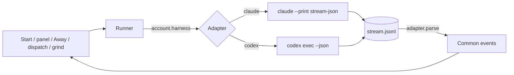
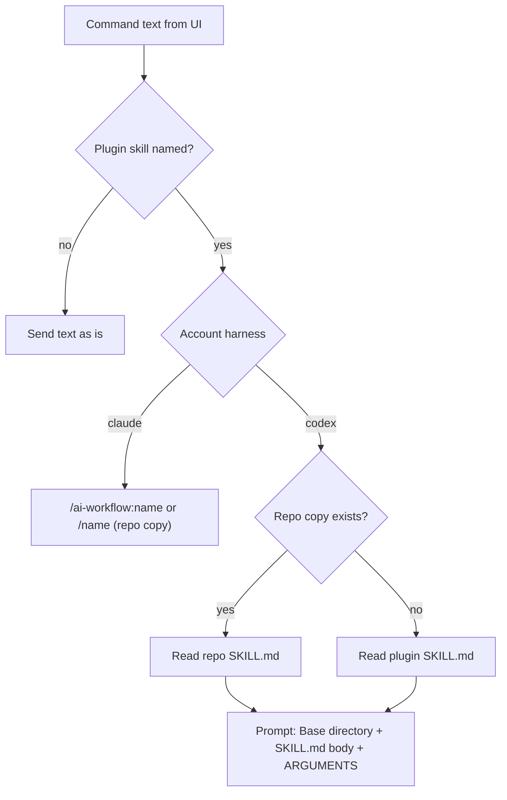

# PRD — Harness-agnostic UI (Claude Code and Codex)

**Status:** Approved · **Date:** 2026-11-03 · **Slug:** `harness-agnostic-ui` · **Owner:** Masnun Siam · **Priority:** high · **Repo:** masnun-siam/ai-workflow

This document is the source of truth for the feature: every issue is derived from it, and a decision that is not written here has not been made.

## Overview

The `aiw ui` web app starts every workflow stage (PRD, tasks, implement-issue, grind, peer review, dispatch) as a headless coding-agent session. Today that agent is always Claude Code. This feature lets an account in Settings be a Codex account instead, so any session, panel or dispatch can run on Codex by picking that account in **Run on**, and everything the UI does around the session (questions, transcript, resume, limits, dispatch) keeps working.

Today:
- Settings > Accounts holds the named `claude` commands (`claude`, `cc masum`, ...). Start's **Run on** picks one per session, and the choice is pinned to what that session creates.
- The runner launches `claude --print --output-format stream-json`, adds the headless instructions with `--append-system-prompt`, passes `--model`/`--effort`, resumes with `--resume <session_id>`, and reads Claude's stream events for text, tool calls, cost, tokens, the session id, `aiw ask` questions and rate-limit events.
- Before a run the account's login is checked with `<cmd> auth status --json`; the header shows each account's 5h/7d plan usage from Anthropic's usage endpoint.
- Peer-review lenses and the Away answerer start with `--agent <plugin agent>`. The herdr runner starts its pane with `herdr agent start --kind claude`.
- Skills are invoked as `/ai-workflow:<name>` (or `/<name>` when the repo has its own copy), which only Claude Code understands.
- Questions already go through the harness-neutral `aiw ask` CLI, and state lives in the plugin data dir, not in a Claude-specific place.
- The personal-skills split is nearly done: `ai-workflow-personal` exists (#747) and the UI hides its commands when it is absent (#766). Removing the originals is issue #767, already refined, and is not re-specified here.

What does not exist yet: any notion of a harness, a second launcher, a way to hand a skill to an agent that has no `/ai-workflow:` namespace, or Codex event parsing.

## Problem

The user cannot run the workflow on Codex. When Claude accounts hit their limits, or a task suits a different model, the only option is to wait or leave the UI and drive Codex by hand, losing questions, transcripts, grind loops, panels and dispatch tracking.

## Users

The single owner of the local `aiw ui` (one user, one machine). Team members who install the plugin get the same Settings and pickers.

## Goals

- Add a Codex account in Settings and run any UI-started session, panel lens, Away answer or dispatch lane on it.
- Questions, transcript, cost/tokens where available, stop, resume, limit auto-resume and herdr tabs behave the same on both harnesses.
- Claude accounts behave exactly as today.
- Adding OpenCode later is one more harness adapter, not another rewrite.

## Non-goals

- OpenCode support. It is the next epic; this PRD only keeps the design open for it.
- Plan usage numbers (5h/7d) for Codex accounts. The usage display says "usage unavailable" for them.
- Moving a running or stopped session between harnesses. A session stays on the harness it started on.
- Editing the imported skills, guides or templates to remove Claude tool names. Adaptation happens in the engine's instructions (repo rule: deviations live in the kept tools and the UI).
- Installing Codex, logging it in, or managing its config from the UI.
- Re-specifying the personal-skill removal (#767) or moving any further skills to the personal plugin.

## Requirements

- **FR-1 Account harness.** Every account in Settings > Accounts has a harness, `claude` or `codex`. The built-in `claude` account is always `claude`. A new account defaults to `claude`. Saved accounts with no harness are `claude`.
  - Acceptance: adding an account with harness Codex and command `codex` saves and reloads with that harness; existing accounts show Claude Code after upgrade with no other change.
- **FR-2 Login check per harness.** Before a session starts, and on Settings' check button, the account's login is checked the way its harness supports. A Codex account that is not logged in fails the session, and Settings' check shows, "codex CLI is not logged in, run `<cmd> login`". When the CLI printed anything, the first line of its output is appended in parentheses: "codex CLI is not logged in, run `<cmd> login` (<first line>)". A command not on PATH gives "codex CLI not found on PATH". The login check is also what catches an account whose harness does not match its command (for example harness Codex with command `cc masum`): the check fails with the CLI's own error and no session starts.
  - Acceptance: with Codex logged out, starting a session on the Codex account fails immediately with that message and no process is spawned; Settings' check button shows the same message.
- **FR-3 Run any skill on Codex.** A session started from the UI on a Codex account runs the requested skill with its arguments, and the repo's own copy of a skill wins as it does on Claude (repo copies are looked for in `.claude/skills/<name>` as today).
  - Acceptance (deterministic, unit): for `implement-issue 12` on a Codex account, the first prompt sent starts with `Base directory for this skill: <plugin>/skills/implement-issue`, contains the `SKILL.md` body without frontmatter, and ends `ARGUMENTS: 12`; with a repo copy present, the base directory is `<repo>/.claude/skills/implement-issue` and the stored command shows the repo spelling.
  - Acceptance (manual): the run follows the skill's steps (worktree, checks, draft PR).
- **FR-4 Skill hand-offs on Codex.** When a skill says to run another plugin skill, a Codex session reads that skill's `SKILL.md` and follows it, with the same "repo copy wins" rule.
  - Acceptance (deterministic, unit): the Codex preamble contains each tool-name mapping quoted in "Harness adapter", including the slash-command → `SKILL.md` path rule.
  - Acceptance (manual): `/create-prd`'s hand-off to `/create-tasks` (when asked to continue) makes the Codex session read the create-tasks skill file, visible in its transcript.
- **FR-5 Headless rules on Codex.** A Codex session gets the same headless rules as Claude: questions go through `aiw ask`, then the turn ends.
  - Acceptance: a Codex session that must ask a gate question records it through `aiw ask`, the Inbox shows it, the process ends, and the answer resumes the same Codex session.
- **FR-6 Transcript and spend.** The session transcript shows a Codex session's messages and commands. Tokens (input, cached, output) are shown; cost shows "—" when the harness reports none. As on Claude today, the session record holds the latest run's tokens: on Codex, that run's own usage, written to the record when the run ends (a resume or follow-up starts a new run and replaces them). Codex reports `turn.completed` usage cumulative over the thread, so a run's tokens are its last cumulative usage minus the thread's cumulative usage when the run started.
  - Acceptance: a finished Codex session shows its agent messages and command executions in order, the token counts from the run, and no cost. A session run twice (start, then a follow-up) shows the second run's summed tokens, in the Session view and the session list alike.
- **FR-7 Stop, resume, continue.** Stop, Resume, Continue and typed follow-ups work on Codex sessions, continuing the same Codex session. The "resume in terminal" command shown in the UI is the harness's own.
  - Acceptance: stop a running Codex session, Resume it, and its transcript continues in the same session id; the shown terminal command is `cd <path> && <cmd> resume <id>`, with each word of `<cmd>`, the path and the id shell-quoted separately (the existing round-trip quoting test is extended to this form). A Codex session never shows the Claude form, including the UI's fallback when `resume_command` is null (it shows no command instead).
- **FR-8 Limits.** A Codex run that ends on a usage or rate limit marks the session limited, and the existing auto-resume retries it on the same account only (never another account) when the limit should have reset (or, when no reset time is given, after the doubling wait in Edge cases, "Limits reached with no reset time"). The Codex limit match and reset-time format are confirmed from real Codex output (build gate G1 in Testing) before the limit issue closes; until then the existing pattern (`usage limit|limit reached|rate.?limit|hit your limit`) is applied to the `turn.failed`/`error` message.
  - Acceptance: a Codex run whose recorded stream (the real fixture, see Testing) ends with a rate-limit error shows as limited in the Inbox's wait group and is resumed by the limit timer on the same account.
- **FR-9 Usage display.** The 5h/7d usage in the Rail and the phone StatusMenu applies to Claude accounts only; a Codex account shows the existing "usage unavailable" text, with the tooltip "not available for Codex".
  - Acceptance: with one Claude and one Codex account, the Rail and StatusMenu show numbers for Claude and "usage unavailable" for Codex, and no request to Anthropic is made for the Codex account.
- **FR-10 Agents on Codex.** Peer-review lens sessions and the Away answerer run on a Codex account with their agent's instructions (the plugin agent file's text, its read-only rules included) given to the session, since Codex has no plugin agents. Panels get no new picker: a panel runs on Codex when its pinned account, or else the Settings default, is a Codex account; the Away answerer uses the account it uses today. Because these sessions read untrusted PR, issue and artifact text, on Codex they run in Codex's read-only sandbox (`--sandbox read-only`) and never with the bypass flag. If that sandbox cannot run the `gh` and `git` read commands the agent needs (build gate G3 in Testing), starting a panel or an Away answer on a Codex account is refused with "panels and Away answers need a Claude account: Codex's read-only sandbox cannot run gh", and no process is spawned. A refused panel start shows the message where panel start errors show today; a refused Away answer leaves the question unanswered in the Inbox with the message as its note. The sandbox is recorded on the session (as `allowed_tools` is for Claude today), so every resume and send of a Codex agent session, including each later panel round, keeps `--sandbox read-only` and never adds the bypass flag; if `exec resume` cannot take the sandbox flag (build gate G2), the refusal applies.
  - Acceptance (unit): a Codex lens's and Away answerer's start and resume arguments include `--sandbox read-only` and not `--dangerously-bypass-approvals-and-sandbox`; with the refusal in force, starting a Codex panel or Away answer returns the quoted message and spawns nothing.
  - Acceptance (only if build gate G3 resolves in favour of running): a PRD review panel whose lenses run on the Codex account produces a `Verdict:` line per lens and the panel advances rounds; an Away-mode answer on Codex ends with its `AWAY-ANSWER:` line.
- **FR-11 Subagent work on Codex.** When a skill asks for subagents, a Codex session does that work itself in the same session.
  - Acceptance: `/pr-review <pr>` on a Codex account completes with findings and a verdict without erroring on a missing subagent tool.
- **FR-12 Model and effort per harness.** The Start and dispatch pickers show the selected account's harness's options. Claude: as today. Codex: `default` plus the models saved on that account in Settings, and efforts `low`, `medium`, `high`, `xhigh`. This covers every caller that sets a model or effort: Start, dispatch (headless and herdr), Settings' saved defaults, the grind re-entry, and the built-in lens and Away answerer choices (`opus`, `medium`). A model or effort the harness does not offer falls back to the harness default: on Codex, no `-m` and no effort override, so Codex's own configured default applies. The session records the note "`<value>` is not a Codex model; ran on Codex's default" (or "... not a Codex effort ..."), with the echoed value cut to 80 characters. On Codex accounts the picker's choice is not saved back to Settings' `run_model`/`run_effort`, which stay the Claude defaults. Switching **Run on** keeps a choice the new harness offers and resets any other to `default`, so the fallback is visible before submit.
  - Acceptance: switching **Run on** from a Claude to a Codex account swaps the model list to the account's Codex models and the effort list to four values, and an `opus` choice resets to `default`; picking a Codex model sends no settings save; a Codex run started with Settings' default `opus` runs with no `-m` and the session shows the fallback note.
- **FR-13 Dispatch on Codex.** A dispatch whose account is a Codex account runs its lanes on Codex with both runners: headless, and herdr. herdr can only start an agent kind's canonical executable (`herdr agent start --kind <kind> ... -- <args>`), not a custom command or profile. So a herdr Codex lane needs an account whose command's first word is `codex`: the pane starts `--kind codex`, the command's remaining words (split the way Settings already splits commands, never run as a shell string) go after `--` with the Codex flags, and the lane prompt is sent. A herdr dispatch on any other Codex account is refused at start with "herdr can only start the codex binary; use the headless runner or an account whose command is codex". herdr Claude lanes are unchanged: they ignore the account and start herdr's own `claude` as today. Limit detection on a herdr Codex lane is out of scope: the pane is not matched against Codex limit text, so a limited herdr Codex lane shows as stalled, not limited. The dispatch cost cap (`max_cost`) does not apply to Codex dispatches, since Codex reports no cost: it is ignored, and dispatch settings show "Cost cap does not apply on Codex accounts" when a Codex account is picked.
  - Acceptance: a two-issue dispatch on a Codex account runs both lanes to a PR with the headless runner, and with `--runner herdr` opens two tabs running Codex; a herdr dispatch on a Codex account whose command is `cc-codex x` is refused with the quoted message; a herdr dispatch on a non-default Claude account produces today's argv; a Codex dispatch with `max_cost` set runs past the cap and its settings show the note.
- **FR-14 Install for use outside the UI.** `aiw install-skills --harness codex` links each plugin skill into Codex's user skills folder so the skills can be used in an interactive Codex session. It creates `~/.agents/skills` when missing. A recorded link is stale when its target is not the current plugin's `skills/<name>`: a rerun repoints stale links to the current plugin and deletes recorded links whose skill no longer exists in the plugin (as after #767). Before changing or deleting any recorded path, it checks the path is still a symlink; anything else is skipped and reported, never touched. Each link is recorded as it is made, so a run that fails partway leaves an accurate record. `--remove` deletes only its own links, with the same symlink check.
  - Acceptance: after the command, `~/.agents/skills/<name>` points at the plugin's `skills/<name>` for every plugin skill, and the folder is created if it did not exist; a user folder with the same name is left untouched and reported; after the plugin path moves, a rerun repoints every link; after a skill is removed from the plugin, a rerun deletes its link; a recorded link the user replaced with a real folder is skipped and reported by both a rerun and `--remove`; `--remove` deletes only the links.
- **FR-15 Claude unchanged.** Every behaviour on Claude accounts is as before: same flags, same invocation, same events.
  - Acceptance: before the refactor, literal golden argv are recorded for a Claude start, resume, answer, panel lens (`--agent`), Away answerer, grind re-entry and dispatch lane (headless and herdr); after it, the Claude argv equal those literals. The existing runner, panel, Away, dispatch and settings tests pass with only import paths changed.

## Edge cases

- **Concurrency.** Sessions on Claude and Codex accounts run side by side; the grind cap (`MAX_GRINDS`) and dispatch concurrency count sessions regardless of harness.
- **Unique commands.** Sessions, pins and limits are keyed by an account's command string (`claude_cmd`), not its label. Account commands must be unique across accounts (400 `each account needs its own command`), so a command maps to one harness. The check runs only on a save that includes `commands` (Settings > Accounts), never on partial saves such as a board's per-repo PUT. Saved settings that already hold a duplicate command load as they are; both entries are `claude`, so the command still maps to one harness, and the user sees the 400 only when they next save Accounts. Each session also records its harness at creation, from the account.
- **Harness switch on a pinned account.** Pins (an epic or PRD pinned to an account) point to the account's command. If that account's harness is changed in Settings, new sessions from the pin use the new harness; existing sessions keep their recorded harness.
- **Resume across harnesses.** A stopped or limited session records the harness it ran on. Resuming it on an account of a different harness is refused with "this session ran on <harness>; pick a <harness> account".
- **Limited session whose account is gone or changed.** A limited Codex session auto-resumes only on its own account (FR-8). If that account was removed or its harness changed, the session stays limited, auto-resume stops for it (no retry loop), and its note reads "account <label> is no longer a <harness> account; resume it on a <harness> account" (the label of the account that still holds the command, or the command itself when no account holds it). A limited Claude session keeps today's Claude-to-Claude account switching.
- **Account removed.** On a manual resume, Continue or follow-up of a Codex session whose account was removed, the session uses the Settings default only if that default is a Codex account; otherwise the action is refused with "account <label> was removed; pick a <harness> account". A Claude session whose account was removed resumes on its recorded command, as today (FR-15). New sessions from a pin to a removed account use the Settings default, as today.
- **Empty states.** No Codex account: the harness column shows Claude Code everywhere and nothing else changes. A Codex account with no saved models: the model picker shows only `default`.
- **Missing CLI.** A Codex account whose command is not on PATH fails the session, and Settings' check, with "codex CLI not found on PATH" (or the custom command's own error), like Claude today.
- **Limits reached with no reset time.** Codex errors that give no reset time are retried on the limit tick after a doubling wait: 1 minute after the first, then 2, 4, 8 ... capped at 60 minutes. The count resets when a run of the session ends without a limit. Claude limits with no reset time are unchanged (not auto-resumed).
- **Unknown stream lines.** Lines the adapter does not recognise are ignored, as with Claude.
- **Skill not found.** A command naming a skill that exists neither in the repo nor in the plugin is sent as plain text, as today.
- **Existing data.** Saved accounts gain `harness: "claude"` on first load; session records without a harness are Claude. No migration of session files.
- **Data isolation.** Single local user. Credentials stay with each CLI; the UI never reads Codex's auth tokens.

## Technical design

### Harness adapter (FR-1 to FR-13, FR-15)

One adapter per harness owns everything harness-specific; the rest of the engine (sessions, inbox, panels, Away, grind, dispatch, limits) talks only to the adapter contract. Callers that pass raw Claude flags today move to the contract: the grind re-entry's `--append-system-prompt REENTRY_PROMPT` becomes extra instructions the adapter delivers (on Codex, prepended to the re-entry's first prompt), headless dispatch's `--effort` becomes the effort argument, and lens and Away model/effort become model/effort arguments. The account-limit queue rule is unchanged: the starts that bypass the queue are exactly today's, those whose caller passes extra instructions, env, fds, an agent, a direct model (lenses, Away answerer) or dispatch's effort. A Start-dialog model or effort does not bypass the queue, as today. Claude's adapter is today's behaviour moved behind the contract. OpenCode will be a third adapter.

*Every caller goes through the runner; only the adapter knows flags and stream formats. Every reader of a session's stream uses that session's harness adapter: the transcript, the panel's final text (`Verdict:` and `AWAY-ANSWER:` lines), the session-list token fill-in, and question detection.*

The adapter contract:

| Responsibility | Claude Code | Codex |
|---|---|---|
| Login check | `<cmd> auth status --json`, `loggedIn` | `<cmd> login status`, exit code 0 = logged in |
| Start | `--print --output-format stream-json --verbose --dangerously-skip-permissions`, headless rules via `--append-system-prompt` | `exec --json --dangerously-bypass-approvals-and-sandbox --skip-git-repo-check`, headless rules prepended to the first prompt only |
| Resume | `--resume <id>` (rules re-appended as today) | `exec resume <id>` with the same flags; sends only the answer or prompt, since the rules and agent text are already in the thread |
| Skill invocation | `/ai-workflow:<name> args` or `/<name> args` (unchanged) | prompt built from the skill file (see Skill delivery) |
| Agent sessions | `--agent ai-workflow:<agent>` | the agent file's body prepended as instructions |
| Model / effort | `--model`, `--effort` | `--model=<model>`, `-c model_reasoning_effort=<effort>`; omitted for `default` |
| Parse | assistant text, tool_use, result (cost, tokens), session id, rate_limit_event | `thread.started` (session id); `item.completed` only (`item.started`/`item.updated` ignored): agent_message → text, command_execution → tool `Bash` with its command, other items → tool by type; `turn.completed` usage → tokens (summed per run); `turn.failed`/`error` → error or limit |
| Limit detection | rate_limit_event, limit text | `turn.failed`/`error` whose message matches the limit rule confirmed by build gate G1; reset time in the format confirmed there |
| Terminal resume command | `claude --resume <id>` | `<cmd> resume <id>` |
| Usage | Anthropic OAuth usage | none |

Common events are the shape the UI already uses (`text`, `tool {name, input}`, `result {cost, is_error, text, tokens}`) plus `session_id` and `limit {resets_at?}`. The question detector keys on a `Bash` tool whose command starts `aiw ask`, so Codex's `command_execution` maps to tool name `Bash` with `input.command`.

The headless rules text is shared; Codex gets one extra paragraph (FR-4, FR-10, FR-11): "Claude Code tool names in skills map as follows: AskUserQuestion → `aiw ask`; a slash command for a plugin skill → read `<plugin>/skills/<name>/SKILL.md` (or the repo copy at `.claude/skills/<name>/SKILL.md` when it exists) and follow it; Agent/subagent or SendMessage → do the work yourself in this session; ScheduleWakeup/Monitor → write the state the skill asks for and end the turn."

The child process environment keeps `AIW_UI_SESSION` and `CLAUDE_PLUGIN_DATA` for every harness, since skills and `aiw` read them.

### Skill delivery (FR-3, FR-4, FR-14)

*The same resolve step that picks the repo copy today also builds the Codex prompt.*

- On Codex, the engine builds the prompt the way Claude Code does internally: "Base directory for this skill: <skill folder>", the `SKILL.md` body (frontmatter removed), and "ARGUMENTS: <args>". Relative paths in skills (`../../guides/...`) resolve from the base directory.
- Personal-plugin skills (`dump`, `worklog`, `sync-from-wasensi`) are inlined the same way from the installed personal plugin (`installPath` of its `ai-workflow-personal@...` entry in `installed_plugins.json`, then `skills/<name>/SKILL.md`); when it is not installed or the file is unreadable, the text is sent as is.
- The stored session command stays the short form (`/implement-issue 12` or `/ai-workflow:implement-issue 12`) so lists, origins and pins read the same for both harnesses.
- The rewrite happens at every spawn and every send, as repo-skill resolution already does (answers, typed prompts, auto-resumes, re-entries, panels, herdr sends). herdr sends are cut at about 480 characters, so on herdr a Codex lane is sent a short instruction to read the skill file by path instead of the inlined body.
- `aiw install-skills --harness codex [--remove]` creates `~/.agents/skills` if missing and a symlink `~/.agents/skills/<name>` → plugin `skills/<name>` for each plugin skill, recording each link in the plugin data dir as it is made. It only repoints or removes recorded links, and only while they are still symlinks (FR-14 defines stale). A name already taken by something it did not make is skipped and reported.

### Data (FR-1, FR-6 to FR-8, FR-12)

Store: the existing JSON files in the plugin data dir.

- `ui_settings.json` accounts: each entry `{label, cmd, harness, models?}`. `harness` is `"claude"` or `"codex"`, default `"claude"`. `models` is a list of model names for Codex accounts (at most 20, each 1-80 characters of letters, digits, `.`, `-`, `_`, `:`, `/`, starting with a letter or digit); ignored for Claude. Dispatch's model check is widened to the same rule so every saved Codex model can be picked for a dispatch. `cmd` is unique across accounts. The built-in account stores only its label as today and is always `claude`.
- Session record gains `harness` (`"claude"` default when missing) and `run_note` (the fallback note of FR-12, or null). `session_id` holds Claude's session id or Codex's thread id. `cost` may be null. The runner writes `tokens` to the record from Codex's `turn.completed` events, as it does from Claude's result event, so the session list never has to scan a Codex stream.
- Install record: the list of links `aiw install-skills` created, per harness.

### API

- `GET /api/settings` — each item in `commands` gains `harness` and, for Codex, `models`. New read-only `harnesses`: `[{id: "claude", label: "Claude Code", models: ["opus","sonnet","haiku"], efforts: ["low","medium","high","xhigh","max"], usage: true}, {id: "codex", label: "Codex", models: null, efforts: ["low","medium","high","xhigh"], usage: false}]` (`models: null` means "from the account").
- `PUT /api/settings` — accepts `harness` and `models` per command. Errors (400): `harness must be claude or codex`; `the built-in account is always claude`; `models must be a list of at most 20 model names`; `each account needs its own command`. A `run_model`/`run_effort` default is still validated against Claude's lists (it is the Claude default; the UI never saves a Codex pick there, and Codex falls back per FR-12).
- Account login check endpoint (existing) — answers per harness, same `{ok, message}` shape.
- Session start, resume, send and dispatch endpoints — unchanged shapes. A `model` or `effort` not offered by the account's harness is accepted and falls back with a note (FR-12). Resume on an account of a different harness returns 409 `this session ran on <harness>; pick a <harness> account`.
- Session JSON gains `harness` and `run_note`; `resume_command` uses the harness's form; `cost` may be null.
- Usage endpoint — Codex accounts are returned with `error: "not available for Codex"` and no numbers; the UI shows its existing "usage unavailable" text with that error as tooltip.

### Backend

- **Runner:** picks the adapter from the session's recorded harness (set at creation from the account). All argv building, prompt shaping, parsing, login and limit detection move behind the adapter. Behaviour under stop, crash and UI restart (reconcile, follower thread, asked-exit grace) is unchanged and harness-independent.
- **Account switching for limits:** today a limited Claude session can be resumed under another Claude profile by copying its transcript between profiles. That stays Claude-only; Codex resumes only on its own account (FR-8, Edge cases).
- **Panels and Away:** start lens and answerer sessions through the runner with the agent name; the adapter turns it into `--agent` or prepended instructions. On Claude the read-only tool restriction stays as today; on Codex agent sessions run with `--sandbox read-only` instead of the bypass flag, or are refused (FR-10).
- **Dispatch:** lane starts pass the dispatch account's harness. For a Codex account the herdr runner uses `--kind codex` with the command's remaining words after `--`, or refuses a command that is not `codex` (FR-13); herdr Claude lanes are unchanged. The cost cap is skipped for Codex dispatches (FR-13).
- **Vault name suggestion:** stays a Claude call (`claude -p --model haiku`); when no Claude account works it falls back to no suggestion, as on failure today.
- **`aiw install-skills`:** new `aiw` verb.

### Frontend

- **Settings > Accounts:** a Harness column (Claude Code / Codex select; fixed for the built-in row) and, for Codex rows, a Models field (comma-separated list). The Models field shows only on Codex rows; switching a row's harness hides or shows it and keeps its value until save (the server ignores `models` on Claude rows). The login check result is cleared when a row's harness or command changes. Save errors (the new 400s included) show where Accounts save errors show today. Every heading of the section, including the loading and error states, becomes "Accounts".
- **Start dialog and dispatch settings:** model and effort pickers read the selected account's harness from `harnesses`; changing **Run on** re-filters them, keeps a still-valid choice and resets an invalid one to `default`. On a Codex account a pick is not saved to Settings' defaults (FR-12). Loading and error states are as today.
- **Usage (Rail and StatusMenu):** Codex accounts show the existing "usage unavailable" text (FR-9).
- **Session view:** shows the harness next to the account, the fallback note when set, and "—" for missing cost. The terminal command for a Codex session is never the Claude form; with no `resume_command` it shows none.

### Realtime and other services

Not affected: the UI polls as today. herdr is used as today, with the `codex` kind for Codex lanes. Codex CLI is an external dependency the user installs; no new Python dependency (stdlib only).

### Non-functional

- Security: Codex runs with approvals and sandbox bypassed, the same trust level as Claude's `--dangerously-skip-permissions`; only run on repos whose `.claude/` and `.agents/` you trust. Agent sessions (lenses, Away answerer) are the exception: on Codex they run in the read-only sandbox, never bypassed, or are refused (FR-10).
- Compatibility: Claude accounts' spawned argv is byte-for-byte unchanged (FR-15). The Codex adapter targets the documented `codex exec --json` event names; unknown events are ignored.
- Performance: the skill file is read at each spawn/send, like the repo-copy check today; no caching.

### Testing

- Build gates. Each is checked against an installed, logged-in Codex before the issue that builds the matching part is closed. Until then the stated fallback is built. A result that differs from the PRD is changed here first (Change log), then in the issues.
  - G1 Limit output (FR-8): record the exact `turn.failed`/`error` text for a usage limit and a rate limit, and the reset-time format (absolute time, seconds or text). Fallback: the existing limit pattern on the error message, retried with the doubling wait (Edge cases) since no reset time is known.
  - G2 `exec resume` flags (FR-7, FR-10): confirm `exec resume <id>` accepts `--json`, the bypass flag, `--sandbox read-only`, `--model=` and `-c` overrides. Fallback: if it rejects `--sandbox read-only`, the FR-10 refusal applies.
  - G3 Read-only sandbox (FR-10): confirm `--sandbox read-only` allows the network `gh` needs and runs `git`/`gh` read commands. Fallback: the FR-10 refusal.
  - G4 Reasoning effort (FR-12): confirm the key `model_reasoning_effort` and the values `low|medium|high|xhigh`. Fallback: as written; if they differ, FR-12 and the `harnesses` effort list are updated.
- Fixture gate: before the Codex parser issue is closed, a real Codex JSONL fixture is recorded from an installed Codex, including a resumed run, an `aiw ask` command, `item.started`/`item.completed` pairs, and a `turn.failed` rate-limit line. A docs-derived fixture may be used while building but is marked provisional and does not close the issue.
- Golden argv: before the refactor, record literal Claude argv for start, resume, answer, panel lens, Away answerer, grind re-entry and dispatch lane (headless and herdr); assert them after (FR-15).
- Unit (`run-engine/test_*.py`, plain asserts, no network): Codex argv for start, resume (no repeated rules), model/effort including `default` and fallback, agent instructions; parsing of the fixture into common events (text, Bash `aiw ask` once per command, tokens summed per run, thread id, limit error); every stream reader (transcript, panel final text, session-list tokens) on a Codex stream; skill prompt building with and without a repo copy (FR-3); the preamble's tool-name mappings (FR-4); settings validation and migration of `harness`/`models`, unique `cmd`; resume refused across harnesses; limited session on a removed or switched account stays limited; usage skipped for Codex; Codex resume command quoting; herdr Codex argv and the refusal for a non-`codex` command; herdr argv for a non-default Claude account equal today's; a Codex dispatch with `max_cost` runs past the cap; Codex agent-session resume keeps the read-only sandbox; the panel/Away refusal spawns nothing; `install-skills` create/repoint/delete-removed/skip-replaced/remove in a temp home, including a missing `~/.agents/skills`. Covers FR-1 to FR-14.
- Existing suites, with only import paths changed, plus the golden argv prove FR-15.
- UI (vitest): picker lists per harness, invalid choice reset on **Run on** change, no settings save for a Codex pick, Settings harness column and Models field, "usage unavailable" for Codex, no Claude terminal fallback for Codex sessions, the cost-cap note in dispatch settings for a Codex account.
- Manual, once Codex is installed: FR-2, FR-3, FR-4, FR-5, FR-7, FR-8, FR-10, FR-11, FR-13 against a test repo.

## Rollout and cost

- Opt-in by account: nothing changes until a Codex account is added. No feature flag.
- Cost: Codex usage is billed on the user's OpenAI/ChatGPT plan; the UI shows tokens only.
- Before release: install and log in Codex on this machine to run the manual checks. Add a CHANGELOG `## Unreleased` entry and update `docs/REFERENCE.md` (accounts, harness, `aiw install-skills`), `docs/INSTALL.md` (Codex as an optional CLI) and `CONTEXT.md` (Harness, Adapter).

## Success metrics

None formally defined. Working signal: a full PRD → merged PR cycle runs on a Codex account from the UI without leaving it.

## Epics

- **E1 Harness-agnostic UI: Claude Code and Codex** — covers FR-1 to FR-15. Issue: #867

Prerequisite (not in this epic): #767 removes the personal skills from this plugin.

## Decisions

- The personal-skill split is #767 as already refined; this PRD only references it — re-specifying refined work adds nothing.
- v1 supports Claude Code and Codex; OpenCode is the next epic — chosen by the owner; the adapter contract keeps OpenCode to one new adapter.
- The harness is a property of each account — **Run on** already picks the account per session and pins it, and usage/limits are per account, so no new picker is needed and a session cannot run on a harness other than its account's. An account whose command does not match its harness is caught by the login check (FR-2).
- Skills reach Codex both ways: the engine inlines `SKILL.md` for UI sessions, and `aiw install-skills` links them for interactive use — the owner wants both; inlining needs no setup and keeps repo copies winning, the links cover terminal use.
- Claude-only features are adapted, not disabled: agent text as instructions for lenses and Away, limit detection from Codex errors, subagent work done in-session; only usage numbers are hidden — everything stays usable on a Codex-only setup.
- Dispatch on Codex supports both headless and herdr, and the dispatch account applies to herdr Codex lanes — chosen by the owner. herdr starts only an agent kind's canonical binary, so herdr Codex lanes need a `codex` command, and herdr Claude lanes keep today's behaviour (account ignored) so Claude stays unchanged. Herdr Codex limits are not detected in v1.
- The cost cap is ignored with a warning on Codex dispatches — chosen by the owner over refusing or adding a token cap.
- Panels run on Codex through their pin or the Settings default, with no new picker — chosen by the owner.
- Codex lenses and the Away answerer run in the read-only sandbox or are refused — chosen by the owner; they read untrusted text, so instruction-only restriction is not accepted.
- Model and effort lists are per harness, with Codex models saved on the account and a fallback note for unsupported choices — keeps per-run control without free-text typos.
- Priority high, opt-in by adding a Codex account, one epic — the account is the gate, so no flag to remove later.
- Imported skills are not edited for Codex; a harness preamble maps Claude tool names — repo rule that deviations live in the kept tools and the UI.
- A session never moves between harnesses — Claude and Codex session ids and transcripts are not interchangeable.
- The four Codex CLI checks (limit output, `exec resume` flags, read-only sandbox, effort key) are build gates G1-G4, not open questions — chosen by the owner at approval; Codex is not installed yet, and each has a safe fallback in the PRD, so a different result is a Change log entry, not a redesign.
- Repo copies are still looked for only in `.claude/skills/` — one rule for both harnesses; `.agents/skills` support can come with OpenCode if wanted.

## Open questions

None.

## Change log

- 2026-11-04: Refining the epic's issues settled four gaps: a Codex limit with no reset time retries after a doubling wait capped at 60 minutes (the old text said "back off as today", but nothing backs off today); the removed-account resume rule applies to Codex sessions only, Claude stays as today (FR-15); the Codex login message appends the CLI's first output line, so a harness/command mismatch shows the CLI's own error (FR-2); personal-plugin skills are inlined on Codex from the installed personal plugin.
- 2026-11-04: A real codex-cli 0.166.0 run showed `turn.completed` usage is cumulative over the thread (input 14196 → 28416 → 42684 over three runs). FR-6 keeps the per-run meaning, as on Claude: a Codex run's tokens are its cumulative usage minus the thread's cumulative usage when it started (#907).
- 2026-11-03: Approved. The four Codex CLI open questions became build gates G1-G4 in Testing. No issues existed yet.

## Related

- #767 (remove personal skills), #766 (UI gating), #747 (personal plugin), `docs/prds/repo-skills-win.md`, `docs/prds/away-mode-answerer.md`.
- Codex docs: non-interactive mode (`codex exec --json`, `exec resume`), Agent Skills (`~/.agents/skills`).
