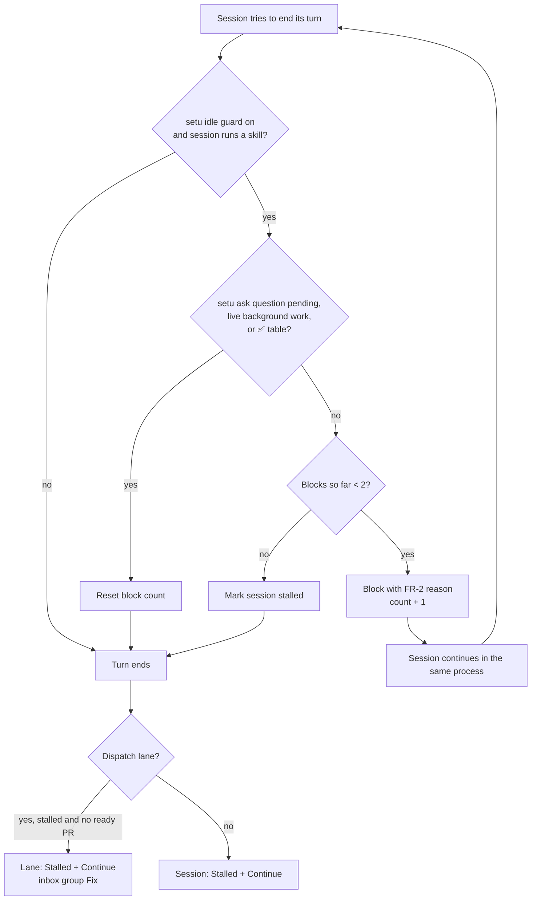

# PRD — Headless idle guard

**Status:** Approved · **Date:** 2026-11-13 · **Slug:** `headless-idle-guard` · **Owner:** Masnun Siam · **Priority:** high · **Repo:** masnun-siam/ai-workflow

Status is `Draft`, `In review` or `Approved`. This document is the source of truth for the feature: the tasks and every issue are derived from it, and a decision that is not written here has not been made.

## Overview

A blubird skill session that setu starts headless must not end its turn quietly, half done. setu gets its own idle guard, a Claude Code `Stop` hook. It sends a session back to work when it stops without asking a question or finishing. A session that still stops after that shows as **Stalled**, with a one-click **Continue**, and no longer looks like a session waiting on a question.

Today:
- In a terminal, blubird's **idle guard** (a `Stop` hook) blocks a blubird skill session from ending its turn unless one of three things holds: a background wait is live, it asked with `AskUserQuestion`, or the final message has a table with ✅. It blocks at most twice.
- setu starts every session with `BLUBIRD_IDLE_GUARD=off` (per [ui/blubird-ui.md](ui/blubird-ui.md) FR-4), because that guard's remedies don't work headless: `AskUserQuestion` is not available, and a Monitor or wakeup keeps the process alive so the UI can't deliver an answer. Headless sessions ask through `setu ask` instead.
- When a dispatch lane's session goes idle with no ready PR, the dispatcher sets needs-you to "stopped without a ready PR". The inbox files every lane needs-you under **Questions**, and the lane shows a **Needs you** tag, even when nothing was asked.
- Closest pattern: the dispatcher's grind nudge (a lane in grind is re-sent its grind message once per due round).
- Missing: anything that sends a headless session back to work when it stops early, and a state that says "stopped early" instead of "has a question".

## Problem

On 2026-11-12, dispatch `5f67d71cdec9` lane `masnun-siam/meqat#135` ran `/blubird:implement-issue 135`. It finished local verification and ended its turn on the verification report, with every check passing, the work committed, and no PR opened. The session was marked done. After the idle grace period the lane showed **Needs you** with "stopped without a ready PR", but there was no question to answer. The lane, and lane #134 queued behind it, sat until the user worked out what had happened and retried it by hand.

Cost: stalled dispatches, a misleading signal that sends the user looking for a question that doesn't exist, and a manual diagnosis each time.

## Users

The one setu user, in the UI (desktop and phone) and through notifications. The sessions setu starts are the other party: they get the guard's message and must act on it.

## Goals

- A headless blubird skill session that stops early is sent back to work on its own, in the same process, without the user.
- **Needs you** and **Questions** mean a real question is waiting. A session that stopped without finishing is shown as **Stalled**, with a one-click way to continue it.
- Terminal sessions and setu sessions follow the same rule for when a turn may end.

## Non-goals

- No change to blubird's own idle guard or to the blubird plugin. setu keeps `BLUBIRD_IDLE_GUARD=off`.
- No guard for grind sessions, peer-review panels or dispatch coordinators. Their own prompts define how they end.
- No automatic resume from the dispatcher after the guard gives up (see Decisions). The user decides with Continue.
- No PR-state check inside the hook. A lane's PR is still judged by the dispatcher's lane machine as today.
- No new way for a session to signal "done" (such as a `setu done` command).
- No change to how `setu ask` questions are asked, answered or shown.

## Requirements

- **FR-1 Guard on skill runs and lanes.** setu attaches its idle guard to every session it starts or resumes that runs a blubird skill: UI-started skill runs and dispatch lane sessions. It does not attach it to grind, peer-review panel or coordinator sessions. Interactive terminal sessions are not affected.
  - Acceptance: a lane session's and a UI skill run's process is started with the guard's `Stop` hook. A grind session and a panel session are started without it.
- **FR-2 When a turn may end.** The guard allows a turn to end when any of these holds:
  1. the session recorded a question with `setu ask` in this turn (a question is pending);
  2. a background agent or background command started in this turn is still running;
  3. the final assistant message contains a Markdown table row with ✅ or ✔.
  Otherwise it blocks the stop with this exact reason: "Do not stop idle. Either continue the flow to its end, ask the user with `setu ask` and end your turn, or, when done, end with a very short table with check-mark emojis. Never call Monitor or ScheduleWakeup."
  - Acceptance: a turn that ends on a table without ✅ and no question is blocked with that reason. A turn that ran `setu ask` ends. A turn whose final message has a ✅ table ends.
- **FR-3 At most two blocks.** The guard blocks at most 2 stops in a row for a session. The count resets whenever a turn ends allowed, and when the user sends a message or answer. It never traps a session: any error inside the guard allows the stop.
  - Acceptance: a session that ignores the reason twice ends on its third attempt. A guard that can't read its input allows the stop.
- **FR-4 Stalled state.** When the guard allows a stop only because it has used up its blocks, the session is recorded as stalled, with the reason "ended without finishing or asking". The stalled mark clears when the session is resumed for any reason.
  - Acceptance: after the third stop in FR-3, the session's API record has `stalled` set, and the session list shows it as **Stalled**. Resuming it clears `stalled`.
- **FR-5 Stalled lanes.** A dispatch lane whose session is stalled, and whose PR is not ready, shows **Stalled: stopped before a PR** instead of **Needs you**. It appears in the dispatch's **Needs you** section and in the inbox under **Fix**, not **Questions**. When the guard is on, the lane's idle-past-grace "stopped without a ready PR" needs-you no longer applies. A lane whose session is blocked on a real `setu ask` question keeps **Needs you** under **Questions**.
  - Acceptance: a lane like #135 (session stalled, no PR) shows the Stalled tag and banner, and its inbox row is under Fix. A lane with a pending `setu ask` question shows Needs you under Questions.
- **FR-6 Continue.** A stalled session, and a stalled lane, offer **Continue**. Continue resumes the same Claude session with: "Continue the `<step>` flow from where you stopped. Do the remaining steps, then end as the idle guard says." `<step>` is the session's skill or step name. It does not start a fresh session, and Retry keeps its current meaning.
  - Acceptance: pressing Continue on a stalled lane resumes its existing Claude session id with that message, and the lane leaves Stalled.
- **FR-7 Stalled notification.** A new notification kind, `stalled`, fires once when a session or lane becomes stalled. It has its own row in the notification matrix, apart from needs-you, and is off on every channel by default.
  - Acceptance: with the defaults, a stall sends nothing. With `stalled` turned on for a channel, one stall sends one notification to that channel.
- **FR-8 Setting.** Settings gets an **Idle guard** toggle, on by default. Off restores today's behaviour exactly: no guard hook, no stalled state from the guard, and lanes idle past grace show needs-you "stopped without a ready PR". A change applies to sessions started or resumed after it.
  - Acceptance: with the toggle off, a new lane session starts without the hook and an idle lane shows Needs you as before. Turning it back on attaches the hook at the next start or resume.
- **FR-9 Visible in the session view.** Each guard block shows in the session's transcript as a hook event with its reason, using the existing hook state display.
  - Acceptance: a session blocked twice shows two idle-guard hook events with the FR-2 reason.

## Edge cases

- **Question and stop together:** a turn that ran `setu ask` ends allowed even if its final message has no ✅ table. The question takes priority, and the session is never marked stalled.
- **Background work:** a session that started a background agent or command which is still running may end its turn. When that work ends it starts a new turn, and the guard checks that turn on its own. A wait that the headless prompt forbids (Monitor, ScheduleWakeup) does not count as background work.
- **False done:** a session that prints a ✅ table after a sub-step and stops is allowed (an accepted weakness, see Decisions). For a lane, the dispatcher still sees no ready PR. With the guard on, that lane shows as stalled once idle past grace, not as needs-you.
- **Usage limit:** a session that stops on a Claude usage limit is handled by the existing limit logic (wait, then continue). The guard does not count that stop as a block.
- **Resume races:** if the user answers or sends a message while the guard is blocking, the next turn starts with a fresh count. The stalled mark is cleared by that resume.
- **Concurrent sessions:** the block count is kept per setu session, in setu's own state under `~/.setu`, written atomically. Parallel lanes never share a count.
- **Setting toggled mid-run:** a running process keeps the hook it was started with. The new value applies at the next start or resume.
- **Existing data:** sessions and lanes from before this change have no `stalled` field and are read as not stalled. No migration.
- **Access and isolation:** single user. The hook reads only its own session's transcript and setu record.

## Technical design

*How a turn end is judged, and where a stall surfaces.*

### Data

- Session record (`~/.setu/sessions/<id>/meta.json`) gains `stalled` (string, internal): the reason, or absent. It also gains `idle_blocks` (int, internal), the guard's count of consecutive blocks. Both are written atomically under the session lock. Resuming the session clears both.
- Dispatch lane (`~/.setu/dispatches/<id>.json`) gains `stalled` (string, internal), set by the lane machine from the session's `stalled` while the PR is not ready, and cleared when the lane moves on or resumes.
- Settings gain `idle_guard` (bool, default true), and the notification matrix gains the kind `stalled` (off on every channel by default).
- No migration: an absent field means not stalled, and an absent setting means on.

### API

- `setu hook idle`, a new CLI verb, is the `Stop` hook command. It reads the hook input JSON on stdin and prints `{"decision":"block","reason":"<FR-2 reason>"}` to block, or nothing to allow. It always exits 0. It finds its session through `SETU_SESSION`, and with no setu session it allows. FR-2, FR-3, FR-4.
- Session JSON (`GET /api/sessions`, `GET /api/sessions/<id>`) gains `stalled: string|null`. FR-4.
- Dispatch lane JSON gains `stalled: string|null`. When it is set, `needs_you` is null for that lane. FR-5.
- New lane action `continue` (alongside pause, resume, retry, skip, merge, hold, unhold, send, unblock), plus a session-level continue on the existing session action route. It is valid only while stalled; otherwise it returns a `conflict` error. FR-6.
- Inbox: a stalled lane row has group `fix`, key `dispatch:<id>:<lane>:stalled`, reason "Stalled: stopped before a PR". A stalled non-lane session gets an inbox item with type `session_stalled`, group `fix`, and a Continue action. FR-5, FR-6.

### Backend

- **Wiring (FR-1, FR-8):** when the setting is on and the session runs a blubird skill (a UI skill run or a lane), every start and resume command line carries `--settings` with a `Stop` hook that runs `setu hook idle`. Grind, panel and coordinator sessions never get it. `BLUBIRD_IDLE_GUARD=off` stays in the child environment.
- **Guard (FR-2–FR-4):** it reads the session's transcript for the current turn, using the same turn and background-task rules as blubird's guard minus `AskUserQuestion`, Monitor and ScheduleWakeup. It reads the setu record for a pending question. It updates `idle_blocks` and `stalled` atomically. Any error allows the stop.
- **Lane machine (FR-5):** in `implementing`, when the guard is on, an idle lane with a stalled session and no ready PR gets `stalled` instead of needs-you. A lane whose agent is blocked on a question keeps needs-you "waiting on you". With the guard off, today's rule is unchanged.
- **Continue (FR-6):** this resumes the existing Claude session id through the normal resume path, with the FR-6 message and the guard attached.
- **Notify (FR-7):** a `stalled` event is sent once per stall through the notification matrix.

### Frontend

- Dispatch lane row and lane detail: a **Stalled** tag (warning tone), a banner with the reason, and a **Continue** button. The Retry button stays. The dispatch's **Needs you** tab and section include stalled lanes.
- Session list and session view: a **Stalled** status with a **Continue** button. Guard blocks show as hook events (FR-9).
- Inbox: stalled rows appear under **Fix** with Continue as the primary action.
- Settings: an **Idle guard** toggle, plus a `stalled` row in the notification matrix.
- States: Continue shows a busy state while resuming. A `conflict` error (no longer stalled) refreshes the row.

### Realtime and other components

The existing polling refresh carries the new fields. blubird's plugin is not changed. The terminal guard keeps running in interactive sessions as today.

### Non-functional

- The hook finishes within 5 s on a long transcript. It reads only the current turn's tail where it can.
- Cost: at most 2 extra short turns per early stop.

### Threats and mitigations

Not affected. No confidential data: the hook reads the session's own local transcript and setu record.

### Testing

- Unit: the guard decides allow or block for each FR-2 case, the FR-3 count and reset, and allows on error. It is tested against transcript fixtures, including the #135 ending (a table with "Pass" and no ✅ blocks).
- Unit: the lane machine shows a stalled session with no ready PR as `stalled`, not needs-you; with a blocked agent it keeps needs-you; with the guard off it is unchanged (FR-5, FR-8).
- Unit: the inbox puts a stalled lane under `fix` and a question under `answer`.
- Session tests with the fake `claude` binary: the start and resume command lines carry the hook for skill and lane sessions and not for grind or panel sessions; Continue resumes the same session id (FR-1, FR-6).
- Web: vitest for the Stalled tag, the Continue action and the setting toggle.
- Manual: one real dispatch lane in which the session stops after verification is sent back and opens its PR.

## Rollout and cost

On for everyone at the release, with the **Idle guard** setting to turn it off (FR-8). Provider cost: up to 2 short extra turns per early stop, usually cheaper than a stalled lane and a manual retry. Nothing for operations to do. Rollback: turn the setting off, or release without the hook wiring. The new fields are optional and ignored by older builds. Watch: how often sessions stall after 2 blocks, and whether skill runs end on false ✅ tables.

## Success metrics

- No dispatch lane shows **Needs you** without a pending question.
- Most early stops (like #135) recover without the user. Measured by guard blocks followed by a ready PR, against stalls.

## Epics

- **E1 Headless idle guard** — covers FR-1 to FR-9. Issue: #1006

## Decisions

- 2026-11-13 Write a PRD before implementing — the fix touches sessions, dispatch, inbox, notifications and settings. Decided by: Masnun Siam, "Write a PRD first".
- 2026-11-13 Guard only blubird skill sessions: UI skill runs and dispatch lanes — the same rule as blubird's guard. Grind, panels and coordinators define their own endings. Decided by: Masnun Siam, "Skill runs + lanes (Recommended)".
- 2026-11-13 Done signal is a ✅ table, the same as blubird — one rule for terminal and UI and no new convention. A false ✅ after a sub-step is an accepted weakness. Decided by: Masnun Siam, "✅ table, same as blubird (Recommended)".
- 2026-11-13 After the guard gives up, mark the lane Stalled with a Continue button, with no automatic dispatcher nudge — the hook has already tried twice in-process. Decided by: Masnun Siam, "Mark it Stalled with a Continue button (Recommended)".
- 2026-11-13 The guard lives in setu as `setu hook idle` and is wired in with `--settings`. blubird's guard stays off — setu can see `setu ask` and dispatch state, and it ships without a plugin change. Decided by: Masnun Siam, "In setu: `setu hook idle` (Recommended)".
- 2026-11-13 At most 2 blocks — matches blubird and never traps a session. Decided by: Masnun Siam, "2, same as blubird (Recommended)".
- 2026-11-13 UI skill runs that stall also show Stalled + Continue — the same treatment as lanes. Decided by: Masnun Siam, "Stalled + Continue on the session (Recommended)".
- 2026-11-13 `stalled` is its own notification kind, off by default — notifications for it can be turned on apart from real questions. Decided by: Masnun Siam, "1 but default off".
- 2026-11-13 On by default, with an Idle guard setting to turn it off — fixes the stalls at release and leaves a way back. Decided by: Masnun Siam, "On by default, setting to turn off (Recommended)".
- 2026-11-13 Priority high — stalled lanes block their dispatches and are mislabelled as questions. Decided by: Masnun Siam, "High (Recommended)".
- 2026-11-13 Stalled lanes go under the inbox's existing **Fix** group, not a new group — a stall needs an action, not an answer, and no new group or keymap is needed. Decided by: Claude (technical, within the owner's decisions above).
- 2026-11-13 The hook allows a stop while background work started this turn is still running, but Monitor and ScheduleWakeup do not count — this keeps blubird's rule for background agents and commands, and the headless prompt already forbids Monitor and ScheduleWakeup. Decided by: Claude (technical, within the owner's decisions above).

## Open questions

## Change log

## Related

- [ui/blubird-ui.md](ui/blubird-ui.md) FR-4 (idle guard off in UI sessions). This PRD replaces its effect for skill runs and lanes while keeping blubird's guard off.
- [notification-matrix.md](notification-matrix.md) (gains the `stalled` kind).
- blubird plugin, idle guard `Stop` hook (reference behaviour).
- Incident: dispatch `5f67d71cdec9`, lane `masnun-siam/meqat#135`.
