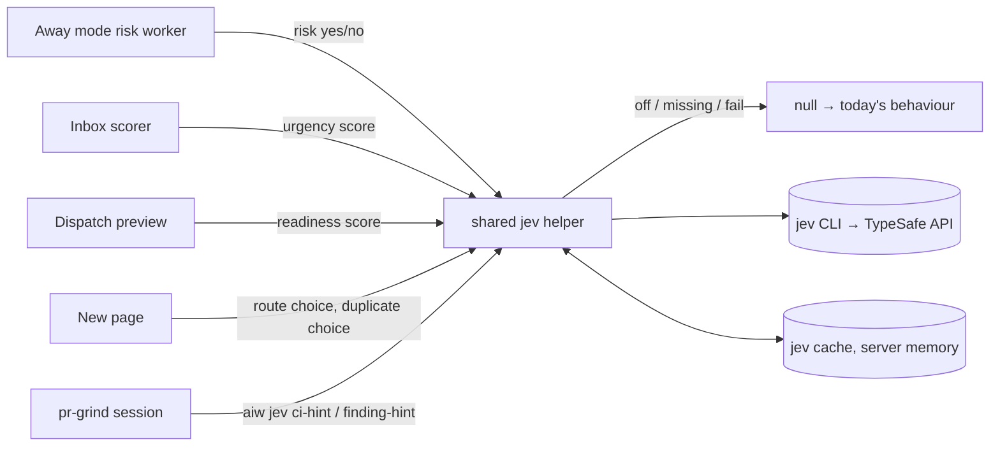
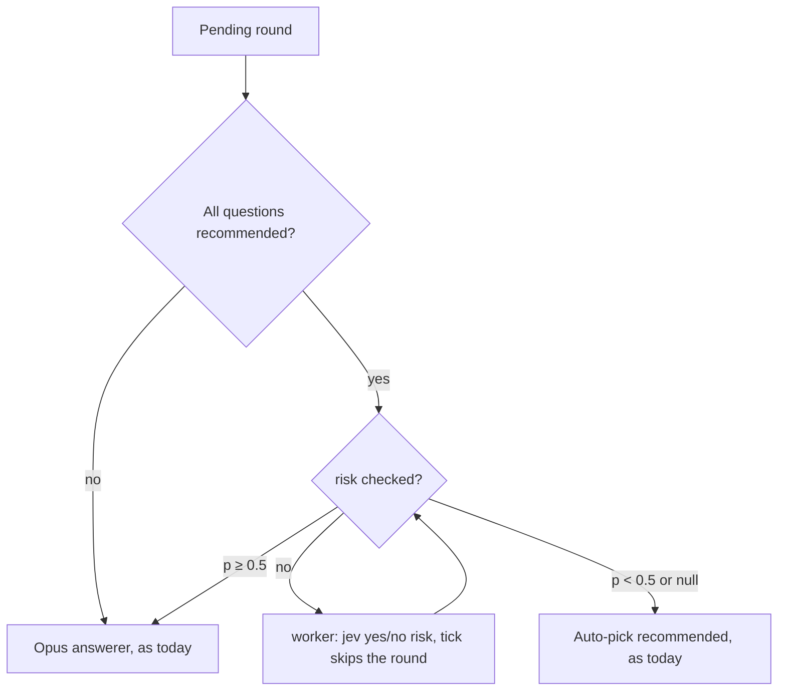

# PRD — jev judgments across the workflow

**Status:** Approved · **Date:** 2026-10-29 · **Slug:** `jev-judgments` · **Owner:** Masnun Siam · **Priority:** medium · **Repo:** masnun-siam/ai-workflow

## Overview

`jev` is a command-line client for TypeSafe AI's Jev model. It answers typed questions about a piece of text (yes/no, one of several options, or a score on a rubric) in under a second, for under a cent, and returns calibrated probabilities rather than generated text. This feature uses it at six points where the workflow makes a judgment today blind, by time order, or not at all: Away mode's auto-picks, the Inbox order, dispatch readiness, duplicate captures, and two advisory hints inside `/pr-grind`.

Today:
- jev is used once: **Auto** in the capture box asks `jev choice` whether the text is a feature or a small change, pinned to one model version, with an 8-second timeout. Any failure, a missing `jev`, or confidence under 0.4 gives a null route and the user picks. This is the pattern every point below follows.
- Away mode auto-picks every round whose questions all carry a `(Recommended)` option, without looking at what the option does. Every other round goes to a read-only Opus answerer, which may hold it.
- The Inbox sorts by fixed group (block, answer, decide, fix, setup, wait), then newest first.
- A dispatch skips an issue only when it lacks the `refined` label. A refined issue with a thin body still starts a full `implement-issue` session.
- A capture creates a PRD interview or an issue without checking the repo for one that already covers it.
- `/pr-grind` decides alone whether a red CI check is a flake or a real break (unsure means real, and it never reruns on a guess) and whether each review finding is fixed or rebutted.

## Problem

Several cheap judgment calls are either missing or made by an expensive model session. Away mode can auto-pick a recommended "push" or "merge" while nobody is watching. The Inbox puts a stale question above an urgent one because it came later. A dispatch spends a whole session on an issue that was never really specified. A capture duplicates an issue or PRD that already exists. Each is a sub-second question jev can answer.

These are expected failures, not counted incidents: no log of them exists today. All six points are kept as preventive work at medium priority, because each one only advises or adds care and costs under a cent a call.

## Users

The single operator of `aiw ui` and the headless sessions it runs. No roles or tenants.

## Goals

- Away mode never auto-picks a risky option without a model reading the context first, whenever jev answers.
- The Inbox puts the most urgent item of each group first.
- The user sees, before a dispatch starts, which issues look underspecified, and on the New page, which existing issue or PRD the text may duplicate.
- `/pr-grind` logs jev's view next to its own decision, so jev's accuracy can be judged before it is ever trusted to act.
- With jev missing or switched off, everything behaves exactly as today: no new text, no new log lines, no new warnings. The one addition is the status line in Settings (FR-2). With jev on but failing, each FR says what shows (FR-5, FR-7).

## Non-goals

- jev never acts on its own: no rerun of CI, no skipped lane, no blocked capture, no answered question. The only change to what runs or gets answered is routing a recommended Away mode round to the Opus answerer. The other visible changes are advisory: Inbox order (FR-4), preview and New page warnings (FR-5, FR-6), and grind log lines (FR-7, FR-8).
- jev does not answer Away mode rounds itself, not even simple ones.
- No per-point switches; one global switch only.
- No duplicate search over closed issues or other repos.
- No duplicate check in the capture bar: its pinned Feature and Small change captures skip the New page and get no check. Its Auto choice already opens the New page, which runs the check.
- No jev MCP server inside skills; skills reach jev only through `aiw jev`.
- No accuracy dashboard. The grind log is the record; analysing it is later work.
- Planning skills (`create-prd`, `create-tasks`, `refine-issues`) do not call jev.

## Requirements

- **FR-1 Shared jev call.** Every point asks jev through one shared helper: model pinned to one version, an 8-second timeout, input truncated to 4000 characters, JSON output. Any failure (not installed, switched off, timeout, non-zero exit, unreadable output) returns a null answer and never an error to the caller. Warnings the helper logs carry only the point name and the failure kind, never the input or jev's output. The helper redacts token-shaped strings (see Data sent) from every input before sending, whatever the point. The capture router moves onto the helper and keeps its current behaviour: the 0.4 threshold, `unclear` giving a null route, and its existing `why` strings. Route answers are not cached.
  - Acceptance: with `jev` removed from `PATH`, every screen and command in FR-3 to FR-8 behaves as it did before this feature: no readiness text, no duplicate warning, no new grind log lines, and no error shown or logged above warning level.
  - Must keep working: `test_ui_route.py` stays green.

- **FR-2 One switch.** Settings has a **Use jev** toggle, on by default, plus a read-only line saying whether `jev` is installed ("jev found" or "jev not found — see docs/INSTALL.md"; the key is not checked). Off makes every point return null, including the capture box's Auto route; the switch is read before the cache, so a cached answer never bypasses it, and the `jev` binary is never run while it is off. A settings save that omits `use_jev` keeps the stored value. If saving the toggle fails, it reverts and shows the error.
  - Acceptance, with off:
    - Auto on the New page shows "jev is off" and leaves the choice to the user; switching on restores the route. The capture bar is unchanged: its Auto opens the New page, which shows the same text.
    - `/api/duplicate` returns `why: "jev is off"`, Inbox `urgency` is null, the preview shows no readiness, Away mode auto-picks as before, and `aiw jev` reports status `off`.
    - A stub `jev` on `PATH` is never invoked, even for an input already in the cache.
    - `PUT /api/settings` with a non-boolean `use_jev` returns 400, and a `PUT` without the key leaves it unchanged.

- **FR-3 Away mode risk check.** Before Away mode auto-picks an all-recommended round, jev answers yes/no: "Is any recommended option irreversible or outward-facing: pushing, merging, publishing, deleting, posting, or spending money?" No round shape is exempt, including routine `/flow` rounds such as "Continue to <next stage>" or "Approve the PRD and file its epic". At a probability of 0.5 or more, the round goes to the Opus answerer instead (which may answer or hold it as today; the answerer is not told the round was flagged). Under 0.5, or a null answer, the round is auto-picked as today. A round is checked once. The check never runs inside the Away mode tick: see Backend.
  - Acceptance, with a stub jev: a stub p=0.9 sends the all-recommended round to the Opus answerer and logs `risk: 0.9` ("Risk check: sent to Opus (p=0.9)"); p=0.49 and a null answer auto-pick it as today; p=0.5 sends it to Opus. A real-model run with a "Merge the PR" round is a manual sanity check only.
  - Must keep working: non-recommended rounds are untouched; the owner answering while the check runs wins; the log entry shape in `test_ui_afk.py`.

- **FR-4 Inbox urgency.** Question, paused grind, failed session and PR conflict items get an urgency from 1 to 5 from a jev score, where 5 means "irreversible, outward-facing or blocking work right now" and 1 means "cosmetic, can wait". Inside each group, items sort by urgency (highest first), then newest first. Unscored items, and dispatch-lane rows, count as urgency 0. Group order does not change. The new order never moves the open item, the selected row or focus: it applies once nothing is open, or on the next visit to the Inbox.
  - Acceptance, with stub scores: two questions in the Answer group, the older scored 5 and the newer scored 1, return the older first from `GET /api/inbox`, with `urgency` 5 and 1. In the UI, with an item open, a poll that brings a new order does not move the selection or focus; closing the item applies the new order.
  - Must keep working: `test_ui_inbox.py` stays green. Mixed cases are tested: a scored old item against an unscored new one (scored first), equal scores (newest first), and a group with no scored items (time order).

- **FR-5 Readiness warning.** The dispatch preview scores each refined lane's issue body from 1 ("no clear outcome") to 5 ("outcome, acceptance criteria and approach all clear"). A score of 2 or less adds a preview warning "#n: may be underspecified (jev 2/5)". The lane still runs. The preview waits at most 8 seconds for scoring; lanes not scored by then, or whose body could not be read, are named in one warnings-list line, "Readiness unavailable for #a, #b". With jev off or missing, nothing is shown. `aiw dispatch plan` waits the same 8 seconds.
  - Must keep working: `test_dispatch_cli.py` and `test_ui_dispatch.py` stay green.
  - Acceptance, with a stub: a lane scored 2 shows the warning and still starts when the user starts the dispatch; a lane scored 3 shows nothing; a stub that sleeps past 8 seconds shows one line "Readiness unavailable for #a, #b" (two lanes share one line) and the preview still opens.

- **FR-6 Duplicate warning.** On the New page, once a repo is chosen and the text is at least 20 characters, jev picks among that repo's newest 100 open issue titles, its PRD titles, and "none of these". A match at 0.6 or more shows "Looks like #n <title>" (or the PRD's title) with a link that opens in a new tab, so the typed draft is kept. The user can still continue with either "Start the PRD interview" or "File the issue".
  - Acceptance, with a stub picking the issue at p=0.7: capturing "Add dark mode to the settings page" in a repo with an open issue "Dark mode support" shows the warning linked to that issue, and both buttons still work. Boundaries: 19 characters runs no check, 20 does; p=0.59 shows nothing, 0.6 shows the warning; "none of these" shows nothing; a PRD match shows the PRD's title.

- **FR-7 CI hint in grind.** When `/pr-grind` meets a red check, it runs `aiw jev ci-hint` on the failing log and writes the hint ("flaky", "real" or "none") with its probability, beside the `ci-attempt` line for that check in the grind state file. The skill's rules are unchanged: it classifies by itself and never reruns on the hint. When jev is off or missing, no line is written; when jev is on but the call fails, the line is written with `none (0)`.
  - Acceptance: after a grind round with a red check, the state file has a line `jev-ci-hint: <check name> <flaky|real|none> (
) — session: <fixed|flake-rerun|rerun-denied|cannot-fix>`. The line never starts with `paused:`, `done:` or `## Round `.

- **FR-8 Finding hint in grind.** For the review findings of a round, `/pr-grind` runs one `aiw jev finding-hint` call (at most 20 findings per round, scored four at a time; findings past the 20th get no line) and logs the hint ("fix", "rebut" or "none") beside its own decision. A finding with no comment id is keyed by its position in the round (`#<n>`). The skill still decides alone. Off or missing writes no lines.
  - Acceptance: after a grind round with three findings, the round log has three `jev-finding-hint: <comment id or #n> <fix|rebut|none> (
) — session: <fix|rebut>` lines.

## Edge cases

- **Concurrency.** Away mode checks a round once and stores the result on the round, so a later tick does not ask again. The owner answering while the check runs wins, as today (the claim fails and nothing is resumed). One background scorer scores the Inbox and tracks the items it has in flight, so two polls never score the same item twice. An item whose text changes is scored again.
- **Empty states.** A repo with no open issues and no PRDs skips the duplicate check. A missing or stale poller snapshot (an unwatched repo, or just after a restart) returns a null match with why "issues not loaded yet". An Inbox with nothing scored keeps time order.
- **Limits.** jev takes at most 255 options; the duplicate check offers at most 100 issues plus PRDs plus "none of these", and drops the PRDs with the oldest file modification time if the total would exceed 254. Option titles are cut to 120 characters. Text over 4000 characters is truncated (CI logs keep their last 4000 characters, where failures print).
- **Slow or down jev.** Each call is bounded at 8 seconds and fails to null. The Inbox never waits on jev: it shows unscored items in time order. The preview waits at most 8 seconds (above). Away mode's tick never waits on jev.
- **Prompt injection.** Issue bodies, review comments and CI logs are untrusted. jev returns only probabilities over fixed options, so injected text can at most move a score. Scores can reorder the Inbox inside a group (FR-4), which is accepted: the impact stays inside the group. The only score that changes what runs (FR-3) can only add an Opus answerer, never remove a check. Skills never put log or comment text on a command line: see `aiw jev` below.
- **Existing data.** None to migrate. The cache starts empty; Away mode rounds already in flight are treated as unchecked.
- **Data sent to TypeSafe AI** under the user's own jev key, which today is only the text typed into the capture box:
  - FR-4: Inbox question, pause-reason and error text.
  - FR-5: bodies of refined issues in a dispatch.
  - FR-6: the typed capture text and the titles of the repo's open issues and PRDs.
  - FR-7: the last 4000 characters of a failing CI log.
  - Every point: token-shaped strings (well-known token prefixes, `KEY=`/`TOKEN=`/`SECRET=` values, `Authorization`/`Bearer` values, long hex or base64 runs) are replaced by `[redacted]` by the helper before sending.
  - FR-8: review finding text.
  - FR-3: question and option text of Away mode rounds.

  The Use jev switch (FR-2) is the way to stop all of it.

## Technical design

_Every point goes through one helper; any failure is a null answer and today's behaviour._

### Data

- **Cache** (FR-4, FR-5, FR-6): held in the server's memory and flushed to one JSON file in the plugin data dir, `jev_cache.json`, on a timer. It maps `<point>:<sha256 of the exact input>` to `{answer, probability, at}`. At most 2000 entries; the oldest are dropped first. Entries older than 7 days are ignored. Only the server reads or writes it; `aiw jev` runs do not touch it. Not in the repo.
- **Call ceiling:** at most 500 jev calls per hour from the server's Inbox scorer, readiness and duplicate points; beyond it those calls return null until the hour turns. Risk checks (FR-3) do not count against it and are never refused by it, so a risky round is never auto-picked unchecked because other points spent the budget. `aiw jev` runs (FR-7, FR-8) are outside it; a grind round makes at most one finding call plus one CI call per red check.
- **Settings** (FR-2): `use_jev: bool`, default `true`, in the UI settings file. Like `vault_dir` and `grind_mode`, a save that omits it keeps the stored value.
- **Away mode round** (FR-3): the pending round gains `risk`. A missing field means unchecked; `{p: float}` means checked; `{p: null}` means checked with no answer (jev off, missing or failed). It is set once. With jev off or missing the worker stores `{p: null}` at once without running jev, so the round is auto-picked as before.
- **Grind state file** (FR-7, FR-8): the `jev-ci-hint:` line sits beside the check's `ci-attempt: <sha> — <outcome>` line (which may be in the header above the first round); `jev-finding-hint:` lines sit under the round heading. Formats are in FR-7 and FR-8. `<outcome>` uses the skill's own words (`fixed`, `flake-rerun`, `rerun-denied`, `cannot-fix`). The hint's `none` carries probability 0.

### API

- `GET /api/settings` adds `use_jev: bool` and `jev_installed: bool`. `PUT /api/settings` accepts `use_jev` (boolean, else 400).
- `POST /api/route` is unchanged in shape; with jev off it returns `{route: null, confidence: 0, why: "jev is off"}`.
- `POST /api/duplicate` (new, FR-6). Request `{repo: "owner/name", text: string}`; `repo` must be a registered repo (400 otherwise), `text` non-empty (400). Response `{match: {kind: "issue"|"prd", n?: int, path?: string, title: string, url: string} | null, confidence: float, why: string}`. `url` is always built by the server, never taken from a title: for an issue, from the repo slug and issue number; for a PRD, the app's Feature page link (`#/features/<slug>`, the UI uses a hash router). Null match with a `why` for off, missing, failed, under 0.6, "none of these", too-short text, or issues not loaded.
- `GET /api/inbox` items gain `urgency: int | null` (1–5).
- Dispatch preview `lanes[]` gain `readiness: int | null` (1–5); low scores also add a `warnings[]` line as in FR-5.
- Away mode log entries for a risk-routed round carry `risk: float`.

### Backend

- **Shared helper** (FR-1, FR-2): generalises the capture box's jev call to the three question types (yes/no, choice, score) with the limits in FR-1, reads the switch first, then the cache. The capture router moves onto it.
- **`aiw jev` verb** (FR-7, FR-8): `aiw jev ci-hint --file <path>` and `aiw jev finding-hint --file <path>` (the file holds a CI log, or a JSON list of `{id, text}` findings). The skill writes log and comment text to the file through a redirect, in a temp dir outside the PR checkout, deletes it after the call, and never puts the text on a command line or in `echo`. The verb prints `{hint, probability, status}` JSON (a list for findings) with `status` one of `ok`, `off`, `missing`, `failed`, and exits 0 always. Question text and options live in the run engine, not in the skill.
- **Away mode** (FR-3): the risk check runs in a small worker, off the tick, at most two at a time; the worker tracks the rounds it has queued or in flight, so a round is never queued twice. The tick sends an all-recommended round to the auto-pick only once `risk` is stored and under 0.5 (or null); until then it skips the round and picks it up on a later tick. At p ≥ 0.5 it marks the round for the Opus path, which today skips recommended rounds, so the answerer sweep must accept a risk-marked round. Non-recommended rounds are untouched.

_Away mode's new risk check sits only in front of the auto-pick, and runs off the tick._

- **Inbox scorer** (FR-4): one background job scans every 30 seconds, scores up to 3 new scorable items per pass (at most 360 calls an hour), three at a time, by their text (question and options, pause reason, error), and fills the cache. With n new items, the last has its urgency within ⌈n/3⌉ scan intervals. The scorer skips a pass once 400 of the hour's 500 calls are spent, so readiness and duplicate checks keep the rest. Building the Inbox only reads the cache. The urgency sort runs after the dispatch-lane rows are merged in.
- **Readiness** (FR-5): the issue bodies come from the dispatch resolve query, asked for `body` only on the preview read (the dispatch tick's 300-second re-read does not fetch bodies), so no per-lane GitHub call is added. Bodies are used only for scoring and never returned in `lanes[]` or printed by `aiw dispatch plan`. At most 30 lanes are scored, five at a time, bounded by 8 seconds as a whole. A failed body read puts the lane in the "Readiness unavailable for #a, #b" line. The preview code is shared, so `aiw dispatch plan` and the herdr-dispatch preview show the same warning.
- **Duplicate** (FR-6): options come from the poller's in-memory open issues (no GitHub call) and the repo's PRD titles as the Features screen lists them (all PRDs it lists, whatever their status). Overlapping calls are cut by the frontend's debounce; at most one request is in flight per page.
- **pr-grind** (FR-7, FR-8): the skill gains the two `aiw jev` calls and the log lines, with a skill-text test in the `test_plugin_text.py` style. `pr-grind` is a kept tool, so this deviation is allowed.

### Frontend

- **Settings**: a "Use jev" toggle and the "jev found / jev not found" line (FR-2).
- **New page**: below the route, a warning "Looks like #n <title>" with a link opening in a new tab, in a polite live region (`role="status"`), at the same contrast as other text. The check runs 800 ms after typing stops; the warning hides as soon as the text or repo changes, and responses for stale text are ignored. Nothing shows while loading or when null.
- **Inbox**: no visual change beyond order; the open item, selected row and focus never move (FR-4).
- **Dispatch preview**: while scoring, the existing "Reading the issues…" copy stays; readiness warnings appear in the existing warnings list.
- **Away mode log**: a risk-routed round shows "Risk check: sent to Opus (p=…)".

### Realtime and other services

Not affected. TypeSafe AI's API is reached only through the `jev` CLI.

### Non-functional

- No new Python dependency; `jev` stays an optional external binary.
- No HTTP request waits on jev for more than 8 seconds, the Inbox and the Away mode tick never wait on it, and the server makes at most 500 non-risk calls an hour.
- Model pinned to one version (the one the capture router pins today); a change of pin is a code change with a CHANGELOG line.

### Testing

- Unit (plain `assert` scripts, a stub `jev` executable on `PATH` with a fixed answer per test):
  - helper null cases (missing, off, timeout, bad exit, bad JSON); cache hit and expiry, eviction at 2000 entries, reload after a restart; call 501 returns null without invoking the stub while a risk check still runs, with the ceiling's clock set by the test and the window resetting after the hour; off never invokes the stub, even on a cache hit; warnings carry no input; redaction (a log with one sample of each listed pattern, the stub records its stdin, none of the secrets reach it) (FR-1, FR-2);
  - settings save without `use_jev` keeps it; non-boolean gives 400 (FR-2);
  - Away mode at p 0.49, 0.5 and null, an unchecked round skipped by the tick, a non-recommended round untouched, the owner's answer winning (FR-3);
  - Inbox ordering with and without urgency, including the mixed cases in FR-4 and dispatch-lane rows (FR-4);
  - preview warning at score 2 and 3, a timeout, a failed body read (FR-5);
  - `/api/duplicate` validation, the 19/20 character and 0.59/0.6 boundaries, "none of these", a PRD match, the 254-option cap, a stale snapshot (FR-6);
  - `aiw jev` verbs' output and exit code on each `status`, and no line for the 21st finding, and the skill text making the two calls and writing the lines (FR-7, FR-8).
- Away mode risk field: absent runs the check, `{p: null}` auto-picks, a round already in flight is not queued twice.
- Component: New page duplicate warning shown, hidden on edit, and a stale response ignored; Settings toggle, including a failed save, and the "jev found / not found" line with the stub on and off `PATH`; Inbox with an item open while a new order arrives (selection and focus stay, the order applies on close).
- Manual: one real Away mode run with a merge round, one real grind round, to check jev's answers look sensible.

## Rollout and cost

On for everyone with `jev` installed and its key set, on release, with a CHANGELOG line saying that jev now sees more than the capture box's text (see the data list above) and where the switch is. Cost per call is under a cent; a busy day stays well under a dollar. The server's non-risk points are capped at 500 calls an hour (about $5 an hour at a cent a call, the worst case); risk checks and grind hints sit outside that cap, and grind hints are bounded by one finding call plus one CI call per red check per round. FR-3 can add Opus answerer runs for risky rounds, which cost more than an auto-pick. It can also slow unattended runs: routine `/flow` rounds such as "Approve the PRD and file its epic (Recommended)" may score as outward-facing, go to Opus, and be held until the owner returns. This is accepted: no round shape is exempt (see Decisions).

## Success metrics

None formally defined for v1, because none of the six points has a baseline today. The data to set them later exists: `risk` on Away mode log entries (share of risk-routed rounds Opus held), the grind hint lines (FR-7, FR-8), and the readiness and duplicate warnings the user acts on.

## Epics

- **E1 jev judgments across the workflow** — covers FR-1 to FR-8. Issue: #567

## Decisions

- Six points in v1: Away mode risk, Inbox urgency, readiness, duplicates, CI hint, finding hint — the user chose all four UI points and both grind hints.
- Grind hints are advisory and never act — `ci.py` and `/pr-grind` deliberately keep flake-vs-real with a model session; logging lets jev be measured first.
- One shared helper, jev optional everywhere — matches the capture router; missing means today's behaviour, and a failing call adds only the text FR-5 and FR-7 name.
- Away mode: a risky recommended round goes to the Opus answerer, not held — only adds care, and the answerer can still hold.
- A null risk check auto-picks as today — keeps "jev missing means today's behaviour" consistent across points.
- Readiness and duplicates warn, never block — a false positive costs a glance, not a stalled dispatch.
- One Settings switch, default on — matches the capture box; one place to stop spend.
- Inbox sorts by urgency inside each group, groups unchanged — keeps the group contract the UI is built on.
- Grind reaches jev through a new `aiw jev` verb that reads a file, never a command line — one copy of the questions and the pin, the switch applies, and untrusted text stays out of the shell.
- Duplicates compare against the chosen repo's open issues and PRDs from memory — no extra GitHub call per capture.
- The preview waits at most 8 seconds for readiness — simpler than a second poll, and bounded.
- The risk check runs off the Away mode tick — one slow call must not stall every session.
- One epic, medium priority — nothing is broken today.
- All six points kept with no logged incidents — each only advises or adds care, costs under a cent, and produces the baseline data Success metrics names.
- On by default behind the one switch, for users who already use jev — matches the capture box and the single-switch non-goal; it is a single-user tool on the user's own key, secrets are redacted, and the CHANGELOG says what is now sent and where the switch is.
- No `/flow` round is exempt from the risk check — filing an epic publishes to GitHub; routing to Opus only adds care and the answerer can still pick the recommended option. The cost is an Opus run and an occasional hold.
- No duplicate check in the capture bar — pinned captures are deliberate, and Auto already goes through the New page.
- Capture bar unchanged with jev off — its Auto opens the New page, which says "jev is off", so there is one behaviour everywhere.
- The preview waits at most 8 seconds for readiness — confirmed; slow lanes are named in one line.
- The Opus answerer is not told a round was flagged — it weighs the evidence unbiased, and its prompt belongs to the away-mode-answerer PRD.
- FR-7 and FR-8 stay in v1 as instrumentation — log only, bounded calls, and the data needed before jev is ever trusted to act.

## Open questions

None.

## Change log

- 2026-10-29: round 1 and round 2 panel revisions.
- 2026-10-29: team review done; the eight open questions settled (see Decisions); capture bar duplicate check moved to Non-goals; FR-3 states that no round shape is exempt. Status Approved. No issues affected yet.

## Related

- `docs/prds/away-mode-answerer.md` — the Away mode answerer this routes risky rounds to.
- `docs/prds/ui-rewrite.md` — the capture box and its jev Auto route.
