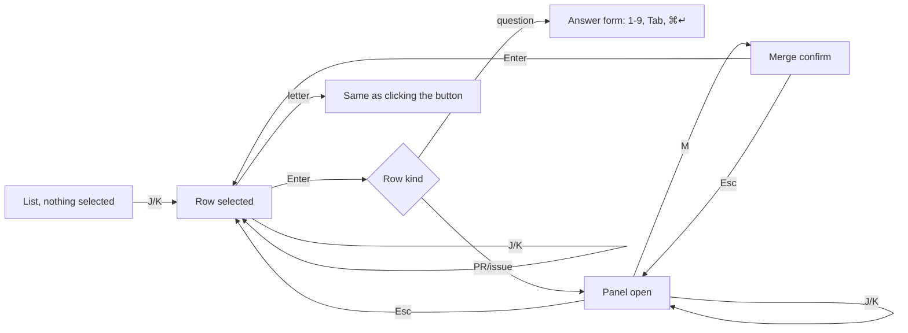
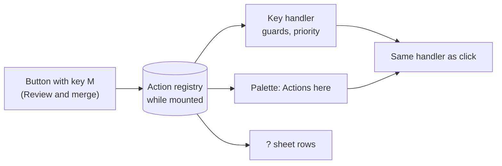

# PRD — Keyboard-first UI

**Status:** Approved · **Date:** 2026-10-25 · **Slug:** `keyboard-shortcuts` · **Owner:** Masnun Siam · **Priority:** medium · **Repo:** masnun-siam/ai-workflow

Status is `Draft`, `In review` or `Approved`. This document is the source of truth for the feature: every issue is derived from it, and a decision that is not written here has not been made.

## Overview

With this change, most of the work in the `aiw ui` web app can be done from the keyboard alone. That covers triaging the Inbox, answering Claude's questions, moving through lists, acting on issues, PRs and sessions, and switching tabs. Every button on a page can also be found in the ⌘K palette. The user is the one person running the workflow from the UI.

Today:
- Global keys: ⌘K / Ctrl+K opens the palette, `N` opens Start, `G` then `I/F/D/A/S` goes to a page, `?` opens the shortcuts sheet, `Esc` closes the top panel or dialog, and ⌘↵ submits the form that has focus. None of the single keys fire while you type in a field or while a dialog or menu is open.
- The palette finds pages, Start commands, features, open issues and PRs, sessions, repos and Away mode. It cannot run an action on the current page.
- The shortcuts sheet can list keys that a page adds while it is mounted, but no page adds any yet.
- The issue/PR side panel can switch to another target while it is open, and it returns focus to whatever opened it when it closes.
- Page tabs (Features, Feature page) use accessible tab primitives, so arrow keys already work once a tab has focus.
- Missing: a way to select a row in a list, keys for row and page actions, number keys for answering questions, and on-screen hints that show which key does what.

## Problem

You work in the UI all day, and almost every step needs the mouse: expanding a question, picking an option, pressing Merge, Retry or Skip CI, opening the next PR. Switching between keyboard and mouse slows down triage, which is the most repeated work in the app (Inbox → act → next).

## Users

The single operator of `aiw ui`, on desktop and over a tailnet in a browser. There are no roles. Below 760 px (the bottom-tab layout) the keys still work when a hardware keyboard is attached, but the hints are hidden.

## Goals

- Every task in the Inbox, on list pages, in the issue/PR panel and on the session page can be done without touching the mouse.
- Answering a question round takes number keys and ⌘↵.
- Keys are the same on every page, and the screen shows them.

## Non-goals

- Remapping keys, or a setting that turns them off.
- Keys inside the Start dialog beyond what exists today (Tab, arrows, ⌘↵). It is already a form.
- Vim-style counts, sequences beyond the existing `G` chord, or multi-select by keyboard (for example ticking several issues on the Feature issues tab).
- An Alt-held "reveal all keys" overlay.
- Keys on the Onboarding or Settings pages beyond Tab order.
- Mobile on-screen keyboard support or touch gestures.

## Requirements

- **FR-1 Selection in lists.** The Inbox, Features (each tab), the Feature issues tab, Dispatches, the Dispatch page lane list and Activity each show one selected row when you use keys. `J` / `↓` moves down and `K` / `↑` moves up, stopping at the ends without wrapping. The selected row has a visible outline that is not colour alone, and it scrolls into view. No row is selected until the first `J`/`K`; the first press selects the first row. A mouse click on a row also selects it.
  - Acceptance: on the Inbox with three items, `J J K` leaves the second item outlined and scrolled into view. With no key pressed, no row is outlined.
- **FR-2 Open the selected row.** `Enter` does what clicking the row does: on the Inbox it expands or collapses the answer form for a question item, and for every other item it presses the item's primary button. On Features it opens the feature page, on the Feature issues tab the issue panel, on Dispatches the dispatch, on the Dispatch page the lane panel, and on Activity the session.
  - Acceptance: `Enter` on a selected feature row lands on that feature's page. `Enter` on a selected Inbox question shows its answer form.
- **FR-3 Selection survives refresh.** The selection follows its row across polls. If the row disappears (handled or merged), the row now at the same position is selected, or the last row if it was at the end. If the list becomes empty, the selection clears.
  - Acceptance: with three Inbox items and the second selected, merging the second leaves the former third item selected after the next poll.
- **FR-4 Action keys.** One fixed map, the same on every page. A key works only when the matching button is visible for the selected row (on list pages), or on the page or panel itself. It does exactly what clicking that button does, including any confirm step the button already has (Merge… still asks before merging).

  | Key | Action (wherever the button exists) |
  | --- | --- |
  | `Enter` | Open or expand the selected row (FR-2) |
  | `A` | Answer |
  | `P` | Approve PRD, Approve PRD anyway |
  | `M` | Review and merge, Merge…, Merge #n, Merge PR |
  | `R` | Retry, Resume, Rerun |
  | `S` | Skip CI, Skip CI and continue |
  | `E` | Refine, Refine again |
  | `T` | Continue in terminal |
  | `C` | Put focus in the Comment or message box |
  | `O` | Open PR, Read PRD |
  | `X` | Stop, Stop grind, Cancel, Dismiss |

  Where a row or page shows two buttons for the same key, the key presses the primary one, and the other stays reachable through the palette (FR-7). `N`, `G`, `J`, `K`, `?`, `[`, `]` and digits are reserved and never used as action keys.
  - Acceptance: on the Inbox with a paused-grind item selected, `S` sends Skip CI and shows the same toast as a click. With a ready-to-merge item selected, `M` opens the PR panel, and inside it `M` shows the merge confirm, where `Enter` merges and `Esc` cancels. A key whose button is not shown does nothing.
- **FR-5 Panel follows the list.** While the issue/PR panel is open from a list, `J`/`K` still move the list selection, and the panel switches to the newly selected row's issue or PR. Rows that have no issue or PR (for example a failed session) close the panel. Action keys act on the panel's buttons first, then on the row's. `Esc` closes the panel and returns focus to the list with the selection kept.
  - Acceptance: with the PR panel open on the first of two ready-to-merge Inbox items, `J` shows the second PR in the panel, and `Esc` closes it with the second row still selected.
- **FR-6 Answering by keyboard.** In an expanded question round (Inbox or session page), the question with focus takes number keys: `1`–`9` pick that option (they toggle it when the question allows several), `0` or `O` picks "Other" and focuses its text box, and `Tab` moves to the next question. When a round expands, focus goes to its first question. ⌘↵ sends the round when every question is answered, the same check the Send button uses. Option labels show their number.
  - Acceptance: a two-question round answered with `2`, `Tab`, `1`, ⌘↵ sends option 2 and option 1. ⌘↵ with an unanswered question sends nothing and the Send button stays disabled.
- **FR-7 Palette "Actions here".** ⌘K shows an "Actions here" group first. It lists every action button on the current page, on the open panel and on the selected row, labelled as the button is (for a row action, with the row's name). Each entry shows its key if it has one, and running it does what a click does.
  - Acceptance: on a session page for a stopped session, ⌘K lists "Resume (R)" and "Continue in terminal (T)" under Actions here, and running Resume resumes it. On a page with no actions the group is absent.
- **FR-8 Page tabs.** `[` and `]` move to the previous and next tab on pages with tabs (Features, Feature page), and they stop at the first and last tab.
  - Acceptance: on Features → Active, `]` shows Shipped and `[` goes back to Active.
- **FR-9 Hints.** A button with a key shows the key as a small badge after its label, and as part of its tooltip. Hints are hidden below 760 px. The `?` sheet lists the global keys, then the keys that work on the current page and panel, as it does today for registered keys.
  - Acceptance: the Inbox shows "Review and merge M" on a ready-to-merge row, and `?` on the Inbox lists `J / K`, `Enter`, and the action keys that apply there.
- **FR-10 Guards.** No single-key shortcut (letters, digits, `[`, `]`, `Enter`) fires while focus is in a text field, select or contenteditable, or while a dialog, alert dialog or menu is open, except number keys inside a question round (FR-6) and `Enter`/`Esc` inside the merge confirm. Key repeat and keys with ⌘, Ctrl or Alt held are ignored, as today.
  - Acceptance: typing "m" in the Inbox repo filter or the comment box merges nothing. Holding `J` moves the selection by one row only.
- **FR-11 Session page keys.** On a session page, `R`, `T`, `X` and `C` press Resume, Rerun or Retry, Continue in terminal, Stop, and focus the message box, wherever those buttons are shown.
  - Acceptance: on a running session `X` stops it, the same as clicking Stop. On a finished session `R` reruns it.

The key path through the Inbox, with the panel following the selection (FR-1, FR-2, FR-4, FR-5):

## Edge cases

- **Concurrency.** A poll can remove the selected row between a keypress and its action. The action runs against the row that was selected when the key was pressed, and if that row's button no longer exists, nothing happens. A second press of an action key while the first request is pending does nothing, because the button is disabled while pending and the key follows the button.
- **Empty states.** On an empty list, `J`/`K`/`Enter` and row action keys do nothing. Page-level keys still work.
- **Limits.** Number keys cover options 1–9. A question with more than nine options can still be answered with Tab and arrow keys, and options 10 and up show no number.
- **Hidden or disabled buttons.** A key whose button is disabled (for example Merge… on a conflicting PR) does nothing and shows no toast.
- **Same key twice.** Inside the open panel its buttons win over the selected row's buttons (FR-5). On a row with two `X` actions (Stop grind and Cancel never appear together today), the primary one wins.
- **Away mode.** Keys work the same whether Away mode is on or off. Answering a round by key while the away answerer is also answering it goes through the same submit path as a click, so a round that is already answered is refused in the same way.
- **Repo switch.** Switching repo clears the selection.
- **Data isolation.** Single user, local app. Not applicable.
- **Existing data.** Nothing is stored, so nothing needs migrating.

## Technical design

### Data

Not affected. The selection lives in memory per page and is lost on reload. Nothing is persisted.

### API

Not affected. Every key goes through the same frontend action a click uses, so it calls the same endpoints.

### Backend

Not affected.

### Frontend

- **One key registry (FR-4, FR-7, FR-9, FR-10, FR-11).** The existing global shortcut handler and the registry behind the `?` sheet grow into a single registry. A page, panel or row registers its actions while mounted, each with a label, an optional key from the fixed map, a priority (panel above row above page, and primary above secondary), and the handler the button already uses. One registration drives three things: the key, the "Actions here" palette entries and the `?` sheet rows. So a button, its key, its palette entry and its hint cannot drift apart. The guards in FR-10 live in this one handler.
- **Button hints (FR-9).** The shared button component accepts an optional key. When one is given, it registers the action and renders the badge and tooltip, so pages give a key to their existing buttons instead of adding new handlers.
- **List selection (FR-1, FR-2, FR-3, FR-5).** One shared selection behaviour for lists, keyed by each row's stable key (the Inbox item key, the feature slug, the issue number, the dispatch id, the lane key, the session id). It tracks the selected key and the selected index, so it can fall back to the same position when the key disappears. Selecting a row while the panel is open retargets the panel through the existing panel API. Rows are focusable, so the outline is the real focus ring and screen readers announce the row.
- **Question form (FR-6).** The shared question-round component (used by the Inbox and the Away Change dialog) handles number keys inside its fieldsets and shows the option numbers. It submits through its existing validity check. In the Away Change dialog, number keys work too, since they are scoped to the focused fieldset.
- **Palette (FR-7).** The palette reads the registry and puts "Actions here" first, ahead of the existing group order.
- **Tabs (FR-8).** The shared tabs component handles `[` and `]` when no field has focus.
- **Loading and error states.** While a list is loading, there is nothing to select. Error banners keep their Retry button. It has no key and is reachable by Tab and through the palette.

How one registration fans out, which is the reason for a single registry:

### Realtime and other services

Not affected. Polling stays as it is, and FR-3 defines how the selection reacts to it.

### Non-functional

- Accessibility: the selected row is the focused element and has a visible focus ring. Badges are hidden from screen readers (`aria-keyshortcuts` carries the key), and status is never shown by colour alone.
- No new dependency. Keys are plain DOM key events, and the palette stays on `cmdk`.
- The built `run-engine/ui_dist/` is rebuilt and committed with the change, per the repo rules.

### Testing

- Component tests (Vitest + React Testing Library) for each acceptance line in FR-1 to FR-11: key sequences against a rendered page with mocked hooks, asserting the selection outline, the panel target, the mutation called, and the palette group.
- Unit tests for the selection fallback (FR-3: key removed in the middle, at the end, list emptied) and for the guard checks (FR-10).
- Manual: one pass through Inbox triage with the keyboard only in a real browser, including VoiceOver announcing the selected row.

## Rollout and cost

Everyone at once, with no flag and no setting. No cost impact. Rebuild `ui_dist` in the same PR. Update the shortcuts section of `docs/REFERENCE.md`.

## Success metrics

None formally defined. The working check: a full Inbox triage (answer, merge, retry, skip CI) done without the mouse.

## Epics

- **E1 Keyboard-first UI** — covers FR-1 to FR-11. Issue: #484

## Decisions

- Coverage is the Inbox, question answering, list pages and tabs, the issue/PR panel and the session page. These are where nearly all clicks go.
- Both letter keys and a palette "Actions here" group. Letters give speed, the palette makes every action discoverable, and it reaches actions that have no letter.
- An action key does exactly what a click does. Merge keeps its existing confirm, and no new confirms are added. It is one behaviour to learn and to test.
- Hints are a key badge on buttons plus the `?` sheet. They can be discovered without cluttering rows, and the sheet's per-page registry already exists.
- One fixed key map: the same verb uses the same key everywhere, so muscle memory carries across pages. The other options (numbers by position, automatic letters) shift meaning between rows next to Merge and Stop.
- When the panel is open, `J`/`K` move the list selection and the panel follows (Linear-style). That allows triage without closing the panel, and the panel can already switch targets.
- The selection follows its row across polls, and if the row vanishes the same position is selected. You keep your place mid-triage.
- Keys are always on, with no remap and no off switch. This matches today's `N`/`G` keys. The typing and dialog guards already prevent accidental presses.
- Priority is medium: quality of life, and nothing is blocked without it.
- One registry drives the keys, the palette and the hints, so a button and its key cannot drift apart. This is a technical call made while writing.
- The Start dialog, multi-select by keyboard and remapping are out of scope for this version.

## Open questions

None.

## Change log

## Related

- `docs/prds/ui-rewrite.md`: FR-4 Palette and FR-5 Shortcuts set the existing keys this extends.
- `docs/REFERENCE.md`: the Shortcuts paragraph under Routes.
