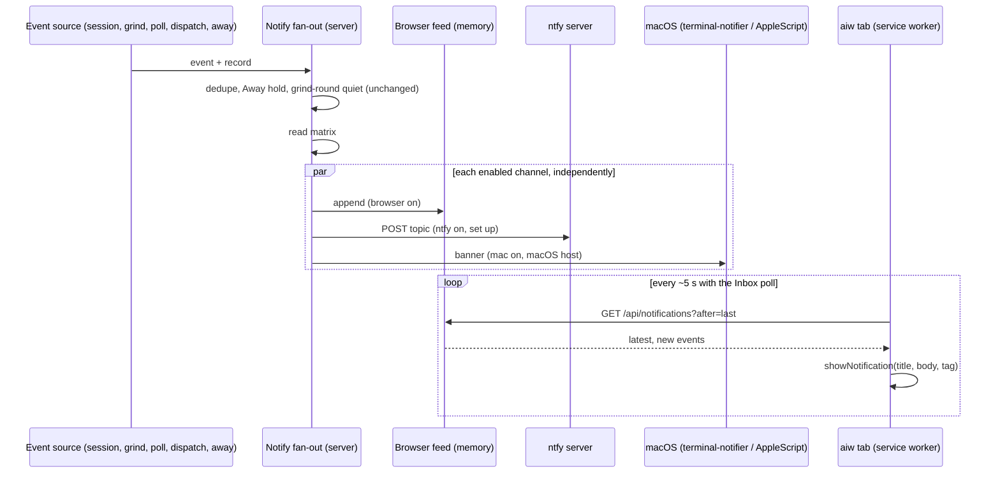

# PRD — Notification matrix

**Status:** Approved · **Date:** 2026-10-23 · **Slug:** `notification-matrix` · **Owner:** Masnun Siam · **Priority:** medium · **Repo:** masnun-siam/ai-workflow

Status is `Draft`, `In review` or `Approved`. This document is the source of truth for the feature: every issue is derived from it, and a decision that is not written here has not been made.

## Overview

Settings → Notifications gets a grid: one row per kind of event (a session waiting on you, a PR ready, a grind paused, …) and one column per channel (Browser, ntfy, This Mac). Each cell is a switch, so the user picks exactly which events reach which channel. aiw has one user, who runs `aiw ui` on their Mac and opens it on the laptop and the phone.

Today:
- **ntfy** pushes all 11 events (listed under FR-1) to the configured server and topic. The only way to turn one off is to clear the server or topic, which turns them all off.
- **Browser** has an "Enable browser notifications" button and a permission chip, but nothing shows a notification any more. The pre-React UI showed one for "waiting" (#124). The React rewrite kept the permission handling, and keeps polling in the background when permission is granted, but dropped the code that shows the notification. The ui-rewrite PRD's "Send test push" button was never built.
- **macOS banner**: a dispatch event also shows a macOS banner on the host through AppleScript. It cannot carry a link, so clicking it opens Script Editor.
- Two rules already decide whether a notification goes out at all. Away mode holds "waiting", "failed" and "grind paused" and sends one summary at the end. A grind round's own "done" is never sent.
- The closest pattern is Settings → Repositories, where each row's auto-grind switch saves the moment it is flipped.

## Problem

Notifications are all or nothing. If the user wants phone pushes only for questions, or wants finished sessions to stay quiet, they cannot set that. Browser notifications look switched on but never appear, so questions wait unseen while the tab sits in the background. The macOS banner is noise because clicking it leads nowhere.

## Users

The single aiw user, in Settings → Notifications in `aiw ui`, from any device that can reach the UI. Every device sees the same settings.

## Goals

- Pick, for each event, which channels it reaches, and have the choice take effect at once.
- See at a glance whether each channel is set up, and prove it works with a test.
- Browser notifications work again, for every event and not only "waiting".
- Clicking a notification on any channel opens the page it is about.

## Non-goals

- **No Web Push to a closed browser.** Browser notifications appear only while an aiw tab or the installed PWA is running, even in the background. Web Push would need crypto that the Python stdlib lacks. ntfy covers the phone.
- No per-device matrix. The Browser column is the same on every device. Each browser still grants its own permission.
- No per-repo or per-issue rules, quiet hours, or digest batching.
- No new channels (email, Slack, webhooks) and no custom notification wording.
- No change to which events exist, how they are deduplicated, or the Away mode and grind-round quiet rules.
- No bundled macOS helper app. Clickable Mac banners rely on the user installing `terminal-notifier`.
- No backlog: a tab that was closed does not replay the events it missed when it opens again. The Inbox shows what still needs the user.

## Requirements

- **FR-1 Event list.** The matrix has these 11 rows, in three groups, labelled as shown:
  - *Needs you*: A session is waiting on you (`waiting`), A session failed (`failed`), A dispatch needs you (`dispatch`), Review panel hit its cap (`panel-cap`).
  - *Pull requests*: PR is ready for review (`pr-ready`), Merged issue needs cleanup (`needs-cleanup`), Grind paused (`grind-paused`), Grind finished (`grind-done`).
  - *Finished*: A session is done (`done`), Pipeline finished (`pipeline`), Away mode ended (`afk`).
  - Acceptance: Settings → Notifications shows exactly these 11 rows under these three group headings, in this order.
- **FR-2 Channels.** Three columns: Browser (`browser`), ntfy (`ntfy`), This Mac (`mac`). Every cell is a switch with an accessible name such as "A session failed: ntfy".
  - Acceptance: 33 switches are shown. A screen reader announces each switch with its event and channel.
- **FR-3 Defaults.** A cell the user has never changed takes its default:
  - ntfy: on for all 11 events.
  - Browser and This Mac: on for the *Needs you* and *Pull requests* groups, except Grind finished. Off for Grind finished and the *Finished* group.
  - Acceptance: on an install whose `ui.json` holds no matrix, the grid shows these values. The same events reach ntfy as before the upgrade.
- **FR-4 Instant save.** Flipping a switch saves that one cell straight away, with no Save button, and toasts on failure. While the save is in flight the switch is disabled. If the save fails, the switch goes back to its old value.
  - Acceptance: flip a switch, reload the page, and the new value is shown. Make the save fail and the switch goes back with an error toast.
- **FR-5 Routing.** When an event fires and passes the existing rules (dedupe, Away mode hold, grind-round quiet), it goes to every channel whose cell is on, and to no other. Channels are independent: a failure or timeout on one never stops or delays the others, and never breaks the session.
  - Acceptance: with "A session failed" on for ntfy only, a failed session sends an ntfy push and no Browser or Mac notification. With it off in all three, nothing is sent. Turning ntfy off for an event while Away mode runs changes nothing that Away mode does.
- **FR-6 Browser notifications.** While an aiw tab with granted permission is open, even in the background or as the installed PWA, every event whose Browser cell is on shows a system notification within about 5 s. It has the same title and body as the ntfy push, and clicking it focuses the tab and opens the page the event is about. On one device, an event shows one notification even with several aiw tabs open. A tab shows only events that happen after it opened.
  - Acceptance: with the tab in the background, a session asking a question shows "aiw: #N waiting on you" with the question as its body. A click opens that session. With two tabs open, one notification appears. Opening a fresh tab shows nothing for earlier events.
- **FR-7 This Mac banners.** On a Mac host, every event whose This Mac cell is on shows a macOS banner with the same title and body. When `terminal-notifier` is installed (on the server's PATH) and a public URL is set, clicking the banner opens the event's page at the public URL in the default browser. Otherwise the banner is still shown through AppleScript, without a link, as today. On a host that is not a Mac, the column is shown but disabled, marked "Only on macOS", and sends nothing.
  - Acceptance: with `terminal-notifier` installed and a public URL set, a failed session's banner opens that session. Without `terminal-notifier`, the banner still appears. On Linux the column is disabled and nothing is sent.
- **FR-8 Dispatch banner moves into the matrix.** A dispatch no longer shows its macOS banner on its own. It fires the `dispatch` event like every other event, and the matrix decides.
  - Acceptance: with "A dispatch needs you" off for This Mac, a dispatch lane needing attention shows no macOS banner.
- **FR-9 Channel status in the header.** Each column header shows the channel's state and a Send test button:
  - Browser: On, Off (with an Enable button), Blocked (with how to unblock), or Not supported, for the current browser.
  - ntfy: Set up when a server and topic are configured (from the form or the environment), otherwise Not set up.
  - This Mac: Clickable when `terminal-notifier` is found and a public URL is set. "No links" when `terminal-notifier` is found but no public URL is set. "Install terminal-notifier to make banners clickable (brew install terminal-notifier)" when it is not found. Only on macOS when the host is not a Mac.
  - Switches in a channel that is not set up stay editable.
  - Acceptance: each state above shows its own text. With ntfy not set up, its switches can still be flipped and are saved.
- **FR-10 Send test.** Each column's Send test sends one sample notification on that channel alone:
  - Browser shows it straight away in the current browser, and the button is disabled unless permission is granted.
  - ntfy and This Mac go through the server, and the result is toasted. An ntfy failure names its HTTP status or error type, never a credential.
  - A test ignores the matrix and Away mode.
  - Acceptance: each button produces one notification on its own channel only. A wrong ntfy topic or token toasts "ntfy test failed: HTTP 401" (or similar).
- **FR-11 ntfy setup stays.** The ntfy server, topic, token, user, password and public URL fields keep today's behaviour: a saved secret is never shown, empty means keep it, environment overrides win. The fields move below the matrix under "Phone push (ntfy)" and keep their own Save button.
  - Acceptance: the existing ntfy settings tests pass unchanged in behaviour. Saving the ntfy form does not change the matrix.

## Edge cases

- **Concurrency.** Two switches flipped quickly, or the matrix and the ntfy form saved at the same moment, must not lose each other's change. Every write to `ui.json` is serialised on the server and rewrites the whole file atomically, as it does today. Each matrix save changes one cell only, so the last write to a cell wins and other cells are untouched.
- **Two devices.** A change made on the phone shows on the laptop the next time Settings loads. No live push of setting changes is needed.
- **Event fires mid-save.** An event reads the matrix as it stood at that moment. Either the old or the new value is acceptable.
- **Empty states.** With no matrix in `ui.json`, defaults apply (FR-3). With ntfy not set up, ntfy cells save but nothing is sent. With no public URL, ntfy and Mac notifications carry no link (as ntfy does today), while browser clicks still work because they use the tab's own address.
- **Server restart.** The browser feed lives in memory and starts empty after a restart. A tab whose last-seen id is higher than the restarted feed's latest id resets to the new latest id and shows nothing old.
- **Limits.** The feed keeps the most recent 200 events. A tab that falls further behind (for example asleep for hours) skips to the newest and shows at most the 5 newest events it missed, so it does not flood the screen.
- **Permission revoked** while a tab is open: the tab stops showing notifications and the header shows Blocked on the next render.
- **Unknown or stale keys** in a stored matrix (an event or channel that no longer exists) are ignored when reading and dropped on the next write. A malformed matrix value falls back to defaults for the cells it breaks.
- **Existing data.** No migration. Installs without a matrix get the defaults, which keep ntfy exactly as it is. The dispatch's macOS banner becomes a matrix cell that is on by default, so it keeps firing for dispatch events.
- **Data isolation.** Not multi-tenant. Credentials stay on the server: the feed and every response carry only titles, bodies and links, never a token, password or ntfy topic.

## Technical design

### Data

Serves FR-3, FR-4.

In `<data_dir>/ui.json` (mode 0600, as today) a new optional key `channels` holds only the cells the user has changed:

```json
{"ntfy": {...}, "public_url": "...",
 "channels": {"done": {"ntfy": false}, "pipeline": {"browser": true}}}
```

- Shape: event key → channel key (`browser`, `ntfy`, `mac`) → boolean. Event keys are the 11 in FR-1.
- A missing cell takes the default from FR-3. Storing only the changed cells means a future event gets its default with no migration.
- Unknown keys are ignored on read and dropped on write. A value that is not a boolean is treated as missing.
- No other store changes.

The browser feed is in memory only. Each entry has an increasing integer `id` (starting at 1 per server process), `event`, `title`, `body`, `path` (the hash route, for example `#/sessions/<id>` or `#/inbox`), `tag` (`aiw-<id>`, so every tab on a device names the same event the same way) and `ts` (ISO time). It keeps the last 200 entries. Only events whose Browser cell is on are added.

### API

All endpoints follow the existing settings ones: there is no auth beyond tailnet reach, bodies and responses are JSON, a bad body gets 400 `{"error": "..."}`.

- **`GET /api/settings/notify`** — extended. Adds:
  - `matrix`: `{ "<event>": {"browser": bool, "ntfy": bool, "mac": bool} }` for all 11 events, with defaults applied.
  - `events`: `[{"key", "label", "group"}]` in display order (FR-1), so labels live in one place.
  - `mac`: `{"available": bool, "clickable": bool, "notifier": bool}`. `available` means the host is macOS. `notifier` means `terminal-notifier` was found. `clickable` means `notifier` is true and a public URL is set.
  - `ntfy_ready`: bool, true when a server and topic are configured from the file or the environment.
  - All existing fields are unchanged.
- **`POST /api/settings/notify/channel`** — sets one cell (FR-4).
  - Body: `{"event": "<event key>", "channel": "browser"|"ntfy"|"mac", "on": bool}`.
  - 400 for an unknown event or channel, or an `on` that is not a boolean.
  - Returns the full `GET /api/settings/notify` response.
- **`POST /api/settings/notify/test`** — sends a sample (FR-10).
  - Body: `{"channel": "ntfy"|"mac"}`. `browser` is a 400, because the browser tests itself.
  - Returns 200 `{"ok": true}`, or 200 `{"ok": false, "error": "HTTP 401"}` when the channel fails or is not set up (the error is "ntfy is not set up" or "Only on macOS").
  - A test skips the matrix and Away mode.
- **`GET /api/notifications?after=<id>`** — the browser feed (FR-6).
  - Response: `{"latest": <int>, "events": [ ...entries newer than after... ]}`.
  - With no `after`, or an `after` higher than `latest` (after a restart), the response has `events: []` and the current `latest`.
  - At most the 5 newest entries are returned. A non-integer `after` is a 400.


*One fan-out decides every channel. The tab pulls browser events from the server's feed.*

### Backend

- **One fan-out** (FR-5, FR-8). The existing single notify entry point keeps its rules (dedupe, Away mode hold, grind-round quiet), then reads the matrix and hands the event to each enabled channel. The title, body and link are composed once and shared, so all channels use the same wording. The dispatch's direct macOS banner call is removed, and dispatch goes through the fan-out only.
- **Channels run independently.** One channel failing, raising or timing out must not stop the others or reach the caller. Each failure is logged as a warning with no credential, as ntfy does today. ntfy keeps its 5 s timeout. The Mac sender gets a 10 s timeout, the same as today's AppleScript call.
- **Mac sender** (FR-7). It does nothing on a host that is not macOS. It uses `terminal-notifier` when it is found on PATH, passing the title, body and, when a public URL is set, the event's link to open on click. Otherwise it uses AppleScript `display notification` with no link. Arguments are passed as argv, never as script text, as today. The search for `terminal-notifier` may be cached for the life of the process.
- **Feed** (FR-6). A thread-safe, bounded, in-memory list behind `GET /api/notifications`.
- **Settings writes** (FR-4, FR-11). The matrix save and the ntfy form save share one lock around `ui.json`'s read-modify-write and keep the existing atomic 0600 write. Each one only changes its own keys.
- **Test sends** (FR-10). The fan-out's ntfy and Mac senders are called directly with a fixed sample event ("aiw: test notification"). The result is reported to the caller, not just logged.

### Frontend

- **Settings → Notifications** (FR-1, FR-2, FR-4, FR-9, FR-10, FR-11). From top to bottom:
  1. The matrix: a table with the three group headings as row groups, and one switch per cell using the existing Switch component.
  2. Column headers with the channel state and Send test.
  3. The ntfy form, unchanged apart from moving below the table.
  - States: a loading line while the settings load, and the existing error text on a load failure. A cell switch is disabled while its save is in flight. A failed save puts the value back and toasts.
  - The Browser header uses the browser's permission and the Enable button, which replaces today's separate "This browser" block.
  - On a narrow phone screen the table keeps its three columns with short headers, and the event label wraps.

```
                              Browser        ntfy           This Mac
                              ● On  [Test]   ● Set up [Test] ● Clickable [Test]
Needs you
  A session is waiting on you    [x]          [x]            [x]
  A session failed               [x]          [x]            [x]
  A dispatch needs you           [x]          [x]            [x]
  Review panel hit its cap       [x]          [x]            [x]
Pull requests
  PR is ready for review         [x]          [x]            [x]
  Merged issue needs cleanup     [x]          [x]            [x]
  Grind paused                   [x]          [x]            [x]
  Grind finished                 [ ]          [x]            [ ]
Finished
  A session is done              [ ]          [x]            [ ]
  Pipeline finished              [ ]          [x]            [ ]
  Away mode ended                [ ]          [x]            [ ]

Phone push (ntfy)
  Server [https://ntfy.sh   ]  Topic [...]  ...  [Save notifications]
```
*Agreed layout (defaults shown).*

- **Browser notifier** (FR-6). It runs app-wide, not only on the Settings page, whenever permission is granted.
  - It polls the feed with the Inbox poll's interval and background behaviour.
  - It remembers the last id it has seen. On first load it takes `latest` without showing anything.
  - For each new event it shows a notification through the service worker registration, with the event's `tag`. The same tag replaces rather than stacks, which gives one notification per device across tabs.
  - A click focuses an existing aiw window, or opens one, and navigates to the event's `path`. This needs a `notificationclick` handler in the service worker. The service worker still caches nothing.
  - Browser Send test shows a sample in the same way, without the server.

### Realtime and other services

No new realtime channel: the browser feed is polled. No other service reads or writes `ui.json`. ntfy's request format is unchanged. `terminal-notifier` is an optional tool on the host. It is not shipped or installed by aiw and is not a Python dependency.

### Non-functional

- The stdlib-only rule holds: no pip packages, and `terminal-notifier` is found at runtime, not required.
- A notification on any channel never blocks or fails the code that fired the event (as today).
- No credential appears in the feed, an API response, a log line or a test error.
- The feed poll adds one small request per Inbox poll and returns empty in the usual case.
- The committed `run-engine/ui_dist/` build is updated with the UI change.

### Testing

- **Python `assert` scripts** (no network):
  - Matrix: defaults, stored overrides, and unknown or malformed keys (FR-3).
  - Fan-out: each combination of cells routes to exactly the enabled channels, the existing rules still run first, and one channel raising does not stop another (FR-5, FR-8). The channels are stubbed.
  - Mac sender: argv for `terminal-notifier` with and without a public URL, the AppleScript fallback, and nothing sent on other hosts (FR-7). The runner is stubbed.
  - Feed: ids, the 200 cap, the 5-newest cap, `after` higher than `latest`, and a bad `after` (FR-6).
  - Endpoints: the channel save (validation, one-cell change, concurrent saves keep both changes), the test endpoint's results, and the `GET` additions (FR-4, FR-9, FR-10, FR-11).
- **Component tests** (the existing settings test suite):
  - The grid renders 33 switches in groups with accessible names (FR-1, FR-2).
  - A toggle posts one cell, and a failed save puts the value back (FR-4).
  - Each header state shows its text (FR-9).
  - The ntfy form still behaves as before (FR-11).
- **Unit test of the browser notifier**:
  - First load shows nothing.
  - New events show with their tag.
  - A click navigates to the event's path (FR-6).
- **Manual**:
  - A real background tab and the installed PWA showing a notification, and its click.
  - A real macOS banner with and without `terminal-notifier`, and its click.
  - A real ntfy test push.

## Rollout and cost

Everyone at once on upgrade, behind no flag. There is no cost. ntfy pushes are unchanged by default. Operations: to get clickable Mac banners, run `brew install terminal-notifier` on the host and restart `aiw ui`. The docs and the This Mac header say so. The CHANGELOG notes that browser notifications work again.

## Success metrics

None formally defined.

## Epics

- **E1 Notification matrix** — covers FR-1 to FR-11. Issue: #357

## Decisions

- **The Browser column means open-tab notifications, not Web Push.** Web Push needs VAPID signing and payload encryption, which the stdlib cannot do. Open-tab notifications match #124, and ntfy covers a closed tab.
- **One matrix on the server**, in `ui.json`. aiw has one user, so the laptop and phone sharing settings is simpler than storing choices per device.
- **Defaults keep today's behaviour.** ntfy stays all on, so nobody loses a push on upgrade. Browser and Mac are on only for events that need the user, to avoid a pop-up for every finished turn.
- **Grouped rows, with each channel's state and Send test in its column header.** This was chosen from the mockups because 11 flat rows read as a wall.
- **Browser events come from a server feed**, not from each tab comparing what it polls. All 11 events work the same way, the wording matches ntfy, and the routing rules live in one place.
- **Away mode and grind-round quiet rules apply to every channel.** There is one rule set, which also matches the ui-rewrite PRD's note that browser notifications are held while away.
- **The macOS banner becomes a "This Mac" column**, and the dispatch's own banner goes through the matrix. The user asked for it, and asked that clicking it must open the right page.
- **Clickable Mac banners use `terminal-notifier` when it is installed, and fall back to AppleScript.** An AppleScript banner belongs to Script Editor and cannot carry a link. `terminal-notifier` is an optional host tool, not a pip dependency. A bundled signed helper app is too heavy.
- **A Mac banner click opens the public URL**, like ntfy. There is no link when no public URL is set. This was the user's choice over the local address.
- **This Mac defaults match the Browser column.** This was the user's choice. With the aiw tab open on the Mac, an event can show two banners until one column is turned off.
- **Toggles save instantly, one cell per request**, as the Repositories auto-grind switches do. The typed ntfy fields keep their Save button.
- **Send test per channel**, which delivers the test button the ui-rewrite PRD promised but never built.
- **Only changed cells are stored**, so events added later get their default with no migration.
- **Priority medium.** It fixes a regression and adds control, and ntfy already works.
- **One epic.**

## Open questions

None.

## Change log

## Related

- #124 browser notifications in the pre-React UI. #121 ntfy push.
- `docs/prds/ui-rewrite.md` (FR-28 Settings and the Away mode muting edge case).
