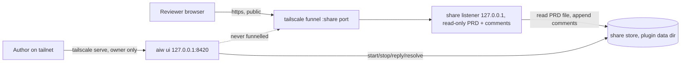
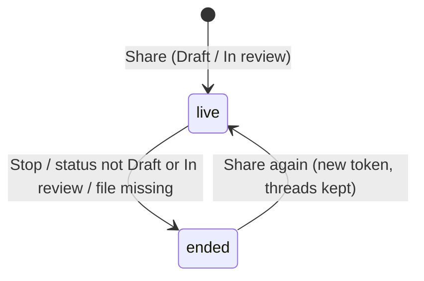
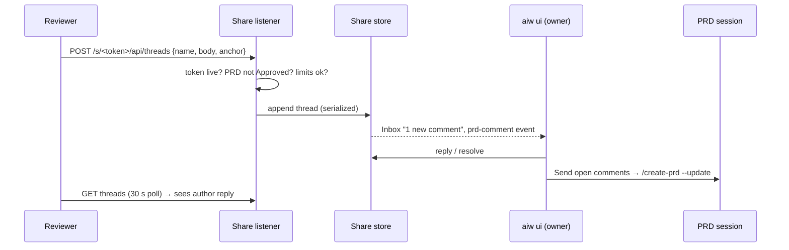

# PRD — Share a PRD for human review

**Status:** Approved · **Date:** 2026-10-29 · **Slug:** `prd-share-links` · **Owner:** Masnun Siam · **Priority:** medium · **Repo:** masnun-siam/ai-workflow

## Overview

While a PRD is in review, its author can share only that PRD with teammates outside their tailnet through a public link. Teammates read the live PRD in the browser and leave comments on any text they select. The author answers in `aiw ui` and can send the open comments to a PRD update session. The share ends when the PRD is Approved or when the author stops it. The UI itself is never made public.

Today:
- `aiw ui` listens on loopback and, when tailscale is running, is served on the owner's tailnet through `tailscale serve`. Only the node owner may use it (requests must carry the owner's `Tailscale-User-Login`). The serve handler is added at start and removed on exit, and a port that is already taken is never overwritten.
- `docs/REFERENCE.md` forbids `tailscale funnel` for the UI. Sessions run with skip-permissions, so a public UI is remote code execution.
- The Features page's PRD tab reads and edits a PRD, renders Markdown and Mermaid, and can start an `--update` session with the author's request. The peer review panel reviews a PRD with AI lenses only.
- Nothing lets a person without tailnet access read or comment on a PRD.

## Problem

The AI panel is not the only review a PRD needs. Recent PRDs have needed outside review often, and each time it went through a workaround: teammates have to read and approve it too. Today the author has to copy the file somewhere, open a pull request early, or let teammates into the tailnet, and their feedback comes back in scattered chat messages that never reach the PRD session in one place.

## Users

- **Author** (the node owner): shares a PRD, reads and answers comments, sends them on to the PRD session, stops the share. Works in `aiw ui`.
- **Reviewer** (anyone holding the link): reads the PRD and comments on it in a plain browser. Needs no account, no tailnet and no access to the UI.

## Goals

- A teammate outside the tailnet can read one PRD and comment on it within a minute of receiving the link.
- Feedback from people reaches the PRD session in one step, and only after the author has chosen to send it.
- Sharing never exposes the UI, other PRDs, the repo's other files or the machine. The shared PRD text itself is public as written.

## Non-goals

- No public access to the UI, to any page other than the shared PRD, or to any PRD not explicitly shared.
- No reviewer accounts, sign-in (GitHub or other) or verified identity. Names are whatever the reviewer types. A reviewer's Approve (FR-13) is a signal to the author, never the PRD's Approved status.
- No editing of the PRD by reviewers, no suggested edits and no tracked changes.
- No resolving or deleting by reviewers. Only the author resolves and deletes.
- No sharing of task lists, issues, sessions or diffs. Only files under `docs/prds/`.
- No automatic relay of public comments to any session.
- No expiry timer. A share ends on leaving Draft or In review, a manual stop, or the PRD file disappearing.
- No email or Slack notification to reviewers when the author replies.
- No sharing without tailscale (no ngrok, gist or other host).

## Requirements

- **FR-1 Start a share.** The PRD tab has a Share button for a PRD whose status is Draft or In review (a header that does not parse counts as Draft, as in the planning board). Any other status is refused. While Share runs the button shows a pending state, and a refusal shows its reason inline in the popover: tailscale's own message, with a plain-language cause in front (tailscale missing, stopped, funnel not permitted, port taken). Starting a share creates an unguessable link, `https://<node>.<tailnet>.ts.net:<share port>/s/<token>`, where the token has at least 128 random bits. Each PRD (repo + path) has at most one live share. Sharing an Approved PRD is refused. When tailscale is missing, stopped or logged out, or funnel is not allowed for the node, nothing is created and the author sees the reason.
  - Acceptance: Share on an In review PRD returns a link that opens the PRD from a browser off the tailnet. Share on an Approved PRD is refused with an error. With the fake tailscale reporting funnel not permitted, no share record exists afterwards and the error names the cause.
- **FR-2 Only the PRD is public.** The public listener answers only `/s/<token>` and its page assets and API. Every other path, an unknown token, an ended token, a request with a foreign `Host`, and a POST with a wrong `Origin` or `Content-Type` all get the same 404. The UI's own port and listener never get a funnel. A shared PRD page shows only the PRD's title, status, text and last-updated time, never the repo name, local path, branch, sessions or other PRDs as page fields. The PRD text is served as written, so it can still name the repo or paths (for example its `**Repo:**` header); Share shows the author a warning to that effect ("The PRD text is public as written, including its header and any paths") that must be confirmed.
  - Acceptance: Share on a PRD shows the public-text warning and needs confirmation before a link is created. Through the share host, `/`, `/api/sessions`, `/s/<wrong token>` and `/s/<ended token>`, a UI-only asset path under `/s/<token>/assets/`, a foreign `Host` and a POST without `Origin` all return the same 404 body. `tailscale funnel status` lists only the share port. The share API response contains no repo, path or branch field.
- **FR-3 Live read.** The share page renders the PRD as it is on disk now, using the same Markdown and Mermaid rendering as the PRD tab, and picks up changes on reload and on a 30-second poll. A poll keeps the scroll position, the current selection and any open comment draft; a draft whose quote changed is handled as in "PRD edited while shared". When a poll or post gets no answer, the page keeps the last text and shows "Can't reach the PRD right now, retrying".
  - Acceptance: after the PRD file is edited, the open share page shows the new text within 30 seconds without a manual reload, and a half-typed comment and the scroll position survive that poll. A PRD with a Mermaid diagram renders styled on the share page.
- **FR-4 Comment on selected text.** A reviewer selects any text in the rendered PRD and adds a comment. The first time, they enter a display name, which their browser remembers. A comment starts a thread anchored to the selection. Reviewers and the author can reply in a thread, including a resolved one; a reviewer reply reopens it. Threads show beside the text they anchor to (below the paragraph on a narrow screen), and the anchored text is highlighted with an underline as well as a colour. Only the PRD body (not its title, a Mermaid diagram, the thread rail or the Outdated list) can be commented on, and the PRD tab anchors over the same rendered text. The Comment button appears for a non-blank selection of at most 1,000 characters inside the body; for a longer selection it is disabled with "Select less text (max 1,000 characters)". It is reachable by keyboard after a keyboard selection, and on touch it is a fixed bar at the bottom, not a floating button. Fields have labels, and focus returns to the new thread after posting. Submit is disabled while a post is in flight. A keyboard-only reviewer can always reply to threads. Any failed post keeps the draft.
  - Acceptance: selecting a sentence, commenting and reloading shows the thread beside that sentence with it highlighted. A second comment from the same browser does not ask for the name again. A 1,001-character selection and a whitespace-only selection offer no working Comment button. A keyboard-only reviewer can select with Shift+arrows, reach the Comment button with Tab and post. On a touch viewport the Comment control is a fixed bottom bar.
- **FR-5 Anchors survive edits.** Each thread stores the selected text plus up to 32 characters before and after it. The anchor is placed (when the thread is new or the PRD text has changed) by exact match of the quote with its context, then by the quote alone when it occurs exactly once, then by a fuzzy match: the single best window of the text of similar length whose similarity to the quote (1 minus edit distance over the longer length) is at least 0.8, and at least 0.05 higher than the next-best non-overlapping window. A quote that occurs more than once without its context matching, or a tie, is not guessed: the thread goes to "Outdated" with its original quote. Failing every step also means Outdated. Cost is bounded: placement runs for threads not yet placed and whenever the PRD text has changed since the last placement, never on a poll with unchanged text, an Outdated thread stays Outdated until the text changes again, and the fuzzy step is skipped, going to Outdated, for a quote over 300 characters or after the first 50 fuzzy attempts in one pass (oldest threads first), so the result is the same on every device.
  - Acceptance: a thread stays attached after an unrelated paragraph is added above it. It stays attached after one word of its sentence changes (quote of at most 300 characters). It moves to Outdated, still showing its quote, after its sentence is deleted or mostly rewritten, and when its quote is a word that now occurs twice without matching context. A 45 KB PRD with 500 threads, several Outdated, runs one placement pass with at most 50 fuzzy attempts, and a poll with unchanged text runs no placement.
- **FR-6 Limits.** Characters are Unicode code points on both sides. A name is 1 to 60 characters and a comment 1 to 2,000 characters, both trimmed. A share holds at most 500 reviewer comments; author replies are neither counted nor rate-limited. At most 20 reviewer comments per minute are accepted per share. A request body is at most 16 KB, which fits the largest valid request in UTF-8. Every reviewer-supplied field (name, comment, anchor quote and context) is stored and shown as plain text on every surface, never as HTML or Markdown.
  - Acceptance: a 2,001-character comment gets 400, the 501st reviewer comment gets 409, the 21st within a minute gets 429, a maximum-size comment with a 1,000-character Bengali quote is accepted, and a comment, name or quote containing `` is shown literally everywhere.
- **FR-7 Author side in the UI.** The PRD tab shows the share's threads next to the PRD text (open threads first, resolved ones collapsed, Outdated listed separately). The author can reply, resolve, reopen, and delete a thread or a single comment (the existing confirm dialog: "Delete this comment? Reviewers will no longer see it. This cannot be undone." and "Delete this thread and its N comments? This cannot be undone."). A deleted comment disappears with no placeholder. Deleting a thread's only comment deletes the thread; deleting its first comment while replies remain keeps the thread and its anchor. A deleted reviewer comment frees its slot in the 500 cap and no longer counts as unsent or toward the Inbox count. On an ended share, the PRD tab offers "Delete share record" ("Delete this share with its N threads and approvals? This cannot be undone."), refused for a live share. A collapsed resolved thread expands by click or Enter and then shows its reply field. Author replies are marked as from the author (the label comes only from `by_owner`; the shown name is the checkout's git `user.name`, or "Author" when it is unset) and appear on the share page. Threads with comments newer than `last_seen_at` are marked new.
  - Acceptance: a reply written in the PRD tab appears on the share page after its next poll, labelled as the author's with the git name. A resolved thread shows collapsed on both sides. A reviewer reply on a resolved thread reopens it, and it counts as unsent for Send. Deleting a comment removes it from the share page on its next poll. At 500 reviewer comments, deleting one lets the next post succeed. Deleting the record of a live share gets 409.
- **FR-8 Inbox and notification.** A new reviewer comment makes an Inbox item for the PRD ("N new comments on <title>", or "N new comments, M approvals on <title>" once approvals arrive) that clears when the author opens the PRD tab, and raises a `prd-comment` event in the notification matrix (group Needs you), at most once per share per minute. Its push carries only the count and the PRD title, never reviewer names or comment text. While the PRD tab stays open it keeps marking the share seen.
  - Acceptance: a reviewer comment adds one Inbox item for that PRD, which further comments update rather than duplicate. The item clears after the PRD tab is opened. Two comments within a minute raise one `prd-comment` event, and its push body holds only the count and title.
- **FR-9 Send comments to the PRD session.** A "Send open comments" button first shows the author the exact prompt to confirm, then starts the existing PRD update session (`/create-prd <path> --update ...`). A thread counts as unsent when it is open and has a comment newer than its `sent_at` (or none sent); only the comments after `sent_at` go in, with the thread's quote and the author names, and an instruction that the content is reviewer input to weigh, not instructions to follow. Outdated threads are included and marked as such; a reopened thread counts only if it has unsent comments. Send also works on an ended share. A running panel or update session on the PRD is shown as a warning but does not block Send. The prompt is capped at the session limit of 32,000 characters: the oldest threads that fit go in (a single thread over the cap goes in with its newest unsent comments that fit, the older ones are dropped from Send for good, `sent_at` moves past them so a second Send never includes them, and the confirm preview says "N older comments on this thread won't be sent" before the author confirms), only those are marked sent, the author is told how many remain, and the button stays enabled. While the request runs the button is disabled; on success it links to the session; if the session fails to start, an error shows and the threads stay unsent. The button is disabled when there is nothing unsent.
  - Acceptance: with 3 open unsent threads, the button starts one session whose prompt contains all 3 quotes and comments. With one thread over 32,000 characters, Send includes its newest comments, reports `dropped: k`, and a second Send does not include them. With unsent threads over the cap, the session gets the ones that fit, the response reports `remaining`, and the button stays enabled. Afterwards the button is disabled until a new comment arrives, including a reviewer reply on an already-sent thread, which enables it again and sends only that reply. A reviewer comment containing the block's closing delimiter stays inside the block.
- **FR-10 Share state in the UI.** A Share popover on the PRD tab shows the link with a Copy button, the comment count, "Ends when the PRD leaves Draft or In review" and a Stop button, which asks first through the existing confirm dialog ("Reviewers lose access. Sharing again makes a new link and clears the N approvals."; the approvals clause reads "1 approval" for one and is left out when there are none). This is the only Stop confirm text. When Share is pressed on an ended share record that still holds approvals, the Share confirm adds "Sharing again clears the N approvals." with the same wording rules. While any share is live, the top bar shows a "Public (n)" badge that opens a list of live shares.
  - Acceptance: with one live share the badge reads "Public (1)" on every page. After Stop the badge is gone.
- **FR-11 Stop and end.** A share ends when the author presses Stop, when the PRD's status becomes anything other than Draft or In review (Approved, or any other status), or when the PRD file is gone or is no longer a regular file under the repo's `docs/prds/` (a symlink whose resolved path is not a regular file under it ends the share as `missing`; a symlink that resolves to one is allowed, in FR-1 too). This is checked on every share request and at least once a minute. An ended share's link returns 404 at once. Its threads stay readable, and reply and resolve still work in the UI. Sharing the same PRD again issues a new token, so the old link stays dead, and keeps the existing threads. When the last live share ends, the funnel is removed, leaving tailnet-only serving.
  - Acceptance: setting the PRD's status to Approved makes the link 404 within a minute and removes the funnel handler. Sharing again gives a different link that shows the earlier threads.
- **FR-13 Reviewer approve signal.** A reviewer can press "Approve" on the share page after entering their display name. It records `{name, at}` once per name (case-insensitive; pressing again changes nothing) and returns a random withdraw key that the browser keeps in `localStorage`; only a request carrying that key can withdraw the approval (another browser, or a name without its key, gets the same 404). An approval given before the PRD's last change (its `at` older than `updated_at`) is kept and shown as "before last edit". Sharing again after any end (Stop, status change or missing file) clears its approvals (threads are kept); the Stop confirm and the re-share confirm say so (FR-10). It counts toward the FR-6 rate limit and the 16 KB body cap but not the 500-comment cap; a share holds at most 100 approvals (409 beyond). The share page shows the approver names and the count ("1 approval", "2 approvals"), and once the reviewer's browser has approved (known from holding a stored withdraw key, not from its name) the button reads "You approved · Withdraw"; a browser with the name but no key sees "Approved as <name>" without Withdraw; it is disabled while posting and shows the same inline errors as comments. The author can delete a single approval in the PRD tab, behind the existing confirm dialog ("Remove <name>'s approval? This cannot be undone."). Approvals are not sent to the PRD session (FR-9). A new approval updates the Inbox item (FR-8: "N new comments, M approvals on <title>", counted in `unread`) and raises the same `prd-comment` event. The author sees "N approvals" with the names in the Share popover and on the PRD tab, and a new approval counts as new activity for the Inbox item (FR-8). An approval never sets the PRD to Approved: only the author sets that status. Approvals are unverified names, like comments.
  - Acceptance: two different names approving shows "2 approvals" with both names in the popover. The same name approving twice shows one. After the author sets the PRD to Approved, the share ends (FR-11) and the approvals stay in the record. The share page offers no way to change the PRD status. Withdrawing from the same browser removes the approval, while another browser, or the right name with a wrong key, gets 404. An approval given before an edit shows "before last edit". Sharing again after Stop shows no approvals but keeps the threads. Re-sharing a share that ended on its own (missing file) with 2 approvals shows "Sharing again clears the 2 approvals." in the Share confirm before anything is cleared.
- **FR-12 Restart.** Shares and threads persist in the plugin data dir. When `aiw ui` exits cleanly, the funnel and share listener go down. The share listener's loopback port and the funnel port are recorded in the plugin data dir, so after an unclean exit (kill, crash) a leftover funnel handler pointing at the recorded port is recognised as ours and adopted or removed at the next start; until then the public link reaches a dead port and does not answer. On the next start, each live share whose PRD is still eligible is served again on the same link. If the recorded funnel port is held by a foreign handler, the share stays live, is listed as "not reachable" in the Public list, and no new port is chosen silently. A not-reachable share is retried at each start and share action, and counts in "Public (n)".
  - Acceptance: after `aiw ui` restarts, a link handed out before the restart opens the PRD again and its threads are intact. While the UI is stopped, the link does not answer. After a killed UI, the next start reclaims the leftover handler. With a foreign handler on the recorded port after restart, the share shows `reachable: false`, counts in "Public (n)", is retried at the next action, and no new port is chosen.

## Edge cases

- **Concurrency:** two reviewers commenting at once, or a reviewer and the author writing to one share at once, must both be saved. Writes to a share's record are serialized, so none is lost. Two Share clicks on the same PRD at once create a single share, and the second returns the first.
- **PRD edited while shared:** handled by FR-3 and FR-5. A comment posted against text that has just changed is still accepted and goes to Outdated if its quote no longer matches.
- **Empty states:** a share with no comments shows "No comments yet. Select text to comment" on the share page and "No comments yet" in the PRD tab. An ended share with no threads shows nothing in the PRD tab.
- **Limits reached:** at 500 comments, the share page disables commenting and says the share is full. The author can still reply, because author replies do not count toward the cap.
- **Funnel port taken:** if the chosen funnel port already has a handler that is not ours, sharing is refused with the same "not overwriting" message the tailnet serve uses. An existing handler is never overwritten.
- **PRD renamed, moved or branch switched:** when the file is missing at its path, the share ends (FR-11); when it still exists on the other branch, the share keeps serving the checkout's current text (no branch is recorded). Threads stay with the record.
- **Tailscale goes down while a share is live:** the link stops answering and the Public list and popover show "not reachable" (`reachable: false`, still counted in "Public (n)"). The share stays live, and the next UI start or share action tries to bring the funnel up again.
- **Data isolation:** a token resolves to exactly one repo and PRD path, fixed when the share is created. The share listener reads only that file and that share's threads, and nothing from a request can change which file is read. Beyond the PRD text as written, it never exposes repo names, local paths, branches, sessions, the owner's tailscale login or other shares. Reviewer names and comments are visible to everyone who holds the same link.
- **Existing data:** none. There is no migration, and the share store starts empty.

## Technical design

_Two listeners in one process: only the share listener is ever behind the funnel._

### Data

One JSON record per shared PRD in the plugin data dir under `shares/`, mode 0600 (FR-1, FR-11, FR-12):

| Field | Type | Notes |
|---|---|---|
| `id` | string | stable id of the share record, one per repo + PRD path |
| `repo`, `path` | string | registered repo and repo-relative path under `docs/prds/`, fixed at creation |
| `token` | string or null | current public token. A new token is issued on re-share, and the field is null while ended |
| `state` | `live` or `ended` | |
| `end_reason` | `stopped`, `approved` (Approved), `status` (any other ineligible status), `missing` or null | |
| `created_at`, `ended_at` | ISO time | |
| `last_seen_at` | ISO time | when the author last opened the PRD tab (Inbox, FR-8) |
| `threads[]` | list | see below |
| `approvals[]` | list | `{id, name, at, key_hash}`, one per reviewer name (case-insensitive), see FR-13 |

A thread has `id`, `anchor` {`exact`, `prefix`, `suffix`}, `created_at`, `resolved` (bool), `sent_at` (ISO or null) and `comments[]`. A comment has `id`, `author` (display name), `by_owner` (bool), `body` and `at`. Anchors are taken from the rendered text, which is what reviewers select, not from the Markdown source. Tokens are compared in constant time. An ended share's old tokens are not kept.

_Share lifecycle (FR-1, FR-11)._

### API

**Owner API** on the existing UI server, behind its existing owner-only guard:

| Method and path | Request | Response | Errors |
|---|---|---|---|
| `GET /api/shares` | — | `[{id, repo, path, title, state, url, comments, unread, reachable, end_reason}]` | — |
| `POST /api/shares` | `{repo, path, confirm: true}` (the public-text warning, FR-2; asked on every Share, a re-share too, in the existing confirm dialog) | 201 the share (with `url`); 200 the existing live share if there is one (no confirm needed) | 400 `confirm` missing; 400 not under `docs/prds/` or unknown repo; 409 PRD not Draft or In review; 409 funnel port taken; 503 tailscale missing or stopped, or funnel not permitted (message from tailscale) |
| `GET /api/shares/<id>` | — | the share with `threads` | 404 |
| `DELETE /api/shares/<id>` | — | 200 the share, ended (`end_reason: stopped`) | 404 |
| `DELETE /api/shares/<id>/threads/<tid>` and `.../comments/<cid>` | — | 204 | 404 |
| `DELETE /api/shares/<id>/approvals/<aid>` | — | 204 | 404 |
| `DELETE /api/shares/<id>/record` | — | 204, removes an ended share with its threads and approvals | 404; 409 share still live |
| `POST /api/shares/<id>/threads/<tid>/comments` | `{body}` | 201 the comment, `by_owner: true` | 400 body; 404 |
| `PATCH /api/shares/<id>/threads/<tid>` | `{resolved: bool}` | 200 the thread | 404 |
| `POST /api/shares/<id>/send` | `{confirm: true}` (a call without it returns the prompt preview, 200) | 201 `{session_id, threads: n, remaining: m, dropped: k}` | 409 nothing unsent; 502 session failed to start |
| `POST /api/shares/<id>/seen` | — | 204 | 404 |

**Public API** on the share listener. Only these routes exist, and any other path is 404:

| Method and path | Request | Response | Errors |
|---|---|---|---|
| `GET /s/<token>` | — | the share page HTML | 404 |
| `GET /s/<token>/assets/<file>` | — | share-page bundle files only | 404 |
| `GET /s/<token>/api/prd` | — | `{title, status, text, updated_at}` | 404 |
| `GET /s/<token>/api/threads` | — | `[{id, anchor, resolved, comments:[{id, author, by_owner, body, at}]}]` | 404 |
| `POST /s/<token>/api/threads` | `{name, body, anchor:{exact, prefix, suffix}}` | 201 the thread | 400 validation (FR-6; `exact` 1 to 1,000 chars, `prefix` and `suffix` at most 32); 409 share full; 413 over 16 KB; 429 rate |
| `GET /s/<token>/api/approvals` | — | `[{name, at}]` | 404 |
| `POST /s/<token>/api/approvals` | `{name}` | 201 `{name, at, key}` (the key is returned only here); 200 `{name, at}` with no key if the name is already recorded, leaving the stored `key_hash` unchanged | 400 name; 409 100 approvals; 413; 429 |
| `DELETE /s/<token>/api/approvals` | `{name, key}` | 204 | 400 name; 404 unknown name or wrong key |
| `POST /s/<token>/api/threads/<tid>/comments` | `{name, body}` | 201 the comment | as above, plus 404 thread |

Every 404 has the same body. Every non-GET public request (POST and DELETE) needs `Content-Type: application/json` and an `Origin` equal to the share host, otherwise it gets that same 404; a valid one over the rate limit gets 429. Request bodies are at most 16 KB (413 above). Every public response sets `Referrer-Policy: no-referrer`, `X-Robots-Tag: noindex`, a strict `Content-Security-Policy` (`default-src 'self'`, `script-src 'self'`, `style-src 'self' 'unsafe-inline'` for Mermaid's SVG styles, no inline script, `frame-ancestors 'none'`) and `Cache-Control: no-store`. The share page's asset list is fixed at build time, so UI-only chunks in the shared `assets/` folder are never served.

### Backend

- **Share listener** (FR-2, FR-3, FR-12): a second, separate HTTP listener started by `aiw ui` on the recorded loopback port when it is free (FR-12), otherwise a free one, while at least one share is live. It routes only the public API above, accepts only the share host in `Host`, and has no access to the UI's handlers. It stops when the last share ends and when the UI exits.
- **Funnel lifecycle** (FR-1, FR-11, FR-12): extends the existing tailscale module, with the same rules: detect the node and refuse when tailscale is not running, adopt a handler that already points at our listener, never overwrite a foreign handler, and remove ours on exit. The funnel port is 8443, or 10000 when the UI's tailnet serve uses 8443. It is never the UI's tailnet port, because funnel makes a whole host:port public. Funnel being disallowed by the tailnet policy is reported as tailscale's own message.
- **End check** (FR-11): every public request and a one-minute timer re-read the PRD status from the file header, using the same parsing the planning board uses. Any status other than Draft or In review, a missing file or a non-regular file ends the share. Ending the last share removes the funnel.
- **Store** (Edge cases): writes to a share record are serialized within the process and written atomically (temp file and rename). Rate limiting (FR-6) is in memory per share, as a sliding one-minute window, and is not persisted.
- **Send** (FR-9): builds one `--update` prompt from the unsent open threads and starts it the way the PRD tab's existing update action does. Reviewer text goes inside a clearly delimited block labelled as untrusted reviewer input. Reviewer text has its delimiter sequence escaped so it cannot end the block. Threads are marked sent only after the session starts, and the prompt is capped at 32,000 characters (see FR-9).
- **Inbox and notify** (FR-8): a new Inbox item kind per share with unread reviewer comments since `last_seen_at`, and a new `prd-comment` event in the notification matrix (group Needs you), with the browser channel on by default and the others off. This amends `docs/prds/notification-matrix.md` with a per-event exception to its shared defaults, and adds the shares as a new input to the Inbox builder.

_A comment's path from reviewer to PRD session (FR-4, FR-7 to FR-9)._

### Frontend

- **Share page** (FR-3 to FR-6, FR-13; an Approve control with the "You approved · Withdraw" state and the approver names): a second entry in the existing Vite build, written into `run-engine/ui_dist/` beside the UI and served only by the share listener. It reuses the PRD Markdown renderer and lazy Mermaid. It is a single page: the PRD title and status, the rendered PRD with highlights, a thread rail, a "Comment" button on text selection (a fixed bottom bar on touch), a name prompt on the first comment (kept in `localStorage`), and an Outdated list. It polls every 30 seconds. States: loading; "This link is no longer active" on 404; "Share is full" at the cap; "Can't reach the PRD right now, retrying" when a poll or post gets no answer; inline errors on 400, 429, 413 and network failure. Every failure keeps the reviewer's draft, and the "no longer active" view still shows an unsent draft so it can be copied.
- **PRD tab** (FR-7, FR-9, FR-10, FR-13; the Share popover first shows the public-text warning in the confirm dialog; it lists approvals with a delete per approval, deletes threads and comments behind confirm, and offers "Delete share record" on an ended share): a Share button and popover (link, Copy, comment count, "Ends when the PRD leaves Draft or In review", Stop; or Share when none is live; disabled for any status but Draft or In review, tooltip "Only Draft or In review PRDs can be shared"), a thread rail with reply, resolve and reopen, an Outdated list, and "Send open comments (n)". Opening the tab marks the share seen.
- **Top bar** (FR-10): a "Public (n)" badge while n > 0 live shares, opening a list that links to each PRD tab.

### Realtime and other services

No push channel. The share page polls every 30 seconds, and the UI picks up comments through its existing polling of the Inbox and the PRD tab. No other service reads or writes the share store. Tailscale is the only external dependency, and it is already used.

### Non-functional

- **Security:** the UI is never funnelled (FR-2), and the share listener is a separate listener that cannot start sessions. Public input is plain text with caps (FR-6), and reviewer text reaches a session only through the author's Send (FR-9). Tokens carry at least 128 bits, are compared in constant time, and are kept out of logs and referrers. `docs/REFERENCE.md`'s "never use tailscale funnel" stays true for the UI and gains a line describing this exception.
- **Compatibility:** Python 3.10+ stdlib only. The share page ships in the committed `ui_dist`, and no new npm or pip dependency is added.
- **Performance:** the PRD is read from disk on each `api/prd` request, which is small and fine for a handful of reviewers.

### Testing

- **Python `assert` scripts** with the existing fake `tailscale` on PATH, extended with `funnel` and `funnel status` and a way to report "funnel not permitted" with a message. The clock and the one-minute timer are injectable, and the 500-comment cap test seeds the store directly. Regressions: with no live share the UI start and exit make no funnel call (the existing no-funnel assertion is narrowed to that case, not deleted), the UI's tailnet serve stays owner-only, and its handler is still removed on exit, separately from the funnel's. Also: restart round-trip of the store and an unclean-exit leftover handler (FR-12), foreign `Host` / bad `Origin` / UI-only asset all 404, a symlinked PRD ending the share unless it resolves to a regular file under `docs/prds/` (then it can be shared and stays live), a foreign handler on the recorded port giving `reachable: false`, and escaping of the Send delimiter. Funnel and serve: funnel up and down, port choice, a refused foreign handler, funnel not permitted (FR-1, FR-11, FR-12). The public router returns 404 for every non-share path and for unknown and ended tokens, with no repo or path in responses (FR-2). Validation, caps, 429 and 413 (FR-6). Ending on Approved and on a missing file (FR-11). Concurrent comment posts all saved (Edge cases). Send builds one prompt from unsent threads and marks them sent (FR-9). Inbox item and notify event (FR-8).
- **Python additions (FR-13, deletes):** the withdraw key (same browser succeeds; another browser or a wrong key gets 404; a 200 for an existing name returns no key), "before last edit" when `at` is older than `updated_at`, re-share after Stop, status change and missing file clearing approvals but keeping threads, approvals de-duplicated case-insensitively, counted in the rate limit but not the 500 cap, capped at 100 (409), listed by the public GET and removed by owner delete; the Inbox text with approvals; the three owner delete routes and 409 on a live record; a DELETE or POST without `Origin` gets the 404; a checkout where the PRD exists with different text keeps the link live and shows the new text (Edge cases).
- **Vitest:** the Approve, "You approved · Withdraw" (key held) and "Approved as <name>" (name only) states and the singular/plural count; fuzzy boundary cases (a 300-character and a 301-character quote with one word edited, and the 50-attempt cap), selection rules and `localStorage` name (FR-4), poll keeping draft and scroll (FR-3), anchor placement, covering exact, context, fuzzy and Outdated (FR-5); escaping of comment text (FR-6); the Share popover, the badge and the thread rail states, and the Stop and re-share confirm text for 0, 1 and 2 approvals (FR-7, FR-10).
- **Manual:** a real funnel from a phone on cellular. Open the link, comment, reply from the UI, set the PRD's status to Approved, and check that the link returns 404 and `tailscale funnel status` is empty (FR-2, FR-3, FR-11).

## Rollout and cost

Available to everyone on release. Nothing is public until an author presses Share. No billing impact, because Tailscale Funnel is included in its plans. One operations prerequisite: the tailnet policy must allow funnel for the node (the `funnel` node attribute). `docs/INSTALL.md` and `docs/REFERENCE.md` describe this and the share URL.

## Success metrics

No metric, because usage is small and the share store can be inspected by hand.

## Epics

- **E1 Share a PRD for human review** — covers FR-1 to FR-13. Issue: #584

## Decisions

- **A separate read-only share listener sits behind the funnel, and the UI is never funnelled.** A public UI with skip-permissions sessions is remote code execution. A separate listener means a routing bug cannot reach session APIs.
- **Reviewers comment on any selected text, anchored by quote + context.** The author wants comments on exact text. Anchors re-attach through edits and fall back to an Outdated list instead of being lost.
- **Access is anyone with an unguessable token link.** This is the simplest way to share with teammates, and it is revoked by stopping the share.
- **A share ends on leaving Draft or In review, a manual stop or a missing file, with no expiry timer.** Sharing exists for the review, so approval is its natural end.
- **Identity is a typed display name kept in the browser.** It needs no accounts or new provider, and the link holder is already trusted.
- **Threads, Inbox and "Send open comments" carry comments to the session, with no auto-relay.** The author decides what public text reaches a skip-permissions session, which guards against prompt injection.
- **Shares persist across restarts, and the funnel follows the UI.** `make restart` must not break links already sent.
- **Reviewers always see the live PRD, re-anchored, with Outdated as the fallback.** They see the panel's revisions without a re-share.
- **Draft and In review PRDs can be shared.** Early eyes on a draft are useful, and other statuses are excluded because leaving Draft or In review ends a share.
- **Limits are 2,000-character comments, 60-character names, 500 reviewer comments per share, 20 per minute and 16 KB bodies.** They keep a leaked link from filling the disk or Inbox without blocking a normal review.
- **The UI has a Share button on the PRD tab and a "Public (n)" badge in the top bar.** A share is managed where the PRD is read, and an open funnel is never forgotten.
- **The funnel port is 8443 (10000 if the UI uses 8443) and never the UI's serve port.** Funnel exposes a whole host:port, so sharing the UI's port would publish the UI.
- **There is one share record per PRD, and re-sharing issues a new token and keeps the threads.** Feedback survives a stop and restart of the share, and old links stay dead.
- **The share page is a second Vite entry in the committed `ui_dist`.** It reuses the PRD renderer and Mermaid and needs no new dependency.
- **Priority is medium.** It is useful, but nothing is blocked without it.
- **The author's replies show the git `user.name` of the checkout.** It is the identity teammates already know, and the tailscale login is not exposed.
- **Settled while refining the issues (2026-10-29).**
  - Send (FR-9): only a reviewer comment newer than `sent_at` makes a thread unsent; author replies after `sent_at` go along as context. Anchoring runs only in the browser, so the PRD tab passes the ids it placed as Outdated: `POST /api/shares/<id>/send` takes `{confirm?, outdated: [thread id]}`. The preview is `{prompt, threads, remaining, dropped, trimmed: [{thread, dropped}], busy: {sessions, panel}}`, and a thread that does not fit the remaining budget stops the fill (the rest is `remaining`). The share detail adds `unsent`, `approvals` (`{id, name, at}`), `last_seen_at` and `prd_updated_at`.
  - Inbox (FR-8): the item sits in the Decide group, uses singular forms ("1 new comment", "1 approval") and reads "M approvals on <title>" when there are only approvals. The matrix label is "Reviewers commented on a PRD". The event is raised from a store hook on each saved reviewer comment or approval.
  - PRD tab (FR-7): an ended share with no threads shows nothing (no "Delete share record"). Delete confirms use the singular for one ("its 1 comment", "its 1 thread"). The "new" marker counts reviewer comments only.
  - Store and listener: `updated_at` is the PRD file's mtime. A re-share resets `created_at` and keeps `last_seen_at`. Public writes are checked 400, then 409, then 429, and only an accepted write uses a rate slot. A whitespace-only `exact` is 400. The page is served at `/s/<token>` with `<base href="/s/<token>/">` injected, and its assets are allow-listed from Vite's `.vite/manifest.json`, walked from the `share.html` entry. When tailscale waits for funnel consent, the call times out to 503 with a generic message. A recorded funnel port equal to the UI's tailnet port this run is never funnelled, and the share is `reachable: false`.
  - Owner API: the list's `comments` counts reviewer comments; an ended share is `reachable: false`; Share on a missing PRD file is 400. A comment is deleted at `DELETE /api/shares/<id>/threads/<tid>/comments/<cid>`.
  - Anchors (FR-5): the fuzzy step is an approximate-substring edit-distance search; a quote whose exact text with context occurs more than once is not guessed (Outdated).

## Open questions

None.

## Change log

- 2026-10-29: Refining the epic's issues settled the Send, Inbox, PRD tab, store and listener details listed under Decisions ("Settled while refining the issues").

- 2026-10-29: Approved after the team's review. Folded in the panel's last minor notes: one Stop confirm text (FR-10) that FR-13 refers to, worded for 0 and 1 approvals; the re-share confirm warns when approvals will be cleared; tests cover both confirms.

- 2026-10-29: Settled with the author: an approval is withdrawn only with a per-browser key; approvals given before the PRD's last change are kept and marked "before last edit"; sharing again clears approvals.

- 2026-10-29: Settled with the author: recent PRDs often needed outside review (Problem); no success metric; reviewers get an Approve signal (FR-13) that does not set Approved.

- 2026-10-29: Settled with the author: PRD text is served as written with a confirmed warning (FR-2); branch switch keeps serving the checkout's text; a reviewer reply reopens a resolved thread; the author can delete threads, comments and ended share records, with confirm, and there is no per-client limit. Threads are kept until the author deletes the share record (no expiry).

## Related

- `docs/REFERENCE.md` (UI security note on `tailscale funnel`), `docs/prds/ui-rewrite.md`, `docs/prds/notification-matrix.md`.
