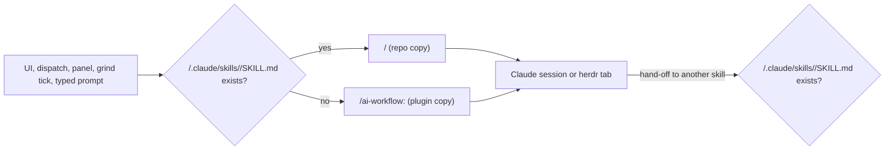

# PRD — Repo skills win

**Status:** Approved · **Date:** 2026-10-24 · **Slug:** `repo-skills-win` · **Owner:** Masnun Siam · **Priority:** medium · **Repo:** masnun-siam/ai-workflow

## Overview

When a repository has its own copy of a workflow skill (for example its own `implement-issue`), every run the workflow starts in that repository uses the repository's copy instead of the plugin's. That covers runs started from the web UI, dispatch lanes and the review panel, and hand-offs where one plugin skill calls another. Repo guides and templates already win over the plugin's; this extends the same rule to skills and makes every skill follow it.

Today:
- The engine types slash commands into Claude sessions in two spellings. Dispatch lanes, final QA, the panel root and the follow-up prompts say `/ai-workflow:<skill>`. That always runs the plugin's copy. The Start dialog, card buttons and named commands say a bare `/<skill>`. Checked with the Claude Code CLI on 2026-10-24 in a repo that has its own `.claude/skills/verifier-locally`: a bare `/verifier-locally` ran the repo copy, and `/ai-workflow:verifier-locally` ran the plugin's. So a bare name already reaches a repo copy when one exists, but the engine does not choose it on purpose, and it cannot show which copy ran.
- Some prompts the UI builds mention other skills inline, for example the small-change note ("run /ai-workflow:refine-issues …") and Resolve conflicts ("run /ai-workflow:verifier-locally …").
- Plugin skills hand off to each other in three spellings: bare (implement-issue → `/create-tasks`, `/verifier-locally`, `/pr-review`; create-prd and dump → `/create-tasks`, `/create-prd`), slash with the plugin name (pr-grind and herdr-dispatch → `/ai-workflow:verifier-locally`), and the plugin name with no slash (flow → `ai-workflow:create-prd`; release-pr → `ai-workflow:pr-grind`). Only the last two always run the plugin's copy.
- The engineering guide's "Repository settings → Repo guides and templates win" says a repo's `docs/guides/<name>.md` and `docs/templates/<name>.md` beat the plugin's. Seven skills tell the model to read that section (create-prd, create-tasks, refine-issues, implement-issue, verifier-locally, pr-review, docs-updater). The ones that hand off to other skills (flow, herdr-dispatch, pr-grind, release-pr, peer-review) do not.
- Some engine code recognises a session's skill from its command text, and part of it only accepts the bare spelling (`/pr-grind …`).
- Nothing picks a repo's copy of a skill on purpose.

## Problem

A team that adapts a skill to its repository has no way to make the workflow use it. The UI and dispatches keep running the plugin's generic copy, so the repo's changes are silently ignored. A bare start from a card picks the repo copy, but a dispatch lane for the same skill runs the plugin's, so the same skill runs differently depending on where it was started.

## Users

The single operator of `aiw ui` and anyone running the plugin's skills by hand. No roles or tenants.

## Goals

- Put a skill at `.claude/skills/<name>/SKILL.md` in a repository, and every workflow run in that repository uses it.
- See from a session's command which copy ran.
- Repo guides and templates win in every skill that reads them, not only in seven of them.

## Non-goals

- No override for agents. The panel's lens agent stays `ai-workflow:peer-reviewer`, and `worklog-runner` stays the plugin's.
- No `.claude/commands/<name>.md`, `~/.claude/skills` or any other location. Only `.claude/skills/<name>/SKILL.md` in the session's working directory.
- No `.claude/guides/` or `.claude/templates/`. Repo guides and templates stay at `docs/guides/<name>.md` and `docs/templates/<name>.md`.
- No setting or toggle to turn the rule off. Removing the repo copy is how you go back to the plugin's.
- No new UI: no badge, column or filter showing a repo copy.
- No check that a repo copy is complete or up to date. The repo owns it.
- No change to `sync-from-wasensi` and `skill-feedback`. They edit skills and guides as their own subject (the plugin's, or a repo's own `.claude/skills` and guides that skill-feedback already covers), not as rules to follow, so FR-5 and FR-6 do not apply to them.
- Skills outside the plugin's own list are never touched, even when a repo has a skill of another name.

## Requirements

- **FR-1 Which copy.** For a plugin skill name `<name>` (the folder names under the plugin's `skills/`) and a session working directory `<cwd>`, the repo copy exists when `<cwd>/.claude/skills/<name>/SKILL.md` is a readable file, following symlinks. It is checked each time text is handed to Claude: at every spawn of a session (including one that waited in a batch queue or behind a rate limit, and every resume), and at every prompt sent into a running session or herdr tab. It is never cached. When it exists the command is `/<name>`; otherwise `/ai-workflow:<name>`.
  - Acceptance: with `.claude/skills/implement-issue/SKILL.md` in the checkout, a resolved prompt reads `/implement-issue 12`. After deleting it, the same start reads `/ai-workflow:implement-issue 12`. A broken symlink or a folder with no `SKILL.md` counts as absent.
- **FR-2 Every engine prompt is resolved.** Every prompt the engine sends to Claude goes through FR-1 against the working directory of the session or herdr tab it goes to. That means new sessions, prompts sent into a running session or lane, auto-resumes, pr-grind re-entries and herdr tabs. That includes prompts you type in the Start dialog or Send box. The only text excluded is the vault's one-shot name suggestion, which runs `claude -p` with no skill and no session record. Every plugin skill command in the text is rewritten, at the start and inline, whichever spelling it was written with (`/<name>` or `/ai-workflow:<name>`).
  - Acceptance: in a repo with a `verifier-locally` copy, a dispatch's final QA prompt reads "run /verifier-locally …" and the Resolve conflicts prompt reads "run /verifier-locally". In a repo without one, both read `/ai-workflow:verifier-locally`. In a repo with an `implement-issue` copy, the Start dialog's free-text prompt "/ai-workflow:implement-issue 5" reaches the session as "/implement-issue 5".
- **FR-3 The recorded command shows the copy.** A session's stored command is its own command as resolved at the latest spawn that sends it: the first start, a start from a batch queue, or a rate-limited restart that begins a fresh session. Resumes and prompts sent into a running session are resolved too (FR-2), but they never change the stored command. A session that is queued or rate-limited stores the unresolved text until it starts, so the session list and session page show `/implement-issue 12` for a repo copy and `/ai-workflow:implement-issue 12` for the plugin's.
  - Acceptance: starting implement-issue in each kind of repo, the session row shows the spelling FR-1 predicts. A rate-limited start whose repo copy is added before the reset shows `/implement-issue …` once it starts. Answering an `aiw ask` question or pressing Resume leaves the stored command as it was.
- **FR-4 Both spellings are recognised.** Wherever the engine or the UI recognises a session's skill from its command, both `/<name> …` and `/ai-workflow:<name> …` match, through one shared matcher per side (engine, UI). That covers the prefix and equality checks that match today on the bare text: the grind tick's busy check and its cwd and account fallback (it matches `/pr-grind <thread>` exactly), the grind index's running, skip-CI and live checks, the grind-live count, the quiet-done notification prefixes and the synthetic grind command built for notifications. It also covers those that already accept a prefix: the implement/grind issue key, the refine guard, the session family, the delivery view, `skillOf` and the small-change parser.
  - Acceptance: with a `pr-grind` repo copy and without one, a grind loop shows "running" while its session is live. A second implement-issue start for the same issue is refused (409). A small change being filed shows in the Small changes tab. A grind tick re-entering a loop whose last session ran `/ai-workflow:pr-grind <url>` finds that session's cwd and account.
- **FR-5 Hand-offs between skills.** "Repository settings" in `guides/engineering-workflow.md` gains a "Repo skills win" rule. Before a skill invokes another plugin skill, it checks `<repo root>/.claude/skills/<name>/SKILL.md`, where `<repo root>` is the top of the current working directory's git worktree. If that file exists it runs `/<name>`, otherwise `/ai-workflow:<name>`. Every hand-off line in a plugin skill, in any of the three spellings, names the skill and points to that rule. One line is exempt and keeps its exact text: dump's `→ next: /create-prd <folder>`, because `/flow` parses it byte for byte. The rule covers it anyway, because flow's own hand-off follows the rule.
  - Acceptance: every hand-off in a plugin skill or guide, whether written `/<skill>`, `/ai-workflow:<skill>` or `ai-workflow:<skill>`, either points to the rule or is dump's exempt line. A manual run of `/ai-workflow:pr-grind` in a repo with a `verifier-locally` copy runs `/verifier-locally` for its local checks.
- **FR-6 Every skill reads Repository settings.** Every plugin skill that reads a plugin guide or template, or hands off to another plugin skill, tells the model to read "Repository settings" first. That brings in flow, herdr-dispatch, pr-grind, release-pr and peer-review, plus any other that matches. `sync-from-wasensi` and `skill-feedback` are exempt (see Non-goals).
  - Acceptance: a check lists each skill's guide/template reads and skill hand-offs, and every skill with one, apart from the two exemptions, references "Repository settings".
- **FR-7 The engine contract is documented.** `docs/REFERENCE.md` gets a "Repo copies of skills" section. It covers FR-1's rule, the guide/template rule, and what a repo copy must keep so the UI can still drive it:
  - pr-grind keeps the state file at `<pr_grind_dir>/<owner>-<repo>-<pr>.md` with the headers the tick and the grind index read: `owner`, `repo`, `number`, `thread`, `author`, `reviewer`, `paused`, `done`, `next-poll`, `poll-since`, `ci-seen` and `dispatch-due`.
  - pr-grind keeps one `## Round ` heading per round, which the grind index counts.
  - pr-grind keeps its `## Re-entry` section (the engine's re-entry prompt calls it the "On-wake branch") and `## Step 8 — Paused stop`, which that prompt names, and the headless re-arm (write `next-poll`, end the turn).
  - The tick always runs the plugin's own review-poll script, whichever copy of pr-grind runs.
  - peer-review keeps the `--root <panel id>` round protocol.
  - Any skill keeps using `aiw ask` for gate questions in a headless run.
  - Relative `../../guides/` paths in a copied skill no longer reach the plugin.
  - Acceptance: a reviewer ticks off each item above in the new section, and every header name in it matches what the engine reads.

*Every prompt is resolved once before it reaches Claude (FR-2). Inside the session, the guide's rule makes the same choice for each hand-off (FR-5).*

## Edge cases

- **Concurrency:** two sessions in the same checkout, started a second apart while someone adds or deletes a repo copy, may get different spellings. Each records what it ran (FR-3), so nothing is hidden. No lock.
- **Mid-session change:** a running session keeps the copy it started with. A prompt sent into it later is resolved again and may point to the other copy. That is accepted, because the next prompt is a new invocation anyway.
- **Worktrees:** the engine checks the checkout a session starts in (FR-1). A skill's hand-off checks the worktree it is running in (FR-5). implement-issue's worktree comes from the base branch. If the copy exists only in the checkout's uncommitted files, or only on the base branch, the two checks can disagree. The recorded command shows the engine's choice, and REFERENCE.md says to commit repo copies to the base branch.
- **No-repo runs:** create-prd, dump and intake runs in the notes vault check the vault folder. Normally there is none, so they run the plugin's copy.
- **Empty state:** a repo with no `.claude/skills` behaves exactly as today, apart from the spelling: bare starts from the Start dialog become `/ai-workflow:<name>` (FR-2).
- **Name clash with another meaning:** a repo skill named like a plugin skill (say its own `pr-review`) is used, even if it does something else. Same name means the repo copy wins. That is the rule, documented in REFERENCE.md.
- **Stale or broken repo copy:** the engine does not check it. A pr-grind copy that never writes `next-poll` leaves the loop idle, and the grind panel shows it as not running. A copy that runs into the old `../../guides` path finds nothing. FR-7's contract is the only defence.
- **Existing data:** stored session records keep their old commands. FR-4's matching covers both spellings, so old and new records are read alike. Nothing to migrate.
- **Same-named personal skill:** Claude Code ranks a personal skill (`~/.claude/skills/<name>`) above a project one of the same name. If both exist, `/<name>` runs the personal one, and the recorded command still reads like the repo copy. The engine does not detect this. REFERENCE.md tells users not to keep personal skills named like plugin skills (see Decisions).
- **Data isolation:** each session is resolved against its own working directory only. One repo's copy is never used for a session in another repo.

## Technical design

### Data

Not affected. Session records already store the command text. They now store the resolved text (FR-3). No new fields, no migration.

### API

Not affected. `POST /api/start`, `POST /api/sessions` and the dispatch endpoints keep their request and response shapes. Only the `command` stored on the session changes spelling (FR-2, FR-3).

### Backend

- **One resolver (FR-1, FR-2).** One stdlib function in the run-engine takes a prompt text and a working directory and returns the resolved text. It knows the plugin's skill names by listing the plugin's own `skills/` folder, so a new skill is covered with no list to maintain. It rewrites `/<name>` and `/ai-workflow:<name>` only where they stand as a slash command. Before the slash there must be the start of the text, whitespace, `(`, `[`, `"`, `'` or a backtick. After the name there must be the end of the text, whitespace, one of `,` `;` `!` `?` `)` `]` `"` `'` or a backtick, or a `.` or `:` that is not followed by a word character. So `/pr-review-strict`, `/verifier-locally/SKILL.md`, `/create-prd.md` and `/pr-grind:x` are left alone. Names are only rewritten when they are on the plugin's list. Paths and URLs that merely contain the name are left alone.
- **Where it runs (FR-2, FR-3).** Prompt building stays as it is. Resolution happens in the session layer, at each point where text reaches Claude: every spawn of a session (first start, start from a batch queue, restart after a rate limit, resume), a prompt sent into a running one, and the text typed into a herdr tab. Only the spawns that send the session's own command (first start, start from a batch queue, rate-limited restart without a session id) write the resolved command back to the record. A resume sends an answer, a typed text or the continue prompt, and leaves `command` alone. Every dispatch lane, panel root, start, small change, QA, grind re-entry and typed prompt already goes through those points.
- **Recognising a skill (FR-4).** One engine helper answers "is this command skill X (with this argument)?" for both spellings, and every matcher FR-4 lists uses it, including the grind tick's exact `/pr-grind <thread>` lookup. The UI keeps one equivalent helper next to `skillOf`.
- **Failure:** if the working directory cannot be read, the check counts as "no repo copy" and the plugin's spelling is used. The start never fails because of the resolver.

### Frontend

Not affected beyond FR-4. The UI keeps building its prompts with `/ai-workflow:<name>`, and the server resolves them. Every matcher on command text accepts both spellings. The small-change parser and `skillOf` already do; any that do not are fixed.

### Realtime and other services

Not affected. Sessions stream as before.

### Skills, guides and docs

- `guides/engineering-workflow.md` "Repository settings": a new "Repo skills win" subsection, next to "Repo guides and templates win", with FR-5's rule and its exemptions (FR-5).
- Plugin skills: hand-off lines rewritten to name the skill and point to that rule, and a "read Repository settings" line in each skill that FR-6 lists (FR-5, FR-6). This edits imported skills and an imported guide on purpose (see Decisions).
- `sync-from-wasensi`: its notes list these lines as kept deviations, so a later port does not revert them.
- `docs/REFERENCE.md`: the "Repo copies of skills" section (FR-7). `docs/HOW-IT-WORKS.md`: one line where it describes how a session is started. `CHANGELOG.md`: an entry.

### Non-functional

- **Security:** a repo copy is code from the repo running with the session's permissions. Claude Code already loads `.claude/skills` and `CLAUDE.md` from the working directory, so trust does not change. REFERENCE.md says so: only run the workflow on repos whose `.claude/` you trust.
- **Performance:** one file-exists check per plugin skill name per prompt. That is negligible.
- **Compatibility:** stdlib only. Commands already stored in either spelling keep working (FR-4).

### Testing

| Requirement | Test |
|---|---|
| FR-1 | Plain `assert` script on the resolver with a temp dir: copy present, absent, broken symlink, folder without `SKILL.md`, a symlink to a valid file. |
| FR-2 | Resolver unit cases: start-of-text and inline mentions, both input spellings, names not on the list, a path or URL containing a skill name. The boundary cases `/pr-review-strict`, `/verifier-locally/SKILL.md`, `` `/create-prd` ``, `(/pr-review)` and a sentence-final `/pr-review.` are covered too. Session-start, queued-start, limited-restart and send-prompt tests check the stored and sent text in a temp checkout with and without a copy. The dispatch and herdr runner tests check a lane's prompt. |
| FR-3 | A session-start test asserts the stored `command`. A resume with an answer and a Resume/Retry of a stopped session both keep the stored `command` unchanged. |
| FR-4 | The existing guard, grind-index, notify and delivery tests, re-run with both spellings. UI unit tests for the small-change parser and `skillOf` with both. |
| FR-5, FR-6 | A test over the plugin's skill and guide text, like the existing plugin-text test. A hand-off is an instruction to run, invoke or hand over to another plugin skill. A plain mention is not, for example "the `/pr-review` verdict", a heading, or a human re-running the same skill. The test lists the allowed mentions explicitly. Every hand-off in any of the three spellings points to the rule, or is dump's exempt line. Every skill that reads a guide or hands off references "Repository settings", apart from the two exemptions. |
| FR-7 | Manual review of REFERENCE.md in the PR. |
| End to end | Manual: in a scratch repo, add `.claude/skills/verifier-locally/SKILL.md` that prints a marker. Start implement-issue from the UI and see the marker in the transcript of its local checks. |

## Rollout and cost

Everyone at once, in the next plugin release. Repos without `.claude/skills` behave the same, apart from the command spelling. No cost impact. The CHANGELOG entry tells users that a copy of a plugin skill in `.claude/skills/` now takes over, so anyone who keeps a stale copy there should delete or update it.

## Success metrics

None formally defined.

## Epics

- **E1 Repo skills win** — covers FR-1 to FR-7. Issue: #431

## Decisions

- Scope covers both the engine's starts and the hand-offs between skills — the user wants the repo copy everywhere, not only in UI-started runs.
- This edits imported skills and an imported guide, against the CLAUDE.md "stay as imported" rule — the user chose hand-offs too, which a prose rule in the skills is the only way to reach. `sync-from-wasensi` keeps them as deviations.
- A repo copy is `.claude/skills/<name>/SKILL.md` only — that is Claude Code's own project-skill location, so `/<name>` loads exactly that file (checked 2026-10-24, see Overview).
- Repo guides and templates stay at `docs/guides/` and `docs/templates/`, and every skill now honours that rule — those are the existing paths. Only the coverage was missing.
- Prompts you type are resolved too — the request was "whenever I run or you run any command".
- The engine checks the session's working directory at the moment it sends — those are the files Claude Code itself loads there. No git calls.
- The engine never sends a skill name it has not checked: `/<name>` only after finding the repo copy, otherwise `/ai-workflow:<name>`. Sending `/<name>` without checking would pick the repo copy whenever one exists (checked 2026-10-24), but the stored command would then not show which copy ran.
- One resolver in the session layer, not in each prompt builder — every prompt already goes through a few funnels, so one change covers the UI's texts with no frontend change.
- The copy that ran shows only in the command text, with no badge — the command is already shown on every row.
- pr-grind and peer-review can be replaced too, and the contract they must keep is documented — "all the others" was the request. The risk of a broken loop is accepted and shows up in the session list.
- The engine resolves at every spawn, and writes the result back at the spawns that send the session's own command, not once at create — a queued or rate-limited session can start hours later, after the repo changed.
- Hand-offs use a rule in the guide, not an `aiw` verb — a file-exists check is reliable for a model, and it adds no CLI verb and no Bash call.
- Agents are not overridden — the request was about skills.
- Priority is medium — it matches the other recent epics, and nobody is blocked today because a bare start already reaches a repo copy.
- A same-named personal skill in `~/.claude/skills/<name>` is accepted and documented, not detected — it is a rare setup, REFERENCE.md warns against it, and checking it would add engine code and silently skip the repo copy on that machine.

## Open questions

None.

## Change log

## Related

- `docs/prds/small-changes.md` — the small-change prompt the resolver now rewrites.
- `guides/engineering-workflow.md` "Repository settings".
