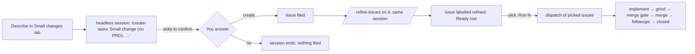
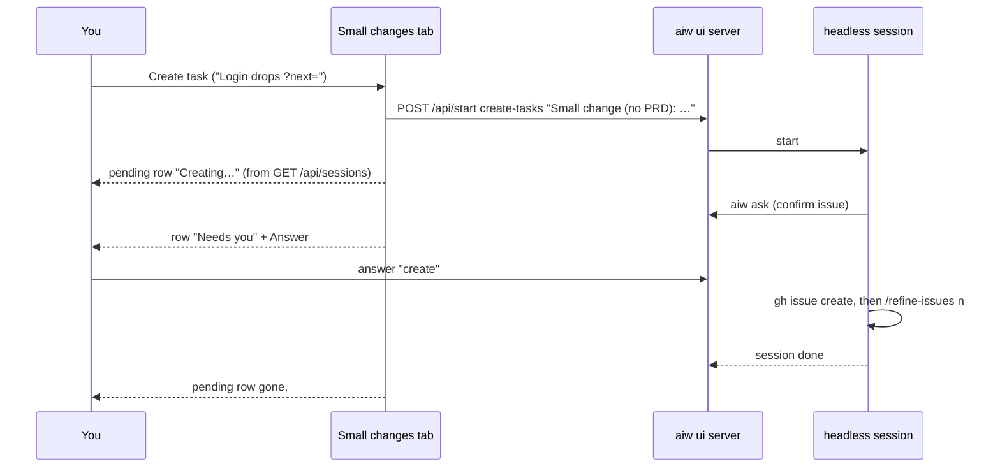

# PRD — Small changes without a PRD

**Status:** Approved · **Date:** 2026-10-23 · **Slug:** `small-changes` · **Owner:** Masnun Siam · **Priority:** medium · **Repo:** masnun-siam/ai-workflow

## Overview

A **Small changes** tab on the Features page for bugs and small changes that do not need a PRD. You describe the change in one box. One headless session files it as an issue and refines it. You then build one or more of them with a dispatch, as you would run an epic.

Today:
- The Features page lists features (one PRD each) in **In progress** and **Shipped** tabs. A feature walks PRD draft → review → approve → tasks → refine → **Run epic**.
- `/create-tasks` already has a "finding" mode that files one issue without splitting a PRD. It reproduces a bug first, shows you the issue and asks before creating it, and then hands off to `/refine-issues <n>`. When no PRD is linked, it asks which PRD the finding belongs to.
- A last **Other issues** row on Features opens `#/issues`. That page lists open issues that belong to no feature (no epic, or an epic with no PRD in this repo), each with its row action (Refine, Start, Merge, Grind and so on).
- A dispatch runs only an epic. It reads the epic's open children, and its record, preview, settings (feature branch, final QA, open-pr) and tick all assume one.
- Nothing in the UI starts a small change. You start `/create-tasks` from the Start dialog with free text and pick a PRD path by hand.

## Problem

Most day-to-day work is a bug fix or a small change. Today it either goes through a full PRD it does not need, or it is started by hand from the Start dialog and run one issue at a time. That route has no automatic grind, merge or followups, and it cannot run several fixes side by side.

## Users

The single operator of `aiw ui`, on the repos they run it on. No roles or tenants.

## Goals

- Describe a bug or small change in one sentence and get a refined issue back, answering only the questions that matter.
- See every small change, from "being created" to merged, in one place next to the features.
- Build several small changes side by side with the same dispatch walk an epic gets: implement, grind, merge gate, merge, followups.

## Non-goals

- No change to any imported skill (`create-tasks`, `refine-issues`, `implement-issue`). The UI only passes them text.
- No bug/change type picker. `/create-tasks` picks the repo's type labels from the text.
- No PRD link or feature picker in the box. Work that belongs to a feature uses that feature's **Add a task** box.
- No feature branch, final QA, open-pr or grind-pr end action for a dispatch of picked issues.
- No adding issues to a running dispatch of picked issues. New changes go in a new dispatch.
- No issue-list dispatch from the CLI (`aiw dispatch plan|start`) or from `herdr-dispatch`. The UI starts it with headless lanes only.
- No issues from more than one repo in one dispatch of picked issues.
- No marker label for small changes. The tab shows every open issue outside a feature.

## Requirements

- **FR-1 Small changes tab.** The Features page has three tabs: **In progress**, **Shipped** and **Small changes**. The tabs show even when the repo has no features; the idea box for a first PRD stays in **In progress**. The tab's count is the number of open issues outside any feature plus the pending rows (FR-4). The selected tab is in the URL (`#/features?tab=changes`), so the tab can be linked and survives a reload.
  - Acceptance: on a repo with 0 PRDs and 3 open issues outside any feature, `#/features?tab=changes` shows the tab selected with count 3 and lists the 3 issues. Reloading keeps the tab.
- **FR-2 Other issues folds into the tab.** The **Other issues** row on Features and the `#/issues` page are removed. `#/issues` redirects to `#/features?tab=changes`. The tab lists the same set: open issues with no epic, or with an epic that has no PRD in this repo. They are grouped by status, with the same row action as today.
  - Acceptance: opening `#/issues` lands on the Small changes tab. No "Other issues" row appears on Features. An issue whose epic has a PRD here is not listed. An issue under an epic with no PRD here is listed.
- **FR-3 Describe a change.** The top of the tab is a text box ("Describe a bug or small change") with a **Create task** button. The button is disabled while the text is blank or a start request is in flight. Submitting starts one headless session of `/create-tasks` on the current repo, using the planning model and effort (the same settings as other planning runs). The session's argument begins with the fixed marker `Small change (no PRD):`, followed by the text with whitespace collapsed. The argument tells the skill that the change has no PRD and that it should go on without one, and that it should run `/refine-issues` on the new issue in the same session once the issue is created. The box clears when the session has started. If the start fails, the text stays and the error shows as a toast.
  - Acceptance: typing "Login drops ?next= on redirect" and pressing Create task starts one session whose command is `/ai-workflow:create-tasks Small change (no PRD): Login drops ?next= on redirect …`. The session does not ask which PRD the change belongs to. It asks to confirm the issue, files it, and the issue ends up labelled `refined` without a second click.
- **FR-4 Pending rows.** Each live session of this repo whose command is `create-tasks` with the `Small change (no PRD):` marker (queued, running or waiting on you) shows as a row above the issue list. The row shows the text you typed, its state (**Queued**, **Creating…** or **Needs you**), and **Answer** (when waiting) or **Watch**. Both open the session. The row goes away when the session ends. A failed session drops out of the tab and shows in the Inbox like any failed session.
  - Acceptance: right after submitting, a "Creating…" row with the text appears. When the session asks to confirm the issue, the row shows "Needs you" with Answer, and Answer opens the session's question. After the session finishes, the row is gone and the new issue is listed.
- **FR-5 No duplicate refine.** While any pending small-change session of this repo is live, the **Refine** action on unrefined rows in the tab is disabled, with the hint "A small change is being filed and refined. Wait for it to finish." The chained session may be refining one of those issues.
  - Acceptance: with a pending row live, every unrefined row's Refine is disabled with that hint. Once the session ends, Refine is enabled again.
- **FR-6 Pick and act.** Rows that are not owned by a running dispatch get a checkbox when they are unrefined, ready or blocked. With picks made, a bar shows **Refine N**, counting the picked unrefined issues, and **Run N**, counting the picked refined ones (ready or blocked). Each shows only when its count is above 0. Refine N starts one `/refine-issues` session on those numbers, as the feature Issues tab does today. **Clear** empties the picks.
  - Acceptance: picking 1 unrefined and 2 ready rows shows "Refine 1" and "Run 2". Refine 1 starts `/refine-issues <n>`. A row owned by a dispatch shows **In dispatch** and has no checkbox.
- **FR-7 Run picked issues as a dispatch.** **Run N** opens the run dialog in issue-list mode. It shows the picked issues instead of the epic field, the dispatch settings except feature branch, and **Preview** then **Start**. Preview shows waves (from the blocked-by links among the picked issues) and warnings, as for an epic. A picked issue blocked by an open issue outside the pick gets a warning and waits, as an epic lane does today. Start creates the dispatch and opens its page.
  - Acceptance: picking #412 and #415, where #415 is blocked by #412, previews two waves, [#412] then [#415]. Starting opens the dispatch page with two lanes, and #415 starts only after #412 is closed.
- **FR-8 Same lane walk.** Every lane of an issue-list dispatch walks the same stages as an epic lane: implement, grind (off/simple/full), merge gate (following the CI mode), merge (automatic only with auto-merge on), followups, closed. The cap, pause, resume, retry, skip, hold, the Inbox items and the notifications all behave as for an epic dispatch. The lane set is fixed at start.
  - Acceptance: a two-issue dispatch with grind off and auto-merge on merges and closes both, running at most `max` lanes at once. An issue created later is never added to it.
- **FR-9 Dispatch lists show issue-list dispatches.** The Dispatches list and the dispatch page show an issue-list dispatch by its title, `Small changes: #412, #415` (the first three numbers, then `+N more`), with the repo in place of the epic reference. The end-of-dispatch actions that need an epic or a feature branch (open-pr, qa, grind-pr) are not offered.
  - Acceptance: the Dispatches list row reads "Small changes: #412, #415" with `owner/repo` under it. A finished issue-list dispatch offers no QA or Open PR action.

## Edge cases

- **Two submits at once:** each starts its own session and its own pending row. Two sessions that file the same change get the duplicate check of `/create-tasks` finding mode (it searches open issues first and comments the new evidence on a match instead of filing twice).
- **The issue appears before the session ends:** the issue row shows as soon as the board refreshes, while the pending row stays until the session ends. Refine is locked (FR-5) for that window.
- **Session declined:** if you answer "do not create", the session ends, the pending row goes, and no issue is listed.
- **Empty tab:** no open issues outside a feature and no pending rows. The box shows, with "Nothing outside a feature. Describe a bug or small change to start one."
- **Picked issue changes before Start:** preview and start re-read every picked issue. An issue that was closed in the meantime is dropped with a warning. If none is left open, start fails with "none of the picked issues is open" and creates nothing.
- **Picked issue already in a running dispatch:** it has no checkbox (FR-6). If another dispatch takes it between Preview and Start, start fails with a 409 naming the issue and the dispatch that owns it.
- **Unrefined issue in a dispatch:** the picker offers only refined issues for Run. If an issue loses `refined` before Start, its lane is created as "needs refine" and joins the walk once it is refined again, as for an epic.
- **Limits:** a dispatch of picked issues holds 1 to 30 issues. 0 or more than 30 fails with a 400. The cap on concurrent lanes is the dispatch's `max`, as today.
- **Repo switch:** pending rows, picks and the dialog belong to the current repo. Switching repo clears the picks.
- **Existing data:** existing epic dispatch records have no `issues` field. They read as epic dispatches, unchanged. Nothing is migrated.
- **Data isolation:** single operator, no tenants. Pending rows and the list are filtered to the current repo.

## Technical design

*A small change from the box to closed. The only gates are the issue confirmation and Run.*

### Data

- **Dispatch record** (plugin data dir, `dispatches/<id>.json`). New optional field `issues`, a list of `owner/repo#n` strings. When it is set, `epic` is `null` and `title` is `Small changes: #a, #b, #c` (+N more). An epic dispatch keeps `epic` set and has no `issues`. Exactly one of the two is set. Settings for an issue-list dispatch always have `feature_branch: null`. (FR-7, FR-8, FR-9)
- **Session marker:** small-change sessions are found by their command: the `create-tasks` skill with an argument starting `Small change (no PRD):`. No new session field. (FR-4, FR-5)
- No migration. Old records have no `issues` field and are epic dispatches.

### API

- `POST /api/dispatches/plan` and `POST /api/dispatches` take either `epic` (unchanged) or `issues: ["owner/repo#n", …]`, never both. Rules for `issues`: 1 to 30 entries, all in one repo, each `owner/repo#n`. Settings as today, except `feature_branch` must be null. (FR-7)
  - Plan response: the same shape as for an epic, with `epic: null`, `issues`, and `title`. `lanes` are the picked issues still open, `waves` come from the blocked-by links among them, and `warnings` cover needs-refine issues, open blockers outside the pick and picked issues that are closed.
  - Start response: the public dispatch (as today), with `epic: null` and `issues`.
  - Errors: 400 for both or neither of `epic`/`issues`, a bad reference, more than one repo, 0 or more than 30 issues, or a feature branch. 400 "none of the picked issues is open". 409 when a picked issue is a lane of another running dispatch, naming that dispatch.
- `GET /api/dispatches` and `GET /api/dispatches/<id>`: the public dispatch gains `issues` (a list, or null). (FR-9)
- No other endpoint changes. The tab reads `GET /api/planning`, `GET /api/delivery` and `GET /api/sessions` as Features and Other issues do today, and starts sessions with `POST /api/start`.

### Backend

- **Resolving an issue list** reads the listed issues from GitHub in one query: state, title, the `refined` label and blocked-by. It returns the same child shape the epic reader returns (repo, n, title, refined, deps among the listed issues, open blockers outside them), so planning, the lane walk and the warnings are shared with epic dispatches. (FR-7)
- **The tick's periodic re-read**, for an issue-list dispatch, re-reads only the listed issues. A "needs refine" lane is queued once it is refined, and nothing is ever added. (FR-8)
- **Anything that used the epic for a repo or a title** (the session/tab title of a lane, Inbox items, notifications, the dispatch's repo for the poller) uses the repo of the listed issues when `epic` is null. (FR-8, FR-9)
- **End actions** open-pr, qa and grind-pr are refused for an issue-list dispatch (they need a feature branch or an epic). (FR-9)
- **Ownership check at start:** under the dispatch store's lock, start fails with 409 if any picked issue is a lane of a dispatch whose state is not done or cancelled. (Edge cases)

### Frontend

- **Features page:** a third tab, **Small changes**, driven by `?tab=` (`active`, `shipped`, `changes`; default `active`). The **Other issues** row goes. With no features, the tabs still show, and the idea box sits in In progress. (FR-1, FR-2)
- **`#/issues`** redirects to `#/features?tab=changes`, and the Other issues page is removed. (FR-2)
- **Small changes tab:** the describe box (FR-3), pending rows (FR-4), the pick bar with Refine N / Run N / Clear (FR-6), and the issue table grouped by status with today's row actions, with Refine locked during a live small-change session (FR-5). States: loading skeleton as today, the error banner with Retry, and the empty message from Edge cases.
- **Run dialog:** the existing run dialog gains an issue-list mode. It shows the picked issues as chips instead of the epic input, hides the feature-branch field, and uses "Run small changes" as its title, with Preview → Start as today. (FR-7)
- **Dispatches list and dispatch page:** show `title`, with the repo instead of the epic ref, when `epic` is null. End actions that need an epic are hidden. (FR-9)

*The pending row comes from the session list. The issue row comes from the next board poll.*

### Realtime and other services

Not affected. The tab picks up sessions and issues through the existing polling of sessions and delivery.

### Non-functional

- No new dependency. Python stays stdlib only, and the UI is rebuilt into `run-engine/ui_dist/`.
- An issue-list resolve is one GitHub GraphQL call per preview, per start and per periodic re-read, the same budget as an epic.

### Testing

- **Python (`run-engine/test_*.py`, plain asserts, no network):** issue-list resolve from a recorded GraphQL response (deps inside the list, outside blockers, closed issues, `refined`); plan and start validation (both or neither, more than one repo, 0 or 31 issues, feature branch, none open, 409 on an owned issue); a create with `issues` and `epic: null`; the periodic re-read never adds a lane and queues a re-refined one; end actions refused; inbox and title helpers with a null epic. (FR-7, FR-8, FR-9)
- **UI component tests:** the tab from `?tab=changes`, the `#/issues` redirect, no Other issues row (FR-1, FR-2); Create task starts the marked command and clears the box (FR-3); pending rows by session state (FR-4); Refine locked while one is live (FR-5); the pick bar counts and actions (FR-6); the run dialog in issue-list mode posts `issues` (FR-7); a Dispatches row with a null epic (FR-9).
- **Manual in the running app:** file a real small change on a test repo through the box, answer its question, and confirm it ends refined; run two picked issues with a dependency and watch both reach closed. This covers what tests cannot: the skill honouring "no PRD" and chaining `/refine-issues`. (FR-3, FR-8)

## Rollout and cost

Everyone at once, shipped with the next plugin release. No billing impact beyond the sessions you start. No operations steps. `CHANGELOG.md`, `docs/REFERENCE.md` (routes, Features, dispatch API), `docs/HOW-IT-WORKS.md` and `CONTEXT.md` (add **Small change**; Dispatch also takes a list of issues) are updated with the work.

## Success metrics

None formally defined.

## Epics

- **E1 Small changes without a PRD** — covers FR-1 to FR-9. Issue: #394

## Decisions

- The flow lives in a **Small changes tab on the Features page**, chosen over turning Other issues into its own page or a panel above the list. Small work sits beside features, under one nav entry.
- **Other issues folds into the tab.** `#/issues` redirects and the page and row go. Two views of the same issues would drift.
- **Refined small changes are built with a dispatch of picked issues, no epic needed.** That is the same walk as Run epic. Chosen over per-row Start only (no automatic grind/merge/followups or cap) and over a standing per-repo epic (it never closes and shows up as a fake feature).
- **One click creates and refines.** One session runs `/create-tasks` finding mode, then `/refine-issues` on the new issue. Building stays a separate click, so you can read the refined issue before code is written.
- **The box tells `/create-tasks` the change has no PRD,** so it does not ask. Feature work already has the feature page's Add a task box, and the imported skill stays unchanged.
- **A pending row for each live create session,** rather than only a toast. A submitted change stays visible while it is being filed and when it needs an answer.
- **The pending rows show only live sessions.** A failed one goes to the Inbox's failed-session item, which already offers the retry. That avoids a second failure list.
- **Refine is locked during a live small-change session.** The session does not report which issue it filed until it ends, and a second refine on the same issue would race on its body. The lock lasts only as long as the session.
- **An issue-list dispatch has the same lane walk, no feature branch or QA, and a fixed list.** Both of those features are per-epic (QA files its bugs as epic children). Adding to a running dispatch is more engine and UI paths for little use.
- **One box, no bug/change type picker.** Finding mode already reproduces bugs and applies the repo's type labels.
- **One repo per issue-list dispatch, 1 to 30 issues, headless lanes, UI only.** That matches how the tab picks (one repo at a time). 30 keeps the GitHub read to one query; raise it when someone needs more. The CLI and herdr can follow if asked.
- **Small changes are found by the session's argument marker and by "outside a feature", with no label.** Nothing new to store or keep in sync.
- **Priority medium, one epic.** Set by the writer, because the interview did not cover it; change it in review if needed.

## Open questions

None.

## Change log

## Related

- `docs/prds/ui-rewrite.md` (the Features page and Other issues)
- `docs/prds/approve-pr-question-md-dispatch-ci.md` (dispatch CI modes)
- `skills/create-tasks/SKILL.md` ("A finding from other work")
