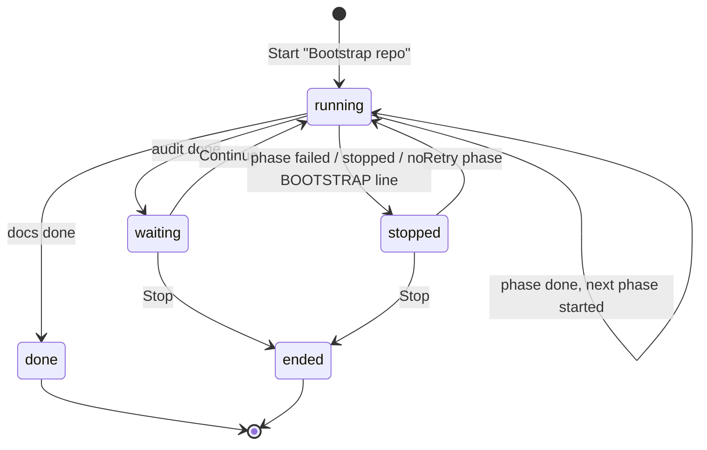
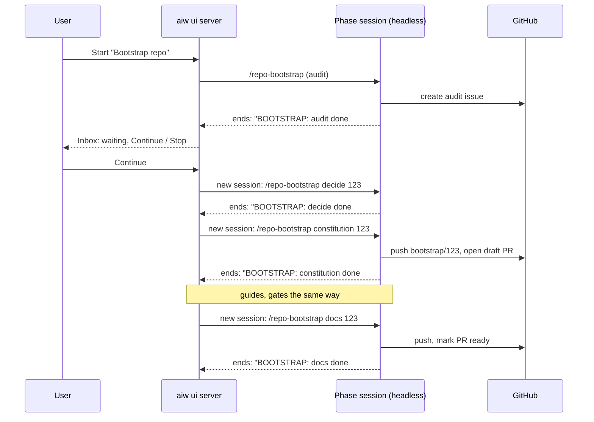

# PRD — Question "none", repo shortcut, PR close/reopen, chained Bootstrap

**Status:** Approved · **Date:** 2026-10-30 · **Slug:** `ui-tweaks-bootstrap-chain` · **Owner:** Masnun Siam · **Priority:** medium · **Repo:** masnun-siam/ai-workflow

Status is `Draft`, `In review` or `Approved`. This document is the source of truth for the feature: every issue is derived from it, and a decision that is not written here has not been made.

## Overview

Four changes to the `aiw ui` web app and the `/repo-bootstrap` skill, for the one person running the workflow from the UI:

1. Multi-select questions get a **"None of these"** option and a **"Select all"** link.
2. **`G` then `R`** opens the repo switcher.
3. The PR panel can **close and reopen** a pull request.
4. **Bootstrap repo** puts the whole run on **one branch with one PR**, and runs **each phase in its own session**, so no session carries the context of all six phases.

Today:
- The question form (Inbox and session page) pre-selects the recommended option. A multi-select question can be submitted only with at least one option ticked, and the server rejects an answer whose labels list is empty. Number keys pick options, `0`/`O` picks "Something else".
- Global keys: ⌘K palette, `N` Start, `G` then `I/F/D/A/S` goes to a page, `?` the shortcuts sheet. The repo is switched from the top-bar switcher (a searchable popover, present on desktop and in the compact mobile top bar) or the palette's "Switch repo" group. No key opens the switcher.
- The PR panel footer offers Merge… (with an inline confirm), Resolve conflicts and "PR on GitHub". The issue panel already closes (completed / not planned) and reopens issues through the server; nothing closes or reopens a PR.
- `/repo-bootstrap` runs six phases (audit, decide, constitution, guides, gates, docs) in one session, each phase its own branch and PR, stopping after each phase to ask whether to go on. The UI starts it as one session from the Start dialog ("Bootstrap repo", optional input: a phase and the bootstrap issue number).
- The closest pattern for chaining sessions: dispatch lanes, where the server starts the next headless session when one ends, and shows a failed lane in the Inbox. The closest pattern for a session reporting a result: the `AWAY-ANSWER:` and `Verdict:` final-message lines that the server parses.

## Problem

- A multi-select question where none of the options apply cannot be answered at all; the user has to pick a wrong option or type "Something else" when free text is allowed.
- Switching repo needs the mouse or three steps through the palette.
- Closing a superseded PR means leaving for GitHub.
- A full bootstrap in one session fills its context long before the docs phase, and six PRs for one setup change are six reviews for the team.

## Users

The single operator of `aiw ui` (no roles), and anyone running `/repo-bootstrap` from a terminal.

## Goals

- Every multi-select question can be answered with "none" or "all" in one action.
- The repo switcher is two keys away.
- A PR can be closed or reopened without leaving the UI.
- A bootstrap ends as one PR, and no phase session holds another phase's context.

## Non-goals

- "None of these" on single-select questions, and any change to how Away mode answers questions.
- A dedicated key for "None of these" or "Select all" (Tab and Space reach them).
- Deleting the PR's head branch, closing the linked issue, or a closing comment when a PR is closed.
- Cycling repos with keys, or a configurable repo key.
- Running bootstrap phases in parallel, skipping a phase, or reordering phases.
- Keeping the per-phase-PR mode of `/repo-bootstrap` as an option; it is removed.
- Chaining sessions in a terminal run.

## Requirements

### Questions

- **FR-1 None of these.** Every multi-select question shows a "None of these" option after its options (and before "Something else" when free text is allowed). Ticking it unticks every other option and "Something else"; ticking any other option unticks it. Single-select questions do not show it.
  - Acceptance: on a multi-select question with three options, ticking "None of these" leaves only it ticked, the Send button is enabled, and the resumed session receives that question's answer as the text "None of these". A single-select question shows no such option.
- **FR-2 Select all.** Every multi-select question shows a "Select all" link above its options. It ticks every option the question offers and unticks "None of these" and "Something else".
  - Acceptance: with nothing ticked, "Select all" ticks all options; sending delivers all option labels for that question.
- **FR-3 Empty multi-select still blocks.** A multi-select question with nothing ticked (no option, no "None of these", no free text) still blocks Send with the existing "Please answer" message.
  - Acceptance: clearing every tick on a multi-select question disables Send.
- **FR-4 Server accepts "none".** The answer endpoint accepts a "none" answer for a multi-select question even when the question does not allow free text, and rejects it for a single-select question.
  - Acceptance: posting a "none" answer for a single-select question returns 400; for a multi-select question it returns success and the session resumes.

### Repo shortcut

- **FR-5 G then R.** Pressing `G` then `R` within the existing chord window opens the top-bar repo switcher with its search field focused (the compact switcher in the mobile top bar when that is the one shown). Enter picks the highlighted repo; Esc closes it. Like the other `G` chords, it does not fire while typing in a field or while a dialog or menu is open. The shortcuts sheet lists it, and the switcher button's tooltip shows the keys.
  - Acceptance: on any page, `g` `r` opens the switcher with focus in its search; typing part of a repo name and Enter switches to that repo. With focus in a text field, `g` `r` types the letters.

### Pull requests

- **FR-6 Close PR.** An open or draft PR shows "Close PR…" in the PR panel footer. It asks for confirmation inline, the same way Merge does ("Close PR #n without merging? The branch is kept."), then closes the PR. The head branch and the linked issue are not changed.
  - Acceptance: closing PR #n from the panel leaves it closed on GitHub, its branch still present, its linked issue still open, and the panel shows "PR closed" after the next refresh.
- **FR-7 Reopen PR.** A closed, unmerged PR shows "Reopen PR" in the panel footer. It reopens without a confirm. A merged PR shows neither button.
  - Acceptance: reopening a closed PR from the panel makes it open on GitHub and the panel shows "PR open". A merged PR's footer has no Close or Reopen.
- **FR-8 Errors.** When GitHub refuses (for example the head branch was deleted, so the PR cannot be reopened), the panel shows GitHub's message in place and the PR state is unchanged.
  - Acceptance: reopening a PR whose head branch is gone shows an error banner in the footer; the PR stays closed.

### Bootstrap

- **FR-9 One branch, one PR.** A bootstrap commits every phase to one branch, `bootstrap/<issue>`, where `<issue>` is the bootstrap issue the audit phase creates. The first phase that commits (constitution) opens a draft PR into the base branch that references the bootstrap issue. Each later phase adds its own commit(s), pushes, and updates the PR body's per-phase checklist. The docs phase marks the PR ready. The audit (an issue) and decide (a comment on the issue) phases commit nothing.
  - Acceptance: after a full run, the repo has one PR from `bootstrap/<issue>` with at least one commit per committing phase and a body that ticks constitution, guides, gates and docs; no other bootstrap branches or PRs exist.
- **FR-10 One phase per session.** Every `/repo-bootstrap` run does exactly one phase and ends. Its final message's last line is `BOOTSTRAP: <phase> done #<issue>` when the phase finished, followed above it by the exact command for the next phase (`/repo-bootstrap <next phase> <issue>`). After the docs phase there is no next command.
  - Acceptance: running `/repo-bootstrap guides 123` in a terminal performs only the guides phase on `bootstrap/123`, ends, and prints `/repo-bootstrap gates 123` and `BOOTSTRAP: guides done #123`.
- **FR-11 UI chain.** Starting "Bootstrap repo" in the UI starts a bootstrap run for that repo: the first phase (audit, or the phase given in the optional input) as a headless session. When a phase session ends `done` with a matching `BOOTSTRAP:` line, the server starts the next phase as a new session on the same branch, with no user action, except after the audit (FR-12). Questions a phase asks reach the Inbox as for any session.
  - Acceptance: after the user continues past the audit, decide through docs each run in their own session, one after another, without a click, and each session's page shows only its own phase.
- **FR-12 Pause after the audit.** After the audit phase, the run waits. The Inbox shows "Bootstrap of <repo> is waiting: audit issue #<issue> is ready for the team" with Continue bootstrap and Stop. Continue starts the decide phase.
  - Acceptance: after the audit session ends, no decide session starts until Continue is pressed; Stop ends the run with nothing further started.
- **FR-13 Stop on failure.** When a phase session ends `failed` or `stopped`, or ends `done` without a matching `BOOTSTRAP:` line, the run stops at that phase and nothing later starts. The Inbox shows "Bootstrap of <repo> stopped at <phase>" with the session's error, Retry phase and Stop. Retry starts a new session for the same phase on the same branch.
  - Acceptance: killing the guides session leaves the run stopped at guides with an Inbox item; Retry starts a new guides session; Stop removes the item and starts nothing.
- **FR-14 One run per repo.** A repo has at most one bootstrap run that is running, waiting or stopped. Starting "Bootstrap repo" for a repo that has one is refused with a message linking to it.
  - Acceptance: starting a second bootstrap on the same repo returns a conflict naming the existing run; after the first run is done or stopped-and-dismissed, a new one can start.
- **FR-15 Visible progress.** The Inbox items (FR-12, FR-13) and the session page of each phase show the run's phases with the current one marked and links to each phase's session.
  - Acceptance: during the gates phase, the gates session page shows audit, decide, constitution and guides done with links, gates running, docs pending.

*A bootstrap run's lifecycle.*

## Edge cases

- **Questions, Away mode:** the Away answerer keeps picking real option labels; it never sends "none". A round answered by Away mode is unchanged.
- **Questions, recommended pre-selection:** a recommended option stays pre-selected; ticking "None of these" clears it.
- **Questions, stale round:** a "none" answer to a round already answered gets the existing "Already answered" conflict.
- **Repo shortcut, one repo:** `G` `R` still opens the switcher, showing the one repo.
- **Repo shortcut, palette or dialog open:** the chord does not fire (existing rule).
- **PR close/reopen, concurrent change:** if the PR was merged or closed on GitHub since the panel loaded, GitHub's error is shown and the panel refreshes; a merged PR is never reopened.
- **PR close on a dispatch lane's PR:** allowed; the lane sees the closed PR on its next tick as it would a PR closed on GitHub.
- **Bootstrap, UI restart mid-run:** the run's state is on disk; a phase session that was running is followed as any session is after a restart, and the chain resumes from its end. A run whose session cannot be followed is shown as stopped.
- **Bootstrap, audit declined:** if the user answers "no" to creating the audit issue, the audit session ends without a `BOOTSTRAP:` line and the run stops (FR-13); Stop ends it.
- **Bootstrap, phase given in the input:** starting at a later phase requires the issue number and checks the earlier phases are on the branch or the issue (as the skill does today); if not, that first session fails and the run stops.
- **Bootstrap, branch exists:** a `bootstrap/<issue>` branch that exists is reused; the PR that already exists for it is reused.
- **Bootstrap, terminal and UI at once:** the chain only follows sessions it started; a terminal run on the same branch is the user's responsibility.
- **Data isolation:** single-user tool; runs and inbox items are per repo and never shown under another repo's filter.
- **Existing data:** none to migrate. A bootstrap started before this change continues as the old single session.

## Technical design

### Data

A bootstrap run is UI state, stored in the plugin data dir (never in a repo), one record per run:

| Field | Type | Meaning |
|---|---|---|
| `id` | string | run id |
| `repo` | `owner/name` | the repo |
| `issue` | int or null | bootstrap issue, set from the audit's `BOOTSTRAP:` line or the start input |
| `branch` | string or null | `bootstrap/<issue>` once known |
| `phases` | list | `[{name, session_id or null, state: pending|running|done|failed}]`, the six phases in order |
| `state` | enum | `running`, `waiting`, `stopped`, `done`, `ended` |
| `error` | string or null | why it stopped |
| `created_at`, `updated_at` | ISO time | |

Writes are atomic and serialised per repo (FR-14). Records in `done` or `ended` are kept for the activity history and pruned like old sessions.

### API

- **Answer a question** — existing `POST /api/sessions/<id>/answer`. Each answer entry is now exactly one of `{"labels": [..]}`, `{"other": "..."}` or `{"none": true}`. `none` is valid only when the question is multi-select (400 otherwise), and is allowed even when free text is off. The text the session resumes with renders a `none` answer as `{"other":"None of these"}`, so skills that already read free-text answers read it unchanged. (FR-1, FR-4)
- **Set PR state** — `POST /api/pulls/<owner>/<repo>/<n>/state`, body `{"state": "open" | "closed"}`. Response `{"ok": true, "state": ...}`. 400 on a bad state, 502 with GitHub's message when `gh` refuses (merged PR, deleted branch). Triggers a repoll of the repo like merge does. (FR-6–FR-8)
- **Bootstrap runs** —
  - Starting `repo-bootstrap` through the existing start endpoint creates a run and its first phase session; 409 with the existing run's id when FR-14 refuses.
  - `GET /api/bootstraps?repo=<owner/name>` → `{runs: [record]}` (newest first; `repo` optional).
  - `POST /api/bootstraps/<id>/continue` (only from `waiting`), `/retry` (only from `stopped`), `/stop` (from `waiting` or `stopped`; also stops a `running` run's live session). 409 on a wrong state. Each returns the updated record. (FR-11–FR-14)
- **Inbox items** — two new types: `bootstrap_waiting {run_id, repo, issue, next_phase}` in group `decide`, and `bootstrap_stopped {run_id, repo, issue, phase, session_id, error}` in group `fix`. Their keys are stable per run and phase.

### Backend

- **Answer validation** accepts the `none` kind per the rule above; everything else about answers is unchanged. (FR-4)
- **PR state** closes with `gh pr close` (no branch deletion, no comment) and reopens with `gh pr reopen`, the same way issue state is set. (FR-6, FR-7)
- **Bootstrap chain**: when a session linked to a run ends, the server reads the session's final message for a `BOOTSTRAP: <phase> done #<issue>` line that names the phase the run expects. Match and not audit → mark done, start the next phase session (`/repo-bootstrap <phase> <issue>`, same repo, headless). Match on audit → record the issue and branch, go `waiting`. Match on docs → `done`. Anything else → `stopped` with the session's error or "phase ended without reporting done". Chain decisions are serialised per run so a double end event starts at most one session. (FR-10–FR-13)
- **Restart**: on start, the server reloads runs and re-checks any `running` run whose phase session has already ended. (Edge cases)

*The chained run, one session per phase.*

### Skill (`/repo-bootstrap`)

- Replace "each phase is one branch and one pull request" with FR-9: one branch `bootstrap/<issue>`, the draft PR opened by constitution, a commit per phase, a per-phase checklist in the PR body, ready after docs.
- Replace "run them in order … stop at the end of each phase and ask whether to go on" with FR-10: one phase per run, ending with the next command and the `BOOTSTRAP:` line. With no argument, the run is the audit.
- Report section: the per-phase report stays, and names the PR rather than one PR per phase.
- `argument-hint` and the docs rows that describe it (`docs/REFERENCE.md`, `docs/HOW-IT-WORKS.md`) change to match.

### Frontend

- **Question fields** (Inbox, session page, Away Change dialog): "None of these" row and "Select all" link on multi-select questions, with the tick rules of FR-1/FR-2; the answer sent for a "None of these" pick is the `none` kind. (FR-1–FR-3)
- **Global shortcuts**: `R` added to the `G` chord, opening the visible repo switcher focused on its search; the shortcuts sheet and the switcher's tooltip list it. (FR-5)
- **PR panel footer**: "Close PR…" with an inline confirm on open and draft PRs; "Reopen PR" on closed, unmerged PRs; error banner in the footer on failure; a pending state disables the buttons. (FR-6–FR-8)
- **Bootstrap**: Inbox cards for `bootstrap_waiting` (Continue bootstrap, Stop) and `bootstrap_stopped` (Retry phase, Stop, link to the failed session), each with the phase strip; the same phase strip on a phase session's page. Start dialog copy for "Bootstrap repo" changes to "one branch and one PR, each phase its own session"; its optional input keeps the phase-and-issue form. (FR-11–FR-15)

### Realtime and other services

The UI already refreshes sessions and the Inbox by polling; run changes appear through the same polls. No other service reads or writes this data.

### Non-functional

- Stdlib-only Python, no new dependencies; the UI build is committed as today.
- A run never starts more than one live phase session.
- The PR state endpoint validates owner, repo and number the same way the merge endpoint does.

### Testing

| Requirement | Test |
|---|---|
| FR-1–FR-3 | component tests of the question fields (tick rules, Send enabled/disabled, body sent) |
| FR-4 | `assert` script on answer validation and the resume text (none accepted on multi-select even with free text off, refused on single-select, resume text reads "None of these") |
| FR-5 | component test of the global chord opening the switcher with focus in search; typing in a field does not |
| FR-6–FR-8 | `assert` script on PR state with a fake `gh` runner (close, reopen, refusal); component test of the footer buttons per state |
| FR-9, FR-10 | text test on the skill (one phase per run, the `BOOTSTRAP:` line, one branch, no per-phase PR wording) |
| FR-11–FR-14 | `assert` script on the chain: done → next start, audit → waiting, failure / missing line → stopped, retry, stop, double end event starts one session, second run refused, restart re-check |
| FR-15 | component test of the phase strip on the Inbox card and the session page |
| End to end | manual: one bootstrap of a throwaway repo through the UI to a single ready PR |

## Rollout and cost

Everyone at once with the next release; no setting. The CHANGELOG notes that `/repo-bootstrap` now produces one PR and runs one phase per session. No billing impact beyond Claude usage per phase session (six shorter sessions instead of one long one).

## Success metrics

None formally defined.

## Epics

- **E1 Question "none", repo shortcut, PR close/reopen, chained Bootstrap** — covers FR-1 to FR-15. Issue: #645

## Decisions

- "None of these" is an explicit option, not an empty submit — the user wants an explicit answer the model reads as "None of these"; an empty multi-select still blocks.
- "None of these" only on multi-select questions — that is where the blocker was; a single-select question's options are meant to be exhaustive and "Something else" covers the rest.
- The model receives "None of these" as a free-text answer — skills already read free-text answers, so no skill changes; the server accepts it on multi-select even when free text is off.
- A "Select all" link on multi-select questions — requested; no server change.
- No dedicated key for "None of these" or "Select all" — Tab and Space reach them; number keys stay mapped to real options.
- `G` then `R` opens the repo switcher — fits the existing `G` chord, `R` is free there, never fires while typing.
- Close PR asks for confirmation, keeps the branch, and leaves the issue alone — reopen always works, and a PR is usually closed to be replaced while the issue stays open. Reopen needs no confirm.
- Bootstrap: one branch and chained sessions are the default, with no parameter, and the per-phase-PR mode is removed — chosen by the user.
- The UI chains one headless session per phase — each phase can still ask questions in the Inbox (decide needs this), and a failure stops at that phase; follows how dispatch starts fresh sessions. A subagent per phase was rejected because a subagent cannot pause to ask.
- Draft PR opened by the first committing phase, marked ready after docs — the team and CI see progress as it happens.
- The chain pauses after the audit with Continue / Stop — keeps the skill's rule that the team discusses the audit before anything changes.
- A failed phase stops the chain with Retry phase / Stop in the Inbox — same shape as a failed dispatch lane; no automatic retry, since a half-committed phase could commit twice.
- In a terminal, one phase per run and the next command printed — keeps each session small without the UI.
- The phase result is a `BOOTSTRAP:` last line in the final message — follows the `AWAY-ANSWER:` and `Verdict:` precedent.
- Run state lives in the plugin data dir — the repo rule: only UI and grind state there, GitHub and the repo are the truth for the rest.
- One epic, medium priority — process default; the four parts become independent tasks.

## Open questions

None.

## Change log

## Related

- `docs/prds/keyboard-shortcuts.md` (the `G` chord and the key rules)
- `docs/prds/away-mode-answerer.md` (the final-line result precedent)
- `skills/repo-bootstrap/SKILL.md`
