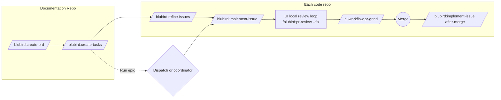

# PRD — The UI drives the blubird plugin

**Status:** Approved · **Date:** 2026-11-06 · **Slug:** `blubird-ui` · **Owner:** Masnun Siam · **Priority:** high · **Repo:** masnun-siam/ai-workflow

Status is `Draft`, `In review` or `Approved`. This document is the source of truth for the feature: the tasks and every issue are derived from it, and a decision that is not written here has not been made.

## Overview

`aiw ui` stops carrying its own engineering process and becomes the front-end for the team's `blubird` plugin (`blubird@agentic-workflow`). The UI starts `/blubird:*` skills as headless sessions, understands blubird's product layout (a Documentation Repo plus code repos), and shows blubird's GitHub Projects board. ai-workflow keeps only the UI and the extras blubird lacks.

Today:
- The UI starts ai-workflow's own process skills (create-prd, create-tasks, refine-issues, implement-issue, pr-review and others) as headless `claude --print` sessions. Skill names and the `ai-workflow` prefix are written into many places in the server and the app.
- A "project" is one repo. PRDs are read from that repo's flat `docs/prds/<slug>.md`, and epics and issues from the same repo.
- The board columns are worked out by the UI from labels, sessions, PRs and grind state. GitHub Projects statuses are not read.
- Questions from headless sessions reach the UI through `aiw ask`, because the appended system prompt tells sessions not to call AskUserQuestion.
- Parallel work runs through the UI's dispatch engine, as headless lanes or herdr tabs.
- blubird is installed (v0.23.0) and none of it is wired to the UI. Its skills ask through native AskUserQuestion. A Stop hook blocks idle stops, and a guard hook asks before root `CLAUDE.md` edits. Its parallel runner is `project-coordinator`, which opens interactive sessions in terminal panes.
- Only this repo has a `.blubird` map. The other 47 registered repos use the old layout.

## Problem

The team's process now lives in blubird, and ai-workflow's copy of it has drifted. Running blubird from the UI is impossible today: the UI calls the wrong skills, reads PRDs in the wrong place, sees one repo where blubird sees a product, and ignores the board blubird moves issues on. Keeping two copies of the process doubles maintenance, and the copies disagree.

## Users

The single operator of `aiw ui` (Masnun Siam), on their own machine. There are no roles and no tenants. A team rollout is out of scope for this version.

## Goals

- Every stage from PRD to merge runs from the UI on a blubird product, using blubird's skills unmodified.
- The UI shows a product (Documentation Repo plus code repos) as one place, with PRDs grouped by module and issues on blubird's board statuses.
- No headless session stalls on a question, a permission ask or the idle guard.
- ai-workflow ships only the UI and the extras.

## Non-goals

- No changes to blubird's skills. Upstream proposals are separate work.
- No multi-user or hosted UI.
- No support for running process skills on unmapped (old-layout) repos. They are read-only apart from the actions in FR-14.
- No machine-wide cleanup or full `agentic-onboard` run from the UI. Onboarding is started from the Start dialog like any other skill.
- No PRD `Done` status. Shipped is derived (FR-9).
- No new reviewer bots and no changes to grind's review contract.
- PRD share links, the Bootstrap chain and herdr tab mode in dispatch are not kept (FR-20).

## Requirements

### E1 — Core: blubird skills in the UI

- **FR-1 Skill registry.** One registry maps each UI step (write PRD, create tasks, refine, implement, review, verify, docs, reproduce bug, security sweep, map PRDs, onboard, CI optimize, after merge, skill feedback) to a fully qualified skill (`/blubird:<name>` or `/ai-workflow:<name>`). The server and the app read it, so no other place names a process skill.
  - Acceptance: changing one entry in the registry changes the command the UI starts for that step, and a search of the server and app finds no other process-skill name.
- **FR-2 Start dialog.** The Start dialog offers: create-prd, create-tasks, refine-issues, implement-issue, pr-review, verifier-locally, docs-updater, reproduce-bug, security-sweep, map-prds, agentic-onboard, ci-optimize (all `/blubird:`), plus release-pr, faq-updater and pr-grind (`/ai-workflow:`) and dump and worklog (personal plugin).
  - Acceptance: each listed command starts a session whose first prompt is the registry's command. Commands that blubird runs only in the Documentation Repo start with the docs repo as working folder. Issue-level commands start in the issue's repo.
- **FR-3 Questions are relayed.** Every UI-started session keeps the `aiw ask` instruction. If a session calls AskUserQuestion natively anyway, the UI detects the tool call in the stream, shows it as a normal pending question, and resumes the session with the answer.
  - Acceptance: a blubird skill that calls AskUserQuestion natively in a headless run shows its question in the Inbox, and answering it resumes the session, which continues past that point.
- **FR-4 Idle guard off.** UI-started sessions run with `BLUBIRD_IDLE_GUARD=off`.
  - Acceptance: a blubird session started from the UI ends its turn without the idle-guard block message in its transcript.
- **FR-5 CLAUDE.md guard relayed.** When blubird's guard hook asks before a root `CLAUDE.md` or `AGENTS.md` edit in a UI session, the UI shows it as an approve or deny question. The answer decides whether the edit happens.
  - Acceptance: a session that tries to edit the root `CLAUDE.md` shows an approve or deny question. Deny leaves the file unchanged, and approve applies the edit.
- **FR-6 "Improve this skill" is a normal question.** No special handling. It reaches the Inbox like any other question.
  - Acceptance: a run that reaches the improve step shows its question in the Inbox.
- **FR-7 After merge.** When a blubird issue's PR merges, the UI starts `/blubird:implement-issue <n>` in its after-merge mode. The UI's own merge cleanup does not run for blubird products.
  - Acceptance: merging an implemented issue's PR starts one after-merge session, which closes the issue, sets it to Done and removes the worktree. The UI's cleanup does not touch it.
- **FR-8 Local review loop.** After an implement session opens its draft PR, the UI runs `/blubird:pr-review <branch> --fix` rounds, up to the count in Settings ("single" means one), before the PR is marked ready.
  - Acceptance: with the loop set to 3, a fresh implement run is followed by at most 3 pr-review sessions on its branch, each started after the previous one ends.

### E2 — Product model and board

- **FR-9 Products.** You register a Documentation Repo checkout. The UI reads its `.blubird/repos.json`, resolves each entry's path relative to the docs repo, and registers each code repo as part of that product. A missing clone shows as "not cloned". A monorepo (one `"."` entry) is a product of one repo.
  - Acceptance: registering a docs repo whose map lists two code repos shows one product with three repos. Deleting one clone shows that repo as "not cloned" after the next poll.
- **FR-10 Features grouped by product and module.** The Features page reads PRDs from the docs repo's `docs/prds/<module>/<slug>.md` (and `docs/prds/<slug>.md` as "no module"). It groups them under product headers, then module sub-headers. The #661 repo filter becomes a product filter. A feature is shipped when its epic issue is closed.
  - Acceptance: a product with PRDs in modules `auth` and `billing` shows two module groups under its header. Closing an epic moves its card to shipped on the next poll.
- **FR-11 Issues across repos.** A feature's issues are the epic's sub-issues, in any of the product's repos.
  - Acceptance: an epic in the docs repo with children in two code repos shows all children on its feature page, each labelled with its repo.
- **FR-12 Board statuses.** Board columns are Backlog, Ready, In progress, In review and Done, read from the GitHub Projects v2 Status field. Inside a column, cards carry UI badges: draft PR, grinding, CI red, waiting on you.
  - Acceptance: moving an issue to In review on GitHub moves its card to In review on the next poll. A card whose PR has failing CI shows the CI-red badge.
- **FR-13 No board fallback.** An issue on no board, or any issue when the token lacks the `project` scope, is placed by mapping today's derived column to the nearest status, and shows a "not on board" marker. A missing scope shows one banner naming `gh auth refresh -s project`.
  - Acceptance: with the scope removed, the board still renders with every card marked and one banner shown.
- **FR-14 Old-layout repos.** A repo with no `.blubird` map and no `.blubird/docs-repo` pointer shows its boards read-only. Only these actions work on it: grind and `/ai-workflow:pr-review` on its PRs, Away answers for sessions already running, and "Map this repo".
  - Acceptance: an unmapped repo offers no process actions (write PRD, create tasks, refine, implement, dispatch) and does offer the four listed actions.
- **FR-15 Map this repo.** This action writes a one-entry `.blubird/repos.json` (`"path": "."`) on a new branch and opens a PR into the default branch. If `origin/staging` is missing, the dialog offers to create it from the default branch, with a warning that the full flow needs `/blubird:agentic-onboard`.
  - Acceptance: on a repo without staging, the dialog shows the warning and the staging choice, and confirming opens a PR containing only `.blubird/repos.json`.
- **FR-16 Small changes.** The Small changes page stays and files a single issue through `/blubird:create-tasks <finding>` in the chosen repo of the product.
  - Acceptance: capturing a small change starts a create-tasks session with the text as its finding, and the resulting issue appears on the page.

### E3 — Parallel runs and new views

- **FR-17 Two ways to run an epic.** "Run epic" asks: UI dispatch or project-coordinator.
  - UI dispatch: headless lanes, each running `/blubird:implement-issue <n>` in the issue's repo, with grind, CI policy and auto-merge as dispatch settings. Base and feature branch default to `staging`.
  - Coordinator: the UI opens the herdr app and starts an interactive session in the background with `hc` (herdr-core), outliving the UI: `claude "/blubird:project-coordinator <issues link>"` in the docs repo. You attach in herdr to answer its questions.
  - Acceptance: choosing dispatch shows lanes in Dispatches. Choosing coordinator shows a live `hc` terminal named for the run, and herdr is open.
- **FR-18 Coordinator monitor.** A page lists coordinator runs found under the coordinator's run folder. Each run shows its queue, each issue's state and attempts, and its events. Events that need you (STOPPED, HOLD_EXPIRED, LOST, ERROR) are highlighted, and each adds an Inbox item. Stop runs the coordinator's stop command.
  - Acceptance: a run with one STOPPED issue shows it highlighted and adds one Inbox item. Stop ends the loop, and the run shows as stopped.
- **FR-19 Product map, Bug lane, Security panel.**
  - Product map: each repo in the map with its role, clone state, open issues and PRs, CI state, and whether an open `Agentic onboard` issue exists.
  - Bug lane: open `bug`-labelled issues across the product, in stages Reported, Questions for reporter, Reproduced, and Ready. Reproduced means the body has a "Reproduction" section. A reproduce-bug action is on each Reported card.
  - Security panel: the open `Security sweep` issue in the docs repo, and the `security`-labelled issues per repo with their board status. A "Run sweep" action starts `/blubird:security-sweep`.
  - Acceptance: each view renders from a product with at least one matching item, and from an empty product with an empty state that names the action to take.
- **FR-20 Removals.** PRD share links, the Bootstrap chain and herdr tab mode in dispatch are removed: their pages, endpoints and state.
  - Acceptance: none of the three appears in the UI, and their endpoints return 404.

### Across epics

- **FR-21 Slim ai-workflow.** Removed: create-prd, create-tasks, refine-issues, implement-issue, docs-updater, close-epic, repo-bootstrap, herdr-dispatch, sync-from-wasensi and skill-feedback. The skill-feedback action uses `/blubird:skill-feedback`. dump and worklog move to the personal plugin (#767). Kept: pr-grind, peer-review, pr-review, verifier-locally (both used by the extras), release-pr, faq-updater, revert-pr, and the agents peer-reviewer and away-answerer. `templates/` and the guides no kept skill reads are removed.
  - Acceptance: the plugin's skill list matches the kept set exactly.

*How a feature moves through the UI after this change. Boxes are the skills the UI starts.*

## Edge cases

- **Concurrency:** two sessions on one issue are still refused by the existing duplicate guard, which now also covers after-merge and local-review sessions. A coordinator run and a UI dispatch on the same epic: the second one is refused, and the error names the running one.
- **Empty states:** a product with no PRDs, no bugs, no sweep issue or no coordinator runs shows the action that creates one.
- **Missing pieces:** a mapped path that is not cloned shows "not cloned" and offers no actions in it. A docs repo whose `repos.json` is invalid JSON shows one error card and is not polled.
- **Limits:** the coordinator's own `--max` (default 5) applies. Dispatch concurrency stays a setting.
- **Secrets:** blubird's mask-secrets hook can block a prompt or answer that contains a secret-like string. The UI shows the block reason on the session instead of a silent stall.
- **Isolation:** single user, no tenants. Products never mix issues, but a repo can belong to only one product. A second docs repo listing it is shown as a conflict.
- **Existing data:** sessions, dispatches and settings stay. Flat PRDs in old repos stay where they are. Share-link and bootstrap state is deleted with their features.

## Technical design

### Data

- **Product registry** (UI data folder, internal): docs repo `owner/name` → checkout path. Code repos are resolved from the docs repo's `repos.json` on every poll and are not stored.
- **Skill registry** (shipped with the plugin, internal): step id → `{plugin, skill, runs_in: docs|issue|any}`. FR-1.
- **Board snapshot** gains `status` (one of the five, or null) and `on_board` (bool) per issue. FR-12, FR-13.
- **Coordinator runs** are read from the coordinator's own run folder (`config.json`, `queue.tsv`, `events.log`, per-issue `state` and `attempts`). The UI never writes to them except through the coordinator's stop command. FR-18.
- Removed state: share links, bootstrap runs, herdr tab lanes.

### API

The server's JSON endpoints change as follows (same auth: local only):
- `GET /api/products` → `[{docs_repo, path, repos:[{name, role, repo, path, cloned}]}]`. `POST /api/products {path}` registers a docs repo, and returns 400 if `.blubird/repos.json` is missing or invalid.
- `GET /api/registry` → the skill registry, read by the app.
- `POST /api/repos/<owner>/<name>/map {create_staging: bool}` → `{pr_url}`. Returns 409 if a map already exists. FR-15.
- `GET /api/coordinator/runs`, `GET /api/coordinator/runs/<id>`, `POST /api/coordinator/runs/<id>/stop`. FR-18.
- `POST /api/coordinator/start {docs_repo, issues_link}` → `{terminal}`. FR-17.
- Share-link and bootstrap endpoints are removed. FR-20.

### Backend

- **Launcher:** builds every command from the registry, sets `BLUBIRD_IDLE_GUARD=off`, and picks the working folder from `runs_in`. The prefix rewrite for repo skills keeps working for `ai-workflow` extras.
- **Stream follower:** recognises a native AskUserQuestion tool call and turns it into a pending question (FR-3). It also recognises the guard hook's ask (FR-5) and the mask-secrets block reason.
- **Poller:** per product, reads issue Status through the issue's Projects items in the same GraphQL call, falls back as in FR-13, and reads sub-issues across repos.
- **After merge and local review:** triggered from the existing merge and draft-PR events. FR-7, FR-8.
- **Coordinator launch:** opens the herdr app, then `hc run --bg --outlive-parent --name coord-<repo>-<run> --cwd <docs repo> claude "/blubird:project-coordinator …"`. The UI does not drive the session after that.
- Codex harness stays: it inlines the blubird SKILL.md the same way it inlines ai-workflow's.

### Frontend

- Features: product and module grouping, product filter, shipped from the closed epic.
- Board: five status columns with badges and the "not on board" marker, plus the scope banner.
- Start dialog driven by the registry. "Run epic" choice dialog. "Map this repo" dialog.
- New pages: Product map, Bug lane, Security panel, Coordinator monitor (in the sidebar per product).
- Removed: share links, the Bootstrap chain, herdr tab mode options.
- Each new view has loading, empty (with its action) and error states.

### Realtime and other components

- No new realtime channel. New views refresh on the existing poll cadence.
- blubird's hooks (mask-secrets, CLAUDE.md guard, idle guard) run inside every session. The coordinator writes its own run folder, which the UI only reads.

### Non-functional

- Stays stdlib Python and the existing React app. No new dependency.
- One GraphQL call per repo per poll, as today. Status adds fields to it, not calls.
- Commands go through the registry only, so a session cannot be started with a name that is not in it.

### Testing

- Plain `assert` scripts for: registry resolution and working folder (FR-1, FR-2), native-AskUserQuestion detection from a recorded stream (FR-3), guard-ask detection (FR-5), products from a fixture `repos.json` (FR-9), status mapping and fallback (FR-12, FR-13), coordinator run parsing from a fixture run folder (FR-18), bug stage derivation (FR-19).
- Manual, on a mapped sandbox product: FR-4, FR-7, FR-8, FR-15, FR-17 and one feature end to end.

## Rollout and cost

- Ships per epic to `master`, live for the single user on merge. E1 first, then E2, then E3.
- Model cost rises slightly from the local-review rounds (FR-8), bounded by the Settings count.
- Before E1 merges: `gh auth refresh -s project`, and blubird installed and updated.
- Rollback: revert the epic's PRs. The old skills come back from git history.
- Watch: stalled sessions, and sessions that end with an unrelayed question.

## Success metrics

- One real feature goes from PRD to merge in ai-workflow (mapped as a blubird product), entirely from the UI.
- No session stalls on an unrelayed question or the idle guard over two weeks.
- ai-workflow ships only the UI and the extras (FR-21).

## Epics

- **E1 Core: blubird skills in the UI** — covers FR-1 to FR-8, FR-21. Issue: #923
- **E2 Product model and board** — covers FR-9 to FR-16. Issue: #924
- **E3 Parallel runs and new views** — covers FR-17 to FR-20. Issue: #925

## Decisions

- The UI drives blubird; ai-workflow is slimmed to the UI plus extras — one copy of the process, owned by the team.
- Single user for now — a team rollout is a later decision.
- A product is a Documentation Repo plus the code repos in its `repos.json`, registered by adding the docs repo — this matches blubird's layout and needs one registration.
- Features are grouped by product, then module, and #661's repo grouping becomes product grouping — blubird files PRDs by module.
- Questions keep going through `aiw ask`, with detect-and-relay as the fallback when a skill asks natively — this needs no blubird changes.
- Board columns are blubird's five statuses, with UI badges inside — the status is the team's truth, and the badges keep the UI's detail.
- An issue on no board, or a token without the project scope, falls back to the derived column with a marker — the board never goes blank.
- Running an epic offers both UI dispatch and project-coordinator. The coordinator is launched through herdr and `hc`, and the UI monitors it — the user picks per run, and the coordinator needs a live terminal.
- `BLUBIRD_IDLE_GUARD=off` in UI sessions — the UI already tracks liveness.
- The "Improve this skill" question is relayed like any other — the user decides each time.
- After merge, the UI starts blubird's after-merge mode, and the UI merge cleanup is retired for blubird products — one owner for cleanup.
- The CLAUDE.md guard is relayed as an approve or deny question — keeps the human check.
- The Start dialog adds reproduce-bug, docs-updater, verifier-locally, security-sweep, map-prds, agentic-onboard and ci-optimize — the user wants them available.
- One skill registry file — removes the names spread across many files.
- New views: Product map, Bug lane, Security panel, Coordinator monitor.
- Codex harness kept.
- Away mode applies the same rules to blubird questions as today.
- Shipped = epic closed; no PRD `Done` — matches blubird's statuses.
- dump and worklog stay through the personal plugin, and #767 proceeds.
- Old-layout repos become read-only now, apart from grind, `/ai-workflow:pr-review`, Away answers for running sessions, and "Map this repo" — the user chose to slim now rather than keep two process paths.
- ai-workflow keeps pr-review and verifier-locally for PR-level use on unmapped repos and for grind — blubird's skills stop without a map.
- "Map this repo" writes a one-entry map by PR, and offers to create `staging` with a warning.
- Bug lane and Security panel read labels plus the record issues — this needs no board type field.
- Kept: the local review loop (run by the UI after implement), jev judgments and Small changes. Removed: share links, the Bootstrap chain and herdr tab mode.
- Auto-merge stays a dispatch setting on blubird products — the UI merges, not an agent, and only when the user opted in.
- `/blubird:skill-feedback` replaces ai-workflow's.
- Three epics, high priority, shipping per epic.
- This repo stays on `master` as its base, even though blubird expects `staging` — the owner chose not to add `staging` here. This repo is mapped as a monorepo by `.blubird/repos.json` only, with no full onboarding.

- `revert-pr` is kept — blubird has no equivalent, and it works at the PR level.
- Only the guides that pr-review, pr-grind and peer-review read are kept. `templates/` and the other guides are deleted — blubird ships its own, and the extras stay independent of blubird's install path.
- The acceptance product is ai-workflow itself — it is already mapped. Its base is `master`, so the `staging` flow is not exercised here.

## Open questions

## Change log

## Related

- Supersedes parts of `docs/prds/cross-repo-boards.md` (#661: repo grouping becomes product grouping), `docs/prds/prd-share-links.md` (#584: removed) and `docs/prds/ui-tweaks-bootstrap-chain.md` (#645: the bootstrap chain is removed).
- Related: `docs/prds/harness-agnostic-ui.md` (#867), issue #767 (personal skills).
- blubird plugin: `blubird-interactiveltd/agentic-workflow` v0.23.0.
