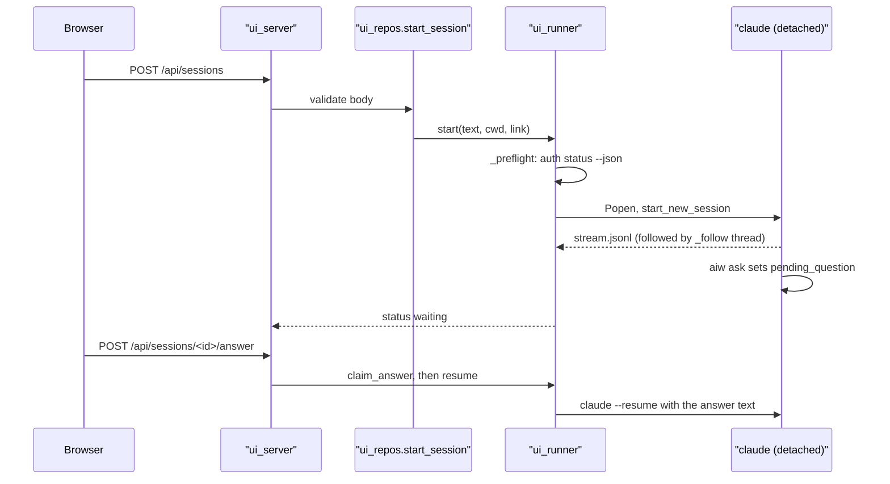
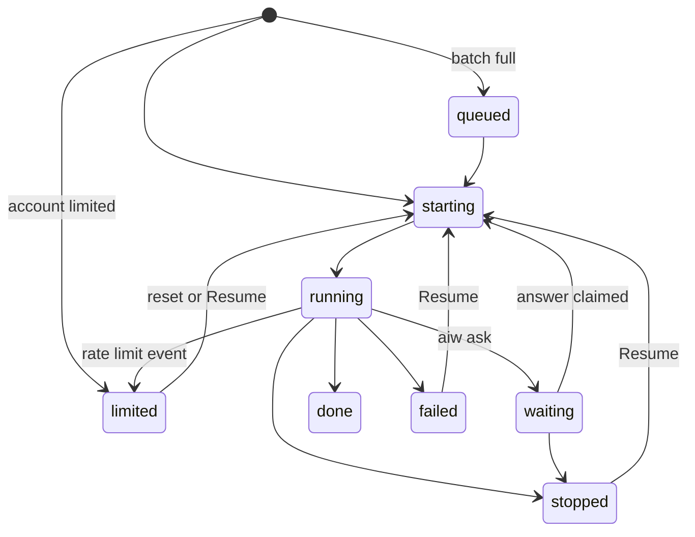

# aiw ui (server)

Covers: `run-engine/ui_*.py`, `run-engine/ui_server.py`, `run-engine/ui_runner.py`

`aiw ui` is a stdlib `http.server` that starts and tracks headless Claude [Sessions](../CONTEXT.md), shows the [Board](../CONTEXT.md), and runs Flow, Dispatch, grind and AFK timers. HTTP routes: [ui-api.md](ui-api.md). Browser code: [ui-frontend.md](ui-frontend.md). Engine, Ledger and `aiw` subcommands: [engine.md](engine.md), [cli.md](cli.md).

## Running aiw ui

| Flag | Default | Effect |
|---|---|---|
| `--port N` | `8420` | Loopback port. Probed first, so a busy port fails with the holder's PID (from `lsof`). |
| `--allow-host HOST` | none | Extra accepted `Host` header. Repeatable, exact match: pass `name:port`, or the bare name for a proxy on the default 443. |
| `--no-tailscale` | off | Do not publish on the tailnet. |
| `--tailscale-port PORT` | `443` | HTTPS port on the tailnet name: `443`, `8443` or `10000` (`ui_tailscale.HTTPS_PORTS`). |

- Wired in `ui_server.register()` and `cmd_serve()`. `route.py` imports `ui_server` and calls `register`.
- It always binds `127.0.0.1` only.
- On start `cmd_serve` runs `ui_runner.reconcile()`, then starts every background timer (see [Background timers](#background-timers)).
- SIGTERM and SIGHUP exit cleanly, so the `finally` block removes the tailscale handler.

### Reaching it over a tailnet

- Default: when `tailscale status --json` reports `BackendState: Running`, `ui_tailscale.up()` runs `tailscale serve --bg --https=<port> http://127.0.0.1:<port>`. The URL is `https://<machine>.<tailnet>.ts.net` (port suffix when not 443).
- It never overwrites a serve port that already proxies elsewhere. It adopts a handler that already points at this UI (left by a crashed run). On exit `ui_tailscale.down()` runs `tailscale serve --https=<port> off`.
- Never `tailscale funnel`: the module is tailnet-only by design.
- Manual alternative: `aiw ui --no-tailscale`, run your own `tailscale serve --bg 8420`, then `aiw ui --no-tailscale --allow-host <machine>.<tailnet>.ts.net`.

## Security model

There is no login or token in the app. What protects it:

| Guard | Where | What it does |
|---|---|---|
| Loopback bind | `cmd_serve` | Listens on `127.0.0.1` only. Any local user of the machine can still reach the port. |
| Host allow-list | `_guard` | `Host` must be `127.0.0.1:<port>`, `localhost:<port>`, an `--allow-host` value or the auto-served tailnet name, else 403. Blocks DNS rebinding. |
| Origin check | `_guard` | An `Origin` header whose netloc differs from `Host` gets 403. No CORS headers are ever sent. |
| Tailnet owner check | `_guard`, `_Server.tailnet_login` | On the auto-served tailnet name only, the `Tailscale-User-Login` header that `tailscale serve` adds must equal the node owner's login, else 403. |
| Every verb guarded | `_method_not_allowed` | PUT, DELETE, PATCH, HEAD, OPTIONS and the rest pass `_guard` before the 405. |

- Auth story: on the auto-served name, only the node owner gets in. A host added with `--allow-host` gets no login check, so there the tailnet ACL is the only auth.
- Sessions run `claude --dangerously-skip-permissions` (`ui_runner.CLAUDE_ARGS`) with no opt-out. Anyone who passes `_guard` can make the agent run any command, so a public exposure is remote code execution.
- Request bodies are capped at 64 KiB (`MAX_BODY`). Static files are served only inside `ui_static/` (realpath containment).
- A client never sends a raw command. `claude_cmd` must be a label saved in Settings. Prompt text must not start with `-` or hold NUL. Cleanup re-derives paths on the server.
- The macOS folder dialog (`ui_repos.browse_folder`, `osascript`) is offered only when `Host` is `127.0.0.1` or `localhost` on darwin (`_can_browse`).
- Ledger values that reach `gh` argv are filtered in `_gh_status`: only `https://` PR URLs and branch names that don't start with `-`.

## Config and state files

All under the plugin data dir (`<data_dir>`, see [cli.md](cli.md)). The UI never writes `run.json` itself: it goes through `aiw` (e.g. `aiw skip-review`).

| Path | Owner module | Holds |
|---|---|---|
| `ui.json` | `ui_notify` | ntfy push config and `public_url`. Read-only to the UI. |
| `ui_settings.json` | `ui_settings` | Saved claude commands, built-in label, default, `auto_grind`, `vault_dir`. |
| `sessions/<id>/meta.json` | `ui_sessions` | The Session record. Atomic replace plus `flock` on `.lock`. |
| `sessions/<id>/stream.jsonl`, `stderr.log` | `ui_runner` | Raw `claude` stream-json output and stderr. |
| `flows/<id>.json` | `ui_flows` | One guided Flow (`f-<14 digits>-<6 hex>`). |
| `pipelines/<id>.json` | `ui_dispatch` | One Dispatch pipeline (`p-<14 digits>-<6 hex>`). |
| `grind_requests.json`, `grind_notified.json` | `ui_grind` | Grinds asked for but not started, and the grind ntfy pushes already sent. |
| `pr-grind/<owner>-<repo>-<pr>.md` | pr-grind skill | Grind loop state. The UI reads it and sets `paused:` / `next-poll:` headers. |
| `afk.json` | `ui_afk` | AFK window: `started`, `until`, `skipped_ci`, `log`, `ended`, `held_at_end`, `dismissed`. |
| `gh-status.json` | `ui_status` | Card status cache. |
| `titles.json` | `ui_board.memoize_title_fetcher` | Issue titles, so a restart shows them at once. |

### ui.json

```json
{"ntfy": {"server": "<ntfy-server-url>", "topic": "<topic>", "token": "<token>"},
 "public_url": "https://<machine>.<tailnet>.ts.net"}
```

- It can hold a credential, so it must be mode `0600` (`chmod 600 <data_dir>/ui.json`).
- Any group or other bit set: the whole file is ignored with the warning `ignoring <path>: mode 0o… is looser than 0600; run chmod 600 <path>`. Env vars still apply.
- A non-object or unreadable file is also ignored with a warning.
- Read keys: `ntfy.server`, `ntfy.topic`, `ntfy.token`, `ntfy.user`, `ntfy.password`, `public_url`. Other keys are ignored.
- `AIW_NTFY_SERVER`, `AIW_NTFY_TOPIC`, `AIW_NTFY_TOKEN`, `AIW_NTFY_USER`, `AIW_NTFY_PASSWORD` override the file.
- Re-read on every push (`load_config`), so an edit needs no restart.

## Notifications

Two channels:

- **ntfy push** (server side, `ui_notify.notify`). It fires only when `server` and `topic` are set. `server` must be `http(s)`. A token is sent as Bearer and wins over `user` + `password` (Basic). It never raises and never logs a credential.
- **Browser notification** (`ui_static/notify.js`): only for waiting sessions, and the question text never leaves the page.

| Event | Sent by | Click-through (needs `public_url`) |
|---|---|---|
| `waiting` | `ui_sessions.update` on status `waiting` | `#/answer/<sid>` |
| `done`, `failed` | `ui_sessions.update` | `#/run/<owner>/<repo>/<n>`, else `#/sessions` |
| `grind-paused`, `grind-done` | `ui_grind.notify_changes` | the run page |
| `pipeline` | `ui_dispatch.tick` when a pipeline finishes | `#/dispatch/<pid>` |
| `afk` | `ui_afk._finish` | `#/` |

- Dedupe lives in the record's `notified` list. `waiting` fires once per round id. `done`/`failed` fire once per start, and a resume resets them.
- No `done` push for grind sessions (`_QUIET_DONE`): the grind's own push is the signal.
- While AFK is on, `waiting`, `failed` and `grind-paused` are muted. One `afk` push sums up the window.

## Server modules

| Module | Owns | Key symbols |
|---|---|---|
| `ui_server.py` | HTTP handler, routing, `_guard`, static serving, flags, startup | `_Handler`, `_Server`, `_guard`, `_public`, `_gh_status`, `cmd_serve`, `register`, `MAX_BODY`, `STATIC_DIR` |
| `ui_runner.py` | Spawning and following `claude`, stop/resume, rate limits, batches, pr-grind re-entry timer | `start`, `_spawn`, `_follow`, `resume`, `resume_stopped`, `send_prompt`, `stop`, `reconcile`, `limits`, `limit_tick`, `release_batch`, `prgrind_tick`, `CLAUDE_ARGS`, `HEADLESS_PROMPT`, `FLOW_PROMPT`, `MAX_GRINDS` |
| `ui_sessions.py` | Session store, question rounds, answer validation, notify dedupe | `create`, `load`, `update`, `set_pending`, `answer_text`, `claim_answer`, `list_sessions`, `_ID_RE` |
| `ui_events.py` | stream-json line to UI events, tail reads, token counts | `parse_line`, `read_from`, `tokens_of` |
| `ui_repos.py` | Repo list, checkout registry, scan, session-start validation | `start_session`, `list_repos`, `resolve_repo`, `scan_and_register`, `register`, `promote_local`, `browse_folder`, `NAMED`, `BATCH_MAX` |
| `ui_settings.py` | Saved claude commands and vault path | `load`, `save`, `validate`, `argv`, `default_cmd`, `check_login`, `config_dir` |
| `ui_board.py` | Board from Ledgers (pure core plus I/O edges), run page data, titles | `build_board`, `scan_records`, `load_run`, `run_timeline`, `memoize_title_fetcher`, `issue_for_pr`, `transferred_run`, `STATIONS` |
| `ui_status.py` | Cached GitHub issue/PR/CI status per Card | `get`, `cached`, `mark_merged`, `TTL`, `IDLE_TTL`, `RATE_LIMIT_PAUSE` |
| `ui_issue.py` | Issue popup (GitHub-rendered HTML) and open issue/PR lists | `fetch`, `open_items`, `valid` |
| `ui_pr.py` | PR popup, merge readiness, squash merge | `fetch`, `readiness`, `merge`, `MAX_PATCH`, `MAX_PATCH_TOTAL` |
| `ui_options.py` | Edit a started run: review off, auto-grind off | `apply`, `skip_review`, `set_auto_grind`, `session_of` |
| `ui_grind.py` | Start, queue, pause, resume and reply to grinds | `request`, `control`, `reply`, `rerun_ci`, `autostart`, `drain`, `index`, `for_card`, `tick` |
| `ui_flows.py` | Flow records, `→ next:` parsing, issue progress, vault note reads | `create`, `update`, `step`, `list_all`, `import_once`, `issue_progress`, `issues_for`, `read_note` |
| `ui_dispatch.py` | Dispatch pipelines: pure scheduler plus store and launches | `parse_input`, `advance`, `item_state`, `order_of`, `preview`, `create`, `act`, `tick`, `detail`, `membership`, `wants_grind` |
| `ui_afk.py` | AFK autopilot | `start`, `stop`, `dismiss`, `tick`, `public`, `NEVER_AUTO`, `RETRY_DELAYS` |
| `ui_cleanup.py` | Removing finished runs, worktrees and sessions | `find_targets`, `describe`, `clean`, `STALE_SECONDS` |
| `ui_vault.py` | No-repo sessions in the notes vault, Create repo, Publish to GitHub | `folders`, `suggest`, `prd_info`, `create_repo`, `publish_repo`, `github_owners`, `NO_REPO_COMMANDS` |
| `ui_notify.py` | ntfy pushes and `ui.json` | `notify`, `compose`, `load_config`, `click_url`, `dedupe_key` |
| `ui_usage.py` | 5h / 7d plan usage per account | `fetch`, `refresh`, `snapshot`, `service` |
| `ui_tailscale.py` | `tailscale serve` up/down | `up`, `down`, `node`, `hosts`, `HTTPS_PORTS` |

## How a session runs



- argv: `<claude cmd> --print --output-format stream-json --verbose --dangerously-skip-permissions --append-system-prompt <HEADLESS_PROMPT> <prompt>`. `FLOW_PROMPT` is added for sessions that carry a `flow_id`.
- Env: `AIW_UI_SESSION=<sid>` and `CLAUDE_PLUGIN_DATA`. `aiw ask` needs `AIW_UI_SESSION` to record a round ([cli.md](cli.md)). The pr-grind re-entry also sets `AIW_HEADLESS=1`.
- `HEADLESS_PROMPT` tells the model to ask only through `aiw ask`, never call `ScheduleWakeup`, and skip `/run-issue` phase 10 (the UI grinds).
- The child gets its own process group and writes straight to files, so it outlives a UI restart. `reconcile()` re-attaches live pids (matched by `ps -o lstart`) and fails dead ones.
- `start_session` adds flags from the form: `--no-review`, `--no-worktree` (plus `--grind` with auto-grind), `--review <lenses>`, and `--to obsidian` for a no-repo create-prd.
- One live `run-issue` or `pr-grind` session per issue: a duplicate gets 409 with the live session's id.
- A `batch` (the worklog date range) runs at most `BATCH_MAX` = 3 at once. The rest wait as `queued`.
- A prompt sent to a live session is queued (`queued_prompt`) and sent when it ends.
- Stop sends SIGTERM to the group, then SIGKILL after 10 s.
- A failed `--resume` of a `/run-issue` session falls back to a fresh `/run-issue <n>` from the Ledger (`_fallback`), else `terminal_handoff`.
- The record's `status` follows this state machine:



## Background timers

All are daemon threads started by `cmd_serve`. Each catches errors per item or per tick, so one bad record never stops a timer.

| Timer | Interval | Does |
|---|---|---|
| `ui_dispatch.start_timer` | 5 s | `tick_all`: advance pipelines, launch ready items, push `pipeline` when done. |
| `ui_grind.start_timer` | 30 s | `autostart` (queue grinds for finished runs with `auto_grind`), `drain` (start under `MAX_GRINDS` = 2), `notify_changes`. |
| `ui_runner.start_prgrind_timer` | 60 s | `prgrind_tick_all`: re-enter a pr-grind loop when a review lands, CI changes, or the 1500 s heartbeat is due. |
| `ui_runner.start_limit_timer` | 30 s | Resume `limited` sessions 5 s after their reset (2 s stagger). Release queued batch sessions. Runs once at startup to catch up. |
| `ui_usage.start_timer` | 5 s check | Refresh usage per account every 300 s (900 s after a failure), only while a client polled `/api/sessions` in the last 120 s. |
| `ui_afk.start_timer` | 5 s | AFK tick while a window is open. |

## Feature behaviour

- **Board** (`ui_board`, `/board.json`). It shows one Card per issue, from that issue's latest Ledger, in its current Station column (or `done`). `ui_server` adds `grind`, `gh` and `pipeline` to each card. `ui_status` runs `gh` on an 8-thread pool and never blocks a request. It refetches after 45 s while CI runs, 300 s otherwise, and pauses 600 s when GitHub reports the rate limit spent. A merged PR or closed issue freezes the entry.
- **Run page** (`/api/runs/<o>/<r>/<n>`). It returns the Ledger timeline plus `title`, `gh`, `grind`, `maintree` and `autoGrind`. `ui_options.apply` turns review off through `aiw skip-review` (it says `too_late` past the boundary) and sets `auto_grind` on the session record.
- **Flow** (`ui_flows`): Dump, PRD, Tasks, Issues, Dispatch. The browser owns the step logic (`flow.js` `stepFromState`), and `ui_flows.step` mirrors it for the switcher. The server stores fields, parses the `→ next:` line, and reads an Issues session's stream into per-issue rows. Empty flows are pruned after a day. User level: [planning](features/planning.md).
- **Dispatch** (`ui_dispatch`). The input is an issue search URL or a list of numbers. Items run in dependency order (`epic.build_dag`), `parallel` with `max` 1 to 10 or `sequential`. A main-tree pipeline (`worktree: false`) must be sequential. A failed or stopped item skips its dependents. Each launch goes through `ui_repos.start_session`, and a 409 adopts the live session. Actions: `pause`, `resume`, `stop`, `update` (max, mode, review, auto_grind, add issues), `delete`, and per item `retry` / `skip`. User level: [dispatch](features/dispatch.md).
- **Grind** (`ui_grind` plus `ui_runner.prgrind_tick`). Start needs a run whose Ledger is `done` and has a PR. The first session runs `/run-issue` phase 10 (`GRIND_PREFIX` text). Later rounds are `/pr-grind <thread>` sessions started by the timer under the state file's `flock`. Pause and resume write the `paused:` header. Reply resumes the newest grind session with the owner's decision. Rerun CI runs `gh run rerun --failed`. User level: [review](features/review.md).
- **AFK** (`ui_afk`): a window of at most 24 h, run by the server. Each tick it answers rounds whose every question has a `(Recommended)` option, except the `NEVER_AUTO` families (create-prd, dump, create-tasks, refine-issues, fix-blockers). It replies "Skip CI for now" once per PR to a grind paused on CI. It retries sessions that failed in the window after 2 m, 10 m, 30 m and 1 h.
- **Cleanup** (`ui_cleanup`). A target is one issue (Ledger plus linked sessions) or one link-less session. Live sessions and escalated Ledgers are never listed, unless the PR is merged. An unfinished Ledger with no session must be quiet for an hour. Cleaning removes the worktree (`wt-issue-<n>` next to the main clone), deletes the local branch of `done` runs, and closes the issue when its PR is merged. A main-tree run is released and checked back out to its base instead. Unsaved work (uncommitted files, unpushed commits) needs `force`. Never touched: the main clone, `checkouts.json`, remote branches.
- **Limits and accounts**. Each saved command is an account (`cc <profile>` is rewritten to `cc-profile`, `config_dir` maps it to `~/.claude-profiles/<profile>`). A `rate_limit_event` that is not allowed marks the session `limited`. A new session on a limited account queues as `limited`. Resume on another account copies the transcript into that account's config dir (`_copy_transcript`).
- **Usage** (`ui_usage`) reads each account's OAuth token from the macOS Keychain (`security find-generic-password`) on the server only. It never refreshes the token, and an expired one shows "re-login needed".
- **No repo yet** (`ui_vault`). create-prd, dump, intake and a custom prompt can run in the notes vault (`vault_dir`, default `~/Documents/notes`) under `05-Work/<Project>/<Feature>`. Create repo makes `<parent>/<name>` with `git init`, a README and `docs/prds/<feature>.md`, registered as `local/<name>`. GitHub commands refuse a `local/` repo until it has an origin. Publish runs `gh repo create --source --push`.
- **Peer review** in the launcher. Lenses come from `/api/peer-review`. A doc command gets `--review <lenses>`. A custom prompt gets a fresh review dir with `ask.md` and a closing line asking for the review, which is not a gate. `_public` reports `peer_review.status`. User level: [peer review](features/peer-review.md).

## Gotchas

- `ui_runner._procs` and `_resume_lock` are in-process: run one `aiw ui` per data dir.
- `_follow` decides the final status from the stream, not the exit code alone. A session that ran `aiw ask` but recorded no round is `failed`. A waiting session whose `claude` lingers is sent SIGTERM 30 s after its result (`ASKED_EXIT_GRACE_SECONDS`).
- `/api/sessions/<id>/answer` refuses while the process still runs (409). The form unlocks once `ended_at` is set.
- Tests: `run-engine/test_ui_*.py`, one per module, plain asserts ([development.md](development.md)).
