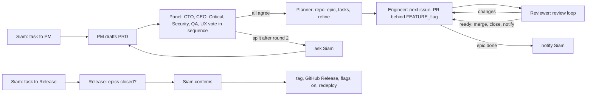

# Paperclip setup (personal projects)

The ai-workflow pipeline run unattended by Paperclip agents on this Mac. Agent instructions live
here and are loaded by Paperclip as external instruction bundles, so this folder is the source of
truth: edit a file here and the agent uses it on its next run.

- `PIPELINE.md`: rules every agent follows (owner availability, overrides of the interactive
  skills, flags, handoffs, notifications).
- `agents/<role>/AGENTS.md`: one stage per agent.

## Flow

## Instance

| | |
|---|---|
| Install | managed CLI `~/.local/bin/paperclipai`, launchd service `ing.paperclip.paperclipai` |
| Data | `~/.paperclip/instances/default` (embedded Postgres, daily backups) |
| Mode | authenticated, private exposure, bound to 127.0.0.1:3100 |
| Remote | `https://paperclip.msiamn.top` through Cloudflare Tunnel, gated by Cloudflare Access |
| Company | Personal Projects (`PER-`) |
| Runtime | `claude_local` on the Claude subscription; one run per agent at a time; timers off |

## Skills

The ai-workflow skills are imported from `github.com/masnun-siam/ai-workflow` (pushed `master`).
After pushing a skill change, re-import:

    paperclipai skills import https://github.com/masnun-siam/ai-workflow --company-id <id>

## Day to day

- New feature or project: create a task assigned to **PM** with the requirement.
- Release: create a task `Release <repo>` assigned to **Release**, then confirm the card.
- Questions to you show up as cards on the task and in the Decisions/Inbox views.
